# Declarations Reference

The reference for every concrete `Decl` and `DeclBase` subclass in the
Slang AST, written for a contributor reading or writing front-end code
who needs to know what fields a particular declaration carries and
which parser function emits it. The abstract roots `DeclBase` and
`Decl` are declared in
[slang-ast-base.h](../../../../source/slang/slang-ast-base.h) and
documented in [base.md](base.md); this page covers their concrete
descendants, which are declared in
[slang-ast-decl.h](../../../../source/slang/slang-ast-decl.h).

## Source

All declarations in this page are declared in
[slang-ast-decl.h](../../../../source/slang/slang-ast-decl.h). The parser
functions that produce them live in
[slang-parser.cpp](../../../../source/slang/slang-parser.cpp); the
top-level dispatch is `ParseDecl` and the syntax-decl table is the
`SyntaxParseInfo` array `g_parseSyntaxEntries` (see
[../syntax-reference/keywords-and-builtins.md](../syntax-reference/keywords-and-builtins.md)).
Not every class here has a parser: a number of them are synthesized by
semantic checking, and those rows carry `(none)` in the `Grammar`
column below.

## Family hierarchy

Abstract intermediates declared in `slang-ast-decl.h` together with
the bases inherited from [base.md](base.md):

```mermaid
flowchart TD
  DeclBase --> Decl
  DeclBase --> DeclGroup
  Decl --> ContainerDecl
  Decl --> VarDeclBase
  Decl --> SimpleTypeDecl
  Decl --> TypeConstraintDecl
  Decl --> FileReferenceDeclBase
  Decl --> OtherDecl["EnumCaseDecl, EmptyDecl, SyntaxDecl, UsingDecl, ..."]
  ContainerDecl --> AggTypeDeclBase
  ContainerDecl --> CallableDecl
  ContainerDecl --> NamespaceDeclBase
  ContainerDecl --> PropertyDecl
  ContainerDecl --> SemanticDecl
  ContainerDecl --> ScopeDecl
  ContainerDecl --> GenericDecl
  ContainerDecl --> AttributeDecl
  ContainerDecl --> FileDecl
  AggTypeDeclBase --> AggTypeDecl
  AggTypeDeclBase --> ExtensionDecl
  AggTypeDecl --> StructDecl
  AggTypeDecl --> ClassDecl
  StructDecl --> LambdaDecl
  StructDecl --> HLSLClassDecl
  CallableDecl --> FunctionDeclBase
  CallableDecl --> FuncAliasDecl
  CallableDecl --> SubscriptDecl
  FunctionDeclBase --> AccessorDecl
  FunctionDeclBase --> FuncDecl
  FunctionDeclBase --> ConstructorDecl
  FunctionDeclBase --> SynthesizedFuncDecl
  VarDeclBase --> VarDecl
  VarDeclBase --> ParamDecl
  VarDeclBase --> GlobalGenericValueParamDecl
  VarDeclBase --> GenericValueParamDecl
  VarDeclBase --> GenericValuePackParamDecl
  VarDecl --> LetDecl
  VarDecl --> UniformParameterShadowVarDecl
  ParamDecl --> ModernParamDecl
  SimpleTypeDecl --> GenericTypeParamDeclBase
  SimpleTypeDecl --> TypeDefDecl
  TypeConstraintDecl --> GenericTypeConstraintDecl
  GenericTypeConstraintDecl --> FuncConstraintDecl
  GenericDecl --> InterfaceDefaultImplDecl
  FileReferenceDeclBase --> ImportDecl
  FileReferenceDeclBase --> IncludeDeclBase
```

The classes declared with `FIDDLE(abstract)` — `ContainerDecl`,
`VarDeclBase`, `AggTypeDeclBase`, `AggTypeDecl`, `TypeConstraintDecl`,
`SimpleTypeDecl`, `CallableDecl`, `FunctionDeclBase`, `AccessorDecl`,
`NamespaceDeclBase`, `IncludeDeclBase`, `GenericTypeParamDeclBase` —
appear here but not in the `## Nodes` table. `FileReferenceDeclBase` is
the one intermediate in this diagram that is declared with a plain
`FIDDLE()`, so it is a concrete class and does have a table row even
though nothing constructs it directly. Concrete leaves below.

## Nodes

| Class | Parent | Key fields | Grammar | Summary |
| --- | --- | --- | --- | --- |
| `DeclGroup` | `DeclBase` | `decls: List<Decl*>` | [declaration group](../syntax-reference/grammar.md#declarations) | Wraps multiple declarations parsed as a single group (e.g. `int a, b;`). |
| `UnresolvedDecl` | `Decl` | (no additional state) | (none) | (unclear) — declared, and named by `printDiagnosticArg`, but no code in `source/` constructs one; see the note in `## Notable nodes`. |
| `VarDecl` | `VarDeclBase` | `type: TypeExp`, `initExpr: Expr*` | [variable declaration](../syntax-reference/grammar.md#declarations) | Ordinary mutable variable: local, global, or member. |
| `UniformParameterShadowVarDecl` | `VarDecl` | `uniformParameter: VarDecl*`, `shouldBeImmutableAlias: bool` | (none) | Variable the parser adds next to a mutable global uniform parameter when HLSL backwards-compatibility is enabled; see `## Notable nodes`. |
| `LetDecl` | `VarDecl` | `type: TypeExp`, `initExpr: Expr*` (from `VarDeclBase`) | [variable declaration](../syntax-reference/grammar.md#declarations) | `let` variable; immutable. |
| `ParamDecl` | `VarDeclBase` | `type: TypeExp`, `initExpr: Expr*` (from `VarDeclBase`) | [parameter](../syntax-reference/grammar.md#function-style-declarations) | Function / initializer / subscript parameter. |
| `ModernParamDecl` | `ParamDecl` | `type: TypeExp`, `initExpr: Expr*` (from `VarDeclBase`) | [parameter](../syntax-reference/grammar.md#function-style-declarations) | Modern-syntax (name-first) parameter; immutable unless `out`/`inout`. |
| `GlobalGenericValueParamDecl` | `VarDeclBase` | `type: TypeExp`, `initExpr: Expr*` (from `VarDeclBase`) | [`__generic_value_param`](../syntax-reference/grammar.md#declarations) | Module-level existential value parameter (not a type parameter); bound by an external specialization argument — see `## Notable nodes`. |
| `GenericValueParamDecl` | `VarDeclBase` | `parameterIndex: int` | [generic-value param](../syntax-reference/grammar.md#generics-and-where-clauses) | A value parameter of a `GenericDecl`. |
| `GenericValuePackParamDecl` | `VarDeclBase` | `parameterIndex: int` | [generic-value-pack param](../syntax-reference/grammar.md#generics-and-where-clauses) | A value-pack parameter of a `GenericDecl` (`let each N`). |
| `ExtensionDecl` | `AggTypeDeclBase` | `targetType: TypeExp` | [extension](../syntax-reference/grammar.md#type-defining-declarations) | `extension T { ... }`; attaches new members to an existing type. |
| `StructDecl` | `AggTypeDecl` | `m_membersVisibleInCtor: HashSet<VarDeclBase*>` | [struct](../syntax-reference/grammar.md#type-defining-declarations) | User-defined struct. |
| `HLSLClassDecl` | `StructDecl` | `typeTags: TypeTag`, `aliasedType: TypeExp` (from `AggTypeDecl`) | [struct](../syntax-reference/grammar.md#type-defining-declarations) | HLSL-dialect `class`; a value type that uses the struct grammar, unlike the reference-type `ClassDecl`. |
| `SynthesizedStructDecl` | `AggTypeDecl` | `operands: List<Val*>`, `irOp: uint32_t` | (none) | Struct synthesized during checking (e.g. for tuples). |
| `ClassDecl` | `AggTypeDecl` | `typeTags: TypeTag`, `aliasedType: TypeExp` (from `AggTypeDecl`) | [class](../syntax-reference/grammar.md#type-defining-declarations) | User-defined class (reference type). |
| `GLSLInterfaceBlockDecl` | `AggTypeDecl` | `typeTags: TypeTag`, `aliasedType: TypeExp` (from `AggTypeDecl`) | (none) | GLSL-style interface block (uniform/buffer/in/out); no parser production reaches it — see `## Notable nodes`. |
| `EnumDecl` | `AggTypeDecl` | `tagType: Type*` | [enum](../syntax-reference/grammar.md#type-defining-declarations) | `enum` declaration. |
| `EnumCaseDecl` | `Decl` | `type: TypeExp`, `tagExpr: Expr*`, `tagVal: IntVal*` | [enum case](../syntax-reference/grammar.md#type-defining-declarations) | A single case inside an `enum`. |
| `ThisTypeDecl` | `AggTypeDecl` | `typeTags: TypeTag`, `aliasedType: TypeExp` (from `AggTypeDecl`) | (none) | Synthetic member of `InterfaceDecl` representing the abstract `This` type. |
| `InterfaceDecl` | `AggTypeDecl` | `typeTags: TypeTag`, `aliasedType: TypeExp` (from `AggTypeDecl`) | [interface](../syntax-reference/grammar.md#type-defining-declarations) | `interface IFoo { ... }`. |
| `ThisTypeConstraintDecl` | `TypeConstraintDecl` | `base: TypeExp` | (none) | Constraint that `This : I` for an interface requirement. |
| `InheritanceDecl` | `TypeConstraintDecl` | `base: TypeExp`, `witnessTable: RefPtr<WitnessTable>`, `witnessVal: Witness*` | [inheritance clause](../syntax-reference/grammar.md#type-defining-declarations) | An inheritance clause (`: IFoo`); stores the witness table after checking. |
| `TypeDefDecl` | `SimpleTypeDecl` | `type: TypeExp` | [typedef](../syntax-reference/grammar.md#type-defining-declarations) | `typedef X Y;`. |
| `TypeAliasDecl` | `TypeDefDecl` | `type: TypeExp` (from `TypeDefDecl`) | [typealias](../syntax-reference/grammar.md#type-defining-declarations) | `typealias Y = X;` (modern alias syntax). |
| `AssocTypeDecl` | `AggTypeDecl` | `typeTags: TypeTag`, `aliasedType: TypeExp` (from `AggTypeDecl`) | [associatedtype](../syntax-reference/grammar.md#type-defining-declarations) | `associatedtype T` inside an interface. |
| `GlobalGenericParamDecl` | `AggTypeDecl` | `typeTags: TypeTag`, `aliasedType: TypeExp` (from `AggTypeDecl`) | [`type_param`](../syntax-reference/grammar.md#declarations) | Module-level type parameter (`type_param`); bound by an external specialization argument — see `## Notable nodes`. |
| `ScopeDecl` | `ContainerDecl` | (no additional state) | [block scope](../syntax-reference/grammar.md#statements) | Anonymous scope created by the parser for block statements, loop headers, and lambda parameter lists. |
| `FuncAliasDecl` | `CallableDecl` | `targetDeclRef: DeclRef<CallableDecl>` | (none) | Alias member naming an existing callable; synthesized during checking (e.g. the `fwd_diff` member of a derivative extension), not parsed. |
| `ConstructorDecl` | `FunctionDeclBase` | `m_flavor: int` (UserDefined / SynthesizedDefault / SynthesizedMemberInit) | [constructor](../syntax-reference/grammar.md#function-style-declarations) | `__init` / synthesized constructor. |
| `LambdaDecl` | `StructDecl` | `funcDecl: FunctionDeclBase*` | (none) | Closure struct synthesized by the checker from a `LambdaExpr`; the parser produces the expression, not this decl. |
| `SubscriptDecl` | `CallableDecl` | `returnType: TypeExp` (from `CallableDecl`) | [subscript](../syntax-reference/grammar.md#function-style-declarations) | `__subscript` (callable used by `a[i]`); named with the internal `operator[]` name from `getSubscriptOperatorName`. |
| `PropertyDecl` | `ContainerDecl` | `type: TypeExp` | [property](../syntax-reference/grammar.md#function-style-declarations) | Property whose body holds `GetterDecl`/`SetterDecl`/`RefAccessorDecl`. |
| `GetterDecl` | `AccessorDecl` | `returnType: TypeExp`, `body: Stmt*` (from `CallableDecl` / `FunctionDeclBase`) | [accessor](../syntax-reference/grammar.md#function-style-declarations) | `get` accessor on a property or subscript. |
| `SetterDecl` | `AccessorDecl` | `returnType: TypeExp`, `body: Stmt*` (from `CallableDecl` / `FunctionDeclBase`) | [accessor](../syntax-reference/grammar.md#function-style-declarations) | `set` accessor. |
| `RefAccessorDecl` | `AccessorDecl` | `returnType: TypeExp`, `body: Stmt*` (from `CallableDecl` / `FunctionDeclBase`) | [accessor](../syntax-reference/grammar.md#function-style-declarations) | `ref` accessor (returns by reference). |
| `SemanticDecl` | `ContainerDecl` | (no additional state) | [`semantic`](../syntax-reference/grammar.md#declarations) | Declaration of a `: SV_*`-style semantic; holds its accessor decls. |
| `SemanticGetterDecl` | `Decl` | `type: TypeExp` | [`semantic`](../syntax-reference/grammar.md#declarations) | Typed `get : <type>` accessor parsed inside a `SemanticDecl` by `parseSemanticAccessorDecl`. |
| `SemanticSetterDecl` | `Decl` | `type: TypeExp` | [`semantic`](../syntax-reference/grammar.md#declarations) | Typed `set : <type>` accessor parsed inside a `SemanticDecl`. |
| `FuncDecl` | `FunctionDeclBase` | `returnType: TypeExp`, `body: Stmt*` (from `CallableDecl` / `FunctionDeclBase`) | [function](../syntax-reference/grammar.md#function-style-declarations) | Ordinary function declaration. |
| `SynthesizedFuncDecl` | `FunctionDeclBase` | `operands: List<Val*>`, `irOp: uint32_t` | (none) | Function synthesized during checking; carries the target IR opcode. |
| `FuncExtensionDecl` | `Decl` | `targetExpr: Expr*`, `innerFunc: FuncDecl*` | [`__func_extension`](../syntax-reference/grammar.md#function-style-declarations) | `__func_extension fwd_diff(foo)(...)` shorthand for attaching a custom derivative / `__apply` to an existing function; desugars to an `ExtensionDecl` during checking. |
| `NamespaceDecl` | `NamespaceDeclBase` | `lexicalScopes: List<Scope*>` | [namespace](../syntax-reference/grammar.md#top-level-structure) | `namespace N { ... }`. |
| `ModuleDecl` | `NamespaceDeclBase` | `module: Module*`, `languageVersion: SlangLanguageVersion`, `defaultVisibility: DeclVisibility` ...plus 2 more; see header | [module](../syntax-reference/grammar.md#top-level-structure) | Top-level declaration of a translation unit / module. |
| `FileDecl` | `ContainerDecl` | (no additional state) | [`__file_decl`](../syntax-reference/grammar.md#top-level-structure) | Transparent per-source-file scope inside a `ModuleDecl`. |
| `UsingDecl` | `Decl` | `arg: Expr*`, `scope: Scope*` | [using](../syntax-reference/grammar.md#top-level-structure) | `using` / bring-into-scope declaration. |
| `FileReferenceDeclBase` | `Decl` | `moduleNameAndLoc: NameLoc`, `scope: Scope*` | (none) | Common base for import/include declarations; concrete, but nothing constructs it directly. |
| `ImportDecl` | `FileReferenceDeclBase` | `importedModuleDecl: ModuleDecl*` | [import](../syntax-reference/grammar.md#top-level-structure) | `import M;`. |
| `IncludeDecl` | `IncludeDeclBase` | `fileDecl: FileDecl*` (from `IncludeDeclBase`) | [`__include`](../syntax-reference/grammar.md#top-level-structure) | `__include`-style file inclusion. |
| `ImplementingDecl` | `IncludeDeclBase` | `fileDecl: FileDecl*` (from `IncludeDeclBase`) | [`implementing`](../syntax-reference/grammar.md#top-level-structure) | `implementing M;` companion to module files. |
| `ModuleDeclarationDecl` | `Decl` | (no additional state) | [module header](../syntax-reference/grammar.md#top-level-structure) | The `module M;` form that names the module of the current file. |
| `RequireCapabilityDecl` | `Decl` | (no additional state) | [`__require_capability`](../syntax-reference/grammar.md#user-defined-syntax) | `__require_capability` declaration; expressed as a decl so it can be exported. |
| `GenericDecl` | `ContainerDecl` | `inner: Decl*`, `_cachedArgsForDefaultSubstitution: List<Val*>` | [generics](../syntax-reference/grammar.md#generics-and-where-clauses) | Generic wrapper: the parameter list lives as members; `inner` is the genericized decl. |
| `InterfaceDefaultImplDecl` | `GenericDecl` | `thisTypeDecl: GenericTypeParamDecl*`, `thisTypeConstraintDecl: GenericTypeConstraintDecl*` | (none) | Generic over `This` that the parser builds by re-parsing an interface member that had a default body; it has no surface syntax of its own. |
| `GenericTypeParamDecl` | `GenericTypeParamDeclBase` | `initType: TypeExp` | [generic type param](../syntax-reference/grammar.md#generics-and-where-clauses) | A type parameter of a `GenericDecl`. |
| `GenericTypePackParamDecl` | `GenericTypeParamDeclBase` | `parameterIndex: int` (from `GenericTypeParamDeclBase`) | [generic type-pack param](../syntax-reference/grammar.md#generics-and-where-clauses) | A variadic type-pack parameter (`each T`). |
| `GenericTypeConstraintDecl` | `TypeConstraintDecl` | `sub: TypeExp`, `sup: TypeExp`, `isEqualityConstraint: bool`, `pathResolutionTable: RefPtr<WitnessTable>` | [where clause](../syntax-reference/grammar.md#generics-and-where-clauses) | A constraint `T : U` or `T == U`; produced by a generic `where` / `<T : I>` clause, an interface `__constraint`, or a relocated `associatedtype` bound. |
| `FuncConstraintDecl` | `GenericTypeConstraintDecl` | `callableRequirementDeclRef: DeclRef<CallableDecl>` | (none) | Synthesized interface requirement constraining a callable requirement as a type (e.g. `This.f : IForwardDifferentiableFunc<This.f>`); never produced by the parser. |
| `TypeCoercionConstraintDecl` | `Decl` | `fromType: TypeExp`, `toType: TypeExp` | [where clause](../syntax-reference/grammar.md#generics-and-where-clauses) | A coercion constraint `where To(From)`, optionally followed by `implicit`. |
| `NonEmptyPackConstraintDecl` | `Decl` | `packExpr: Expr*` | [where clause](../syntax-reference/grammar.md#generics-and-where-clauses) | Constraint that a type pack is non-empty (`where nonempty(Pack)`). |
| `GenericVariadicPackCountConstraintDecl` | `Decl` | `packExpr: Expr*`, `packDeclRef: DeclRef<Decl>`, `expectedCountVal: IntVal*`, `actualCountVal: IntVal*` ...plus 2 more; see header | [where clause](../syntax-reference/grammar.md#generics-and-where-clauses) | Constraint that a variadic pack's element count equals a value (`where countof(Pack) == N`). |
| `HasDiffTypeInfoConstraintDecl` | `Decl` | `type: TypeExp` | [where clause](../syntax-reference/grammar.md#generics-and-where-clauses) | Differentiable-type constraint (`where __hasDiffTypeInfo(T)`). |
| `EmptyDecl` | `Decl` | (no additional state) | [`__ignored_block`](../syntax-reference/grammar.md#declarations) | An empty declaration that exists only to carry modifiers (e.g. GLSL `layout(...) in;`), and the result of `__ignored_block` / `__transparent_block`. |
| `SyntaxDecl` | `Decl` | `syntaxClass: SyntaxClass<NodeBase>`, `parseCallback: SyntaxParseCallback` | [`syntax`](../syntax-reference/grammar.md#user-defined-syntax) | Binds a keyword to a parser callback; see `## Notable nodes` and [../syntax-reference/keywords-and-builtins.md](../syntax-reference/keywords-and-builtins.md). |
| `AttributeDecl` | `ContainerDecl` | `syntaxClass: SyntaxClass<NodeBase>` | [`attribute_syntax`](../syntax-reference/grammar.md#user-defined-syntax) | Binds the spelling `[name(args)]` to an AST attribute class the compiler already knows; its body is the parameter list. |

## Notable nodes

### GenericDecl

The wrapper that turns any inner declaration into a generic. The parser parses the parameter list as `ContainerDecl` members of the `GenericDecl` itself and stores the inner declaration in `GenericDecl::inner`, so the rest of the front end sees "the inner decl with a parameter list". See [../pipeline/02-parse-ast.md](../pipeline/02-parse-ast.md) for the two-pass parsing strategy. `InterfaceDefaultImplDecl` is a `GenericDecl` subclass built by `parseInterfaceDefaultCallableAsExplicitGeneric` for an interface member written with a body: it re-parses the member inside a fresh generic over `This` (`thisTypeDecl`, constrained by `thisTypeConstraintDecl`) and renames it `<name>$defaultImpl`.

### ExtensionDecl

Parsed by `parseExtensionDecl` from the `extension` / `__extension` keyword and given a `struct`-like body, but semantically it attaches members to an existing type (`ExtensionDecl::targetType`). The target is resolved by name lookup during checking, which is why `targetType` is a `TypeExp` rather than a resolved `Type*` at parse time.

### FuncExtensionDecl

A shorthand parsed from `__func_extension` that attaches a custom forward derivative (`fwd_diff`), backward derivative (`bwd_diff`), or `__apply` pass to an existing function. The parser stores the target as a higher-order `Expr*` and the user-written body as `innerFunc: FuncDecl*`. The node does not survive the front end; it is desugared into an `ExtensionDecl`, as described in [../pipeline/03-semantic-check.md](../pipeline/03-semantic-check.md).

### AggTypeDecl, StructDecl, ClassDecl, EnumDecl

`AggTypeDecl` is the shared base for named aggregate types: `StructDecl` is the value-type variant, `ClassDecl` a reference-type aggregate, and `EnumDecl` the enumeration form. All share container behaviour (members, inheritance clauses, generics), plus `typeTags: TypeTag` and `aliasedType: TypeExp`, the right-hand side of the link-time alias spelling `struct FooAlias : IFoo = Foo;`. `HLSLClassDecl` is a `StructDecl` subclass: in HLSL source, `_parseSimpleTypeSpec` calls `Parser::ParseStruct` with a fresh `HLSLClassDecl` for the `class` keyword, while in other languages `class` produces a `ClassDecl`. `SynthesizedStructDecl` is produced by the checker for anonymous aggregates such as tuples.

### InheritanceDecl

A pseudo-member of an aggregate decl that records one entry in the type's `: Base, IFoo` list. After checking, `witnessTable` records how the containing type satisfies the base interface's requirements, which connects the declaration AST to the witness-table machinery in [values.md](values.md) and [../cross-cutting/ir-instructions.md](../cross-cutting/ir-instructions.md).

### SyntaxDecl and the syntax-as-declaration model

`SyntaxDecl` is the AST representation of a keyword binding. `populateBaseLanguageModule` in [slang-parser.cpp](../../../../source/slang/slang-parser.cpp) walks the `g_parseSyntaxEntries` table at startup and creates one `SyntaxDecl` per entry, so the parser maps an identifier to an AST node class (`syntaxClass`) and callback (`parseCallback`) through ordinary name lookup. The `syntax` keyword (`parseSyntaxDecl`) lets core-module source such as [core.meta.slang](../../../../source/slang/core.meta.slang) add further bindings; see [../syntax-reference/keywords-and-builtins.md](../syntax-reference/keywords-and-builtins.md). `attribute_syntax` produces an `AttributeDecl` and binds a spelling to an AST attribute class the compiler already knows (`parseAttributeSyntaxDecl` resolves it with `ASTBuilder::findSyntaxClass`), so a user module can add a new spelling but not a new attribute. Valid placements come from `AttributeTargetModifier`s on the declaration, which `parseAttributeTargetModifier` in [slang-parser.cpp](../../../../source/slang/slang-parser.cpp) builds from `__attributeTarget(...)`; the use-site check is in [slang-check-modifier.cpp](../../../../source/slang/slang-check-modifier.cpp) (line 1527), see [../pipeline/03-semantic-check.md](../pipeline/03-semantic-check.md). All 128 `attribute_syntax` declarations ship with the compiler: 110 in `core.meta.slang`, 8 in `diff.meta.slang`, 8 in [workgraph.slang](../../../../source/standard-modules/experimental/workgraph.slang), and 2 in `hlsl.meta.slang`.

### NamespaceDecl, ModuleDecl, FileDecl

`ModuleDecl` is the root for a translation unit, `FileDecl` a per-source-file scope beneath it, and `NamespaceDecl` the user-declared `namespace { ... }`. `parseNamespaceDecl` collapses same-named namespaces in a module into one `NamespaceDecl` and expands a qualified name (`namespace A.B`, `namespace A::B`) into nested namespaces; every lookup scope it creates is recorded in `NamespaceDecl::lexicalScopes`. The `FileDecl` produced by `__include` or `implementing` is the one stored in `IncludeDeclBase::fileDecl`. `ModuleDecl` also carries `languageVersion: SlangLanguageVersion` (default `SLANG_LANGUAGE_VERSION_DEFAULT`, the legacy language) and `defaultVisibility: DeclVisibility` (initially `DeclVisibility::Internal`); the rules they drive are in [../name-resolution/visibility.md](../name-resolution/visibility.md).

### EnumDecl and EnumCaseDecl

An `EnumDecl` is an `AggTypeDecl`, so enums can have conformances and member functions; each `EnumCaseDecl` is a plain `Decl` carrying a tag expression and value. `parseEnumDecl` reads the tag type with `parseOptionalInheritanceClause`, so it arrives as an `InheritanceDecl` child like any interface conformance. `EnumDecl::tagType` is never set by the parser; checking fills it in from that inheritance list.

### AccessorDecl family

`GetterDecl`, `SetterDecl`, and `RefAccessorDecl` model the accessors of a `PropertyDecl` or `SubscriptDecl`. The parser creates one only for an explicit `get` / `set` / `ref` keyword: `parseStorageDeclBody` accepts a braced list of accessors or a bare `;`, and `parseAccessorDecl` rejects anything else, so `property int p { return v; }` is a parse error. The empty body `{ }` and the `;` form leave no accessor member and are treated like `{ get; }`; semantic checking later materializes the implicit `GetterDecl`. Accessor bodies are parsed lazily like other function bodies.

### SemanticDecl

A `semantic` declaration introduces a name usable in the `: Name` position of a field or parameter, and its accessors carry a type instead of a body. `parseSemanticDecl` requires a braced body, and `parseSemanticAccessorDecl` accepts only `get : <type>;` and `set : <type>;`, producing a `SemanticGetterDecl` or `SemanticSetterDecl`.

### RequirementDecl-style nodes inside InterfaceDecl

Interface requirements are not a separate `Decl` class; a requirement is whatever `Decl` was written in the interface body (a `FuncDecl`, `PropertyDecl`, `AssocTypeDecl`, ...). The checker distinguishes them with `isInterfaceRequirement(Decl*)` in [slang-ast-decl.h](../../../../source/slang/slang-ast-decl.h) rather than by class. The one requirement with a class of its own is `FuncConstraintDecl`, because the checker, not the user, writes it.

### AssocTypeDecl

An `AssocTypeDecl` is the `associatedtype T` declaration inside an interface body. It derives from `AggTypeDecl` and adds no fields. `parseAssocType` in [slang-parser.cpp](../../../../source/slang/slang-parser.cpp) creates it and passes any constraint clause to `parseOptionalGenericConstraints`; directly inside an `InterfaceDecl` the constraint is redirected to that interface as a sibling, so `: IBar` and `where A : IBar` produce identical ASTs.

### GenericTypeConstraintDecl as an interface requirement

`maybeParseGenericConstraints` in [slang-parser.cpp](../../../../source/slang/slang-parser.cpp) maps each `where` term to one of five classes: `T : IBar` and `T == U` to `GenericTypeConstraintDecl` (the `==` form sets `isEqualityConstraint`), `nonempty(Pack)` to `NonEmptyPackConstraintDecl`, `countof(Pack) == N` to `GenericVariadicPackCountConstraintDecl`, `__hasDiffTypeInfo(T)` to `HasDiffTypeInfoConstraintDecl`, and `To(From)` to `TypeCoercionConstraintDecl` (`toType` before the parentheses, `fromType` inside). Inside an interface body a `GenericTypeConstraintDecl` is also a constraint requirement, written as `__constraint <type> : <type>;` (`parseInterfaceConstraintDecl`) or as a bound on an associated type. The associated-type forms are redirected to the enclosing `InterfaceDecl` via `constraintTarget`, so all three produce the same sibling representation. `isConstraintDecl` in [slang-ast-decl.h](../../../../source/slang/slang-ast-decl.h) covers all five classes, while `isGenericConstraintParameterDecl` is the narrower test for constraints that occupy a hidden generic-argument slot.

### FuncConstraintDecl

A `FuncConstraintDecl` is a `GenericTypeConstraintDecl` that no parser production creates, hence `(none)` in its `Grammar` cell. It carries `sub` and `sup` plus `callableRequirementDeclRef`, the decl-ref of the callable requirement it constrains. For when the front end creates these nodes, see [../pipeline/03-semantic-check.md](../pipeline/03-semantic-check.md).

### GlobalGenericParamDecl and GlobalGenericValueParamDecl

`type_param T;` and `__generic_value_param N : int;` are module-scope declarations, not members of a `GenericDecl`; `parseGlobalGenericTypeParamDecl` and `parseGlobalGenericValueParamDecl` produce them. Each becomes a specialization parameter of the enclosing module (flavor `GenericType` or `GenericValue`) in `Module::_collectShaderParams` ([slang-check-shader.cpp](../../../../source/slang/slang-check-shader.cpp)). The binding arrives from outside the module; see [../pipeline/03-semantic-check.md](../pipeline/03-semantic-check.md) for how it is validated.

### GLSLInterfaceBlockDecl

`GLSLInterfaceBlockDecl` has a parse function, `Parser::ParseGLSLInterfaceBlock`, but nothing calls it, so no source spelling produces the node at this commit. In GLSL source, `uniform { ... }`, `buffer { ... }`, and plain `in` / `out` blocks are desugared by `parseHLSLCBufferDeclWithLayout`, `parseGLSLShaderStorageBufferDecl`, and `ParseBufferBlockDecl` into a `StructDecl` plus a `VarDecl`.

### UniformParameterShadowVarDecl

For HLSL source with `EnableExtendedHLSLBackwardsCompatibility`, `createUniformParameterShadowVarIfNeeded` handles a mutable global uniform parameter such as `uint x;` that the program assigns to. The parser renames the original to `$uniformParameter_<name>` and adds a `UniformParameterShadowVarDecl` that takes the original name and points back through `uniformParameter`. The shadow has no written type or initializer; semantic checking supplies them and sets `shouldBeImmutableAlias` (see [../pipeline/03-semantic-check.md](../pipeline/03-semantic-check.md)).

### UnresolvedDecl

`UnresolvedDecl` is declared in [slang-ast-decl.h](../../../../source/slang/slang-ast-decl.h) with no state, and the only other mention under `source/` is the `printDiagnosticArg(StringBuilder&, ASTNodeType)` switch. Nothing constructs one, so its role cannot be established and its `Summary` is `(unclear)`.

## See also

- [base.md](base.md) — abstract roots (`DeclBase`, `Decl`,
  `ContainerDecl` family relationships).
- [expressions.md](expressions.md) — many decls embed `Expr*`
  initializers, `Stmt*` bodies, and `TypeExp` annotations.
- [modifiers.md](modifiers.md) — visibility, intrinsics, attributes
  that attach to declarations.
- [values.md](values.md) — `WitnessTable` referenced by
  `InheritanceDecl` and `GenericTypeConstraintDecl`.
- [../pipeline/02-parse-ast.md](../pipeline/02-parse-ast.md) —
  parsing of declarations (entry points such as `ParseDecl`,
  `Parser::ParseStruct`, `parseDeclBody`, `parseGenericDecl`).
- [../pipeline/03-semantic-check.md](../pipeline/03-semantic-check.md)
  — declaration checking and witness-table construction.
- [../name-resolution/visibility.md](../name-resolution/visibility.md)
  — the rules driven by `ModuleDecl::languageVersion` and
  `ModuleDecl::defaultVisibility`.
- [../syntax-reference/grammar.md#declarations](../syntax-reference/grammar.md#declarations)
  — the grammar productions matching this page.
