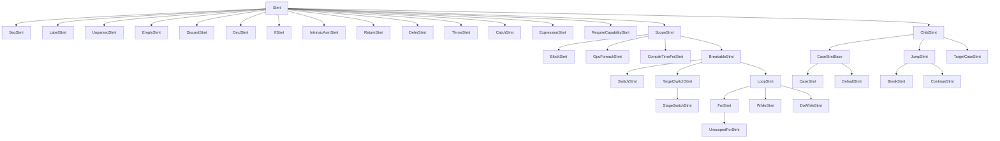

# Statements Reference

The reference for every concrete `Stmt` subclass in the Slang AST,
written for a contributor reading parser, checker, or IR-lowering code
that handles statements.
`Stmt` itself is documented in [base.md](base.md#stmt-modifiablesyntaxnode).

## Source

Statement classes are declared in
[slang-ast-stmt.h](../../../../source/slang/slang-ast-stmt.h). `Stmt`
itself is not declared there — it is one of the abstract roots in
[slang-ast-base.h](../../../../source/slang/slang-ast-base.h).

The parser entry point is `Parser::ParseStatement`
([slang-parser.cpp](../../../../source/slang/slang-parser.cpp) line
7281), a keyword-lookahead dispatcher that selects one of the
`Parse*Statement` / `parse*Stmt` helpers; `Parser::parseBlockStatement`
(line 7523) parses a `{ ... }` block. Both take an
`AllowCaseDefaultStatements` argument, which is how a `case` or
`default` written outside a `switch` body is parsed into a node and
then diagnosed rather than rejected as an unexpected token — see
[../syntax-reference/keywords-and-builtins.md](../syntax-reference/keywords-and-builtins.md). Function bodies are not parsed at
the same time as the declarations that own them: the parser runs in one
of two stages, `ParsingStage::Decl` or `ParsingStage::Body` (the
`ParsingStage` enum is at lines 85-89), and `parseOptBody` (line 2297)
records a `{`-delimited body as an `UnparsedStmt` instead of parsing it.
`parseUnparsedStmt` (line 10357) later re-enters with
`stage = ParsingStage::Body` and turns those tokens into a real
`BlockStmt`. See
[../pipeline/02-parse-ast.md](../pipeline/02-parse-ast.md) for the
surrounding two-stage strategy.

## Family hierarchy

Statement nodes split along two axes: whether the statement is a
`ScopeStmt` grouping — a structural base, only some of whose subclasses
are actually given a `ScopeDecl` — and whether it can be the target of a
`break` (loops and `switch`) or `continue` (loops only). A separate
group of `ChildStmt`s holds statements that refer to an enclosing
`BreakableStmt`.

`BreakableStmt`s carry a `UniqueStmtIDNode* uniqueID` that
`ChildStmt`s reference via `targetOuterStmtID`. `UniqueStmtIDNode` is
declared in this header as a `Decl` subclass for serialization
convenience, even though it is not a real declaration; it is listed in
the `## Nodes` table as a helper because the header declares it with
`FIDDLE()`, even though it is not in the `Stmt` hierarchy and is not
parsed as a statement.

## Nodes

| Class | Parent | Key fields | Grammar | Summary |
| --- | --- | --- | --- | --- |
| `SeqStmt` | `Stmt` | `stmts: List<Stmt*>` | (none) | A flat sequence of statements, used where a single statement is required (e.g. the several statements of a `{ ... }` block). |
| `LabelStmt` | `Stmt` | `label: Token`, `innerStmt: Stmt*` | [labeled stmt](../syntax-reference/grammar.md#statements) | `label:` followed by a single statement. |
| `BlockStmt` | `ScopeStmt` | `body: Stmt*`, `closingSourceLoc: SourceLoc` | [block](../syntax-reference/grammar.md#statements) | `{ ... }`; introduces a `ScopeDecl` for block-scoped declarations. |
| `UnparsedStmt` | `Stmt` | `tokens: List<Token>`, `sourceLanguage: SourceLanguage`, `currentScope: Scope*`, `outerScope: Scope*` | (none) | A `{ ... }` function body captured as raw tokens during `ParsingStage::Decl`, to be re-parsed on demand. |
| `EmptyStmt` | `Stmt` | (no additional state) | [empty stmt](../syntax-reference/grammar.md#statements) | A bare `;`. |
| `DiscardStmt` | `Stmt` | (no additional state) | [discard](../syntax-reference/grammar.md#statements) | `discard` (fragment-shader pixel kill). |
| `DeclStmt` | `Stmt` | `decl: DeclBase*` | [decl stmt](../syntax-reference/grammar.md#statements) | A declaration used where a statement is expected (e.g. `int x = 1;` inside a body). |
| `IfStmt` | `Stmt` | `predicate: Expr*`, `positiveStatement: Stmt*`, `negativeStatement: Stmt*`, `afterLoc: SourceLoc` | [if](../syntax-reference/grammar.md#statements) | `if (...) ... else ...`; also the node an `if (let x = ...)` desugars into. |
| `SwitchStmt` | `BreakableStmt` | `condition: Expr*`, `body: Stmt*` | [switch](../syntax-reference/grammar.md#statements) | `switch (cond) { ... }`. |
| `TargetCaseStmt` | `ChildStmt` | `capability: int32_t`, `capabilityToken: Token`, `body: Stmt*` | [__target_switch](../syntax-reference/grammar.md#statements) | `case <capability>:` (or `default:`) inside a `__target_switch`; `capability` holds a `CapabilityName` code. |
| `TargetSwitchStmt` | `BreakableStmt` | `targetCases: List<TargetCaseStmt*>` | [__target_switch](../syntax-reference/grammar.md#statements) | Static dispatch by capability set. |
| `StageSwitchStmt` | `TargetSwitchStmt` | (inherits) | [__stage_switch](../syntax-reference/grammar.md#statements) | Static dispatch by pipeline stage. |
| `IntrinsicAsmStmt` | `Stmt` | `asmText: String`, `args: List<Expr*>` | [__intrinsic_asm](../syntax-reference/grammar.md#statements) | Inline intrinsic-assembly statement used by core-module intrinsics. |
| `CaseStmt` | `CaseStmtBase` | `expr: Expr*`, `exprVal: Val*` | [case](../syntax-reference/grammar.md#statements) | `case <expr>:` inside a `switch`. |
| `DefaultStmt` | `CaseStmtBase` | (no additional state) | [default](../syntax-reference/grammar.md#statements) | `default:` inside a `switch`. |
| `GpuForeachStmt` | `ScopeStmt` | `device: Expr*`, `gridDims: Expr*`, `dispatchThreadID: VarDecl*`, `kernelCall: Expr*` | [__GPU_FOREACH](../syntax-reference/grammar.md#statements) | Host-side compute-foreach over a grid, written as `__GPU_FOREACH(device, gridDims, LAMBDA(...) { ... })`. |
| `ForStmt` | `LoopStmt` | `initialStatement: Stmt*`, `sideEffectExpression: Expr*`, `predicateExpression: Expr*`, `statement: Stmt*` | [for](../syntax-reference/grammar.md#statements) | `for (init; cond; step) body`; the loop variable is scoped to the body. |
| `UnscopedForStmt` | `ForStmt` | (inherits) | [for](../syntax-reference/grammar.md#statements) | Same syntax as `ForStmt`, produced only for HLSL input, where the loop variable leaks into the surrounding scope. |
| `WhileStmt` | `LoopStmt` | `predicate: Expr*`, `statement: Stmt*` | [while](../syntax-reference/grammar.md#statements) | `while (cond) body`. |
| `DoWhileStmt` | `LoopStmt` | `statement: Stmt*`, `predicate: Expr*` | [do-while](../syntax-reference/grammar.md#statements) | `do body while (cond);`. |
| `CompileTimeForStmt` | `ScopeStmt` | `varDecl: VarDecl*`, `rangeBeginExpr: Expr*`, `rangeEndExpr: Expr*`, `body: Stmt*`; plus the checked `rangeBeginVal` / `rangeEndVal` `IntVal*`s | [compile-time for](../syntax-reference/grammar.md#statements) | Range-based loop unrolled at compile time; emits no runtime loop. |
| `BreakStmt` | `JumpStmt` | `targetLabel: Token` | [break](../syntax-reference/grammar.md#statements) | `break` (optionally with a target label). |
| `ContinueStmt` | `JumpStmt` | (inherits) | [continue](../syntax-reference/grammar.md#statements) | `continue`; unlike `break` it takes no label. |
| `ReturnStmt` | `Stmt` | `expression: Expr*` | [return](../syntax-reference/grammar.md#statements) | `return` (optionally with an expression). |
| `DeferStmt` | `Stmt` | `statement: Stmt*` | [defer](../syntax-reference/grammar.md#statements) | `defer S`; `statement` holds the deferred statement. |
| `ThrowStmt` | `Stmt` | `expression: Expr*` | [throw](../syntax-reference/grammar.md#statements) | `throw e` for errorable functions (`ParseThrowStatement` reads the trailing `;`). |
| `CatchStmt` | `Stmt` | `errorVar: ParamDecl*`, `tryBody: Stmt*`, `handleBody: Stmt*` | [do-catch](../syntax-reference/grammar.md#statements) | `do { ... } catch (e) { ... }`; `tryBody` is the protected body, `handleBody` the handler; `errorVar == null` means a catch-all. |
| `ExpressionStmt` | `Stmt` | `expression: Expr*` | [expression stmt](../syntax-reference/grammar.md#statements) | An expression used for its side effects (`f();`, `a = b;`). |
| `RequireCapabilityStmt` | `Stmt` | `requiredCaps: List<Token>` | [__requireCapability](../syntax-reference/grammar.md#statements) | `__requireCapability(...)`; statement-level capability requirement scoped to the enclosing function. |
| `UniqueStmtIDNode` | `Decl` | (no parsed state) | (none) | Synthesized identity helper that gives a statement a stable unique id; used by serialization and control-flow tracking rather than parsed as a statement. |

## Notable nodes

### BlockStmt and SeqStmt

`ScopeStmt` is the structural base for statements that may own a
lexical scope; its `scopeDecl: ScopeDecl*` receives block-local
declarations. Only a few parser routines fill it in:
`Parser::parseBlockStatement` (line 7534), `Parser::ParseForStatement`
(line 7817), `ParseGpuForeachStmt` (line 7094), `parseCompileTimeForStmt`
(line 7214), and `Parser::parseIfLetStatement` (line 7762). `SwitchStmt`
and `TargetSwitchStmt` inherit `ScopeStmt` but leave `scopeDecl` null,
taking their scope from the `BlockStmt` built for the body, so a whole
`switch` body is one scope.

`BlockStmt` is a `{ ... }` block whose `body` is a *single* `Stmt`;
`SeqStmt` is a flat container with no scope that lets several statements
fill such a slot. `parseBlockStatement` makes the first statement the
`body` and creates a `SeqStmt` when a second arrives; an empty block gets
an `EmptyStmt` body. Other `SeqStmt` builders are
`Parser::parseIfLetStatement` (line 7682) and the per-case loop in
`parseTargetSwitchStmtImpl` (line 7022).

### UnparsedStmt

An `UnparsedStmt` is not an exotic construct — it is the ordinary
first-stage representation of a function body. When the parser reaches
a `{` where a body is expected, `parseOptBody` (line 2297) does not
recurse into `parseBlockStatement`; it copies the tokens up to the
matching `}` into `UnparsedStmt::tokens` (terminated by a synthetic
end-of-file token) and records the two scopes that were in effect,
`currentScope` and `outerScope`. Callers such as the function-decl
parser at line 2507 treat the result as the decl's `body`.

The captured scopes are what makes the deferral safe: when the body is
finally needed, `parseUnparsedStmt` (line 10357) reinstalls them on a
fresh `Parser` configured with `stage = ParsingStage::Body` and calls
`parseBlockStatement`, so the body is parsed with exactly the lookup
environment it had at its original position. The result is a normal
`BlockStmt`, and an `UnparsedStmt` is not expected to survive into
later phases. The call site that triggers the re-parse lives in the
checker, outside this page's watched paths.

### IfStmt

Holds an `Expr*` predicate and two `Stmt*` branches. The
`negativeStatement` slot is null for an `if` without an `else`. The
`afterLoc` field is the location the parser is looking at once both
branches have been consumed (`tokenReader.peekLoc()` at the end of
`Parser::parseIfStatement`, line 7787), i.e. the first token past the
whole `if`.

There is no dedicated node for `if let`. When `ParseStatement` sees
`let` two tokens after `if`, it calls `Parser::parseIfLetStatement`,
which desugars the form at parse time into a `SeqStmt` holding a
`DeclStmt` for a synthesized `$OptVar` binding followed by an ordinary
`IfStmt`; a second synthesized `LetDecl`, bound to `$OptVar.value`, is
prepended to the positive branch, which is itself wrapped in a
`BlockStmt` that owns the binding's `ScopeDecl`. A reader chasing `if let` through the
AST is therefore looking for `SeqStmt`, not a distinct class.

### SwitchStmt, CaseStmt, DefaultStmt

`SwitchStmt::body` is a `BlockStmt` — `ParseSwitchStmt`
(line 6928) parses the `{ ... }` with `parseBlockStatement`, which
returns an `EmptyStmt` instead if no `{` follows — and that
block's body is normally a `SeqStmt` of mixed `CaseStmt`, `DefaultStmt`,
and other statements. The case labels are not the parents of the
statements that fall under them: `ParseCaseStmt` and `ParseDefaultStmt`
(lines 6940 and 6950) read only `case <expr> :` / `default :` and leave
the following statements as siblings, so each `CaseStmt`/`DefaultStmt`
is just a marker in the sequence. `BreakStmt` inside a `SwitchStmt` is
matched via `BreakableStmt::uniqueID`.

### Loop family

`ForStmt`, `WhileStmt`, and `DoWhileStmt` all derive from `LoopStmt`,
which derives from `BreakableStmt`, so every loop is `break`-able, though
only `for` is given a `ScopeDecl` of its own. `ForStmt::initialStatement`
is parsed as a statement so that a `DeclStmt` can introduce loop
variables; `Parser::ParseForStatement` (line 7792) diagnoses anything
that is not a `DeclStmt` or `ExpressionStmt` there (`E20001`) while still
building the node. `UnscopedForStmt` is created instead of a `ForStmt`
when `getSourceLanguage()` is `SourceLanguage::HLSL`, which for a
command-line compile is decided in `OptionsParser::addInputPath`
([slang-options.cpp](../../../../source/slang/slang-options.cpp) line
1927) from `-lang` or the file extension. In that case the parser fills
in `scopeDecl` but never pushes the scope, so the loop variable leaks
into the surrounding scope. `Parser::ParseDoStatement` (line 7916)
parses the body first, then builds a `DoWhileStmt` for a following
`while` or a `CatchStmt` for a following `catch`.

### ReturnStmt

`return` is both a control-flow terminator and the carrier of the
function's result: `ReturnStmt::expression` is the returned `Expr*`,
or null for a bare `return` in a `void` function. The checker matches
the expression against the enclosing function's declared return type.

### CompileTimeForStmt

A range-based for whose bounds must be compile-time constants
(`rangeBeginVal` and `rangeEndVal` are `IntVal*` filled in by
checking). The parser produces it from the `$for (name in Range(...))`
syntax: `parseCompileTimeStmt` (line 7267) consumes the `$` and
`parseCompileTimeForStmt` (line 7210) the rest. `Range` is a required
literal keyword there — the parser reads it with `ReadToken("Range")`,
so any other identifier in that position is the parse error `E20004`,
"unexpected identifier, expected 'Range'". The one-argument form
`$for (i in Range(4))` leaves `rangeBeginExpr` null and iterates 0
through 3; a comma moves the first argument into `rangeBeginExpr`, so
`$for (i in Range(2, 5))` iterates 2 through 4 — the range is
half-open in both spellings. The form is deprecated: for language
versions 2025 and 2026 the parser reports the warning `E30525`,
"compile-time for is deprecated and will be removed in Slang 202c. Use
'[ForceUnroll] for' instead.", and from 202c on it reports the error
`E30526`, "compile-time for has been removed from the language." while
still building the node (lines 7218-7226). The loop variable is a `VarDecl` created
by the parser and added to the statement's own `ScopeDecl`, so the
body can refer to it.

### TargetSwitchStmt, StageSwitchStmt, TargetCaseStmt

A `TargetSwitchStmt` is a static dispatch chosen at compile time by
matching capabilities; each `TargetCaseStmt` carries a capability code
and a body. `StageSwitchStmt` dispatches on pipeline stage instead, and
the two share `parseTargetSwitchStmtImpl` (via `parseTargetSwitchStmt`
and `parseStageSwitchStmt`, lines 7055 and 7061). The capability name is
resolved during parsing: `findCapabilityName` stores it in
`TargetCaseStmt::capability`, and an unrecognized name is diagnosed
immediately as `E29110` with `capability` left at
`CapabilityName::Invalid`. Labels stacked in front of one body
(`case a: case b: ...`) produce one `TargetCaseStmt` per label, all
pointing at the *same* body `Stmt`, so a consumer walking `targetCases`
sees that body more than once.

### DeferStmt

`Parser::ParseDeferStatement` (line 7971) reads the `defer` keyword and
then a single `Stmt` — so a deferred block needs no trailing semicolon —
and stores it in `DeferStmt::statement`. The node carries no other
state; when the deferred statement actually runs is decided by IR
lowering, not by the AST. Observably, it runs when the enclosing scope
exits — at the end of the block that contains the `defer`, and also
when the function leaves that scope early through a `return`. For
example, `{ defer log(1); log(2); }` runs `log(2)` and then `log(1)`.
The checker restricts what the deferred statement may contain: a
`return` inside it is the error `E30110`, a `break` or `continue` that
would leave it is `E30108` / `E30109`, and a `throw` that would escape
it is also diagnosed (`visitReturnStmt`, `visitBreakStmt`,
`visitContinueStmt` and `visitThrowStmt` in
[slang-check-stmt.cpp](../../../../source/slang/slang-check-stmt.cpp),
which test `FindOuterStmt<DeferStmt>`). What the deferred statement
does at a `break` or `throw` exit is not stated here. See
[../pipeline/04-ast-to-ir.md](../pipeline/04-ast-to-ir.md).

### ThrowStmt and CatchStmt

The two halves of Slang's errorable-function model. A `CatchStmt`
holds both the protected body (`tryBody`) and the handler
(`handleBody`); the error parameter is a `ParamDecl` so that the
catch handler has a fully-typed local variable. A null `errorVar`
denotes a catch-all that does not bind the error value.

Note that the statement-level spelling is `do { ... } catch (e) { ... }`
— there is no `try` statement; a `try` at statement position is routed
to `Parser::ParseExpressionStatement` because `try` is an expression
keyword. A `do` may be followed by several `catch` clauses, and
`Parser::ParseDoCatchStatement` (line 7882) chains them: it loops while
the next token is `catch`, using the `CatchStmt` it just built as the
`tryBody` of the next one, so `n` catch clauses become `n` nested
`CatchStmt`s and the outermost one is returned. Each clause gets its
own parser-created `ScopeDecl` holding the error parameter.

### DeclStmt, ExpressionStmt, and EmptyStmt

These boilerplate wrappers exist so that the statement grammar
remains uniform. `DeclStmt` lets any `DeclBase` appear in a statement
position (the canonical use is a local-variable declaration, and a
multi-declarator form such as `int a = 1, b = a;` is a single
`DeclStmt` holding a `DeclGroup`);
`ExpressionStmt` lets an arbitrary `Expr` be used for its side
effects. The checker validates each kind separately. `EmptyStmt` is
the node the parser emits for a bare `;`, so an empty statement slot
(for example, a loop body that is just `;`) still has a concrete
`Stmt`.

Choosing between the first two requires backtracking: for a statement
that starts with an identifier or `::`, `ParseStatement` speculatively
parses a type and, if an identifier follows, rewinds the token reader
and re-parses the whole thing as a declaration through
`Parser::parseVarDeclrStatement` (line 7630); otherwise it rewinds and
calls `ParseExpressionStatement`. A `;` immediately after an `if` is
suspicious rather than illegal, so that case — `ParseStatement` sees a
`;` while its `parentStmt` is an `IfStmt`, for either branch, at line
7461 — still yields an `EmptyStmt` but also reports `Diagnostics::UnintendedEmptyStatement` — the warning
`E20101`, "potentially unintended empty statement at this location; use
{} instead." Being a warning and not an error, it leaves the program
compiling. For instance, `if (c);` draws it and `if (c) {}` does not.

### LabelStmt, BreakStmt, ContinueStmt, and DiscardStmt

Slang supports labeled statements and labeled breaks. `LabelStmt`
attaches a label token to an inner statement, and `ParseStatement`
selects `Parser::parseLabelStatement` (line 7620) when it sees an
identifier immediately followed by `:`; `BreakStmt::targetLabel`
optionally names the enclosing labeled loop or switch to break out
of. Resolution of `targetLabel` to a `BreakableStmt::uniqueID` is
done by semantic checking. `ContinueStmt` is the sibling `JumpStmt`
that restarts the nearest enclosing loop, and it accepts no label.
`DiscardStmt` is a
fragment-shader-only control-flow statement (`discard`) that kills the
current pixel and carries no operands.

### RequireCapabilityStmt

Asserts that the surrounding function requires the listed capability
atoms. `Parser::ParseRequireCapabilityStatement` (line 8002) recognizes
the `__requireCapability` keyword and validates each name as it is read,
via `findCapabilityName`; a name that does not resolve is dropped and
diagnosed as `Diagnostics::UnknownCapability` — `E36105`,
`unknown capability name '<name>'.` The accepted spelling inside a
function body is `__requireCapability(hlsl);`: the names are read as a
comma-separated list, so several atoms may be listed in one statement
(`__requireCapability(a, b);` for two atoms `a` and `b`),
and the closing `)` must be followed by a `;`. Only the accepted tokens
are stored, still as raw `Token`s in `requiredCaps`, for the capability
system documented in
[../cross-cutting/targets.md](../cross-cutting/targets.md) to interpret.

## See also

- [base.md](base.md) — `Stmt`, `ModifiableSyntaxNode` base classes.
- [declarations.md](declarations.md) — `DeclStmt` wraps any `DeclBase`.
- [expressions.md](expressions.md) — every `Expr*` slot in a
  statement.
- [../pipeline/02-parse-ast.md](../pipeline/02-parse-ast.md) — two-stage
  body parsing.
- [../name-resolution/scopes.md](../name-resolution/scopes.md) — how the
  `ScopeDecl` a `ScopeStmt` owns participates in lookup.
- [../pipeline/04-ast-to-ir.md](../pipeline/04-ast-to-ir.md) — IR
  lowering of `DeferStmt`, `ThrowStmt`, `CompileTimeForStmt`,
  `TargetSwitchStmt`.
- [../syntax-reference/grammar.md#statements](../syntax-reference/grammar.md#statements)
  — statement productions.
