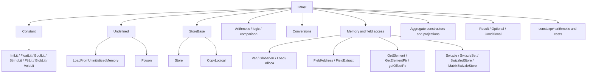

# Values

This page is the per-opcode reference for Slang IR value-producing
opcodes that are not types, not control-flow, not structural, not
GPU resource ops, and not autodiff-specific: literals, arithmetic
and logic, comparisons, conversions, memory access, aggregate
constructors and projections, and a handful of bit-manipulation
helpers.

The intended reader is a compiler engineer reading IR around an
ordinary expression — a numeric computation, a struct-field access,
a vector construction, or a type cast — and needs to identify each
opcode it produces. The `DescriptorHandle<T>` conversions are also
covered here, since a conversions table is their natural home; the
untyped descriptor-heap handle casts are not (see
[misc.md](misc.md#untyped-descriptor-heap-handle-casts)).

## Source

The opcodes documented here are spread through
[slang-ir-insts.lua](../../../../source/slang/slang-ir-insts.lua):

- `Constant` group at line 953 (literals, lines 954-965).
- `Undefined` group at line 972 (`LoadFromUninitializedMemory` at
  988, `Poison` at 1008) plus `defaultConstruct` at line 1014.
- Aggregate constructors and reshape helpers at lines 1061-1091
  (`allocObj`, `makeUInt64`, `makeVector`, `makeMatrix`,
  `matrixReshape`, `vectorReshape`, `makeArray`, `makeStruct`,
  `makeTuple`, `getTupleElement`, ...). `globalValueRef` (1062) sits
  inside that range but is tabulated on
  [generics-and-existentials.md](generics-and-existentials.md).
- Result / Optional / Conditional makers and getters at lines
  1135-1145.
- `alloca` (1150), `updateElement` (1151), `bitfieldExtract` /
  `bitfieldInsert` (1153-1154).
- `var` (1172), `load` (1173), the `StoreBase` group (1175) holding
  `store` (1178) and `copyLogical` (1179), and `CUDA_LDG` (1182).
- Field, element, and address opcodes at lines 1271-1284, followed by
  the string / native-pointer cluster at 1287-1297.
- `MakeVectorFromScalar` (1394), the swizzle family (1401-1449), and
  `SumVectorElements` / `SumMatrixElements` (1451-1453).
- Arithmetic, comparison, bit, logical and `select` ops at lines
  1556-1611.
- Conversion opcodes at lines 2770-2814.
- `constexpr*` arithmetic and casts at lines 3454-3483.

Each Lua entry generates the enumerator `kIROp_` + the entry's
`struct_name`, which is *not* always the Lua key: `boolConst` becomes
`kIROp_BoolLit`, `shl` becomes `kIROp_Lsh`, `get_field` becomes
`kIROp_FieldExtract`, `and` becomes `kIROp_BitAnd`, and `logicalAnd`
becomes `kIROp_And`. Where a `struct_name` is absent the key is
converted to PascalCase (`integer_constant` → `kIROp_IntLit` comes
from an explicit `struct_name`; `makeVector` → `kIROp_MakeVector`
comes from the implicit conversion). The tables below key rows on the
Lua entry name and give the wrapper name, from which the enumerator
can be read off directly.

C++ wrappers are declared in
[slang-ir-insts.h](../../../../source/slang/slang-ir-insts.h). Every
opcode has one: the FIDDLE template at the end of that file
(`getAllOtherInstStructsData`, invoked from the template block near
line 3159) emits an `IR<struct_name>` struct for every entry that does
not already have a hand-written declaration, so an opcode is either
hand-written or generated and never wrapper-less. See
[C++ wrappers: hand-written vs generated](#c-wrappers-hand-written-vs-generated).
Builder helpers (`IRBuilder::emitCast`, `IRBuilder::emitVar`,
`IRBuilder::emitMakeStruct`, ...) are in
[slang-ir.cpp](../../../../source/slang/slang-ir.cpp).

Lowering from the AST is in
[slang-lower-to-ir.cpp](../../../../source/slang/slang-lower-to-ir.cpp).
Two producers account for most rows below, and the distinction matters
when reading the `AST origin` column:

- The `visit*Expr` / `visit*Decl` family, reached through `lowerExpr`
  and `lowerDecl`.
- `emitCallToDeclRef` (line 977), which turns a call to a core-module
  function carrying an `__intrinsic_op(...)` modifier straight into
  that opcode. Many opcodes in this family have *no* visitor at all
  and exist only because
  [core.meta.slang](../../../../source/slang/core.meta.slang),
  [hlsl.meta.slang](../../../../source/slang/hlsl.meta.slang), or
  [glsl.meta.slang](../../../../source/slang/glsl.meta.slang) declares
  an operator or function with `__intrinsic_op($(kIROp_...))`.

Literal opcodes carry their value inline on the `IRInst` itself (see
the per-class layout in
[slang-ir-insts.h](../../../../source/slang/slang-ir-insts.h)) rather
than as ordinary operands; this is the single case in the IR where
an instruction's payload is not visible through the operand list.

## Family hierarchy

Most opcodes on this page are direct children of `IRInst`; the Lua file
declares only three grouping parents in this family, `Constant`,
`Undefined`, and `StoreBase`. The remaining boxes below are the
editorial groupings this page's tables use, not Lua groups.

## Opcodes

Two markers appear in the tables below, matching the convention on
[types.md](types.md):

- `†` on an operand name means the Lua entry does **not** declare that
  operand under that name (it declares none, uses `min_operands`, or
  declares a name that disagrees with what is actually built); the
  name and index come from the C++ wrapper's accessors or from the
  construction site, which are authoritative in that case.
- `‡` after a wrapper name means the wrapper is hand-written — in
  [slang-ir-insts.h](../../../../source/slang/slang-ir-insts.h), or in
  [slang-ir.h](../../../../source/slang/slang-ir.h) for the literal
  classes — rather than FIDDLE-generated, so its accessor names may
  differ from the Lua operand names. No row in this family has *no*
  wrapper.

### Literals (`Constant` group)

Two `IntLit 42` produce the same IR value: the `Constant` opcodes
are not marked with the `H` (hoistable) opcode flag, but are
deduplicated through the constant map by
`IRBuilder::_findOrEmitConstant`
([slang-ir.cpp](../../../../source/slang/slang-ir.cpp) line 2414).
Each literal stores its payload (integer, float, bytes, ...) inline on
the `IRInst`, *not* in the operand list.

| Opcode | C++ wrapper | Operands | Flags | AST origin | Summary |
| --- | --- | --- | --- | --- | --- |
| `boolConst` | `IRBoolLit`‡ | — | | `BoolLiteralExpr` (`visitBoolLiteralExpr`, line 6457) | `true` / `false`. |
| `integer_constant` | `IRIntLit`‡ | — | | `IntegerLiteralExpr` (`visitIntegerLiteralExpr`, line 6472); also `ConstantIntVal` via `lowerVal` | Integer literal; signedness encoded in the result type. |
| `float_constant` | `IRFloatLit`‡ | — | | `FloatingPointLiteralExpr` (`visitFloatingPointLiteralExpr`, line 6478) | Floating-point literal. |
| `ptr_constant` | `IRPtrLit`‡ | — | | `NullPtrLiteralExpr` (`visitNullPtrLiteralExpr`, line 6462, through `IRBuilder::getNullVoidPtrValue`) | Pointer constant (e.g. `nullptr`); also `IRBuilder::getNullPtrValue` ([slang-ir.cpp](../../../../source/slang/slang-ir.cpp) line 2651), which the pointer case of `emitDefaultConstruct` calls. |
| `void_constant` | `IRVoidLit` | — | | `NoneLiteralExpr` (`visitNoneLiteralExpr`, line 6467) | The unique `void` value; also produced by `IRBuilder::getVoidValue` ([slang-ir.cpp](../../../../source/slang/slang-ir.cpp) line 2660) wherever a cast to `void` is discarded. |
| `string_constant` | `IRStringLit`‡ | — | | `StringLiteralExpr` (`visitStringLiteralExpr`, line 6484) | String constant; bytes inline. |
| `blob_constant` | `IRBlobLit` | — | | `emitEmbeddedDownstreamIR` | Arbitrary blob literal (payload: bytes), built by `IRBuilder::getBlobValue` ([slang-ir.cpp](../../../../source/slang/slang-ir.cpp) line 2614); the only caller is `emitEmbeddedDownstreamIR` (line 4347). |

### Undefined and default-construct

`Undefined` is the grouping parent of `LoadFromUninitializedMemory`
and `Poison`; only its concrete children are listed here.

| Opcode | C++ wrapper | Operands | Flags | AST origin | Summary |
| --- | --- | --- | --- | --- | --- |
| `LoadFromUninitializedMemory` | `IRLoadFromUninitializedMemory` | — | | SSA construction: `readVarRec` ([slang-ir-ssa.cpp](../../../../source/slang/slang-ir-ssa.cpp) line 980) | A load from uninitialized memory; like LLVM's `freeze(undef)`. Emitted by `readVarRec` in the SSA pass (same file, lines 1033 and 1121) when a variable is read on a path with no reaching store; built by `IRBuilder::emitLoadFromUninitializedMemory` ([slang-ir.cpp](../../../../source/slang/slang-ir.cpp) line 3307). Frontend diagnostics surface uses. |
| `Poison` | `IRPoison` | — | H | `getDefaultVal` for a resource type (line 6167), `visitInvokeExprImpl` when the nesting-depth guard fires (line 4967), differential-pair type lowering (line 2746), and core-module `__declVal()` ([core.meta.slang](../../../../source/slang/core.meta.slang) line 3967); also IR passes | Infectious undefined value; analogue of LLVM `poison`. Hoistable, so all poison values of the same type dedupe to one inst. Unlike the row above it has no single owning pass: `IRBuilder::getPoison` ([slang-ir.cpp](../../../../source/slang/slang-ir.cpp) line 3315) is called wherever an operation provably has no defined result — empty-array legalization ([slang-ir-legalize-empty-array.cpp](../../../../source/slang/slang-ir-legalize-empty-array.cpp) line 89 onward), `legalizeVectorTypes` ([slang-ir-legalize-vector-types.cpp](../../../../source/slang/slang-ir-legalize-vector-types.cpp) line 97 onward), `lowerConditionalType` ([slang-ir-lower-conditional-type.cpp](../../../../source/slang/slang-ir-lower-conditional-type.cpp) line 171), GLSL varying legalization ([slang-ir-glsl-legalize.cpp](../../../../source/slang/slang-ir-glsl-legalize.cpp) line 4306), typeflow specialization ([slang-ir-typeflow-specialize.cpp](../../../../source/slang/slang-ir-typeflow-specialize.cpp) line 5932 onward), and reverse-mode autodiff ([slang-ir-autodiff-rev.cpp](../../../../source/slang/slang-ir-autodiff-rev.cpp) line 120) among them. |
| `defaultConstruct` | `IRDefaultConstruct`‡ | — | | `DefaultConstructExpr` (`visitDefaultConstructExpr`, line 6211) and `getDefaultVal` (line 6116, interface-typed case at line 6178); core-module `__default()` ([core.meta.slang](../../../../source/slang/core.meta.slang) line 3971); also IR passes that call `emitDefaultConstruct`, among them [slang-ir-init-local-var.cpp](../../../../source/slang/slang-ir-init-local-var.cpp) (lines 65, 92) and [slang-ir-lower-optional-type.cpp](../../../../source/slang/slang-ir-lower-optional-type.cpp) (lines 190, 201) | Produces a default-initialized value of the result type; nullary (`IRBuilder::emitDefaultConstructRaw`, [slang-ir.cpp](../../../../source/slang/slang-ir.cpp) line 4185). |

### Arithmetic and bitwise

There is no `InfixExpr` or `PrefixExpr` visitor behind these rows. An
operator in Slang source is an ordinary overloaded call, so `a + b`
checks to an `InvokeExpr` on a core-module `operator+`. Two things can
then happen, and both reach the same opcode:

- If the checker recognizes the call as one of the builtin arithmetic
  fast paths, `convertToBuiltinArithmeticOp`
  ([slang-check-expr.cpp](../../../../source/slang/slang-check-expr.cpp)
  line 4865) rewrites it to an already-checked `BuiltinOperatorExpr`
  carrying a `BuiltinOperationKind`. `lowerBuiltinOperatorExpr` (line
  4859) switches on that kind and calls `emitIntrinsicInst` with the
  opcode directly, bypassing call lowering entirely — see
  [../pipeline/04-ast-to-ir.md](../pipeline/04-ast-to-ir.md). Only the
  non-short-circuit operators take this route: the kinds `And`, `Or`,
  `Conditional` and `Unknown` hit `SLANG_UNEXPECTED` there, because
  the checker never builds a `BuiltinOperatorExpr` for them.
- Otherwise the call survives as an `InvokeExpr` and
  `emitCallToDeclRef` (line 977) reads the `__intrinsic_op($(kIROp_...))`
  modifier off the resolved core-module declaration. The `IInteger` /
  `IFloat` conformances for scalars, vectors, and matrices in
  [core.meta.slang](../../../../source/slang/core.meta.slang) are
  declared this way.

The `AST origin` column names both routes as
`BuiltinOperatorExpr` / core-module `__intrinsic_op`.

| Opcode | C++ wrapper | Operands | Flags | AST origin | Summary |
| --- | --- | --- | --- | --- | --- |
| `add` | `IRAdd` | `left, right` | | `BuiltinOperatorExpr` (`+`) / core-module `__intrinsic_op` | Addition. |
| `sub` | `IRSub` | `left, right` | | `BuiltinOperatorExpr` (`-`) / core-module `__intrinsic_op` | Subtraction. |
| `mul` | `IRMul` | `left, right` | | `BuiltinOperatorExpr` (`*`) / core-module `__intrinsic_op` | Multiplication. |
| `div` | `IRDiv` | `left, right` | | `BuiltinOperatorExpr` (`/`) / core-module `__intrinsic_op` | Division (signed / unsigned / floating-point keyed by operand types). |
| `irem` | `IRem` | `left, right` | | `BuiltinOperatorExpr` (`%` with integer element type) | Integer remainder; *not* modulus. The Lua comment notes the distinction. |
| `frem` | `IRFRem` | `left, right` | | `BuiltinOperatorExpr` (`%` with floating-point element type) | Floating-point remainder. `lowerBuiltinOperatorExpr` picks `FRem` over `IRem` from `BuiltinOperatorExpr::elementTypeIsFloatingPoint`, which `convertToBuiltinArithmeticOp` resolves at check time ([slang-check-expr.cpp](../../../../source/slang/slang-check-expr.cpp) line 5131) because the element type can still be an abstract generic parameter during lowering. |
| `neg` | `IRNeg` | `value` | | `BuiltinOperatorExpr` (unary `-`) / core-module `__intrinsic_op` | Unary negation. |
| `shl` | `IRLsh` | `value, amount` | | `BuiltinOperatorExpr` (`<<`) / core-module `__intrinsic_op` | Left-shift. |
| `shr` | `IRRsh` | `value, amount` | | `BuiltinOperatorExpr` (`>>`) / core-module `__intrinsic_op` | Right-shift (arithmetic / logical chosen by operand signedness). |
| `and` | `IRBitAnd` | `left, right` | | `BuiltinOperatorExpr` (`&`) / core-module `__intrinsic_op` | Bitwise AND. |
| `or` | `IRBitOr` | `left, right` | | `BuiltinOperatorExpr` (`\|`) / core-module `__intrinsic_op` | Bitwise OR. |
| `xor` | `IRBitXor` | `left, right` | | `BuiltinOperatorExpr` (`^`) / core-module `__intrinsic_op` | Bitwise XOR. |
| `bitnot` | `IRBitNot` | `value` | | `BuiltinOperatorExpr` (`~`) / core-module `__intrinsic_op` | Bitwise NOT. |
| `not` | `IRNot` | `value` | | `BuiltinOperatorExpr` (`!`) / core-module `__intrinsic_op` | Logical NOT. |
| `bitfieldExtract` | `IRBitfieldExtract` | `value, offset, count` | | core-module `bitfieldExtract` ([core.meta.slang](../../../../source/slang/core.meta.slang) line 3498) | Extracts a bit-field into the low bits of the result. |
| `bitfieldInsert` | `IRBitfieldInsert` | `base, insert, offset, count` | | core-module `bitfieldInsert` ([core.meta.slang](../../../../source/slang/core.meta.slang) line 3490) | Inserts the low `count` bits of `insert` into `base` at `offset`. |

### Logical

`logicalAnd` / `logicalOr` are **not** the lowering of `&&` and `||`.
Those operators check to a `LogicOperatorShortCircuitExpr`, and
`visitLogicOperatorShortCircuitExpr` (line 6641) lowers them to an
`ifElse` plus a join-block `Param` so the right-hand side is only
evaluated on the taken edge. `kIROp_And` / `kIROp_Or` come instead
from the core-module functions that deliberately do *not*
short-circuit: the `and` / `or` members generated for the `bool`
scalar type ([core.meta.slang](../../../../source/slang/core.meta.slang)
lines 1292-1293), the `and` / `or` members of the `IInteger` extension on
`vector<T,N>` (lines 2425, 2428), and the free `and()` / `or()`
overloads on `vector<bool,N>` (lines 3834, 3860).

| Opcode | C++ wrapper | Operands | Flags | AST origin | Summary |
| --- | --- | --- | --- | --- | --- |
| `logicalAnd` | `IRAnd` | `left, right` | | core-module `and` / `bool.and` (`__intrinsic_op($(kIROp_And))`) | Boolean AND of two already-evaluated `bool` (or `vector<bool,N>`) operands; no short-circuiting. |
| `logicalOr` | `IROr` | `left, right` | | core-module `or` / `bool.or` (`__intrinsic_op($(kIROp_Or))`) | Boolean OR of two already-evaluated operands; no short-circuiting. |
| `select` | `IRSelect`‡ | `condition, trueResult, falseResult` | | `SelectExpr` (`visitSelectExpr`, line 6587) when the condition is not a `BasicExpressionType`, or at global scope; declared `__intrinsic_op(select)` on `operator?:` and `select()` ([core.meta.slang](../../../../source/slang/core.meta.slang) lines 1110-1121) | Branch-free conditional selection. |

### Comparison

Same two routes as the arithmetic table above.

| Opcode | C++ wrapper | Operands | Flags | AST origin | Summary |
| --- | --- | --- | --- | --- | --- |
| `cmpEQ` | `IREql` | `left, right` | | `BuiltinOperatorExpr` (`==`) / core-module `__intrinsic_op` | Equality. |
| `cmpNE` | `IRNeq` | `left, right` | | `BuiltinOperatorExpr` (`!=`) / core-module `__intrinsic_op` | Inequality; also emitted by `emitCast` for a float-to-`bool` cast (compare against `defaultConstruct`). |
| `cmpLT` | `IRLess` | `left, right` | | `BuiltinOperatorExpr` (`<`) / core-module `__intrinsic_op` | Less-than. |
| `cmpLE` | `IRLeq` | `left, right` | | `BuiltinOperatorExpr` (`<=`) / core-module `__intrinsic_op` | Less-or-equal. |
| `cmpGT` | `IRGreater` | `left, right` | | `BuiltinOperatorExpr` (`>`) / core-module `__intrinsic_op` | Greater-than. |
| `cmpGE` | `IRGeq` | `left, right` | | `BuiltinOperatorExpr` (`>=`) / core-module `__intrinsic_op` | Greater-or-equal. |

### Conversions

Most numeric conversions are chosen by `IRBuilder::emitCast`
([slang-ir.cpp](../../../../source/slang/slang-ir.cpp) line 4409),
which maps a (from, to) pair of `TypeCastStyle` values through a
`static const OpSeq opMap[5][5]` table (line 4463) covering the five
data-carrying styles `Int`, `Float`, `Bool`, `Ptr`, and `Enum`. An
entry may name two opcodes, in which case the cast lowers to a pair
(for example `Ptr` → `Float` becomes `CastPtrToInt` followed by
`CastIntToFloat`). `Bool` → `Bool` is `kIROp_Nop`, i.e. the operand is
returned unchanged, and `Float` → `Bool` is `{kIROp_Neq}` — a `cmpNE`
against `defaultConstruct`
([slang-ir.cpp](../../../../source/slang/slang-ir.cpp) line 4474, with
the compare built at line 4518).

Read that table as describing `IRBuilder::emitCast`, not as a
prediction about what a source-level cast lowers to. A written
`bool(f)` does not consult it: the conversion resolves in the front end
to a core-module conversion backed by
`__intrinsic_op($(kIROp_CastFloatToInt))`, so the lowered form is a
single `castFloatToInt(%f)` whose result type is `Bool`, with no
`cmpNE` and no `defaultConstruct` anywhere in the dump. The `Neq` entry
is reached from IR-internal callers of `emitCast`. Casts to `void` never reach the table; see
[Live-but-unproduced opcodes](#live-but-unproduced-opcodes).

Three rows that used to appear here — `CastStorageToLogical`,
`CastStorageToLogicalDeref`, and `TreatAsDynamicUniform` — are owned by
[misc.md](misc.md): see
[misc.md#storage-type-legalization-casts](misc.md#storage-type-legalization-casts)
and [misc.md#annotations](misc.md#annotations). The four *untyped*
descriptor-heap handle casts added for the
`ResourceDescriptorHeap` / `SamplerDescriptorHeap` direct-index syntax
are also owned there:
[misc.md#untyped-descriptor-heap-handle-casts](misc.md#untyped-descriptor-heap-handle-casts).
The `DescriptorHandle<T>` conversions below *are* owned by this page.

| Opcode | C++ wrapper | Operands | Flags | AST origin | Summary |
| --- | --- | --- | --- | --- | --- |
| `BuiltinCast` | `IRBuiltinCast` | `val` | | `BuiltinCastExpr` (`visitBuiltinCastExpr`, line 6719) | Fallback emitted by `emitCast` when either side's `TypeCastStyle` is `Unknown` (i.e. not a scalar / pointer / enum), leaving the conversion for a later pass. The peephole pass resolves the vector / array shapes it knows (vector to array, array to vector, and array to array of equal literal length) into `makeVector` / `makeArray` ([slang-ir-peephole.cpp](../../../../source/slang/slang-ir-peephole.cpp) lines 1479-1562). |
| `bitCast` | `IRBitCast` | `val` | | core-module `bit_cast<T, U>` ([core.meta.slang](../../../../source/slang/core.meta.slang) line 3451) and the other `__intrinsic_op($(kIROp_BitCast))` declarations, e.g. GLSL `unpack8` ([glsl.meta.slang](../../../../source/slang/glsl.meta.slang) line 768); the GLSL `floatBitsToInt` family does not use it, as it calls the HLSL `asint` / `asuint` / `asfloat` helpers (same file, lines 600-662) | Reinterpret bits without changing them; also the `Ptr` → `Ptr` entry of the `emitCast` table, and `IRBuilder::emitBitCast` ([slang-ir.cpp](../../../../source/slang/slang-ir.cpp) line 6687). There is no `BitCastExpr` AST node. The HLSL-compatibility reinterpret builtins `asuint` / `asint` / `asfloat` / `asdouble` are *not* a surface for this opcode: they are `__target_switch` functions whose bodies use `__intrinsic_asm` (or `spirv_asm` on SPIR-V) rather than `__intrinsic_op` ([hlsl.meta.slang](../../../../source/slang/hlsl.meta.slang) line 8687 onward), so lowering leaves them as `call` instructions and they are resolved per target afterwards. |
| `reinterpret` | `IRReinterpret` | `val` | | core-module `reinterpret<T,U>` ([core.meta.slang](../../../../source/slang/core.meta.slang) line 3481) | Same bit pattern, different type tag; less restrictive than `bitCast` (any scalar / vector / matrix / struct / array). There is no `ReinterpretExpr` AST node. |
| `ReinterpretOptional` | `IRReinterpretOptional` | `val` | | **no producer at HEAD** | Covariant `Optional<T>` → `Optional<U>` conversion. The comment at [slang-ir-typeflow-set.cpp](../../../../source/slang/slang-ir-typeflow-set.cpp) line 266 says the set-upcast path emits it, but the code returns `openOptional(...)`, which builds the if-else directly; `lowerReinterpretOptional` only consumes instances that never appear. See [live-but-unproduced opcodes](#live-but-unproduced-opcodes). |
| `unmodified` | `IRUnmodified` | `val` | | core-module `unused` / `unmodified` ([core.meta.slang](../../../../source/slang/core.meta.slang) lines 3506, 3513) | No-op cast that marks an `out` / `inout` parameter as deliberately untouched, silencing the uninitialized-use warning. |
| `outImplicitCast` | `IROutImplicitCast` | `baseAddress`† | | `OutImplicitCastExpr` (`visitLValueImplicitCastExpr`, line 7327), materialized by `tryGetAddress` (line 9950) | Implicit cast at the boundary of an `out` parameter. Despite the Lua name `value` the operand is the *address* of the caller's variable, and the result type is a `Ptr`. A same-type argument does *not* produce it — that case passes the caller's `var` pointer through unchanged. See [`out` / `inout` argument casts](#out--inout-argument-casts). |
| `inOutImplicitCast` | `IRInOutImplicitCast` | `baseAddress`† | | `InOutImplicitCastExpr` (`visitLValueImplicitCastExpr`, line 7327), materialized by `tryGetAddress` (line 9946) | The `inout` / borrowed-`inout` counterpart; same pointer-in / pointer-out shape and the same narrow reachability condition. |
| `intCast` | `IRIntCast`‡ | `value` | | `emitCast` table (Int→Int, Int→Bool, Bool→Int) | Integer-to-integer cast (sign / zero extension chosen by types). |
| `floatCast` | `IRFloatCast`‡ | `value` | | `emitCast` table (Float→Float) | Float-to-float cast (precision change). |
| `castIntToFloat` | `IRCastIntToFloat`‡ | `value` | | `emitCast` table (Int→Float, Bool→Float) | Int-to-float conversion. |
| `castFloatToInt` | `IRCastFloatToInt`‡ | `value` | | `emitCast` table (Float→Int) | Float-to-int conversion (truncation). |
| `CastPtrToBool` | `IRCastPtrToBool` | `value` | | `emitCast` table (Ptr→Bool); `IRBuilder::emitCastPtrToBool` ([slang-ir.cpp](../../../../source/slang/slang-ir.cpp) line 6694), called by `getOptionalHasValue` in the optional-type lowering pass ([slang-ir-lower-optional-type.cpp](../../../../source/slang/slang-ir-lower-optional-type.cpp) line 226) | True if the pointer operand is non-null. |
| `CastPtrToInt` | `IRCastPtrToInt` | `value` | | `emitCast` table (Ptr→Int); `IRBuilder::emitCastPtrToInt` (line 6701) | Reinterprets a pointer as an integer. |
| `CastIntToPtr` | `IRCastIntToPtr` | `value` | | `emitCast` table (Int→Ptr, Bool→Ptr); `IRBuilder::emitCastIntToPtr` (line 6708) | Reinterprets an integer as a pointer. |
| `castToVoid` | `IRCastToVoid` | `value` | | — (declared but never emitted; see [Live-but-unproduced opcodes](#live-but-unproduced-opcodes)) | Would discard its operand and yield `void`. `(void)expr` produces a `void_constant` instead. |
| `PtrCast` | `IRPtrCast` | `value` | | — (no producer at `source_commit`) | Cast between pointer types of different element types; only the emitters and instruction-classification switches mention it. |
| `CastEnumToInt` | `IRCastEnumToInt` | `value` | | `emitCast` table (Enum→Int and the first half of Enum→Float / Enum→Bool / Enum→Ptr); also the tag step of the HLSL-compatibility implicit conversion from an unscoped enum to a builtin scalar, which wraps the operand in a `BuiltinCastExpr` to the tag type first ([slang-check-conversion.cpp](../../../../source/slang/slang-check-conversion.cpp) line 2287) | Casts an enum value to its underlying integer tag. |
| `CastIntToEnum` | `IRCastIntToEnum` | `value` | | `emitCast` table (Int→Enum, Bool→Enum, and the second half of Float→Enum / Ptr→Enum) | Casts an integer to an enum type. |
| `EnumCast` | `IREnumCast` | `value` | | `emitCast` table (Enum→Enum) | Casts between two enum types with the same underlying type. Enum-to-enum conversion written in Slang source does not reach this cell: the checker's explicit-coercion path for an enum target ([slang-check-conversion.cpp](../../../../source/slang/slang-check-conversion.cpp) line 2328) first coerces the operand to the *target* enum's tag type and then wraps that tag in the target enum, so it builds two nested `BuiltinCastExpr` nodes and lowering emits a `CastEnumToInt` followed by a `CastIntToEnum`. The Enum→Enum cell is reached only where a single `emitCast` call already has both enum types in hand. |
| `CastUInt2ToDescriptorHandle` | `IRCastUInt2ToDescriptorHandle` | `value` | | `DescriptorHandle<T>.__init(uint2)` ([hlsl.meta.slang](../../../../source/slang/hlsl.meta.slang) line 29158) | Packs a `uint2` as a descriptor handle. |
| `CastDescriptorHandleToUInt2` | `IRCastDescriptorHandleToUInt2` | `value` | | `uint2.__init(DescriptorHandle<T>)` ([hlsl.meta.slang](../../../../source/slang/hlsl.meta.slang) line 29225) | Unpacks a descriptor handle to a `uint2`. |
| `CastUInt64ToDescriptorHandle` | `IRCastUInt64ToDescriptorHandle` | `value` | | `DescriptorHandle<T>.__init(uint64_t)` ([hlsl.meta.slang](../../../../source/slang/hlsl.meta.slang) line 29165) | Packs a `uint64_t` as a descriptor handle. |
| `CastDescriptorHandleToUInt64` | `IRCastDescriptorHandleToUInt64` | `value` | | `uint64_t.__init(DescriptorHandle<T>)` ([hlsl.meta.slang](../../../../source/slang/hlsl.meta.slang) line 29234) | Unpacks a descriptor handle to a `uint64_t`. |
| `CastDescriptorHandleToResource` | `IRCastDescriptorHandleToResource` | `handle` | | `__castDescriptorHandleToResource<T>` ([hlsl.meta.slang](../../../../source/slang/hlsl.meta.slang) line 29430); also `MetalParameterBlockElementTypeLoweringPolicy::lowerLeafLogicalType` ([slang-ir-lower-buffer-element-type.cpp](../../../../source/slang/slang-ir-lower-buffer-element-type.cpp) line 3409) | Turns a descriptor handle into the resource it names. |
| `CastResourceToDescriptorHandle` | `IRCastResourceToDescriptorHandle` | `resource` | | `MetalParameterBlockElementTypeLoweringPolicy::lowerLeafLogicalType` ([slang-ir-lower-buffer-element-type.cpp](../../../../source/slang/slang-ir-lower-buffer-element-type.cpp) line 3410) | The reverse direction; has no core-module spelling and is only produced by Metal parameter-block lowering. |

### Memory

| Opcode | C++ wrapper | Operands | Flags | AST origin | Summary |
| --- | --- | --- | --- | --- | --- |
| `var` | `IRVar`‡ | — | | `VarDecl` (local, `visitVarDecl`, line 11812), plus temporaries created throughout lowering | Allocates a local variable; result type is `Ptr<T>` (`IRVar::getDataType()` casts to `IRPtrType`). Built by `IRBuilder::emitVar` ([slang-ir.cpp](../../../../source/slang/slang-ir.cpp) line 5526). |
| `global_var` | `IRGlobalVar`‡ | (variadic) | G | `VarDecl` (module-scope) | Module-scope mutable variable; documented in [structure.md](structure.md#global-state). |
| `globalConstant` | `IRGlobalConstant`‡ | (variadic) | G | `VarDecl` with `const` / `static const` at module scope | Module-scope constant; documented in [structure.md](structure.md#global-state). |
| `alloca` | `IRAlloca`‡ | `rttiObject`† | | — (no producer at `source_commit`) | Stack allocation sized from an RTTI object. The Lua names the operand `allocSize`, but `IRBuilder::emitAlloca` ([slang-ir.cpp](../../../../source/slang/slang-ir.cpp) line 4078) takes an RTTI object pointer, and the C++ backend emits `alloca(<operand>->typeSize)`. See [`Var` vs `GlobalVar` vs `Alloca`](#var-vs-globalvar-vs-alloca). |
| `load` | `IRLoad`‡ | `ptr`, optional trailing alignment / access attrs† (`min=1`) | | `DerefExpr` (`visitDerefExpr`, line 5868) and every rvalue read of an lvalue via `getSimpleVal` | Reads through a pointer. `IRLoad` stores its pointer as a named `IRUse ptr` field; extra operands beyond the first are attributes, not values. |
| `store` | `IRStore`‡ | `ptr, val` | | Assignment lowering (`assign`, line 10006) | Writes through a pointer. Child of the `StoreBase` group (Lua line 1175), which is where the `ptr, val` names come from. |
| `copyLogical` | `IRCopyLogical` | `dest, srcPtr`†, optional load attrs | | Buffer-element-type legalization ([slang-ir-lower-buffer-element-type.cpp](../../../../source/slang/slang-ir-lower-buffer-element-type.cpp) lines 1443, 1937) | Copies a whole value between two *pointers*, member by member, without reinterpreting bytes; result type is `void`. Built by `IRBuilder::emitCopyLogical` ([slang-ir.cpp](../../../../source/slang/slang-ir.cpp) line 5688). Because it inherits `IRStoreBase`, `getVal()` returns the *source pointer*, not a value — the inherited name misleads. |
| `get_field` | `IRFieldExtract`‡ | `base, field`† (`min=2`) | | `MemberExpr` on a value (`visitMemberExpr`, line 5822) | Reads a struct member from a value; rvalue path. `field` is a `StructKey`. |
| `get_field_addr` | `IRFieldAddress`‡ | `base, field`† (`min=2`) | | `MemberExpr` on an lvalue (`visitMemberExpr`, line 5822) | Returns the address of a struct member; lvalue path. |
| `getElement` | `IRGetElement`‡ | `base, index` | | `IndexExpr` on a value (`visitIndexExpr`, line 5806) | Reads the `index`-th element of an aggregate. The hand-written wrapper declares no accessors, so consumers read `getOperand(0)` / `getOperand(1)` directly. |
| `getElementPtr` | `IRGetElementPtr`‡ | `base, index` | | `IndexExpr` on an lvalue (`visitIndexExpr`, line 5806) | Returns the address of the `index`-th element. Also accessor-less. |
| `getOffsetPtr` | `IRGetOffsetPtr`‡ | `base, offset` | | core-module `__getOffsetPtr` / pointer `operator+` ([core.meta.slang](../../../../source/slang/core.meta.slang) lines 1551, 1669, 3095 — the pointer `__subscript`, `__getOffsetPtr`, and pointer `operator+`), which `emitCallToDeclRef` special-cases by opcode at line 1005; also `IRBuilder::emitGetOffsetPtr` callers such as [slang-ir-lower-cpu-resource-types.cpp](../../../../source/slang/slang-ir-lower-cpu-resource-types.cpp) (line 159) | Pointer offset: `pBase + offset_in_elements`. |
| `getAddr` | `IRGetAddress` | `ptr` | | — (no producer at `source_commit`) | Would mark a pointer as "an address obtained explicitly". `IRBuilder::emitGetAddress` ([slang-ir.cpp](../../../../source/slang/slang-ir.cpp) line 6103) has no callers; `__getAddress` lowers to `assumeAddress` instead. |
| `assumeAddress` | `IRAssumeAddress` | `addr` | | `__getAddress(...)` address-of lowering (`visitAddressOfExpr`, line 5250; emitted at line 5274) | Marks an address as obtained via `__getAddress` so IR validation can reject cases the target disallows (a local variable, a function parameter); lowered away to its operand after validation. |
| `swizzle` | `IRSwizzle`‡ | `base, index0, index1, ...`† (`min=1`) | | `SwizzleExpr` (`visitSwizzleExpr`, line 7515 for rvalues, line 7371 for lvalues) | Reads a swizzle of a vector. `getBase()` is operand 0; `getElementIndex(i)` is operand `i + 1`, and `getElementCount()` is `getOperandCount() - 1`. Each index is an integer literal. |
| `swizzleSet` | `IRSwizzleSet`‡ | `base, source, index0, ...`† (`min=2`) | | Assignment to a swizzle lvalue whose base has no address (`assign`, line 10084) | Returns a copy of `base` with the selected lanes replaced by `source`. `getElementIndex(i)` is operand `i + 2`. Reached only when `tryGetAddress` cannot turn the swizzle's base into a pointer — see [`swizzle`, `swizzleSet`, `swizzledStore`](#swizzle-swizzleset-swizzledstore). |
| `swizzledStore` | `IRSwizzledStore`‡ | `dest, source, index0, ...` (`min=2`) | | Assignment to a swizzle lvalue when the destination is addressable (`assign`, line 10127) | Stores selected lanes through a pointer. The Lua comment notes this is expected to be reduced to a write-mask form eventually. |
| `matrixSwizzleStore` | `IRMatrixSwizzleStore`‡ | `dest, source, (row, col)...` (`min=2`) | | Assignment to a matrix-swizzle lvalue (`assign`, line 10161) | Stores selected matrix elements through a pointer. Indices come in *pairs*: `getElementRow(i)` is operand `2 + 2i` and `getElementCol(i)` is operand `2 + 2i + 1`, so `getElementCount()` is `(getOperandCount() - 2) / 2`. |
| `updateElement` | `IRUpdateElement`‡ | `base, newElement, accessKey0, ...`† | | tuple-type lowering ([slang-ir-lower-tuple-types.cpp](../../../../source/slang/slang-ir-lower-tuple-types.cpp) line 413), address-instruction elimination ([slang-ir-addr-inst-elimination.cpp](../../../../source/slang/slang-ir-addr-inst-elimination.cpp) line 66), and the autodiff passes ([slang-ir-autodiff-fwd.cpp](../../../../source/slang/slang-ir-autodiff-fwd.cpp) line 1907, [slang-ir-autodiff-transpose.cpp](../../../../source/slang/slang-ir-autodiff-transpose.cpp) line 2221) | Functional update: returns a copy of `base` with one nested element replaced. See [`updateElement`](#updateelement). |

### Strings and native pointers

| Opcode | C++ wrapper | Operands | Flags | AST origin | Summary |
| --- | --- | --- | --- | --- | --- |
| `makeString` | `IRMakeString` | `nativeStringValue` | | core-module `String.__init(NativeString)` ([core.meta.slang](../../../../source/slang/core.meta.slang) lines 2165-2190) | Constructs a `String` from a `NativeString`. |
| `getNativeStr` | `IRGetNativeStr` | `stringValue` | | core-module `NativeString.__init(String)` ([core.meta.slang](../../../../source/slang/core.meta.slang) lines 2240-2241); `IRBuilder::emitGetNativeString` ([slang-ir.cpp](../../../../source/slang/slang-ir.cpp) line 4778) | Returns an unowned `NativeString` view of a `String`. |
| `getNativePtr` | `IRGetNativePtr`‡ | `managedPtr`† | | core-module `NativeRef<T>.__init(T)` ([core.meta.slang](../../../../source/slang/core.meta.slang) lines 2132-2135) | Returns a native pointer from a `ComPtr<T>` / interface / `ExtractExistentialType` value. `IRBuilder::emitGetNativePtr` ([slang-ir.cpp](../../../../source/slang/slang-ir.cpp) line 7055) derives the result type from the operand's type, so the Lua name `elementType` describes the *result*, not the operand. |
| `getManagedPtrWriteRef` | `IRGetManagedPtrWriteRef`‡ | `ptrToManagedPtr` | | `NativeCallMarshallingContext::marshalRefManagedValueToNativeValue` ([slang-ir-marshal-native-call.cpp](../../../../source/slang/slang-ir-marshal-native-call.cpp) line 85) | Returns a write reference to a managed-pointer variable (operand must be `Ptr<ComPtr<T>>` or `Ptr<RefPtr<T>>`); built by `IRBuilder::emitGetManagedPtrWriteRef` ([slang-ir.cpp](../../../../source/slang/slang-ir.cpp) line 7094). |
| `ManagedPtrAttach` | `IRManagedPtrAttach` | `ptrValue`, `nativeValue`† | | core-module `__managed_ptr_attach` ([core.meta.slang](../../../../source/slang/core.meta.slang) lines 2139-2140) | Attaches a managed-pointer variable to a `NativePtr` without changing its reference count. `IRBuilder::emitManagedPtrAttach` ([slang-ir.cpp](../../../../source/slang/slang-ir.cpp) line 7083) builds *two* operands although the Lua declares one. |
| `ManagedPtrDetach` | `IRManagedPtrDetach` | `ptrValue` | | `NativeCallMarshallingContext::marshalManagedValueToNativeResultValue` ([slang-ir-marshal-native-call.cpp](../../../../source/slang/slang-ir-marshal-native-call.cpp) lines 186, 194) | Detaches a managed-pointer variable from its `NativePtr`. |

### Object and CUDA helpers

| Opcode | C++ wrapper | Operands | Flags | AST origin | Summary |
| --- | --- | --- | --- | --- | --- |
| `allocObj` | `IRAllocObj` | — | | `lowerFuncDeclInContext` for a `ConstructorDecl` of a class type ([slang-lower-to-ir.cpp](../../../../source/slang/slang-lower-to-ir.cpp) line 14322) | Allocates an object value (`IRBuilder::emitAllocObj`, [slang-ir.cpp](../../../../source/slang/slang-ir.cpp) line 5521); the initializer allocates the heap object and stores it into the `this` variable. |
| `CUDA_LDG` | `IRCUDALDG` | `elementPtr`† (`min=1`) | | the CUDA immutable-load pass ([slang-ir-cuda-immutable-load.cpp](../../../../source/slang/slang-ir-cuda-immutable-load.cpp) line 168) | Read-only cached load through CUDA's `__ldg` intrinsic. Note the `struct_name` drops the underscore: the enumerator is `kIROp_CUDALDG`. |

### Aggregate constructors

The `make*` opcodes have two producers. `visitInitializerListExpr`
(line 6242) picks one per aggregate kind when lowering `{ ... }`
syntax, and `getDefaultVal` (line 6116) does the same for
default-initialization. Separately, the vector / matrix / array
constructors declared with `__intrinsic_op` in the core module reach the
same opcodes through `emitCallToDeclRef`, which is how `float3(x, y, z)`
becomes a `makeVector`.

| Opcode | C++ wrapper | Operands | Flags | AST origin | Summary |
| --- | --- | --- | --- | --- | --- |
| `makeVector` | `IRMakeVector` | `components...`† | | `InitializerListExpr` (line 6337) and `MatrixSwizzleExpr` (line 7508); `getSimpleVal` of a matrix-swizzle l-value (line 1332); core-module `vector` constructors ([core.meta.slang](../../../../source/slang/core.meta.slang) line 2851 onward); the peephole pass's array-to-vector `BuiltinCast` rewrite ([slang-ir-peephole.cpp](../../../../source/slang/slang-ir-peephole.cpp) line 1534) | Constructs a vector from its components. |
| `makeMatrix` | `IRMakeMatrix` | `components...`† | | `InitializerListExpr` (line 6361); core-module `matrix.__init` overloads, emitted by the generator loop at [core.meta.slang](../../../../source/slang/core.meta.slang) lines 2930, 2942 | Constructs a matrix from its components (rows or scalars). |
| `makeMatrixFromScalar` | `IRMakeMatrixFromScalar` | `scalarVal` | | Core-module `matrix.__init(T)` ([core.meta.slang](../../../../source/slang/core.meta.slang) lines 2376, 2586); also `getDefaultVal` for matrix types (line 6137) and `emitDefaultConstruct` for matrix types | Splats a scalar into a matrix. |
| `MakeVectorFromScalar` | `IRMakeVectorFromScalar` | `scalarValue`† | | Core-module `vector.__init(T)` ([core.meta.slang](../../../../source/slang/core.meta.slang) line 2346, [hlsl.meta.slang](../../../../source/slang/hlsl.meta.slang) line 644); also `getDefaultVal` for vector types (line 6130) | Splats a scalar into a vector. **The Lua operand list is wrong**: it declares `elementType, elementCount, scalarValue`, but `IRBuilder::emitMakeVectorFromScalar` ([slang-ir.cpp](../../../../source/slang/slang-ir.cpp) line 4897) builds a single operand and takes the element type and count from the result type. |
| `makeArray` | `IRMakeArray` | `elements...`† | | `InitializerListExpr` (line 6314); core-module `__makeArray` ([hlsl.meta.slang](../../../../source/slang/hlsl.meta.slang) line 4505); the peephole pass's `BuiltinCast` rewrites from a vector or an equal-length array ([slang-ir-peephole.cpp](../../../../source/slang/slang-ir-peephole.cpp) lines 1506, 1558) | Constructs a fixed-size array. |
| `makeArrayFromElement` | `IRMakeArrayFromElement` | `element` | | `MakeArrayFromElementExpr` (`visitMakeArrayFromElementExpr`, line 6231); core-module array-splat intrinsic ([diff.meta.slang](../../../../source/slang/diff.meta.slang) line 1359); also `getDefaultVal` for array types (line 6145) | Splats a single element into a fixed-size array. |
| `makeCoopVector` | `IRMakeCoopVector` | `components...`† | | `InitializerListExpr` (line 6384) | Constructs a cooperative-vector value. |
| `makeCoopVectorFromValuePack` | `IRMakeCoopVectorFromValuePack` | `valuePack` | | Core-module coop-vector intrinsic ([hlsl.meta.slang](../../../../source/slang/hlsl.meta.slang) line 33829) | Constructs a cooperative-vector value from a `valuePack`. |
| `makeCoopMatrixFromScalar` | `IRMakeCoopMatrixFromScalar` | `scalarValue`† | | `IRBuilder::emitDefaultConstruct` (`CoopMatrixType` case) | Constructs a cooperative-matrix value from a scalar (`IRBuilder::emitMakeCoopMatrixFromScalar`, [slang-ir.cpp](../../../../source/slang/slang-ir.cpp) line 4972). No `__intrinsic_op` in any core module names this opcode, and its emitter's only caller is the `CoopMatrixType` case of `IRBuilder::emitDefaultConstruct` ([slang-ir.cpp](../../../../source/slang/slang-ir.cpp) line 4325), so it never arises from a call written in Slang source. |
| `makeStruct` | `IRMakeStruct` | `fieldValues...`† | | `InitializerListExpr` (line 6444) and `getDefaultVal` (line 6205) | Constructs a struct from its field values, in declaration order. |
| `makeTuple` | `IRMakeTuple` | `elements...`† | | `TupleExpr` (`visitTupleExpr`, line 5976), `InitializerListExpr` (line 6439) and `getDefaultVal` for tuple types (line 6159); core-module tuple constructors ([core.meta.slang](../../../../source/slang/core.meta.slang) lines 2007, 2012) | Constructs a tuple. |
| `makeTargetTuple` | `IRMakeTargetTuple` | `elements...`† | | the PyTorch C++ binding pass, `makeTargetTuple` ([slang-ir-pytorch-cpp-binding.cpp](../../../../source/slang/slang-ir-pytorch-cpp-binding.cpp) lines 135, 140, 166) | Constructs a tuple in the target language (positional elements, emitted as `std::make_tuple` in C++), used by PyTorch binding conversion; built by `IRBuilder::emitMakeTargetTuple` ([slang-ir.cpp](../../../../source/slang/slang-ir.cpp) line 4749). |
| `makeValuePack` | `IRMakeValuePack` | `elements...`† | H | `PackExpr` (`visitPackExpr`, line 5999); also IR passes (specialization, peephole, autodiff) | Constructs a value-pack aggregate; hoistable, so identical packs dedupe. Also produced by pack slicing in the peephole pass and by autodiff transposition. |
| `makeCombinedTextureSampler` | `IRMakeCombinedTextureSampler` | `texture, sampler` | | Core-module combined-sampler constructor ([hlsl.meta.slang](../../../../source/slang/hlsl.meta.slang) line 2747) | Bundles a texture and a sampler into a combined texture-sampler value. |
| `makeUInt64` | `IRMakeUInt64` | `low, high` | | the any-value marshalling pass ([slang-ir-any-value-marshalling.cpp](../../../../source/slang/slang-ir-any-value-marshalling.cpp) line 1065) | Constructs a `uint64` from two `uint32` halves (`IRBuilder::emitMakeUInt64`, [slang-ir.cpp](../../../../source/slang/slang-ir.cpp) line 4716). There is no `MakeUInt64Expr` AST node. |
| `SumVectorElements` | `IRSumVectorElements` | `vector`† (`min=1`) | | the autodiff transposition pass ([slang-ir-autodiff-transpose.cpp](../../../../source/slang/slang-ir-autodiff-transpose.cpp) line 1786) | Sum of all elements of a vector. |
| `SumMatrixElements` | `IRSumMatrixElements` | `matrix`† (`min=1`) | | the autodiff transposition pass ([slang-ir-autodiff-transpose.cpp](../../../../source/slang/slang-ir-autodiff-transpose.cpp) line 1875) | Sum of all elements of a matrix. |

### Reshape and pack helpers

| Opcode | C++ wrapper | Operands | Flags | AST origin | Summary |
| --- | --- | --- | --- | --- | --- |
| `matrixReshape` | `IRMatrixReshape` | `matrix` | | Core-module `matrix.__init(matrix<T,R,C,L>)` reshaping overloads, generated at [core.meta.slang](../../../../source/slang/core.meta.slang) line 2957 | Reshapes a matrix to a different row / column count with the same element type. |
| `vectorReshape` | `IRVectorReshape` | `vector` | | GLSL legalization ([slang-ir-glsl-legalize.cpp](../../../../source/slang/slang-ir-glsl-legalize.cpp) line 2504), SPIR-V legalization ([slang-ir-spirv-legalize.cpp](../../../../source/slang/slang-ir-spirv-legalize.cpp) line 1892), and varying-parameter legalization ([slang-ir-legalize-varying-params.cpp](../../../../source/slang/slang-ir-legalize-varying-params.cpp) line 306) | Reshapes a vector (`IRBuilder::emitVectorReshape`, [slang-ir.cpp](../../../../source/slang/slang-ir.cpp) line 4637). |
| `getTupleElement` | `IRGetTupleElement`‡ | `tuple, elementIndex`† (`min=2`) | | `EachExpr` (`visitEachExpr`, line 6011) | Reads one element of a tuple, and `visitEachExpr` is the *only* site in lowering that emits it. Positional member access is not a second surface: the member names of a `Tuple` are swizzle components ([core.meta.slang](../../../../source/slang/core.meta.slang) line 1993), so `checkTupleSwizzleExpr` ([slang-check-expr.cpp](../../../../source/slang/slang-check-expr.cpp) line 8593) rewrites `t._0` into a swizzle and lowering emits `swizzle` — the same opcode that reads vector lanes. |
| `getTargetTupleElement` | `IRGetTargetTupleElement`‡ | `tuple, elementIndex`† | | the PyTorch C++ binding pass, `makeValueFromTargetTuple` ([slang-ir-pytorch-cpp-binding.cpp](../../../../source/slang/slang-ir-pytorch-cpp-binding.cpp) lines 250, 256, 279) | Reads one element of a target tuple (`IRBuilder::emitTargetTupleGetElement`, [slang-ir.cpp](../../../../source/slang/slang-ir.cpp) line 4754). |

### Result / Optional / Conditional helpers

The `Optional<T>` and `Conditional<T>` opcodes follow the core-module
route: those declarations in
[core.meta.slang](../../../../source/slang/core.meta.slang) carry
`__intrinsic_op($(kIROp_...))` on their members, so the opcode appears
when `emitCallToDeclRef` lowers the member call. `Optional<T>` values
also arise from `MakeOptionalExpr` (`visitMakeOptionalExpr`, line 6491).
The `Result` opcodes have no core-module spelling at all: no
`Result<T, E>` declaration in the `*.meta.slang` files names them. They
are produced by `lowerErrorHandling` for `IRResultType`-returning
functions and by native-call marshalling, as the `AST origin` cells
below record.

| Opcode | C++ wrapper | Operands | Flags | AST origin | Summary |
| --- | --- | --- | --- | --- | --- |
| `makeResultValue` | `IRMakeResultValue`‡ | `value` | | `ErrorHandlingLoweringContext::processReturn` ([slang-ir-lower-error-handling.cpp](../../../../source/slang/slang-ir-lower-error-handling.cpp) line 156); `NativeCallMarshallingContext` ([slang-ir-marshal-native-call.cpp](../../../../source/slang/slang-ir-marshal-native-call.cpp) line 360) | Constructs a `Result` holding a success value. |
| `makeResultError` | `IRMakeResultError`‡ | `errorValue` | | `ErrorHandlingLoweringContext::processThrow` ([slang-ir-lower-error-handling.cpp](../../../../source/slang/slang-ir-lower-error-handling.cpp) line 175); [slang-ir-marshal-native-call.cpp](../../../../source/slang/slang-ir-marshal-native-call.cpp) line 357 | Constructs a `Result` holding an error value. |
| `isResultError` | `IRIsResultError`‡ | `resultOperand` | | `ErrorHandlingLoweringContext::processTryCall` ([slang-ir-lower-error-handling.cpp](../../../../source/slang/slang-ir-lower-error-handling.cpp) line 102); [slang-ir-marshal-native-call.cpp](../../../../source/slang/slang-ir-marshal-native-call.cpp) line 254 | True if the `Result` holds an error. |
| `getResultValue` | `IRGetResultValue`‡ | `resultOperand` | | `ErrorHandlingLoweringContext::processTryCall` (line 131) | Reads the success value (UB if it holds an error). |
| `getResultError` | `IRGetResultError`‡ | `resultOperand` | | `ErrorHandlingLoweringContext::processTryCall` (line 119) | Reads the error value. |
| `makeOptionalValue` | `IRMakeOptionalValue`‡ | `value` | | `MakeOptionalExpr` (line 6504), `CastOptionalExpr` (`visitCastOptionalExpr`, line 6517; emitted at line 6548) and `AsTypeExpr` (`visitAsTypeExpr`, line 6940); core-module `Optional<T>` constructor ([core.meta.slang](../../../../source/slang/core.meta.slang) line 1906) | Constructs an `Optional<T>` from a value. |
| `makeOptionalNone` | `IRMakeOptionalNone`‡ | — | | `MakeOptionalExpr` with no value (line 6512), `CastOptionalExpr` (line 6557) and `AsTypeExpr` (line 6982), via `IRBuilder::emitMakeOptionalNone` ([slang-ir.cpp](../../../../source/slang/slang-ir.cpp) line 4892); `emitDefaultConstruct` for an `Optional<T>` type | Constructs an `Optional<T>` with no value. |
| `optionalHasValue` | `IROptionalHasValue`‡ | `optionalOperand` | | `Optional<T>::hasValue` ([core.meta.slang](../../../../source/slang/core.meta.slang) line 1894) | True if the optional holds a value. |
| `getOptionalValue` | `IRGetOptionalValue`‡ | `optionalOperand` | | `Optional<T>::value` | Reads the value (UB if it holds none). |
| `makeConditionalValue` | `IRMakeConditionalValue` | `value` | | Core-module `Conditional<T>` constructor ([core.meta.slang](../../../../source/slang/core.meta.slang) line 1950) | Constructs a `Conditional` value (value present). |
| `getConditionalValue` | `IRGetConditionalValue` | `conditionalOperand` | | Core-module `Conditional<T>::value` ([core.meta.slang](../../../../source/slang/core.meta.slang) line 1945) | Reads the inner value of a `Conditional`. |

`extractTaggedUnionTag` and `extractTaggedUnionPayload` sit next to
these in the Lua file (lines 2768-2769) but belong to the existential
representation and are tabulated on
[generics-and-existentials.md](generics-and-existentials.md#existential-destructuring),
which also records that their `IRBuilder` emitters have no callers at
`source_commit`.

### Constexpr arithmetic and casts

Hoistable variants of the regular arithmetic and cast opcodes used
to lower compile-time integer expressions (`IntVal` subclasses) so
that identical compile-time values dedupe. Operand and result types
mirror their non-`constexpr` counterparts. These opcodes are produced
by `lowerVal` in
[slang-lower-to-ir.cpp](../../../../source/slang/slang-lower-to-ir.cpp),
not by an expression visitor: `visitBuiltinOperationIntVal` (line
1936) maps a
`BuiltinOperationIntVal` (the checked, folded form of a constant
operator expression — see [../ast-reference/expressions.md](../ast-reference/expressions.md))
to the matching `constexpr*` op keyed on its `BuiltinOperationKind`;
`visitPolynomialIntVal` (line 2038) emits `constexprMul` /
`constexprAdd` to materialize each term; and `visitTypeCastIntVal`
(line 2004) calls `IRBuilder::emitConstexprCast`
([slang-ir.cpp](../../../../source/slang/slang-ir.cpp) line 4532),
whose `opMap[4][4]` table (line 4559) picks the typed `constexpr*Cast`
op (e.g. `constexprIntCast`, `constexprCastIntToFloat`) for the
from/to pair — four styles here rather than five, because `Ptr` and
`Void` cannot appear in an `IntVal`. Every wrapper in this family is
FIDDLE-generated. The `AST origin` column below records the
originating `IntVal` subclass.

| Opcode | C++ wrapper | Operands | Flags | AST origin | Summary |
| --- | --- | --- | --- | --- | --- |
| `constexprAdd` | `IRConstexprAdd` | `left, right` | H | `BuiltinOperationIntVal` (`+`); `PolynomialIntVal` | Compile-time integer addition. |
| `constexprSub` | `IRConstexprSub` | `left, right` | H | `BuiltinOperationIntVal` (`-`) | Compile-time integer subtraction. |
| `constexprMul` | `IRConstexprMul` | `left, right` | H | `BuiltinOperationIntVal` (`*`); `PolynomialIntVal` | Compile-time integer multiplication. |
| `constexprNeg` | `IRConstexprNeg` | `value` | H | `BuiltinOperationIntVal` (`-`) | Compile-time unary negation. |
| `constexprDiv` | `IRConstexprDiv` | `left, right` | H | `BuiltinOperationIntVal` (`/`) | Compile-time integer division. |
| `constexprIRem` | `IRConstexprIRem` | `left, right` | H | `BuiltinOperationIntVal` (`%`) | Compile-time integer remainder. |
| `constexprShl` | `IRConstexprShl` | `left, right` | H | `BuiltinOperationIntVal` (`<<`) | Compile-time left-shift. |
| `constexprShr` | `IRConstexprShr` | `left, right` | H | `BuiltinOperationIntVal` (`>>`) | Compile-time right-shift. |
| `constexprBitAnd` | `IRConstexprBitAnd` | `left, right` | H | `BuiltinOperationIntVal` (`&`) | Compile-time bitwise AND. |
| `constexprBitOr` | `IRConstexprBitOr` | `left, right` | H | `BuiltinOperationIntVal` (`\|`) | Compile-time bitwise OR. |
| `constexprBitXor` | `IRConstexprBitXor` | `left, right` | H | `BuiltinOperationIntVal` (`^`) | Compile-time bitwise XOR. |
| `constexprBitNot` | `IRConstexprBitNot` | `value` | H | `BuiltinOperationIntVal` (`~`) | Compile-time bitwise NOT. |
| `constexprNot` | `IRConstexprNot` | `value` | H | `BuiltinOperationIntVal` (`!`) | Compile-time logical NOT. |
| `constexprEql` | `IRConstexprEql` | `left, right` | H | `BuiltinOperationIntVal` (`==`) | Compile-time equality. |
| `constexprNeq` | `IRConstexprNeq` | `left, right` | H | `BuiltinOperationIntVal` (`!=`) | Compile-time inequality. |
| `constexprGreater` | `IRConstexprGreater` | `left, right` | H | `BuiltinOperationIntVal` (`>`) | Compile-time greater-than. |
| `constexprLess` | `IRConstexprLess` | `left, right` | H | `BuiltinOperationIntVal` (`<`) | Compile-time less-than. |
| `constexprGeq` | `IRConstexprGeq` | `left, right` | H | `BuiltinOperationIntVal` (`>=`) | Compile-time greater-or-equal. |
| `constexprLeq` | `IRConstexprLeq` | `left, right` | H | `BuiltinOperationIntVal` (`<=`) | Compile-time less-or-equal. |
| `constexprAnd` | `IRConstexprAnd` | `left, right` | H | `BuiltinOperationIntVal` (`&&`) | Compile-time logical AND. |
| `constexprOr` | `IRConstexprOr` | `left, right` | H | `BuiltinOperationIntVal` (`\|\|`) | Compile-time logical OR. |
| `constexprSelect` | `IRConstexprSelect` | `condition, ifTrue, ifFalse` | H | `BuiltinOperationIntVal` (`?:`) | Compile-time branch-free selection. |
| `constexprIntCast` | `IRConstexprIntCast` | `value` | H | `TypeCastIntVal` (via `emitConstexprCast`) | Compile-time integer-to-integer cast. |
| `constexprCastIntToFloat` | `IRConstexprCastIntToFloat` | `value` | H | `TypeCastIntVal` | Compile-time integer-to-float cast. |
| `constexprCastFloatToInt` | `IRConstexprCastFloatToInt` | `value` | H | `TypeCastIntVal` | Compile-time float-to-integer cast. |
| `constexprFloatCast` | `IRConstexprFloatCast` | `value` | H | `TypeCastIntVal` | Compile-time float-to-float cast. |
| `constexprCastIntToEnum` | `IRConstexprCastIntToEnum` | `value` | H | `TypeCastIntVal` | Compile-time integer-to-enum cast. |
| `constexprCastEnumToInt` | `IRConstexprCastEnumToInt` | `value` | H | `TypeCastIntVal` | Compile-time enum-to-integer cast. |
| `constexprEnumCast` | `IRConstexprEnumCast` | `value` | H | `TypeCastIntVal` | Compile-time enum-to-enum cast. |

## Notable opcodes

### Literal payload encoding

Every `Constant`-family opcode (`IntLit`, `FloatLit`, ...) stores
its value inline on the `IRInst` rather than as an operand. This is
the single exception to the "everything semantically relevant is an
operand" rule that the rest of the IR follows. Pass authors who
inspect operands directly will see *zero* operands on a literal —
they must call the typed accessors (`IRIntLit::getValue()`,
`IRStringLit::getStringSlice()`, ...) on the wrapper class. Unusually
for this family, those classes live in
[slang-ir.h](../../../../source/slang/slang-ir.h) rather than
`slang-ir-insts.h`: `IRConstant` at line 1045 holds the payload union,
and `IRIntLit`, `IRFloatLit`, `IRBoolLit`, `IRStringLit`, and `IRPtrLit`
derive from it at lines 1109-1146. `IRVoidLit` and `IRBlobLit` carry no
distinct payload accessors and are FIDDLE-generated.

The IR dump reflects that encoding rather than hiding it.
`shouldFoldInstIntoUses`
([slang-ir.cpp](../../../../source/slang/slang-ir.cpp) line 7907)
folds every `IRConstant` into its use sites, so a literal never gets a
definition line of its own; it is printed inline wherever it is used,
by `dumpInstExpr` (line 8249), so `add(%a, 42 : Int)` rather than a
separate `%b = integer_constant 42` line.

The inline spelling is `<value> : <Type>` for `IntLit` and `FloatLit`,
a bare `true` / `false` for `BoolLit` (no type clause), the quoted
bytes for `StringLit`, `<ptr>` for `PtrLit`, and `<binary blob>` for
`BlobLit`. `VoidLit` has no case in that switch and falls through to
the generic form, which prints the opcode name — `void_constant`. The
one exception to the folding is `IRDumpOptions::Mode::Detailed`, which
turns folding off so the dump mirrors the instruction list exactly.

### C++ wrappers: hand-written vs generated

Every opcode on this page has an `IR<struct_name>` wrapper struct;
none is wrapper-less. The FIDDLE template near the end of
[slang-ir-insts.h](../../../../source/slang/slang-ir-insts.h) (line
3157) walks the whole Lua instruction tree via
`getAllOtherInstStructsData` in
[slang-ir.h.lua](../../../../source/slang/slang-ir.h.lua) and emits a
struct for every entry whose `IR<struct_name>` is not already declared
by hand, so hand-written and generated wrappers are mutually exclusive
by construction rather than by a static exclusion list — the check is
literally `if not Slang["IR" .. struct_name]`. In this family the
hand-written minority (40 of the 148 opcode rows, marked `‡` above) is roughly the literals (in
[slang-ir.h](../../../../source/slang/slang-ir.h)), the memory and
field opcodes, the swizzles, the `Result` / `Optional` accessors, and
the four numeric casts
`intCast` / `floatCast` / `castIntToFloat` / `castFloatToInt`.

The distinction matters for two reasons. First, a generated wrapper's
accessors are derived from the Lua `operands` list, so an entry that
declares no operand names (or uses only `min_operands`) yields a
wrapper with no accessors at all and consumers must call
`getOperand(i)` — that is why several rows above carry `†`. Second, a
hand-written wrapper ignores the Lua operand names entirely, so where
the two disagree the wrapper wins: `IRAlloca` and `IRUpdateElement`
are the clearest cases on this page.

### `Var` vs `GlobalVar` vs `Alloca`

`var` declares a local variable inside a function; its result type
is `Ptr<T>` for some element type `T`, which `IRVar::getDataType()`
returns as an `IRPtrType`. `global_var` (documented in
[structure.md](structure.md#global-state)) is the module-scope
counterpart. Local variables that need storage become `var` (an initialized immutable `let` instead lowers to its initializer's SSA value, with no `var`);
`IRBuilder::emitVar`
([slang-ir.cpp](../../../../source/slang/slang-ir.cpp) line 5526) is
called both from `visitVarDecl` and from the many places in lowering
that need a temporary.

`alloca` is *not* the dynamically-sized form of `var`, despite the
Lua operand name `allocSize`. Its single operand is an RTTI object
pointer: `IRBuilder::emitAlloca` (line 4078) is declared as
`emitAlloca(IRInst* type, IRInst* rttiObjPtr)` and stores the RTTI
pointer, and the C++ backend emits `alloca(<operand>->typeSize)`, i.e.
the size is read out of the RTTI object at run time rather than passed
in. `emitAlloca` has no callers at `source_commit`, so no `alloca`
reaches the backends today; see
[Live-but-unproduced opcodes](#live-but-unproduced-opcodes).

### `FieldAddress` vs `FieldExtract`

`get_field_addr` (`FieldAddress`) returns a pointer to a struct
member, so the result can flow into another `Store`,
`FieldAddress`, `GetElementPtr`, etc. `get_field` (`FieldExtract`)
returns the *value* of the member, breaking the lvalue chain.
Lowering picks one or the other based on whether the `MemberExpr`
appears in lvalue or rvalue position. Each takes a struct value /
pointer plus a `StructKey` (see
[structure.md](structure.md#key--structkey)) as selector. Both
wrappers are hand-written and expose the operands as named `IRUse`
fields (`base`, `field`) rather than through Lua-derived accessors,
which is why the Lua entries carry only `min_operands = 2`.

### `GetElementPtr` vs `GetElement`

Same distinction as the `FieldAddress` / `FieldExtract` pair, but
for array indexing. `getElementPtr` returns a pointer to the array
element; `getElement` returns the element's value. Both accept
`base` and `index` as operands. Unlike the field pair, both wrappers
are hand-written *and* empty: `IRGetElement`, `IRGetElementPtr`, and
`IRGetOffsetPtr` declare no accessors at all, so the Lua `base, index`
names are documentation only and consumers call `getOperand(0)` /
`getOperand(1)`.

### `swizzle`, `swizzleSet`, `swizzledStore`

The three swizzle opcodes encode read, value-update, and store
forms. `swizzle base idx0 idx1 ...` reads M elements from an
N-vector to make an M-vector; `IRSwizzle` exposes `getBase()`,
`getElementCount()` (operand count minus one), and
`getElementIndex(i)` (operand `i + 1`).
`swizzleSet base source idx0 idx1 ...` takes a vector and a smaller
value pack and returns a new vector where the selected lanes have been
overwritten, so its indices start at operand 2. `swizzledStore`
mutates memory in place and has the same `dest, source, indices...`
shape; the Lua comment notes that this opcode is expected to
eventually be reduced to a write-mask operation by moving the swizzle
to the source side. `matrixSwizzleStore` is the matrix analogue, and
is the one member of the group whose trailing operands are *pairs*:
`IRMatrixSwizzleStore::getElementRow(i)` and `getElementCol(i)` read
operands `2 + 2i` and `2 + 2i + 1`, so a reader who assumes one index
per element will double-count.

Which of `swizzleSet` and `swizzledStore` an assignment produces is
decided by whether the swizzle's *base* has an address. `assign`
([slang-lower-to-ir.cpp](../../../../source/slang/slang-lower-to-ir.cpp)
line 10016) runs `tryGetAddress` over the base first: if that yields a
pointer it emits `swizzledStore` (or a plain `store` through
`getElementPtr` when only one lane is selected), and otherwise it
loads the whole base, applies `swizzleSet`, and tail-recursively
assigns the updated value back through whatever write the base does
support.

A base without an address is a `property` or `__subscript` that has
`get` / `set` accessors but no `ref` accessor: such an access lowers
to a `BoundStorage`, and `tryGetAddress` can only turn a
`BoundStorage` into a pointer by calling a `ref` accessor (lines
9822-9834).

For a struct with `property P : float4 { get; set; }` and a field
`v`, `s.P.xy = float2(1, 2)` lowers to `get`, `swizzleSet`, `set`,
while `s.v.xy = float2(1, 2)` lowers to `swizzledStore`.

### `updateElement`

`updateElement` is a functional update: it returns a copy of an
aggregate with one nested element replaced, so the surrounding code
stays in SSA form instead of needing a `var` plus `store`. The Lua
entry declares two operands, `oldValue` and `elementValue`, and both
names undersell the instruction. `IRBuilder::emitUpdateElement`
([slang-ir.cpp](../../../../source/slang/slang-ir.cpp) line 6078)
builds `base`, then `newElement`, then an arbitrarily long *access
chain* of struct keys and element indices, and the hand-written
`IRUpdateElement` reads that chain back with `getAccessKey(i)` (from
operand 2), `getAccessKeyCount()`, and `getAccessChain()`. The
single-index overload (line 6059) is the same shape with a chain of
length one. Nothing reads operands 0 and 1 through Lua-derived names,
because the hand-written wrapper does not generate any.

### `select`

`select(condition, trueResult, falseResult)` is the branch-free
conditional. Unlike the `ifElse` terminator (documented in
[control-flow.md](control-flow.md)), `select` is an *expression* —
it produces a value and does not affect control flow. Both result
operands must already be computed; their types must match. Note that
`visitSelectExpr` (line 6587) only emits this opcode when the
*condition* is not a `BasicExpressionType` — in practice a
`vector<bool,N>` or `matrix<bool,R,C>` condition — or when there is no
enclosing function, i.e. at global (constant) scope. Both of those
cases fall through to `visitInvokeExpr`, which reaches the opcode via
the `__intrinsic_op(select)` declarations on `operator?:` and
`select()`. A scalar `SelectExpr` inside a function instead lowers to
an `ifElse` with `then` / `else` blocks and a join-block `Param`,
because Slang's scalar `?:` does short-circuit even though HLSL's does
not.

### `Poison`

`Poison` is the IR's analogue of LLVM's `poison`. A poison value of
some type T behaves like a hypothetical out-of-band T-NaN: most
instructions that consume a poison operand yield a poison result,
which lets the optimizer assume the original expression had no
defined value and rewrite freely. The Lua comment notes the
exceptions (`select` and block parameters, which can pass through
a poison operand on a non-taken edge without poisoning the result).
`Poison` is hoistable, so every poison value of a given type
deduplicates to a single inst; it is constructed through
`IRBuilder::getPoison` (declared at
[slang-ir-insts.h](../../../../source/slang/slang-ir-insts.h) line
4073, defined at
[slang-ir.cpp](../../../../source/slang/slang-ir.cpp) line 3315),
whose `get`-prefixed name reflects the deduplicated, hoistable
construction.

`LoadFromUninitializedMemory` is the non-infectious counterpart
(LLVM `freeze(undef)`): each instance may evaluate to an arbitrary
value of its type, which a pass may pick and substitute for all uses
of that instruction, and distinct instances may yield different
values even for the same memory location. It exists mainly so the
front end can diagnose such reads; see
[../../../design/ir.md](../../../design/ir.md) for the IR rationale.

### `defaultConstruct`

`defaultConstruct` produces a default-initialized value of the result
type. The Lua comment is careful to say *initialized* rather than
*zeroed*, and to restrict the opcode to types "where default
construction is a meaningful thing to do"; backends emit a zero
literal, an all-zero aggregate, or a target-specific default, and the
choice is deferred until emit. It is the IR encoding both of the
user-facing `T()` / `T{}` expressions and of many IR-pass-introduced
default values.

The opcode is often *avoided* rather than emitted.
`IRBuilder::emitDefaultConstruct`
([slang-ir.cpp](../../../../source/slang/slang-ir.cpp) line 4190)
recurses into the result type first and builds a concrete aggregate
where it can — `makeStruct` for a struct, `makeTuple` for a tuple,
`makeArray` for an array, `makeCoopVector` for a cooperative vector,
`MakeVectorFromScalar` for a vector, `makeMatrixFromScalar` for a
matrix, `makeOptionalNone` for an `Optional<T>` — and only falls back
to `kIROp_DefaultConstruct` (via `emitDefaultConstructRaw`, line 4185)
when its `fallback` argument is
set. So a `defaultConstruct` in the IR usually means the type was one
it could not decompose.

The types it cannot decompose are the ones with no case in that
switch: an opaque resource or sampler type (`Texture2D`,
`SamplerState`, a structured buffer), an interface-typed value, an
unspecialized generic type parameter, and an associated type all fall
straight through to the fallback. Two shapes that look decomposable
join them — an array or cooperative vector whose element count is not
an `IRIntLit` (a `let N : int` generic parameter, before
specialization), and one whose literal count exceeds the 4096-element
cap the same code applies. `fallback` defaults to `true`
([slang-ir-insts.h](../../../../source/slang/slang-ir-insts.h) line
3893), so all of those cases do produce the opcode rather than
returning null to the caller.

All of that describes `emitDefaultConstruct` as a function, and most of
it is only reachable from IR passes that call it — not from a written
default-initialization. Two consequences are worth stating outright,
because the natural source experiment contradicts the list above.

First, the opaque-resource and sampler cases have no Slang spelling at
all: `Texture2D t = {};` is rejected with `E30513` (*cannot use
initializer list for type*) and `Texture2D()` / `SamplerState()` match
no constructor overload, so those rows are IR-pass-internal in exactly
the way the `makeCoopMatrixFromScalar` note describes. The
interface-typed and unspecialized-generic-parameter cases in the same
sentence *are* reachable from source.

Second, `int a[N] = {}` inside an unspecialized generic does **not**
reach the fallback, even though `N` is not an `IRIntLit`. The `{}`
surface is lowered by the initializer-list path rather than by
`emitDefaultConstruct`, and that path emits
`makeArrayFromElement(0 : Int)` typed `Array(Int, %N)`. The
non-literal-extent and over-4096 rows above are conditions inside
`emitDefaultConstruct`'s `kIROp_ArrayType` arm
([slang-ir.cpp](../../../../source/slang/slang-ir.cpp) lines 4275-4293,
where a missing `IRIntLit` and a count over the 4096 cap both `break`
to the fallback; the cooperative-vector arm at lines 4303-4321 applies
the same cap); they bind when an IR pass calls the function, not
when a user writes `= {}`.

### `MakeUInt64`

`makeUInt64(low, high)` constructs a 64-bit value from two 32-bit
halves. The opcode exists because several targets do not have a
direct `uint64` literal form; the IR carries the two halves as
explicit operands so the backend can emit either a single literal
(when supported) or the two halves combined at runtime.

### `out` / `inout` argument casts

`outImplicitCast` and `inOutImplicitCast` have no cast expression of
their own in ordinary source, and they are far rarer than their
`AST origin` cell suggests. An argument whose type already matches the
parameter produces no cast: the caller's `var` pointer is passed
straight through. The opcodes appear only for an argument that is an
l-value of a *different* type which the checker is willing to
round-trip through a temporary, and that set is narrow —
`_canLValueCoerceScalarType`
([slang-check-expr.cpp](../../../../source/slang/slang-check-expr.cpp)
line 3911) accepts only two integer types of the same width, or the
vector / matrix forms of such a pair, so `int` / `uint` is close to
the whole surface. There the checker rewrites the argument into an
`OutImplicitCastExpr` or `InOutImplicitCastExpr` (lines 4492-4498), the
lvalue lowering visitor records it as an `ImplicitCastedLValue`, and
`tryGetAddress` materializes the opcode with the caller's address as
its operand so the callee can write to a temporary that is copied
back. A type difference the coercion does not cover is rejected at
semantic check before lowering runs.

### Descriptor-handle conversions

`DescriptorHandle<T>` — the `kIROp_DescriptorHandleType` type, owned by
[types.md](types.md#pointer-types) and declared at
[hlsl.meta.slang](../../../../source/slang/hlsl.meta.slang) line 29153
— is an opaque bindless handle. Six opcodes on this page, in three pairs,
convert to and from it, and this page is their only full treatment —
[misc.md](misc.md#storage-type-legalization-casts) cross-links here
rather than repeating them.

Two are the pack / unpack pair for a 64-bit handle:
`CastUInt64ToDescriptorHandle` is the `DescriptorHandle<T>.__init(uint64_t)`
constructor and `CastDescriptorHandleToUInt64` is the matching
`uint64_t.__init(DescriptorHandle<T>)` extension, so user code writes
an ordinary initialization and the IR gets a one-operand cast. They are
gated on `spvBindlessTextureNV` and `cuda`, which is why the `uint2`
pair (`CastUInt2ToDescriptorHandle` / `CastDescriptorHandleToUInt2`)
exists alongside them for the targets that spell a handle as two
32-bit words.

The other two convert between a handle and the resource it names.
`CastDescriptorHandleToResource` has a core-module spelling,
`__castDescriptorHandleToResource<T>`
([hlsl.meta.slang](../../../../source/slang/hlsl.meta.slang) line
29430), so it can appear directly from user or core-module code.
`CastResourceToDescriptorHandle` has none: it is produced only by the
Metal parameter-block buffer-element-type legalization
([slang-ir-lower-buffer-element-type.cpp](../../../../source/slang/slang-ir-lower-buffer-element-type.cpp) lines 3409-3410; see
[../pipeline/05-ir-passes.md](../pipeline/05-ir-passes.md) for what that
pass does). That is why its `AST origin` names only that policy while its
inverse also lists a core-module spelling.

These six are distinct from the four *untyped* handle casts
(`CastUIntToUntypedResourceHandle` and friends) added for the
`ResourceDescriptorHeap` / `SamplerDescriptorHeap` direct-index syntax,
which are owned by
[misc.md](misc.md#untyped-descriptor-heap-handle-casts); the
`UntypedResourceHandle` / `UntypedSamplerHandle` *types* are owned by
[types.md](types.md#untypedresourcehandle-and-untypedsamplerhandle).

### Live-but-unproduced opcodes

Five opcodes in this family are fully declared — they have a Lua entry,
a wrapper, and a stable name — but nothing constructs them at
`source_commit`. Backend handling varies by opcode, and `castToVoid`
has none: no backend can emit it. Reading IR you will never meet them.

`castToVoid` is the most likely to mislead, because a core-module
declaration *does* name it: `void`'s `__init(T)` carries
`__intrinsic_op($(kIROp_CastToVoid))`
([core.meta.slang](../../../../source/slang/core.meta.slang) line
1413). Both paths that would honour that declaration intercept it
instead. `emitCallToDeclRef` has an explicit `case kIROp_CastToVoid`
(line 1008) that asserts one argument and returns
`builder->getVoidValue()`, and `IRBuilder::emitCast`
([slang-ir.cpp](../../../../source/slang/slang-ir.cpp) line 4409)
returns `getVoidValue()` as soon as the target style is
`TypeCastStyle::Void`. The `opMap` table was narrowed from `[5][6]` to
`[5][5]` to delete the column that would have selected this opcode, and
its comment now says so. The reasoning both sites give is
representational: `void` has one canonical spelling, so a
data-carrying cast to `void` would be a second representation of a
value that already has exactly one. Side effects of the operand are
preserved because they are already separate instructions.
[../pipeline/04-ast-to-ir.md](../pipeline/04-ast-to-ir.md) describes
the same interception from the lowering side.

`PtrCast` and `getAddr` have no producer of any kind: for `getAddr`,
`IRBuilder::emitGetAddress` (line 6103) exists but is never called,
and `__getAddress(...)` lowers to `assumeAddress` instead so that IR
validation can diagnose taking the address of something the target
forbids. `alloca` is the fourth, discussed under
[`Var` vs `GlobalVar` vs `Alloca`](#var-vs-globalvar-vs-alloca).
`ReinterpretOptional` is the fifth: its only would-be producer,
the typeflow set-upcast path
([slang-ir-typeflow-set.cpp](../../../../source/slang/slang-ir-typeflow-set.cpp)
line 266), carries a comment saying it emits the opcode but calls
`openOptional` and builds the if-else itself, so the stale comment is a
source bug and `lowerReinterpretOptional` never has anything to lower.

The rows for these opcodes are kept rather than deleted because the
opcodes are live in the enum and in the stable-name table
([slang-ir-insts-stable-names.lua](../../../../source/slang/slang-ir-insts-stable-names.lua)), so a reader who finds
one in a switch statement still needs to know what it would mean.

### `constexpr*` family

These opcodes are worth calling out because they are the one family
here that no `Expr` visitor ever reaches. They come from `lowerVal`,
which walks the *checked, folded* `IntVal` representation of a
compile-time expression rather than its surface syntax — see the
[table intro above](#constexpr-arithmetic-and-casts) for the exact
visitors and the cast table. Two mappings are easy to get wrong when
reading `visitBuiltinOperationIntVal`: `BuiltinOperationKind::Mod`
becomes `constexprIRem` (never `constexprFRem`, which does not exist,
since an `IntVal` is integral by construction), and
`BuiltinOperationKind::Conditional` becomes `constexprSelect`. Note
also that `constexprAnd` / `constexprOr` *are* produced from `&&` and
`||` inside a constant expression, which is the opposite of the runtime
`logicalAnd` / `logicalOr` situation described above — there is no
control flow to short-circuit through in an `IntVal`. All of these
opcodes are hoistable so that equal compile-time values deduplicate to
one inst, mirroring the literal opcodes' own deduplication through the
constant map.

## See also

- [../cross-cutting/ir-instructions.md](../cross-cutting/ir-instructions.md)
  — schema, op flags, hoistable / global / parent conventions.
- [types.md](types.md) — every value here has a type; the
  composite, scalar, and vector type opcodes that show up in the
  result types of opcodes here live there.
- [control-flow.md](control-flow.md) — `block`, `Param`, and the
  terminators that frame the value-producing opcodes documented
  here.
- [structure.md](structure.md#global-state) — `global_var`,
  `globalConstant`, and (at
  [structure.md#key--structkey](structure.md#key--structkey)) the
  `StructKey` selector for `FieldAddress` / `FieldExtract`.
- [generics-and-existentials.md](generics-and-existentials.md#existential-destructuring)
  — `extractTaggedUnionTag` / `extractTaggedUnionPayload`,
  `packAnyValue` / `unpackAnyValue`, and other existential-side
  opcodes that share lowering paths with the value opcodes here.
- [misc.md](misc.md) — the type-introspection predicates
  ([misc.md#type-queries-and-predicates](misc.md#type-queries-and-predicates)),
  the storage / logical legalization casts and
  `TreatAsDynamicUniform`
  ([misc.md#storage-type-legalization-casts](misc.md#storage-type-legalization-casts),
  [misc.md#annotations](misc.md#annotations)), and the untyped
  descriptor-heap handle casts
  ([misc.md#untyped-descriptor-heap-handle-casts](misc.md#untyped-descriptor-heap-handle-casts)).
- [../pipeline/04-ast-to-ir.md](../pipeline/04-ast-to-ir.md) — the
  expression visitors that produce these opcodes.
- [../pipeline/05-ir-passes.md](../pipeline/05-ir-passes.md) —
  constant folding, DCE, SSA construction, and other passes that
  rewrite the value opcodes documented here.
- [../../../design/ir.md](../../../design/ir.md) — design rationale for
  the literal payload encoding and the `Poison` /
  `LoadFromUninitializedMemory` distinction.
- [../glossary.md](../glossary.md) — definitions of `hoistable
  instruction`, `parent instruction`, `decl-ref`,
  `single static assignment (SSA)`.
