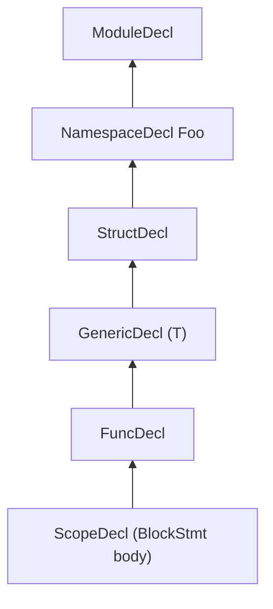

# Scopes

This document describes the `Scope` data structure that drives Slang's
name resolution, the AST node kinds that introduce a new scope, and how
the parser threads scopes through the AST as it builds it. The
intended reader is a developer modifying scope construction, adding a
new scope-bearing AST node, or trying to understand why a given
identifier is in scope at a particular source location.

For the lookup algorithm itself, see [lookup.md](lookup.md). For
visibility filtering, see [visibility.md](visibility.md). For how the
overall pipeline gets here, see
[../pipeline/02-parse-ast.md](../pipeline/02-parse-ast.md).

## Source

Scopes are declared in
[slang-ast-base.h](../../../../source/slang/slang-ast-base.h). The
`Decl` subclasses that own scopes are declared in
[slang-ast-decl.h](../../../../source/slang/slang-ast-decl.h), and the
`Stmt` subclasses that own scopes are declared in
[slang-ast-stmt.h](../../../../source/slang/slang-ast-stmt.h). Scope
construction during parsing happens in
[slang-parser.cpp](../../../../source/slang/slang-parser.cpp); the
`addSiblingScopeForContainerDecl` helper used by semantic-checking and
session/module setup code is declared at line 1249 of
[slang-ast-decl.h](../../../../source/slang/slang-ast-decl.h) and defined
in [slang-check-expr.cpp](../../../../source/slang/slang-check-expr.cpp).

## Concepts

- `Scope` (lines 112-128 of
  [slang-ast-base.h](../../../../source/slang/slang-ast-base.h)) — a
  three-field record:
  - `ContainerDecl* containerDecl` (line 121) — the decl whose members
    are the contents of this scope.
  - `Scope* parent` (line 124) — the next scope to consult when a name
    is not found in `containerDecl`.
  - `Scope* nextSibling` (line 127) — the next scope to consult at the
    *same* level before falling through to `parent` (see "Sibling
    scopes" below). The comment in the header notes that `containerDecl`
    is deliberately an unowned pointer so a `Scope` cannot keep an AST
    node alive.
- `ContainerDecl` (abstract, declared in
  [slang-ast-decl.h](../../../../source/slang/slang-ast-decl.h)) — the
  `Decl` subclass that has child decls. Every `ContainerDecl` carries
  an `ownedScope` field whose `containerDecl` points back to the owning
  decl. This is the canonical way an AST node "owns" a scope.
- `ScopeDecl` (line 641 of
  [slang-ast-decl.h](../../../../source/slang/slang-ast-decl.h)) — a
  synthetic `ContainerDecl` used to attach a scope to a statement.
  `ScopeDecl` instances do not appear in the surface syntax; they are
  created by the parser for any statement that introduces a local
  scope.
- `ScopeStmt` (abstract, lines 16-21 of
  [slang-ast-stmt.h](../../../../source/slang/slang-ast-stmt.h)) — the
  abstract base of statements that own a scope. It carries a single
  `ScopeDecl* scopeDecl` field; the actual `Scope*` is
  `scopeDecl->ownedScope`.
- `BlockStmt` (line 41 of
  [slang-ast-stmt.h](../../../../source/slang/slang-ast-stmt.h)) — the
  concrete `{ ... }` block; the most common `ScopeStmt`.

## Rules

### Scope-bearing AST nodes

The nodes listed below either own a `Scope` directly (a `ContainerDecl`
via `ownedScope`) or declare a `ScopeStmt::scopeDecl` field. The
"How the scope is attached" column distinguishes a node that *always*
gets a fresh scope from one whose `scopeDecl` field is only populated on
some parser paths — see the notes after the table and the edge-case
section for the statements where the parser does not push a fresh scope.
Citations point at the concrete class in the header.

| Node kind | Header | How the scope is attached |
| --- | --- | --- |
| `ModuleDecl` | [slang-ast-decl.h](../../../../source/slang/slang-ast-decl.h) (line 865) | `ContainerDecl::ownedScope` |
| `NamespaceDecl` | [slang-ast-decl.h](../../../../source/slang/slang-ast-decl.h) (line 850) | `ContainerDecl::ownedScope`, which is the most recent scope the parser pushed for the namespace; every scope pushed for it is also recorded in `NamespaceDecl::lexicalScopes` (line 859) |
| `FileDecl` | [slang-ast-decl.h](../../../../source/slang/slang-ast-decl.h) (line 912) | `ContainerDecl::ownedScope` |
| `AggTypeDecl` and its subclasses `StructDecl`, `ClassDecl`, `InterfaceDecl`, `EnumDecl`, `HLSLClassDecl`, `SynthesizedStructDecl`, `GLSLInterfaceBlockDecl`, `AssocTypeDecl`, `GlobalGenericParamDecl`, `ThisTypeDecl` | [slang-ast-decl.h](../../../../source/slang/slang-ast-decl.h) (common base `AggTypeDeclBase` at line 393, plus `HLSLClassDecl` line 465 (a `StructDecl` subclass that inherits `ownedScope`; the parser pushes a fresh scope for it through the shared `ParseStruct` path), `SynthesizedStructDecl` line 471, `GLSLInterfaceBlockDecl` line 485, `ThisTypeDecl` line 529, `AssocTypeDecl` line 618, `GlobalGenericParamDecl` line 626) | `ContainerDecl::ownedScope`; `ThisTypeDecl` is the synthesized member of an `InterfaceDecl` representing the abstract `This` type, reached through `InterfaceDecl::getThisTypeDecl` (line 539), and it is never pushed as a parser scope, so it inherits the `ownedScope` field but the field stays null |
| `ExtensionDecl` | [slang-ast-decl.h](../../../../source/slang/slang-ast-decl.h) (line 400) | `ContainerDecl::ownedScope` |
| `GenericDecl` | [slang-ast-decl.h](../../../../source/slang/slang-ast-decl.h) (line 987) | `ContainerDecl::ownedScope`; the scope contains the generic parameters |
| `CallableDecl` and its subclasses `FuncDecl`, `ConstructorDecl`, `SubscriptDecl`, `AccessorDecl`, `GetterDecl`, `SetterDecl`, `RefAccessorDecl`, `SynthesizedFuncDecl`, `FuncAliasDecl` | [slang-ast-decl.h](../../../../source/slang/slang-ast-decl.h) (line 663 onward; `GetterDecl` line 763, `SetterDecl` line 769, `RefAccessorDecl` line 775, `SynthesizedFuncDecl` line 811; the three accessor kinds are created in `parseAccessorDecl` (`slang-parser.cpp` line 4975), which calls `PushScope` (line 4999), while `SynthesizedFuncDecl` is created by the checker and only inherits the `ownedScope` field; `FuncAliasDecl` line 704) | `ContainerDecl::ownedScope`; the scope contains the parameter decls |
| `PropertyDecl` | [slang-ast-decl.h](../../../../source/slang/slang-ast-decl.h) (line 749) | `ContainerDecl::ownedScope` |
| `SemanticDecl`, `AttributeDecl` | [slang-ast-decl.h](../../../../source/slang/slang-ast-decl.h) (`SemanticDecl` line 783, `AttributeDecl` line 1229; both direct `ContainerDecl` subclasses) | `ContainerDecl::ownedScope` |
| `ScopeDecl` | [slang-ast-decl.h](../../../../source/slang/slang-ast-decl.h) (line 641) | `ContainerDecl::ownedScope`; attached to a `ScopeStmt` |
| `BlockStmt` | [slang-ast-stmt.h](../../../../source/slang/slang-ast-stmt.h) (line 41) | `ScopeStmt::scopeDecl`; when the block has a `{`, `Parser::parseBlockStatement` ([slang-parser.cpp](../../../../source/slang/slang-parser.cpp) line 7523) always pushes a fresh `ScopeDecl` (line 7535); a missing `{` yields an `EmptyStmt` with no scope (lines 7525-7529) |
| `ForStmt`, `UnscopedForStmt` | [slang-ast-stmt.h](../../../../source/slang/slang-ast-stmt.h) (lines 216-231) | `ScopeStmt::scopeDecl`; `Parser::ParseForStatement` ([slang-parser.cpp](../../../../source/slang/slang-parser.cpp) line 7792) assigns `scopeDecl` (line 7817) but only pushes it for the scoped `ForStmt` (line 7819) — the HLSL source language gets an `UnscopedForStmt` that reuses the parent scope (line 7801) |
| `WhileStmt`, `DoWhileStmt` | [slang-ast-stmt.h](../../../../source/slang/slang-ast-stmt.h) (lines 234-247) | declare `ScopeStmt::scopeDecl` (via `LoopStmt` -> `BreakableStmt` -> `ScopeStmt`), but the parser (`ParseWhileStatement`, `ParseDoWhileStatement`) does **not** create or assign a fresh `ScopeDecl`; the loop body owns its own scope only when it is a `BlockStmt` |
| `CompileTimeForStmt` | [slang-ast-stmt.h](../../../../source/slang/slang-ast-stmt.h) (line 251) | `ScopeStmt::scopeDecl`; `parseCompileTimeForStmt` ([slang-parser.cpp](../../../../source/slang/slang-parser.cpp)) assigns it (line 7214) and pushes it with `pushScopeAndSetParent` around the body (lines 7257-7262) |
| `GpuForeachStmt` | [slang-ast-stmt.h](../../../../source/slang/slang-ast-stmt.h) (line 198) | `ScopeStmt::scopeDecl`; `ParseGpuForeachStmt` ([slang-parser.cpp](../../../../source/slang/slang-parser.cpp)) assigns it (line 7094) and pushes it with `pushScopeAndSetParent` (line 7118) |
| `SwitchStmt`, `TargetSwitchStmt`, `StageSwitchStmt` (`BreakableStmt` subclasses) | [slang-ast-stmt.h](../../../../source/slang/slang-ast-stmt.h) (lines 116-154) | declare `ScopeStmt::scopeDecl`, but the parser does not assign it: `ParseSwitchStmt` ([slang-parser.cpp](../../../../source/slang/slang-parser.cpp) line 6928) gives the body a scoped `BlockStmt` (line 6936), and `parseTargetSwitchStmtImpl` (line 6959) creates a per-case `ScopeDecl` rather than one on the statement |
| `CatchStmt` (catch handler) | [slang-ast-stmt.h](../../../../source/slang/slang-ast-stmt.h) (line 306); a fresh `ScopeDecl` is pushed for each handler in `Parser::ParseDoCatchStatement` ([slang-parser.cpp](../../../../source/slang/slang-parser.cpp) lines 7882 and 7887) | indirect, through the surrounding `ScopeDecl` the parser creates |
| `parseIfLetStatement` (synthetic) | [slang-parser.cpp](../../../../source/slang/slang-parser.cpp) (line 7677) | two fresh `ScopeDecl`s are pushed (lines 7680 and 7721): the outer one for the `$OptVar` temporary, and `positiveScopeDecl` for the unwrapped variable, which the parser attaches as `scopeDecl` of a `BlockStmt` that wraps the positive branch (lines 7760-7762) |
| `LambdaExpr` (parameter scope) | the parser creates and pushes `lambdaExpr->paramScopeDecl` in `parseLambdaExpr` ([slang-parser.cpp](../../../../source/slang/slang-parser.cpp) lines 8828-8829); `LambdaDecl` itself ([slang-ast-decl.h](../../../../source/slang/slang-ast-decl.h) line 733) is a `StructDecl` and owns a scope as an aggregate | dedicated `ScopeDecl` for the lambda parameter list, owned by the expression, not by `LambdaDecl` |

Several AST nodes do *not* own a fresh scope even though syntactically
they look like they might:

- `IfStmt` ([slang-ast-stmt.h](../../../../source/slang/slang-ast-stmt.h)
  line 83) does not own a scope; a braced branch parses as a
  `BlockStmt` that owns one, while an unbraced branch is any statement
  (`ParseStatement`, `slang-parser.cpp` lines 7781 and 7785) and
  introduces none. `if (let x = ...)`
  is the exception: `Parser::parseIfLetStatement`
  ([slang-parser.cpp](../../../../source/slang/slang-parser.cpp) line
  7677) synthesizes additional `ScopeDecl`s for the unwrapped
  variable.
- `SeqStmt`, `DeclStmt`, and other `Stmt` subclasses that are not
  `ScopeStmt` simply live inside the enclosing scope.

A declaration used directly as the body of a statement that owns no
scope — `while (c) int x = 1;`, and the same shape under `do` or
`if` — is accepted rather than rejected, and the name leaks:
`Parser::parseVarDeclrStatement`
([slang-parser.cpp](../../../../source/slang/slang-parser.cpp) line
7630) hands the declaration to `currentScope->containerDecl` (line
7635), which is the *enclosing* container when no scope was pushed for
the statement, so `x` stays visible after the loop. Only a `{ ... }`
body isolates it, because only the `BlockStmt` pushes a `ScopeDecl`.

The two switch forms differ in the same way. A plain `switch` gives its
whole body one scoped `BlockStmt` (`ParseSwitchStmt`,
[slang-parser.cpp](../../../../source/slang/slang-parser.cpp) line
6936), so a local declared under one `case` label is still in scope in
textually later cases of the same `switch`, and out of scope after it.
`__target_switch` and `__stage_switch` instead push and pop a
`ScopeDecl` around *each* case group (`parseTargetSwitchStmtImpl`,
lines 6971 and 7050), so a local declared in one case is not
visible from any other case of the same statement.

The scope holding a lambda's parameter list ends with the expression
that introduced it: `parseLambdaExpr`
([slang-parser.cpp](../../../../source/slang/slang-parser.cpp) line
8824) pushes `paramScopeDecl` before the parameter list (line 8829) and
pops it after the body (line 8850), so a parameter is visible
throughout the body — block form or single-expression form — and
undefined once the expression ends.

```slang
// `applyF` is an `IFunc`-constrained helper; `c` is a local of the
// enclosing function.
int r = applyF((int p) => p * c, 5);
int q = p; // error: undefined identifier 'p'
```

### Parser scope construction

The parser carries the current scope pointer as member fields
([slang-parser.cpp](../../../../source/slang/slang-parser.cpp) lines
132-134 at `source_commit`):

- `Parser::currentScope` (line 134) — scope where new decl definitions
  are inserted.
- `Parser::currentLookupScope` (line 133) — scope where in-parser
  expression lookup starts (kept in sync with `currentScope` via
  `resetLookupScope`, line 153).
- `Parser::outerScope` (line 132) — the initial scope at the start of
  parsing.

Four helper methods push and pop scopes
([slang-parser.cpp](../../../../source/slang/slang-parser.cpp) lines
153-196):

- `PushScope(ContainerDecl*)` (line 157) — calls `pushLookupScope`, then
  writes the new scope into `containerDecl->ownedScope`, replacing any
  scope the container owned before.
- `pushLookupScope(ContainerDecl*)` (line 170) — allocates a new `Scope`,
  links its `parent` to `currentScope`, and makes it current, without
  touching `ownedScope`. When the container is a `NamespaceDecl`, it also
  appends the new scope to `NamespaceDecl::lexicalScopes`.
- `PushScope(Scope*)` (line 181) — makes an already-built scope current;
  it is used to restore a saved scope, for example the function scope
  re-entered before parsing a body (`parseFuncDecl` line 5390) or the
  module's existing `ownedScope` in `Parser::parseSourceFile` (line 6674).
- `pushScopeAndSetParent(ContainerDecl*)` (line 187) — assigns
  `containerDecl->parentDecl = currentScope->containerDecl` and then
  calls `PushScope`.
- `PopScope()` (line 193) — restores `currentScope = currentScope->parent`.

Every push and `PopScope` ends by calling `resetLookupScope()`, so
`currentLookupScope` does not drift from `currentScope` across a push or
pop. `Parser::ParseParameter` (line 8034) is the one place that
deliberately sets `currentLookupScope = currentScope->parent` around the
parameter's type parse (lines 8038-8040), and restores it afterwards.

A representative chain that arises in a Slang file is shown below.
Each box is the `ContainerDecl` referenced by a `Scope::containerDecl`,
and arrows point from a child scope to its `parent`.



The same parser-call chain that produces this looks roughly like:
`parseNamespaceDecl` (line 4689) -> `parseDeclBody` (line 6638, for the
namespace body) -> `Parser::ParseStruct` (line 6719) -> `parseDeclBody`
(called at line 6784, for the struct body) -> `parseFuncDecl` (line
5365) -> `parseOptGenericDecl` (line 1864) -> `parseBlockStatement`
(line 7523).
The declaration parsers in that chain call `PushScope`
(`parseDeclBody` line 6640, `parseOptGenericDecl` line 1871,
`parseFuncDecl` lines 5376 and 5390), which creates the `Scope`,
parents it to `currentScope`, and stores it in `ownedScope`; those
declarations get their `parentDecl` from the surrounding construction
path. A `ScopeDecl` introduced by a statement, such as the block in
`parseBlockStatement` (line 7535), instead calls `pushScopeAndSetParent`,
which sets `parentDecl` from the current scope's container before
pushing (line 189). A few declaration parsers also use
`pushScopeAndSetParent`, for example the enum body in the `enum` parser
(line 6911). Every path matches its push with a `PopScope` on the way
out.

### Sibling scopes

`Scope::nextSibling` lets one scope chain consult several containers
at the same nesting level. The constructor is the free function
`addSiblingScopeForContainerDecl`, declared at line 1249 of
[slang-ast-decl.h](../../../../source/slang/slang-ast-decl.h) and defined in
[slang-check-expr.cpp](../../../../source/slang/slang-check-expr.cpp)
(lines 317-324); it takes the destination `Scope*`, allocates a fresh
`Scope`, points it at the secondary `ContainerDecl`, and splices it into
the existing `nextSibling` list of the destination scope directly after
the destination.

Four concrete uses of sibling scopes are visible in the source:

1. **`FileDecl` per source file in a multi-file module.** A module
   that is split across multiple `__include`d files has one
   `ModuleDecl` plus one `FileDecl` per source file. Each `FileDecl`
   is attached to the module's scope as a sibling so that lookup
   inside the module sees the union of all files'
   members — see
   [slang-session.cpp](../../../../source/slang/slang-session.cpp)
   line 2538 and `SemanticsVisitor::importFileDeclIntoScope` in
   [slang-check-decl.cpp](../../../../source/slang/slang-check-decl.cpp)
   line 18654 (called at lines 18836 and 18957).
2. **Imported modules.** When module B imports module A, the
   checker adds A's scope as a sibling of B's scope so that names
   from A are reachable in B without explicit qualification — see
   `SemanticsVisitor::importModuleIntoScope` in
   [slang-check-decl.cpp](../../../../source/slang/slang-check-decl.cpp)
   line 18663. Not every scope already on module A's sibling chain gets
   re-exported into B, though. The loop is filtered by
   `isOwnModuleOrIncludedFileScope` (called at line 18700, defined at
   [slang-check-expr.cpp](../../../../source/slang/slang-check-expr.cpp)
   line 326), which admits only A's own scope and `FileDecl`s whose
   `parentDecl` is A itself. Without that filter, a `using namespace
   Foo;` written in A's primary file, or a module C that A merely
   `import`ed, would arrive on A's `nextSibling` chain and then leak
   into B — making a plain `import` silently transitive. See
   [visibility.md](visibility.md) for the reachability rules this
   upholds.
3. **Reopened and qualified `namespace` declarations.** When the same
   namespace name reappears in the same parent, the parser reuses the
   existing `NamespaceDecl` (`parseNamespaceDecl`,
   [slang-parser.cpp](../../../../source/slang/slang-parser.cpp) line
   4689) so that further declarations are inserted into the same
   container, but each `{ ... }` body still gets its own `Scope`: the
   body is parsed by `parseDeclBody`, whose `PushScope` goes through
   `pushLookupScope` and appends the scope to
   `NamespaceDecl::lexicalScopes`
   ([slang-ast-decl.h](../../../../source/slang/slang-ast-decl.h) line
   859). `ownedScope` is only the most recent of them. For a qualified
   name such as `namespace A.B` or `namespace A::B`, the parser also
   pushes a scope for each earlier component that the body must see:
   `PushScope` for a parent namespace it just created, and
   `pushLookupScope` for one that already existed (lines 4780 and
   4791). The semantic checker links siblings in
   `SemanticsDeclScopeWiringVisitor::visitNamespaceDecl`
   ([slang-check-decl.cpp](../../../../source/slang/slang-check-decl.cpp) line 19024): for every other namespace of the
   same name reachable from the parent's scope chain, it calls
   `addSiblingScopeForContainerDecl` (line 19060) once per entry of
   `decl->lexicalScopes`, so code in each body of a reopened namespace
   finds the other namespace's members.
4. **`using` declarations.** `SemanticsDeclScopeWiringVisitor::visitUsingDecl`
   ([slang-check-decl.cpp](../../../../source/slang/slang-check-decl.cpp)
   line 18960) checks the `using` argument and, for each
   namespace-like (`NamespaceDeclBase`) target it names, runs the local
   lambda `addAllSiblingScopesFromDecl` (line 18983). The lambda walks
   the target's `ownedScope` and its `nextSibling` chain and calls
   `addSiblingScopeForContainerDecl` (line 18990) for each container
   not already on the `using` decl's scope chain, so the namespace's
   members become reachable without qualification.

A three-module shape shows what the filter in use case 2 keeps and what
it drops. Module `C` declares `namespace Foo`; module `A` is

```slang
import C;            // plain import: A does not re-export C
using namespace Foo; // splices Foo onto A's module scope sibling chain
```

and module `B` is `import A;`. `B` sees `A`'s own members and the
members of every file `A` pulls in with `__include`, because those are
the only two shapes `isOwnModuleOrIncludedFileScope` admits. It does
not see `Foo`'s members unqualified — the `using`-spliced
`NamespaceDecl` scope is neither `A` nor a `FileDecl` parented to `A` —
and it does not see `C`, whose scope and whose `FileDecl`s all carry a
`parentDecl` of `C`. Writing `__exported import C;` in `A` is what
makes `C` reachable from `B`: `importModuleIntoScope` recurses into
nested `import`s that carry the `ExportedModifier`
([slang-check-decl.cpp](../../../../source/slang/slang-check-decl.cpp)
lines 18708-18714).

When two scopes on the same sibling chain supply the same name, neither
wins by position. `_lookUpInScopes`
([slang-lookup.cpp](../../../../source/slang/slang-lookup.cpp) line
815) walks every `nextSibling` link (line 836) before it considers
stopping, so a hit in one sibling does not preclude a hit in another
and both declarations land in one `LookupResult`. The one sibling it
skips is a repeated `FileDecl`: it remembers the first `FileDecl` it
encounters (`thisFileDecl`, line 829) and skips any later link that
refers to that same declaration (lines 849-856); this is not a visited
set over every file. Overloadable declarations then
form an overload set that overload resolution ranks; anything else
remains an `OverloadedExpr` whose use site is reported as
`Diagnostics::AmbiguousReference` by
`SemanticsVisitor::diagnoseAmbiguousReference`
([slang-check-expr.cpp](../../../../source/slang/slang-check-expr.cpp)
line 1534). See [lookup.md](lookup.md) for the refinement steps that
run before that point.

### Implicit scopes

A few intermediate scopes have no direct surface-syntax representation
but are still created at parse time:

- **Generic parameter list.** `parseOptGenericDecl`
  ([slang-parser.cpp](../../../../source/slang/slang-parser.cpp) line
  1864) creates a `GenericDecl` and pushes its scope *before* parsing
  the inner decl. The generic parameters live in the `GenericDecl`'s
  scope; the inner decl's own scope is its child.
- **Extension body.** `ExtensionDecl` owns its own scope, but the
  members of the type it extends are *not* in the extension's scope
  chain; they are reached through member lookup at check time.
- **Interface requirement list.** `InterfaceDecl` owns a single scope
  for its requirements; the default-impl bodies parse against a
  derived `InterfaceDefaultImplDecl` ([slang-ast-decl.h line
  1002](../../../../source/slang/slang-ast-decl.h)) that is itself a
  `GenericDecl` subclass and thus has its own scope. An associated
  type's constraint clause does *not* go into the
  `AssocTypeDecl`'s own scope: when `parseAssocType`
  ([slang-parser.cpp](../../../../source/slang/slang-parser.cpp) line
  4551) sees that the current scope's `containerDecl` is an
  `InterfaceDecl`, it sets `constraintTarget` to the *enclosing
  interface* so each `GenericTypeConstraintDecl`
  ([slang-ast-decl.h line 1037](../../../../source/slang/slang-ast-decl.h))
  produced by `associatedtype A : IBar` or `associatedtype A where A : IBar`
  becomes a sibling member of the associated type. The dedicated
  `__constraint` keyword (`parseInterfaceConstraintDecl`,
  [slang-parser.cpp](../../../../source/slang/slang-parser.cpp) line
  4593) inserts a `GenericTypeConstraintDecl` directly into the
  interface scope the same way. All three surface forms therefore land
  in one scope as parallel requirement members.
- **`if (let x = ...)` desugaring.** `parseIfLetStatement`
  ([slang-parser.cpp](../../../../source/slang/slang-parser.cpp) line
  7677) creates `ScopeDecl`s for the temporary `$OptVar` binding (line
  7680) and for the user-visible unwrapped variable inside the positive
  branch (line 7721).

### Scope walking order during lookup

Lookup walks the chain in a fixed order, defined by the lookup entry
points (see [lookup.md](lookup.md)):

1. Visit `currentScope` itself: its `containerDecl`'s direct members.
2. Walk `currentScope->nextSibling` until null, repeating step 1 for
   each sibling.
3. Move to `currentScope->parent` and repeat from step 1.
4. Stop when the parent chain reaches `nullptr`, or earlier: once a
   level (a scope plus its siblings) has produced a result that is not
   overloaded and not of an overloadable kind, `_lookUpInScopes` does
   not go on to the parent
   ([slang-lookup.cpp](../../../../source/slang/slang-lookup.cpp) lines
   1015-1027). Completion lookups always continue.

The same `parent`-then-`nextSibling` traversal is reused outside the
main lookup path by `findClosestInScopeName` in
[slang-check-expr.cpp](../../../../source/slang/slang-check-expr.cpp)
(line 5455): when a `VarExpr` fails to resolve, the checker walks the
scope chain (skipping the core module so its thousands of builtins do
not produce spurious matches) looking for a sufficiently close
edit-distance spelling and attaches a "did you mean" suggestion to the
`Diagnostics::UndefinedIdentifier` diagnostic (line 5614).

The detailed lookup algorithm — masks, inheritance walks,
transparent-member injection, deduplication — lives in
[lookup.md](lookup.md). This page only states the order in which scopes
are consulted.

## Edge cases and failure modes

- **Empty block scope.** A `BlockStmt` whose body contains zero
  declarations still has a fresh `ScopeDecl`: the parser pushes one
  unconditionally (line 7535) and gives the empty block an `EmptyStmt`
  ([slang-parser.cpp](../../../../source/slang/slang-parser.cpp) lines
  7611-7614), so the scope exists whether or not anything is declared
  in it. The per-decl `Decl::hiddenFromLookup` flag
  ([slang-ast-base.h](../../../../source/slang/slang-ast-base.h) line
  803) is a separate mechanism that only engages for blocks that do
  contain declaration statements: `SemanticsStmtVisitor::visitBlockStmt`
  ([slang-check-stmt.cpp](../../../../source/slang/slang-check-stmt.cpp)
  line 95) sets it on each `DeclStmt` (and each member of a
  `DeclGroup`) of the body's `SeqStmt` (line 129 onward; the flag is
  set at lines 137 and 142). The flag is cleared as the checker walks
  past each `DeclStmt`, in `checkDeclAtDeclarationPoint` (line 75, the
  clear at line 87); the lookup-side check is in
  [slang-lookup.cpp](../../../../source/slang/slang-lookup.cpp) line 178.
- **`UnscopedForStmt`.** When the source language is HLSL,
  `Parser::ParseForStatement`
  ([slang-parser.cpp](../../../../source/slang/slang-parser.cpp) line
  7792) creates an `UnscopedForStmt` and *skips* the
  `pushScopeAndSetParent` call (line 7819), so the `for` loop's initialization
  variable leaks into the surrounding scope as HLSL semantics demand.
- **Multiple `namespace Foo {}` bodies.** `parseNamespaceDecl`
  ([slang-parser.cpp](../../../../source/slang/slang-parser.cpp) line
  4689) reuses the first `NamespaceDecl` it finds in the parent, so
  all subsequent declarations parse into the same `ContainerDecl`, but
  each body has a separate `Scope`. `NamespaceDecl::ownedScope` is the
  most recent one only; `NamespaceDecl::lexicalScopes` lists all of
  them, and `visitNamespaceDecl` attaches the other namespaces of the
  same name to every entry. Lookup still has to walk sibling-linked
  `NamespaceDecl`s across modules; that is what
  `addSiblingScopeForContainerDecl` is for.
- **`GenericDecl` parameter scope vs inner-decl scope.** A reference
  to a generic type parameter `T` inside the inner decl resolves
  through the inner scope's `parent`, which is the `GenericDecl`'s
  scope. A sibling of the outer decl that mentions `T` cannot reach
  it — its scope chain does not pass through the `GenericDecl`.
- **`__constraint` subject must not be `This`.** A
  `GenericTypeConstraintDecl` is only allowed as a child of an
  `InterfaceDecl` (or of a `GenericDecl`); `isDeclAllowed`
  ([slang-parser.cpp](../../../../source/slang/slang-parser.cpp) line
  5638) enforces the placement, and its `StructDecl` / `ClassDecl` /
  `EnumDecl` arm does not list `GenericTypeConstraintDecl`, so

  ```slang
  struct S { __constraint int : IBar; }
  ```

  is rejected with `E30102` (`decl-not-allowed`,
  *"GenericTypeConstraintDecl is not allowed here."*) — note that this
  is the *placement* rule, separate from the subject rule below, which
  applies only once the decl is somewhere it is allowed. When the
  relocated decl lands
  in the interface scope, the header visitor
  `SemanticsDeclHeaderVisitor::visitGenericTypeConstraintDecl`
  ([slang-check-decl.cpp](../../../../source/slang/slang-check-decl.cpp)
  line 4755) further rejects a `__constraint` whose subject resolves to
  the bare `This` type — that is the role of the inheritance clause —
  diagnosing `Diagnostics::ConstraintSubjectCannotBeThisType`
  ([slang-check-decl.cpp](../../../../source/slang/slang-check-decl.cpp)
  line 4773) and replacing the subject with the error type. Constraints
  on associated types (e.g. `This.A : IBar`) are permitted.
- **`ExtensionDecl` members are not in the extension's scope chain.**
  Lookup *into* a type that has an active extension must walk the
  extension's members explicitly; the extension scope is not
  configured as a sibling of the extended type's scope. The relevant
  helper is in [slang-lookup.cpp](../../../../source/slang/slang-lookup.cpp)
  and is documented in [lookup.md](lookup.md).
- **`UsingDecl`.** A `using` declaration ([slang-ast-decl.h line
  919](../../../../source/slang/slang-ast-decl.h)) captures
  `parser->currentScope` at parse time (see `parseUsingDecl` in
  [slang-parser.cpp](../../../../source/slang/slang-parser.cpp) line
  4820). The injection into the surrounding scope happens at check
  time, not at parse time:
  `SemanticsDeclScopeWiringVisitor::visitUsingDecl`
  ([slang-check-decl.cpp](../../../../source/slang/slang-check-decl.cpp)
  line 18960) adds the scopes of each named namespace/module as sibling
  scopes via `addSiblingScopeForContainerDecl`. If the argument does not resolve
  to any namespace-like entity, no sibling is added and the checker
  diagnoses `Diagnostics::ExpectedANamespace`
  ([slang-check-decl.cpp](../../../../source/slang/slang-check-decl.cpp)
  line 19019). The destination is always the scope captured at parse
  time — `parseUsingDecl` stores `parser->currentScope` in `decl->scope`
  ([slang-parser.cpp](../../../../source/slang/slang-parser.cpp) line
  4829) and checking passes that same pointer unchanged — so what
  checking changes is that scope's `nextSibling` chain, not the scope
  the names land in.
- **`UnparsedStmt` and deferred body parsing.** The parser has two
  stages, `ParsingStage::Decl` and `ParsingStage::Body`
  ([slang-parser.cpp](../../../../source/slang/slang-parser.cpp) lines
  85-89, field at line 108); `parseSourceFile` runs the `Decl` stage
  (line 10397) and `parseUnparsedStmt` the `Body` stage (line 10368).
  `parseOptBody` (line 2297) does not read the stage: when a declaration
  body starts with `{`, it records the body as an `UnparsedStmt` (created
  at line 2324) holding the tokens, and that `UnparsedStmt` captures both
  `currentScope` and `outerScope` (lines 2325-2326;
  [slang-ast-stmt.h](../../../../source/slang/slang-ast-stmt.h) lines
  53-61). The checker later calls `SemanticsVisitor::maybeParseStmt`
  ([slang-check-decl.cpp](../../../../source/slang/slang-check-decl.cpp)
  line 15606), which passes the two captured pointers to
  `parseUnparsedStmt` ([slang-parser.cpp](../../../../source/slang/slang-parser.cpp)
  line 10357); that function sets `currentScope` and `currentLookupScope`
  to the captured `currentScope` (line 10381) and calls
  `parseBlockStatement`, so a deferred body resolves names against the
  scope chain that was live at its declaration site rather than wherever
  the deferred parse happens to be driven from. This is why the captured
  scopes must be stored on the statement instead of being recomputed.
  The stage also matters to local declarations: in the `Body` stage with
  a semantics visitor present, parsed local decls are marked
  `DeclCheckState::ReadyForParserLookup` so parser-time lookup can find
  them (line 6161).
- **Synthesized constraint decls in an interface scope.** Besides the
  three parsed forms above, `FuncConstraintDecl`
  ([slang-ast-decl.h](../../../../source/slang/slang-ast-decl.h) line
  1095) — a `GenericTypeConstraintDecl` subclass — also lands in an
  interface or generic scope as a requirement member, but it is
  created by `SemanticsDeclHeaderVisitor::synthesizeDifferentiabilityRequirements`
  ([slang-check-decl.cpp](../../../../source/slang/slang-check-decl.cpp)
  lines 16160 and 16513) during header checking, so it has no parser path and no
  scope of its own.
- **Empty parser scope.** Pushing a `Scope` whose `containerDecl`
  is null is not supported. `Parser::PushScope` requires the
  `ContainerDecl*` overload to allocate one; the bare-`Scope*`
  overload (line 181) exists only for restoring a pre-built scope.

## See also

- [lookup.md](lookup.md) — the lookup algorithm that walks the
  scope chain.
- [visibility.md](visibility.md) — the visibility filter that runs
  on top of lookup.
- [overload-resolution.md](overload-resolution.md) — overload
  ranking that consumes filtered lookup results.
- [../ast-reference/base.md](../ast-reference/base.md) — the
  reference for `NodeBase`, `Decl`, `Scope`, and other base types.
- [../ast-reference/declarations.md](../ast-reference/declarations.md)
  — per-class reference for every `Decl` subclass.
- [../ast-reference/statements.md](../ast-reference/statements.md)
  — per-class reference for every `Stmt` subclass.
- [../pipeline/02-parse-ast.md](../pipeline/02-parse-ast.md) — the
  parsing-stage overview that drives scope construction.
- [../glossary.md](../glossary.md) — glossary entries for
  `scope`, `decl-ref`, `lookup result`, `name resolution`.
