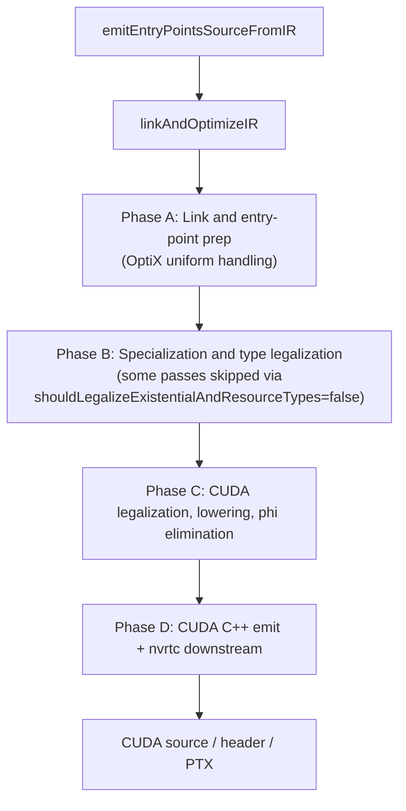
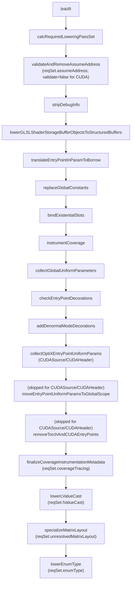
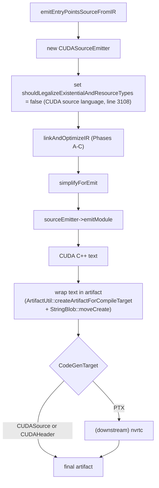

# CUDA Target Pipeline

This page documents the ordered IR-pass and downstream-binary
sequence executed when Slang compiles for the CUDA target family.
It is written for compiler developers who need to locate the CUDA
pass order, the gate that selects a given pass, and the OptiX
handling within it.
The corresponding `CodeGenTarget` values are `CUDASource`,
`CUDAHeader`, and `PTX` — spelled `-target cuda` (or `cu`),
`-target cuh`, and `-target ptx` on the `slangc` command line
([slang-type-text-util.cpp line 82-84](../../../../source/core/slang-type-text-util.cpp)).
A final `PTX` request does **not** drive
`linkAndOptimizeIR` or the emit pipeline with `CodeGenTarget::PTX`
directly: `emitWithDownstreamForEntryPoints` first maps `PTX` to
its source target via `_getDefaultSourceForTarget`, which returns
`CodeGenTarget::CUDASource`
([slang-code-gen.cpp line 268-269](../../../../source/slang/slang-code-gen.cpp)),
then runs `emitEntryPointsSource` on a `CodeGenContext` built with
that `CUDASource` target
([slang-code-gen.cpp line 534-538](../../../../source/slang/slang-code-gen.cpp)).
The whole IR pipeline described below therefore sees
`CUDASource`, and the resulting CUDA C++ source is handed to nvrtc
(or the runtime CUDA compiler) for PTX generation as a separate
downstream step. `CUDAHeader` has no such mapping: it keeps its own
target value through `emitEntryPointsSource`
([slang-code-gen.cpp line 1270-1285](../../../../source/slang/slang-code-gen.cpp)),
which explains the `CUDAHeader`-only differences below. The only
switch arm that names `PTX` is `synthesizeActiveMask` (line 2356),
unreachable under the ordinary downstream path. All three targets
share most of the IR pipeline via `isCUDATarget(targetRequest)`.

This page complements
[../pipeline/05-ir-passes.md](../pipeline/05-ir-passes.md), which
is an unordered topical catalog of every IR pass. The pass sequence
below is **not** an unconditional list: a large and growing number
of the backend passes are gated on flags in the
`RequiredLoweringPassSet` predicate computed by
`calcRequiredLoweringPassSet` (line 409 of
[slang-emit.cpp](../../../../source/slang/slang-emit.cpp)), so a
pass runs only when the linked IR actually contains the construct
it handles. The `Gate` column of every phase table records which
flag, if any, selects each pass; see
[Conditional gates](#conditional-gates) for the consolidated list
and for how the flags are computed. Branches in
`linkAndOptimizeIR` gated on a sibling target (SPIR-V, HLSL,
Metal, WGSL, GLSL, pure CPP / Host) are filtered out of the
diagrams and tables below. CUDA shares a few arms with CPU /
Metal (`undoParameterCopy`, `transformParamsToConstRef`,
`introduceExplicitGlobalContext`, `expandAutodiffParameterContexts`);
those passes are included because they reach CUDA, but the other
targets in those arms are documented on their own pages.

## Source

- [slang-emit.cpp](../../../../source/slang/slang-emit.cpp) —
  `linkAndOptimizeIR` (line 1015) is the orchestrator;
  `calcRequiredLoweringPassSet` (line 409) computes the
  per-module gate predicate it consults;
  `emitEntryPointsSourceFromIR` (line 2968) constructs the
  `CUDASourceEmitter` and emits CUDA C++ text.
- [slang-emit-cuda.cpp](../../../../source/slang/slang-emit-cuda.cpp)
  — `CUDASourceEmitter` implementation.
- [slang-emit-cpp.cpp](../../../../source/slang/slang-emit-cpp.cpp)
  — `CPPSourceEmitter` base class that `CUDASourceEmitter`
  inherits from.
- [slang-emit-c-like.cpp](../../../../source/slang/slang-emit-c-like.cpp)
  — shared C-like emitter base.
- [slang-ir-cuda-immutable-load.cpp](../../../../source/slang/slang-ir-cuda-immutable-load.cpp)
  — `lowerImmutableBufferLoadForCUDA` (line 403).
- [slang-ir-legalize-varying-params.cpp](../../../../source/slang/slang-ir-legalize-varying-params.cpp)
  — `legalizeEntryPointVaryingParamsForCUDA` (line 2794) and
  `legalizeOptiXReportIntersectionsForCUDA` (line 2804).
- [slang-ir-optix-entry-point-uniforms.cpp](../../../../source/slang/slang-ir-optix-entry-point-uniforms.cpp)
  — `collectOptiXEntryPointUniformParams` (line 276).
- [slang-ir-expand-autodiff-parameter-contexts.cpp](../../../../source/slang/slang-ir-expand-autodiff-parameter-contexts.cpp)
  — `expandAutodiffParameterContexts` (line 262).
- [slang-ir-pytorch-cpp-binding.cpp](../../../../source/slang/slang-ir-pytorch-cpp-binding.cpp)
  — `removeTorchAndCUDAEntryPoints`, `removeTorchKernels`,
  `lowerBuiltinTypesForKernelEntryPoints`, `handleAutoBindNames`.
- [slang-ir-synthesize-active-mask.cpp](../../../../source/slang/slang-ir-synthesize-active-mask.cpp)
  — `synthesizeActiveMask`.
- [slang-target-program.h](../../../../source/slang/slang-target-program.h)
  / [slang-compiler-options.h](../../../../source/slang/slang-compiler-options.h)
  — gate sources.

## High-level phase diagram



A defining feature of the CUDA pipeline: at line 3108 of
`slang-emit.cpp`, `emitEntryPointsSourceFromIR` sets
`shouldLegalizeExistentialAndResourceTypes = false` for the CUDA
source language (the `SourceLanguage::CPP`, `C`, and `CUDA` arm),
which causes several Phase-B passes inside `linkAndOptimizeIR` to
take their `else` branches or be skipped.

## Phase A: Link and entry-point prep

Spans lines 1050-1486 of
[slang-emit.cpp](../../../../source/slang/slang-emit.cpp) — from the
`linkIR` call to `lowerEnumType`. CUDA has
two arms it hits in this phase that other shader targets do not:

A final `PTX` request runs this pipeline as `CUDASource` (see the
intro); `CUDAHeader` runs it under its own target value.

- `collectOptiXEntryPointUniformParams` runs at line 1400
  (`case CUDASource: case CUDAHeader:` at lines 1398-1399) instead
  of `collectEntryPointUniformParams`. This handles OptiX's
  Shader Binding Table (SBT) entry-point uniform parameters
  through a CUDA/OptiX-specific scheme.
- `moveEntryPointUniformParamsToGlobalScope` is **skipped** for
  `CUDASource` / `CUDAHeader` (they are in the explicit case list
  at lines 1424-1436 whose only statement is `break`; the pass is
  in the `default` arm of the same switch, at line 1421).

`CUDASource` / `CUDAHeader` are also in the explicit case list for
the `removeTorchAndCUDAEntryPoints` switch (lines 1441-1444) and
thus **skip** that pass too — their entry points are valid CUDA
kernels; the pass itself is at line 1447 in the `default` arm.



| # | Pass | File | Gate | Notes |
| --- | --- | --- | --- | --- |
| 1 | `linkIR` | [slang-ir-link.cpp](../../../../source/slang/slang-ir-link.cpp) | (always) | Plain call at line 1050, not a `SLANG_PASS`. Its result feeds the first `calcRequiredLoweringPassSet` scan at line 1085. |
| 2 | `validateAndRemoveAssumeAddress` | [slang-ir-validate.cpp](../../../../source/slang/slang-ir-validate.cpp) | `reqSet.assumeAddress` (line 1087) | **`validate = false` for CUDA** (line 1088: `!isCPUTarget(targetRequest) && !isCUDATarget(targetRequest)`); contrast with HLSL / Metal / WGSL / SPIR-V which validate. |
| 3 | `stripDebugInfo` | [slang-ir-strip-debug-info.cpp](../../../../source/slang/slang-ir-strip-debug-info.cpp) | `reqSet.debugInfo && DebugInfoLevel::None` (lines 1099-1100) | |
| 4 | `lowerGLSLShaderStorageBufferObjectsToStructuredBuffers` | [slang-ir-lower-glsl-ssbo-types.cpp](../../../../source/slang/slang-ir-lower-glsl-ssbo-types.cpp) | `!isKhronosTarget && reqSet.glslSSBO` | CUDA is non-Khronos. |
| 5 | `translateEntryPointInParamToBorrow` | [slang-ir-transform-params-to-constref.cpp](../../../../source/slang/slang-ir-transform-params-to-constref.cpp) | (always) | |
| 6 | `replaceGlobalConstants` | [slang-ir-link.cpp](../../../../source/slang/slang-ir-link.cpp) | (always) | |
| 7 | `bindExistentialSlots` | [slang-ir-bind-existentials.cpp](../../../../source/slang/slang-ir-bind-existentials.cpp) | `reqSet.bindExistential` | |
| 8 | `instrumentCoverage` | [slang-ir-coverage-instrument.cpp](../../../../source/slang/slang-ir-coverage-instrument.cpp) | `reqSet.coverageTracing` | The coverage buffer is packed into `GlobalParams` for CUDA. The call (line 1351) forwards `counterByteWidth` (default `kDefaultCoverageCounterByteWidth = 8`) and `coverageBoolean` (default off). |
| 9 | `collectGlobalUniformParameters` | [slang-ir-collect-global-uniforms.cpp](../../../../source/slang/slang-ir-collect-global-uniforms.cpp) | (always) | |
| 10 | `checkEntryPointDecorations` | [slang-ir-entry-point-decorations.cpp](../../../../source/slang/slang-ir-entry-point-decorations.cpp) | (always) | |
| 11 | `addDenormalModeDecorations` | [slang-emit.cpp](../../../../source/slang/slang-emit.cpp) | (always) | Line 801. |
| 12 | `collectOptiXEntryPointUniformParams` | [slang-ir-optix-entry-point-uniforms.cpp](../../../../source/slang/slang-ir-optix-entry-point-uniforms.cpp) | `case CUDASource / CUDAHeader` (line 1400) | All CUDA targets (incl. final `PTX`, which runs as `CUDASource`). Replaces `collectEntryPointUniformParams`; `moveEntryPointUniformParamsToGlobalScope` and `removeTorchAndCUDAEntryPoints` are both skipped for these arms. |
| 13 | `finalizeCoverageInstrumentationMetadata` | [slang-ir-coverage-instrument.cpp](../../../../source/slang/slang-ir-coverage-instrument.cpp) | `reqSet.coverageTracing` (line 1453) | **Material on CUDA.** Runs after entry-point uniform packing (where the coverage buffer is folded into `GlobalParams`, the struct `collectGlobalUniformParameters` builds at [slang-ir-collect-global-uniforms.cpp](../../../../source/slang/slang-ir-collect-global-uniforms.cpp) line 145) to fill the `uniformOffset` / `uniformStride` fields of the coverage buffer's synthetic-resource record on the post-emit metadata, which the host runtime reads to bind the buffer at dispatch time. In emitted CUDA the buffer is a field of the `GlobalParams` struct that the emitter passes as `SLANG_globalParams` ([slang-emit-cuda.cpp](../../../../source/slang/slang-emit-cuda.cpp) line 428), mangled as `_slang_coverage_0` rather than the internal `__slang_coverage`; each entry is an atomic add in counting mode or a plain store of `1` under `-trace-coverage-boolean`. CUDA is one of only two targets that *diagnose* a failure here: when `tryGetCoverageUniformBindingInfo` finds no uniform layout and `isCPUTarget \|\| isCUDATarget`, the pass emits `Diagnostics::CoverageUniformLayoutUnavailable` (**`E45105`**, lines 1928-1931 of the pass file). Instrumentation is enabled by `TraceCoverage` / `TraceFunctionCoverage` / `TraceBranchCoverage` (slangc `-trace-coverage`, `-trace-function-coverage`, `-trace-branch-coverage`), read by `CodeGenContext::shouldTraceAnyCoverage` ([slang-code-gen.cpp](../../../../source/slang/slang-code-gen.cpp) line 1425-1431); `reqSet.coverageTracing` is set by the `kIROp_Increment*CoverageCounter` opcodes (slang-emit.cpp lines 614-618). |
| 14 | `lowerLValueCast` | [slang-ir-lower-l-value-cast.cpp](../../../../source/slang/slang-ir-lower-l-value-cast.cpp) | `reqSet.lValueCast` (line 1473) | `kIROp_InOutImplicitCast` / `kIROp_OutImplicitCast` are front-end-only, so the flag cannot be a false negative. |
| 15 | `specializeMatrixLayout` | [slang-ir-specialize-matrix-layout.cpp](../../../../source/slang/slang-ir-specialize-matrix-layout.cpp) | `reqSet.unresolvedMatrixLayout` (line 1479) | Runs before the first `simplifyIR`. The flag is set by a `kIROp_MatrixType` whose layout operand is missing or `SLANG_MATRIX_LAYOUT_MODE_UNKNOWN` (lines 662-671). |
| 16 | `lowerEnumType` | [slang-ir-lower-enum-type.cpp](../../../../source/slang/slang-ir-lower-enum-type.cpp) | `reqSet.enumType` (line 1485) | The flag is also set by `kIROp_CastEnumToInt` / `kIROp_CastIntToEnum` / `kIROp_EnumCast`, so the pass still runs when constant folding removed the last live `IREnumType` but left a cast behind. |

Filtered out for CUDA in this phase: the Host* arm of the
`collectEntryPointUniformParams` switch and the CPP / LLVM arms
(which run it with `alwaysCreateCollectedParam = true`).

## Phase B: Specialization and type legalization

Spans lines 1499-2178 of `slang-emit.cpp` — from the first
`simplifyIR` to `checkStaticAssert`. The second
`calcRequiredLoweringPassSet` scan runs mid-phase at line 1666,
after specialization has resolved generics; the flags it sets are
accumulated on top of the post-link scan rather than replacing
them, so several later gates in this phase and in Phase C read
flags established by either scan. CUDA's divergence from the
SPIR-V / Metal / WGSL / HLSL paths is most visible here:

1. `generateDerivativeWrappers` runs at line 1522 (CUDA /
   CUDAHeader / PyTorch arm at lines 1516-1518) if
   `reqSet.derivativePyBindWrapper`.
2. `lowerCooperativeVectors`: for `CUDASource` it runs **only** if
   the target caps do not imply `optix_coopvec` (line 1860),
   so on OptiX targets with hardware cooperative-vector support
   Slang preserves the IR-level instruction. A final `PTX`
   request runs this switch as `CUDASource` and so takes that
   gated arm. Only `CUDAHeader`, which is not a named case, falls
   through the `default` arm (line 1865) and runs
   `lowerCooperativeVectors` unconditionally.
3. `lowerBuiltinTypesForKernelEntryPoints`, `removeTorchKernels`,
   and `handleAutoBindNames` run for CUDA at lines 1678-1680
   (`case CUDASource: case CUDAHeader:` at lines 1676-1677)..
4. `expandAutodiffParameterContexts` (line 1823) runs for
   `CUDASource` and Metal only, after `lowerTuples`; a final `PTX`
   request runs it as `CUDASource`, while `CUDAHeader` does not
   match the `target == CodeGenTarget::CUDASource` test. See
   [Notable passes](#expandautodiffparametercontexts).
5. `legalizeOptiXReportIntersectionsForCUDA` (line 1904) runs for
   `CUDASource` / `CUDAHeader` after the post-force-inlining
   simplification. See
   [Notable passes](#legalizeoptixreportintersectionsforcuda).
6. `lowerCombinedTextureSamplers` is **skipped** for CUDA. The
   `default` arm of the switch at line 1941 falls through into the
   named HLSL / Metal / WGSL cases only when
   `ArtifactDescUtil::isCpuLikeTarget(artifactDesc)` (line 1944)
   holds, and CUDA is **not** CPU-like: a CUDA source or header
   artifact is `Kind::Source` with payload `CUDA`
   ([slang-artifact-desc-util.cpp](../../../../source/compiler-core/slang-artifact-desc-util.cpp)
   lines 306-309), while for `ArtifactKind::Source` the predicate
   accepts only payload `C` or `Cpp` (line 612). That same predicate
   is why `performTypeInlining` and `checkGetStringHashInsts`
   **do** run for CUDA (rows 42 and 44).
7. The Slang-emit caller (`emitEntryPointsSourceFromIR`) sets
   `options.shouldLegalizeExistentialAndResourceTypes = false`
   for the CUDA source language at line 3108. Inside
   `linkAndOptimizeIR`, the block at lines 1982-2068 is therefore
   skipped, which means:
   - `legalizeRayTracingPayloads` (line 1989) is skipped; its
     comment states that CPU and CUDA need no artificial payload.
   - `legalizeExistentialTypeLayout` is skipped.
   - `legalizeResourceTypes` is skipped.
   - The Metal-only `legalizeEmptyTypes` arm inside the block
     does not apply.
   - The CPU/CUDA fallback `legalizeEmptyTypes` (line 2073,
     `else` arm at line 2069) runs instead.
8. `inlineGlobalConstantsForLegalization` is forced for
   `CUDASource` at lines 1974-1978; only `CUDAHeader` does **not**
   run it (row 58).
9. After empty-type legalization, four passes run for every
   target that reaches this point: `translateGlobalVaryingVar`
   (`reqSet.globalVaryingVar`), `fixEntryPointCallsites`,
   `moveGlobalVarInitializationToEntryPoints`, and
   `legalizeResourceGlobalVars` (lines 2079-2099).
   `moveGlobalVarInitializationToEntryPoints` takes
   `(targetProgram, sink)`; its header states that kernel targets
   other than HLSL move every non-`ActualGlobal` initializer.
10. `wrapStructuredBuffersOfMatrices` and
    `wrapCBufferElementsForMetal` are both **skipped** (HLSL /
    Metal only). `legalizeMatrixTypes` runs in Phase C, after
    `lowerBufferElementTypeToStorageType`.
11. Passes selected by `RequiredLoweringPassSet` flags rather than
    running unconditionally: `finalizeAutoDiffPass`
    (`reqSet.autodiff`, with `stripAutoDiffDecorations` on the
    `else` arm), `lowerSumVectorMatrixInsts`
    (`reqSet.sumVectorMatrix`), `lowerTaggedUnionTypes`
    (`reqSet.taggedUnion`), `lowerUntaggedUnionTypes`
    (`reqSet.untaggedUnion`), `lowerTagInsts` (`reqSet.tagOps`) and
    `lowerTagTypes` (`reqSet.tagType`). See
    [The autodiff gate](#the-autodiff-gate) for why the autodiff
    gate matters most on CUDA.

```mermaid
flowchart TD
  s1[simplifyIR default]
  vu[validateUniformity]
  fSC[fuseCallsToSaturatedCooperation]
  gDW["generateDerivativeWrappers (CUDA arm)"]
  cAP[checkAutodiffPatterns]
  dCC[diagnoseCircularConformances]
  sM[specializeModule]
  sHOP[specializeHigherOrderParameters]
  adGate{reqSet.autodiff}
  fADP[finalizeAutoDiffPass]
  sADD[stripAutoDiffDecorations]
  lMSS[lowerMatrixSwizzleStores]
  dce1[eliminateDeadCode]
  fS[finalizeSpecialization]
  lDTI["lowerDiffTypeInfoInsts<br/>(reqSet.autodiff)"]
  lCT[lowerConditionalType]
  lRO[lowerReinterpretOptional]
  cONU[checkForOptionalNoneUsage]
  lOT[lowerOptionalType]
  lRT[lowerResultType]
  reqSet2[calcRequiredLoweringPassSet]
  lBTK["lowerBuiltinTypesForKernelEntryPoints (CUDA arm)"]
  rTK[removeTorchKernels]
  hABN[handleAutoBindNames]
  dUR[detectUninitializedResources]
  rAIDD[removeAvailableInDownstreamModuleDecorations]
  checks["checkForRecursive* checkForOutOfBoundAccess<br/>checkForMissingReturns checkForInvalidShaderParameterType"]
  iAVS[inferAnyValueSizeWhereNecessary]
  uPWT[unpinWitnessTables]
  lSVMI["lowerSumVectorMatrixInsts<br/>(reqSet.sumVectorMatrix)"]
  minOptGateA{"!minimalOptimization"}
  s2a[simplifyIR fast]
  dceGen["eliminateDeadCode<br/>(else if reqSet.generics)"]
  lTUT["lowerTaggedUnionTypes<br/>(reqSet.taggedUnion)"]
  lUUT["lowerUntaggedUnionTypes<br/>(reqSet.untaggedUnion)"]
  lR["lowerReinterpret<br/>(reqSet.reinterpret)"]
  lSIDC[lowerSequentialIDTagCasts]
  lTI["lowerTagInsts<br/>(reqSet.tagOps)"]
  lTT["lowerTagTypes<br/>(reqSet.tagType)"]
  dce3[eliminateDeadCode]
  lE[lowerExistentials]
  rWUI[removeWeakUseInsts]
  pTIN["performTypeInlining<br/>(!isCpuLikeTarget; CUDA is not CPU-like)"]
  dce4[eliminateDeadCode]
  cGSHI["checkGetStringHashInsts<br/>(!isCpuLikeTarget && shouldRunNonEssentialValidation)"]
  lTu[lowerTuples]
  eAPC["expandAutodiffParameterContexts<br/>(target == CUDASource)"]
  gAVMF[generateAnyValueMarshallingFunctions]
  sSS["specializeStageSwitch<br/>(reqSet.specializeStageSwitch)"]
  lCV["lowerCooperativeVectors<br/>(CUDASource if !optix_coopvec; CUDAHeader always)"]
  pFI1[performForceInlining]
  minOptGate{fastIRSimplificationOptions.minimalOptimization}
  sccp[applySparseConditionalConstantPropagation]
  dce_min[eliminateDeadCode]
  s2b[simplifyIR default]
  tSCP[threadSwitchOnConstantPhi]
  lORI["legalizeOptiXReportIntersectionsForCUDA<br/>(CUDASource/CUDAHeader)"]
  lACSB["lowerAppendConsumeStructuredBuffers<br/>(reqSet.appendConsumeStructuredBuffer)"]
  lCTS["(skipped) lowerCombinedTextureSamplers<br/>default arm breaks: CUDA is not CPU-like"]
  aUTHD["addUserTypeHintDecorations<br/>(VulkanEmitReflection)"]
  lEA[legalizeEmptyArray]
  lVT[legalizeVectorTypes]
  iGC["inlineGlobalConstantsForLegalization<br/>(CUDASource only; lines 1974-1978)"]
  skipRTP["(skipped) legalizeRayTracingPayloads<br/>shouldLegalizeExistentialAndResourceTypes=false"]
  skipETL["(skipped) legalizeExistentialTypeLayout<br/>shouldLegalizeExistentialAndResourceTypes=false"]
  skipRT["(skipped) legalizeResourceTypes<br/>shouldLegalizeExistentialAndResourceTypes=false"]
  lET_cpu["legalizeEmptyTypes<br/>(CPU/CUDA else branch, line 2073)"]
  tGVV["translateGlobalVaryingVar<br/>(reqSet.globalVaryingVar)"]
  fEPC[fixEntryPointCallsites]
  mGVI[moveGlobalVarInitializationToEntryPoints]
  lRGV[legalizeResourceGlobalVars]
  minOptGateB{minimalOptimization}
  s2c[simplifyIR fast]
  dceLegal[eliminateDeadCode]
  lURH["lowerUntypedResourceHandleToUInt<br/>(reqSet.untypedResourceHandle)"]
  lDRH["lowerDynamicResourceHeap<br/>(reqSet.dynamicResourceHeap)"]
  sRU[specializeResourceUsage]
  sFBLA1[specializeFuncsForBufferLoadArgs]
  dBL[deferBufferLoad]
  sAP[specializeArrayParameters]
  cSA[checkStaticAssert]

  s1 --> vu --> fSC --> gDW --> cAP --> dCC --> sM --> sHOP --> adGate
  adGate -->|true| fADP --> lMSS
  adGate -->|false| sADD --> lMSS
  lMSS --> dce1 --> fS --> lDTI --> lCT --> lRO --> cONU --> lOT --> lRT --> reqSet2 --> lBTK --> rTK --> hABN --> dUR --> rAIDD --> checks --> iAVS --> uPWT --> lSVMI --> minOptGateA
  minOptGateA -->|true| s2a --> lTUT
  minOptGateA -->|false| dceGen --> lTUT
  lTUT --> lUUT --> lR --> lSIDC --> lTI --> lTT --> dce3 --> lE --> rWUI --> pTIN --> dce4 --> cGSHI --> lTu --> eAPC --> gAVMF --> sSS --> lCV --> pFI1 --> minOptGate
  minOptGate -->|true| sccp --> dce_min --> tSCP
  minOptGate -->|false| s2b --> tSCP
  tSCP --> lORI --> lACSB --> lCTS --> aUTHD --> lEA --> lVT --> iGC --> skipRTP --> skipETL --> skipRT --> lET_cpu --> tGVV --> fEPC --> mGVI --> lRGV --> minOptGateB
  minOptGateB -->|true| dceLegal --> lURH
  minOptGateB -->|false| s2c --> lURH
  lURH --> lDRH --> sRU --> sFBLA1 --> dBL --> sAP --> cSA
```



(Conditional gates omitted from the diagram for readability;
see the conditional-gates table.) `validateMutableGlobalVariableTypes`
(line 1571, a plain call that fails the compile on error), `lowerDiffTypeInfoInsts`,
the interleaved `eliminateDeadCode` at line 1804, and `checkStaticAssert` are
direct calls, not `SLANG_PASS` invocations.

| # | Pass | File | Gate | Notes |
| --- | --- | --- | --- | --- |
| 1 | `simplifyIR` | [slang-ir-ssa-simplification.cpp](../../../../source/slang/slang-ir-ssa-simplification.cpp) | (always) | Line 1499, `defaultIRSimplificationOptions`. |
| 2 | `validateUniformity` | [slang-ir-uniformity.cpp](../../../../source/slang/slang-ir-uniformity.cpp) | `getBoolOption(ValidateUniformity)` (line 1501) | |
| 3 | `fuseCallsToSaturatedCooperation` | [slang-ir-fuse-satcoop.cpp](../../../../source/slang/slang-ir-fuse-satcoop.cpp) | `!shouldPerformMinimumOptimizations` (line 1511) | |
| 4 | `generateDerivativeWrappers` | [slang-ir-autodiff.cpp](../../../../source/slang/slang-ir-autodiff.cpp) | `reqSet.derivativePyBindWrapper && case CUDASource / CUDAHeader / PyTorchCppBinding` (lines 1516-1521) | **CUDA/PyTorch only.** |
| 5 | `checkAutodiffPatterns` | [slang-ir-check-differentiability.cpp](../../../../source/slang/slang-ir-check-differentiability.cpp) | `reqSet.autodiff` (line 1529) | |
| 6 | `diagnoseCircularConformances` | [slang-ir-any-value-inference.cpp](../../../../source/slang/slang-ir-any-value-inference.cpp) | (always) | |
| 7 | `specializeModule` | [slang-ir-specialize.cpp](../../../../source/slang/slang-ir-specialize.cpp) | `!isSpecializationDisabled()` (line 1556) | |
| 8 | `specializeHigherOrderParameters` | [slang-ir-defunctionalization.cpp](../../../../source/slang/slang-ir-defunctionalization.cpp) | `reqSet.higherOrderFunc` | |
| 9a | `finalizeAutoDiffPass` | [slang-ir-autodiff.cpp](../../../../source/slang/slang-ir-autodiff.cpp) | `reqSet.autodiff` (line 1592) | Runs `processPairTypes`, `removeDetachInsts`, and `removeTypeAnnotations`; skipped entirely for modules with no autodiff IR. |
| 9b | `stripAutoDiffDecorations` | [slang-ir-autodiff.cpp](../../../../source/slang/slang-ir-autodiff.cpp) | `!reqSet.autodiff` (`else` arm, line 1598) | Runs *instead of* row 9a. Removes the `Export` / `HLSLExport` / `KeepAlive` pins on the linked-in `[__AutoDiffBuiltin]` core-module types so row 11's DCE can drop them. |
| 10 | `lowerMatrixSwizzleStores` | [slang-ir-lower-matrix-swizzle-store.cpp](../../../../source/slang/slang-ir-lower-matrix-swizzle-store.cpp) | `reqSet.matrixSwizzleStore` | |
| 11 | `eliminateDeadCode` | [slang-ir-dce.cpp](../../../../source/slang/slang-ir-dce.cpp) | (always) | |
| 12 | `finalizeSpecialization` | [slang-ir-specialize.cpp](../../../../source/slang/slang-ir-specialize.cpp) | (always) | |
| 13 | `lowerDiffTypeInfoInsts` | [slang-ir-autodiff.cpp](../../../../source/slang/slang-ir-autodiff.cpp) | `reqSet.autodiff` (line 1611) | Direct call at line 1612, not a `SLANG_PASS`; same flag as row 9a. |
| 14 | `lowerConditionalType` | [slang-ir-lower-conditional-type.cpp](../../../../source/slang/slang-ir-lower-conditional-type.cpp) | `reqSet.conditionalType` | |
| 15 | `lowerReinterpretOptional` | [slang-ir-lower-reinterpret.cpp](../../../../source/slang/slang-ir-lower-reinterpret.cpp) | `reqSet.optionalType` | |
| 16 | `checkForOptionalNoneUsage` | [slang-ir-check-optional-none-usage.cpp](../../../../source/slang/slang-ir-check-optional-none-usage.cpp) | `shouldRunNonEssentialValidation()` | |
| 17 | `lowerOptionalType` | [slang-ir-lower-optional-type.cpp](../../../../source/slang/slang-ir-lower-optional-type.cpp) | `reqSet.optionalType` | |
| 18 | `lowerResultType` | [slang-ir-lower-result-type.cpp](../../../../source/slang/slang-ir-lower-result-type.cpp) | `reqSet.resultType` | Runs **after** `lowerOptionalType`: depends on accurate `getAnyValueSize()` results, which requires Optional lowering first. |
| 19 | `lowerBuiltinTypesForKernelEntryPoints` | [slang-ir-pytorch-cpp-binding.cpp](../../../../source/slang/slang-ir-pytorch-cpp-binding.cpp) | `case CUDASource / CUDAHeader` (line 1678) | **CUDA-arm + PyTorch arm.** Strips Slang shader types from kernel signatures. |
| 20 | `removeTorchKernels` | [slang-ir-pytorch-cpp-binding.cpp](../../../../source/slang/slang-ir-pytorch-cpp-binding.cpp) | `case CUDASource / CUDAHeader` (line 1679) | Removes any PyTorch entry points still present. |
| 21 | `handleAutoBindNames` | [slang-ir-pytorch-cpp-binding.cpp](../../../../source/slang/slang-ir-pytorch-cpp-binding.cpp) | `case CUDASource / CUDAHeader` (line 1680) | |
| 22 | `detectUninitializedResources` | [slang-ir-detect-uninitialized-resources.cpp](../../../../source/slang/slang-ir-detect-uninitialized-resources.cpp) | (always) | |
| 23 | `removeAvailableInDownstreamModuleDecorations` | [slang-ir-redundancy-removal.cpp](../../../../source/slang/slang-ir-redundancy-removal.cpp) | `removeAvailableInDownstreamIR` | |
| 24 | `checkForRecursiveTypes` | [slang-ir-check-recursion.cpp](../../../../source/slang/slang-ir-check-recursion.cpp) | `shouldRunNonEssentialValidation()` | |
| 25 | `checkForRecursiveFunctions` | [slang-ir-check-recursion.cpp](../../../../source/slang/slang-ir-check-recursion.cpp) | `shouldRunNonEssentialValidation()` | |
| 26 | `checkForOutOfBoundAccess` | [slang-check-out-of-bound-access.cpp](../../../../source/slang/slang-check-out-of-bound-access.cpp) | `shouldRunNonEssentialValidation()` | |
| 27 | `checkForMissingReturns` | [slang-ir-missing-return.cpp](../../../../source/slang/slang-ir-missing-return.cpp) | `shouldRunNonEssentialValidation() && reqSet.missingReturn` (lines 1693, 1699) | Called with `SLANG_LANGUAGE_VERSION_UNKNOWN` as the language-version argument. |
| 28 | `checkForInvalidShaderParameterType` | [slang-ir-check-shader-parameter-type.cpp](../../../../source/slang/slang-ir-check-shader-parameter-type.cpp) | `shouldRunNonEssentialValidation()` | |
| 29 | `inferAnyValueSizeWhereNecessary` | [slang-ir-any-value-inference.cpp](../../../../source/slang/slang-ir-any-value-inference.cpp) | (always) | |
| 30 | `unpinWitnessTables` | [slang-ir-strip-legalization-insts.cpp](../../../../source/slang/slang-ir-strip-legalization-insts.cpp) | (always) | |
| 31 | `lowerSumVectorMatrixInsts` | [slang-emit.cpp](../../../../source/slang/slang-emit.cpp) | `reqSet.sumVectorMatrix` (line 1737) | Defined in `slang-emit.cpp` (line 924). `kIROp_SumVectorElements` / `kIROp_SumMatrixElements` are produced only by the autodiff transpose pass, which runs before the line-1666 scan. |
| 32a | `simplifyIR` | [slang-ir-ssa-simplification.cpp](../../../../source/slang/slang-ir-ssa-simplification.cpp) | `!fastIRSimplificationOptions.minimalOptimization` (line 1740) | `minimalOptimization` comes from `CompilerOptionName::MinimumSlangOptimization`, read through `CompilerOptionSet::shouldPerformMinimumOptimizations()` ([slang-compiler-options.h](../../../../source/slang/slang-compiler-options.h) line 386) and copied onto `fastIRSimplificationOptions` at lines 1493-1494; the `slangc` spelling is `-minimum-slang-optimization`. The same flag selects rows 32b, 51a-51c, 64a/64b, and Phase C row 24. |
| 32b | `eliminateDeadCode` | [slang-ir-dce.cpp](../../../../source/slang/slang-ir-dce.cpp) | `else if (requiredLoweringPassSet.generics)` (line 1744) | Runs *instead of* row 32a in minimal-optimization mode, and only when the module had generics to specialize; otherwise neither row runs. |
| 33 | `lowerTaggedUnionTypes` | [slang-ir-lower-dynamic-dispatch-insts.cpp](../../../../source/slang/slang-ir-lower-dynamic-dispatch-insts.cpp) | `reqSet.taggedUnion` (line 1757) | When it returns `true` it sets `reqSet.reinterpret`, which selects row 35; skipping the pass therefore also leaves `reinterpret` untouched. |
| 34 | `lowerUntaggedUnionTypes` | [slang-ir-lower-dynamic-dispatch-insts.cpp](../../../../source/slang/slang-ir-lower-dynamic-dispatch-insts.cpp) | `reqSet.untaggedUnion` (line 1763) | |
| 35 | `lowerReinterpret` | [slang-ir-lower-reinterpret.cpp](../../../../source/slang/slang-ir-lower-reinterpret.cpp) | `reqSet.reinterpret` | |
| 36 | `lowerSequentialIDTagCasts` | [slang-ir-lower-dynamic-dispatch-insts.cpp](../../../../source/slang/slang-ir-lower-dynamic-dispatch-insts.cpp) | (always) | |
| 37 | `lowerTagInsts` | [slang-ir-lower-dynamic-dispatch-insts.cpp](../../../../source/slang/slang-ir-lower-dynamic-dispatch-insts.cpp) | `reqSet.tagOps` (line 1770) | |
| 38 | `lowerTagTypes` | [slang-ir-lower-dynamic-dispatch-insts.cpp](../../../../source/slang/slang-ir-lower-dynamic-dispatch-insts.cpp) | `reqSet.tagType` (line 1772) | |
| 39 | `eliminateDeadCode` | [slang-ir-dce.cpp](../../../../source/slang/slang-ir-dce.cpp) | (always) | |
| 40 | `lowerExistentials` | [slang-ir-lower-dynamic-dispatch-insts.cpp](../../../../source/slang/slang-ir-lower-dynamic-dispatch-insts.cpp) | (always) | |
| 41 | `removeWeakUseInsts` | [slang-ir-redundancy-removal.cpp](../../../../source/slang/slang-ir-redundancy-removal.cpp) | (always) | |
| 42 | `performTypeInlining` | [slang-ir-inline.cpp](../../../../source/slang/slang-ir-inline.cpp) | `!ArtifactDescUtil::isCpuLikeTarget(artifactDesc)` (line 1790) | **Runs for CUDA.** A CUDA source/header artifact is `Kind::Source` with payload `CUDA`, and the predicate accepts only `C` / `Cpp` for source kinds, so CUDA is not CPU-like. Inlines so that string calls/returns reduce to `getStringHash(stringLiteral)`. |
| 43 | `eliminateDeadCode` | [slang-ir-dce.cpp](../../../../source/slang/slang-ir-dce.cpp) | (always, direct call at line 1804) | |
| 44 | `checkGetStringHashInsts` | [slang-ir-string-hash.cpp](../../../../source/slang/slang-ir-string-hash.cpp) | `!ArtifactDescUtil::isCpuLikeTarget(artifactDesc) && shouldRunNonEssentialValidation()` (lines 1806-1807) | **Runs for CUDA** whenever non-essential validation is enabled; verifies row 42 left every `getStringHash` operand a string literal. |
| 45 | `lowerTuples` | [slang-ir-lower-tuple-types.cpp](../../../../source/slang/slang-ir-lower-tuple-types.cpp) | (always) | |
| 46 | `expandAutodiffParameterContexts` | [slang-ir-expand-autodiff-parameter-contexts.cpp](../../../../source/slang/slang-ir-expand-autodiff-parameter-contexts.cpp) | `target == CodeGenTarget::CUDASource \|\| isMetalTarget(target)` (line 1821) | Exposes captured autodiff parameter contexts as separate arguments of internal derivative functions. Not run for `CUDAHeader`. |
| 47 | `generateAnyValueMarshallingFunctions` | [slang-ir-any-value-marshalling.cpp](../../../../source/slang/slang-ir-any-value-marshalling.cpp) | (always) | |
| 48 | `specializeStageSwitch` | [slang-ir-specialize-stage-switch.cpp](../../../../source/slang/slang-ir-specialize-stage-switch.cpp) | `reqSet.specializeStageSwitch` | |
| 49 | `lowerCooperativeVectors` | [slang-ir-lower-coopvec.cpp](../../../../source/slang/slang-ir-lower-coopvec.cpp) | `case CUDASource && !targetCaps.implies(optix_coopvec)` (lines 1857-1861); **`CUDAHeader` runs it unconditionally via the `default` arm (line 1865)** | For `CUDASource` (and final `PTX`, which runs as `CUDASource`) it fires only when OptiX hardware cooperative-vector support is absent; `CUDAHeader` always runs it. |
| 50 | `performForceInlining` | [slang-ir-inline.cpp](../../../../source/slang/slang-ir-inline.cpp) | (always) | |
| 51a | `applySparseConditionalConstantPropagation` | [slang-ir-sccp.cpp](../../../../source/slang/slang-ir-sccp.cpp) | `fastIRSimplificationOptions.minimalOptimization` (line 1875) | Minimal-optimization arm (call at line 1882): cleans up dead branches revealed by force-inlining so dead `static_assert`s do not falsely fire. |
| 51b | `eliminateDeadCode` | [slang-ir-dce.cpp](../../../../source/slang/slang-ir-dce.cpp) | `fastIRSimplificationOptions.minimalOptimization` (line 1887) | Paired with row 51a. |
| 51c | `simplifyIR` | [slang-ir-ssa-simplification.cpp](../../../../source/slang/slang-ir-ssa-simplification.cpp) | `!fastIRSimplificationOptions.minimalOptimization` (else arm, line 1891) | The alternative to rows 51a/51b. |
| 52 | `threadSwitchOnConstantPhi` | [slang-ir-thread-switch-on-constant-phi.cpp](../../../../source/slang/slang-ir-thread-switch-on-constant-phi.cpp) | (always) | Line 1900, outside the optimization-level branch, so it runs at every optimization level. |
| 53 | `legalizeOptiXReportIntersectionsForCUDA` | [slang-ir-legalize-varying-params.cpp](../../../../source/slang/slang-ir-legalize-varying-params.cpp) | `target == CUDASource \|\| target == CUDAHeader` (line 1902) | Flattens the `ReportHit` attribute aggregate into scalar OptiX attribute registers; see [Notable passes](#legalizeoptixreportintersectionsforcuda). |
| 54 | `lowerAppendConsumeStructuredBuffers` | [slang-ir-lower-append-consume-structured-buffer.cpp](../../../../source/slang/slang-ir-lower-append-consume-structured-buffer.cpp) | `target != HLSL && reqSet.appendConsumeStructuredBuffer` (line 1936) | `HLSLAppendStructuredBuffer` / `HLSLConsumeStructuredBuffer` are front-end-only types, so the flag cannot be a false negative. |
| - | *(skip)* `lowerCombinedTextureSamplers` | [slang-ir-lower-combined-texture-sampler.cpp](../../../../source/slang/slang-ir-lower-combined-texture-sampler.cpp) | `default` arm of the switch at line 1941 breaks unless `isCpuLikeTarget(artifactDesc)` (line 1944) | Never reached on CUDA: the named cases are HLSL / Metal* / WGSL, and CUDA is not CPU-like, so the `reqSet.combinedTextureSamplers` test at line 1952 is not evaluated. |
| 55 | `addUserTypeHintDecorations` | [slang-ir-user-type-hint.cpp](../../../../source/slang/slang-ir-user-type-hint.cpp) | `getBoolOption(CompilerOptionName::VulkanEmitReflection)` (line 1957) | No CUDA-excluding gate: runs for CUDA whenever `VulkanEmitReflection` is set. |
| 56 | `legalizeEmptyArray` | [slang-ir-legalize-empty-array.cpp](../../../../source/slang/slang-ir-legalize-empty-array.cpp) | (always) | |
| 57 | `legalizeVectorTypes` | [slang-ir-legalize-vector-types.cpp](../../../../source/slang/slang-ir-legalize-vector-types.cpp) | (always) | |
| 58 | `inlineGlobalConstantsForLegalization` | [slang-ir-legalize-global-values.cpp](../../../../source/slang/slang-ir-legalize-global-values.cpp) | `target == CUDASource \|\| (isCPUTarget && isKernelTarget) \|\| shouldLegalizeExistentialAndResourceTypes` (lines 1974-1976) | **Forced for `CUDASource`** (and final `PTX`, which runs as `CUDASource`) to avoid dynamic `__device__` initialization (rejected by nvrtc); `CUDAHeader` skips it because `shouldLegalizeExistentialAndResourceTypes` is `false` for CUDA. |
| - | *(skip)* `legalizeRayTracingPayloads` | [slang-ir-ray-tracing-legalize.cpp](../../../../source/slang/slang-ir-ray-tracing-legalize.cpp) | `shouldLegalizeExistentialAndResourceTypes = false` | Call at line 1989 sits inside the skipped block. |
| - | *(skip)* `legalizeExistentialTypeLayout` | [slang-ir-legalize-types.cpp](../../../../source/slang/slang-ir-legalize-types.cpp) | `shouldLegalizeExistentialAndResourceTypes = false` | CUDA's C++ template system handles existentials. |
| - | *(skip)* `legalizeResourceTypes` | [slang-ir-legalize-types.cpp](../../../../source/slang/slang-ir-legalize-types.cpp) | `shouldLegalizeExistentialAndResourceTypes = false` | CUDA's resource handles are direct CUDA types. |
| 59 | `legalizeEmptyTypes` | [slang-ir-legalize-types.cpp](../../../../source/slang/slang-ir-legalize-types.cpp) | `!shouldLegalizeExistentialAndResourceTypes` (else branch at line 2069) | Eliminates empty types not part of the public interface. |
| 60 | `translateGlobalVaryingVar` | [slang-ir-translate-global-varying-var.cpp](../../../../source/slang/slang-ir-translate-global-varying-var.cpp) | `reqSet.globalVaryingVar` (line 2078) | Runs before entry-point cloning so the ordinary clone contains the same input setup. |
| 61 | `fixEntryPointCallsites` | [slang-ir-fix-entrypoint-callsite.cpp](../../../../source/slang/slang-ir-fix-entrypoint-callsite.cpp) | (always) | Line 2085; separates launch functions from ordinary callees before initializers are injected, which also lets later CUDA active-mask synthesis distinguish a launch from a call in divergent control flow. |
| 62 | `moveGlobalVarInitializationToEntryPoints` | [slang-ir-explicit-global-init.cpp](../../../../source/slang/slang-ir-explicit-global-init.cpp) | (always) | Line 2091, `(targetProgram, sink)`; followed by an error-count check that returns `SLANG_FAIL`. |
| 63 | `legalizeResourceGlobalVars` | [slang-ir-legalize-resource-globals.cpp](../../../../source/slang/slang-ir-legalize-resource-globals.cpp) | (always) | Line 2099; replaces selected mutable resource globals with locals and generated parameters; followed by an error-count check. |
| 64a | `eliminateDeadCode` | [slang-ir-dce.cpp](../../../../source/slang/slang-ir-dce.cpp) | `fastIRSimplificationOptions.minimalOptimization` (line 2132) | Minimal-optimization arm; the mutually exclusive alternative to row 64b. |
| 64b | `simplifyIR` | [slang-ir-ssa-simplification.cpp](../../../../source/slang/slang-ir-ssa-simplification.cpp) | `else` arm of the same test (line 2135) | Cleans up temporaries created by specialization and type legalization. |
| 65 | `lowerUntypedResourceHandleToUInt` | [slang-ir-lower-dynamic-resource-heap.cpp](../../../../source/slang/slang-ir-lower-dynamic-resource-heap.cpp) | `reqSet.untypedResourceHandle` (line 2143) | Ensures no untyped `ResourceDescriptorHeap[i]` / `SamplerDescriptorHeap[j]` handle survives to emit; lowers any the peephole did not already collapse to its `uint` index. |
| 66 | `lowerDynamicResourceHeap` | [slang-ir-lower-dynamic-resource-heap.cpp](../../../../source/slang/slang-ir-lower-dynamic-resource-heap.cpp) | `reqSet.dynamicResourceHeap` (line 2146) | |
| 67 | `specializeResourceUsage` | [slang-ir-specialize-resources.cpp](../../../../source/slang/slang-ir-specialize-resources.cpp) | (always) | |
| 68 | `specializeFuncsForBufferLoadArgs` | [slang-ir-specialize-buffer-load-arg.cpp](../../../../source/slang/slang-ir-specialize-buffer-load-arg.cpp) | (always) | |
| 69 | `deferBufferLoad` | [slang-ir-defer-buffer-load.cpp](../../../../source/slang/slang-ir-defer-buffer-load.cpp) | (always) | |
| 70 | `specializeArrayParameters` | [slang-ir-specialize-arrays.cpp](../../../../source/slang/slang-ir-specialize-arrays.cpp) | (always) | |
| 71 | `checkStaticAssert` | [slang-emit.cpp](../../../../source/slang/slang-emit.cpp) | (always) | Direct call (line 2178), not `SLANG_PASS`. Processes `static_assert` after specialization, when the information it needs is available. |

Filtered out for CUDA in this phase: `legalizeNonVectorCompositeSelect`
(HLSL), the CPP / HostCPP COM and DLL arm, the PyTorch-only arm
(`generateHostFunctionsForAutoBindCuda`, `generatePyTorchCppBinding`),
the HostVM early return (line 1832), `wrapStructuredBuffersOfMatrices`
(HLSL), `wrapCBufferElementsForMetal` and the Metal buffer-lowering
and `legalizeEmptyTypes` arms, `validateBarrierFlagsForHLSL`, and the
CPU-LLVM `lowerBufferElementTypeToStorageType` invocation.

## Phase C: CUDA legalization, lowering, phi elimination

Spans lines 2209-2961 of `slang-emit.cpp` — from the
`reqSet.byteAddressBuffer` gate to `checkUnsupportedInst`. CUDA has
**no single legalization driver** function; the target-specific
work is concentrated in three passes: `synthesizeActiveMask`
(line 2358), `legalizeEntryPointVaryingParamsForCUDA` (line
2442), and `lowerImmutableBufferLoadForCUDA` (call site at line 2726). CUDA
shares Phase-C arms with CPU and Metal at several places:
`undoParameterCopy` (line 2524) falling through to
`introduceExplicitGlobalContext` (line 2530), and
`transformParamsToConstRef` (line 2684).

```mermaid
flowchart TD
  babbGate{reqSet.byteAddressBuffer}
  lBABOps_cuda["legalizeByteAddressBufferOps<br/>(default options for CUDA)"]
  vAO[validateAtomicOperations]
  sAM[synthesizeActiveMask]
  rTF["(skipped) resolveTextureFormat<br/>GLSL/SPIRV/WGSL only"]
  rvirGate{reqSet.resolveVaryingInputRef}
  rvir[resolveVaryingInputRef]
  lEPVPCUDA[legalizeEntryPointVaryingParamsForCUDA]
  fNRI[floatNonUniformResourceIndex]
  lLAO_skip["(skipped) legalizeLogicalAndOr<br/>CUDA not in any arm"]
  lISub_skip["(skipped) legalizeImageSubscript<br/>Metal/GLSL/SPIRV only"]
  uPC[undoParameterCopy]
  iEGC[introduceExplicitGlobalContext]
  sLOI[stripLegalizationOnlyInstructions]
  vVAM[validateVectorsAndMatrices]
  dce7[eliminateDeadCode]
  pLRC["processLateRequireCapabilityInsts<br/>(reqSet.lateRequireCapability)"]
  cUV[cleanUpVoidType]
  bqGate{reqSet.bindingQuery}
  lBQ[lowerBindingQueries]
  meshGate{reqSet.meshOutput}
  lMO[legalizeMeshOutputTypes]
  bcGate{reqSet.bitcast}
  lBC[lowerBitCast]
  lUBL_skip["(skipped) legalizeUniformBufferLoad<br/>Khronos/HLSL only"]
  lBETST_def["lowerBufferElementTypeToStorageType<br/>(Default policy)"]
  lMT[legalizeMatrixTypes]
  tPCRef[transformParamsToConstRef]
  lART[legalizeArrayReturnType]
  lIBLCUDA[lowerImmutableBufferLoadForCUDA]
  pFI2[performForceInlining]
  eMB[eliminateMultiLevelBreak]
  s2d["simplifyIR with removeTrivialSingleIterationLoops<br/>(!minimalOptimization)"]
  lET2[legalizeEmptyTypes]
  cUV2[cleanUpVoidType]
  livenessStartGate{shouldTrackLiveness}
  lStart["LivenessUtil::addVariableRangeStarts"]
  ePhi["eliminatePhis (default options)"]
  livenessEndGate{shouldTrackLiveness}
  lEnd["LivenessUtil::addRangeEnds"]
  sNSIR[simplifyNonSSAIR]
  aVSC[applyVariableScopeCorrection]
  cCM[collectCooperativeMetadata]
  uNEI[unexportNonEmbeddableIR]
  cM[collectMetadata]
  cURL[checkUnsupportedResourceLocals]
  cUI[checkUnsupportedInst]

  babbGate -->|true| lBABOps_cuda --> vAO
  babbGate -->|false| vAO
  vAO --> sAM --> rTF --> rvirGate
  rvirGate -->|true| rvir --> lEPVPCUDA
  rvirGate -->|false| lEPVPCUDA
  lEPVPCUDA --> fNRI --> lLAO_skip --> lISub_skip --> uPC --> iEGC --> sLOI --> vVAM --> dce7 --> pLRC --> cUV --> bqGate
  bqGate -->|true| lBQ --> meshGate
  bqGate -->|false| meshGate
  meshGate -->|true| lMO --> bcGate
  meshGate -->|false| bcGate
  bcGate -->|true| lBC --> lUBL_skip
  bcGate -->|false| lUBL_skip
  lUBL_skip --> lBETST_def --> lMT --> tPCRef --> lART --> lIBLCUDA --> pFI2 --> eMB --> s2d --> lET2 --> cUV2 --> livenessStartGate
  livenessStartGate -->|true| lStart --> ePhi
  livenessStartGate -->|false| ePhi
  ePhi --> livenessEndGate
  livenessEndGate -->|true| lEnd --> sNSIR
  livenessEndGate -->|false| sNSIR
  sNSIR --> aVSC --> cCM --> uNEI --> cM --> cURL --> cUI
```



| # | Pass | File | Gate | Notes |
| --- | --- | --- | --- | --- |
| 1 | `legalizeByteAddressBufferOps` | [slang-ir-byte-address-legalize.cpp](../../../../source/slang/slang-ir-byte-address-legalize.cpp) | `reqSet.byteAddressBuffer` (line 2209) | CUDA uses **default** options (CUDA is in the `default` arm of both byte-address-buffer switches, at lines 2218 and 2294). The flag is set by `kIROp_ByteAddressBufferLoad` / `Store` and, through the `IRByteAddressBufferTypeBase` check (line 446), by any byte-address buffer type. |
| 2 | `validateAtomicOperations` | [slang-ir-validate.cpp](../../../../source/slang/slang-ir-validate.cpp) | `target != SPIRV && target != SPIRVAssembly` (line 2342) | `skipFuncParamValidation = true`. |
| 3 | `synthesizeActiveMask` | [slang-ir-synthesize-active-mask.cpp](../../../../source/slang/slang-ir-synthesize-active-mask.cpp) | `case CUDASource / CUDAHeader / PTX` (cases at lines 2354-2356, pass at line 2358) | **CUDA-only.** Replaces implicit active-mask references with an explicit warp-mask parameter. |
| 4 | `resolveVaryingInputRef` | [slang-ir-resolve-varying-input-ref.cpp](../../../../source/slang/slang-ir-resolve-varying-input-ref.cpp) | `reqSet.resolveVaryingInputRef` (line 2382) | Runs after `specializeResourceUsage`, so interpolation operations inlined into an entry point are resolved while varying parameters still have their original address representation. |
| 5 | `legalizeEntryPointVaryingParamsForCUDA` | [slang-ir-legalize-varying-params.cpp](../../../../source/slang/slang-ir-legalize-varying-params.cpp) | `case CUDASource / CUDAHeader` (cases at lines 2439-2440, pass at line 2442) | **CUDA-only.** Also performs the OptiX terminate-inlining step described under [Notable passes](#legalizeentrypointvaryingparamsforcuda). |
| 6 | `floatNonUniformResourceIndex` | [slang-ir-float-non-uniform-resource-index.cpp](../../../../source/slang/slang-ir-float-non-uniform-resource-index.cpp) | `!isSPIRV(target)` (line 2460; true for CUDA) | Runs for every non-SPIR-V target with `NonUniformResourceIndexFloatMode::Textual`, before the narrower four-way `legalizeLogicalAndOr` gate. |
| 7 | `undoParameterCopy` | [slang-ir-undo-param-copy.cpp](../../../../source/slang/slang-ir-undo-param-copy.cpp) | (CPU / CUDA / Metal arm; cases at lines 2517-2521, pass at line 2524) | Removes explicit `inout` copy-in / copy-out wrappers in favor of pass-by-pointer. |
| 8 | `introduceExplicitGlobalContext` | [slang-ir-explicit-global-context.cpp](../../../../source/slang/slang-ir-explicit-global-context.cpp) | (same arm, reached by `[[fallthrough]]` from row 7; line 2530) | `target = CUDASource / CUDAHeader`. |
| 9 | `stripLegalizationOnlyInstructions` | [slang-ir-strip-legalization-insts.cpp](../../../../source/slang/slang-ir-strip-legalization-insts.cpp) | (always) | |
| 10 | `validateVectorsAndMatrices` | [slang-ir-validate.cpp](../../../../source/slang/slang-ir-validate.cpp) | (always) | |
| 11 | `eliminateDeadCode` | [slang-ir-dce.cpp](../../../../source/slang/slang-ir-dce.cpp) | (always) | |
| 12 | `processLateRequireCapabilityInsts` | [slang-ir-late-require-capability.cpp](../../../../source/slang/slang-ir-late-require-capability.cpp) | `reqSet.lateRequireCapability` (line 2592) | Gated on the presence of `kIROp_LateRequireCapability`; with no such inst the pass is a pure no-op and no diagnostic is lost. |
| 13 | `cleanUpVoidType` | [slang-ir-cleanup-void.cpp](../../../../source/slang/slang-ir-cleanup-void.cpp) | (always) | First invocation (line 2595); the second is row 26. |
| 14 | `lowerBindingQueries` | [slang-ir-lower-binding-query.cpp](../../../../source/slang/slang-ir-lower-binding-query.cpp) | `reqSet.bindingQuery` | |
| 15 | `legalizeMeshOutputTypes` | [slang-ir-legalize-mesh-outputs.cpp](../../../../source/slang/slang-ir-legalize-mesh-outputs.cpp) | `reqSet.meshOutput` | Rare for CUDA. |
| 16 | `lowerBitCast` | [slang-ir-lower-bit-cast.cpp](../../../../source/slang/slang-ir-lower-bit-cast.cpp) | `reqSet.bitcast` | |
| 17 | `lowerBufferElementTypeToStorageType` | [slang-ir-lower-buffer-element-type.cpp](../../../../source/slang/slang-ir-lower-buffer-element-type.cpp) | (always; pass at line 2648) | `loweringPolicyKind = Default` for CUDA. The policy is selected by a four-way branch at lines 2636-2647: `WGSL` (WGPU), `KhronosTarget`, `Metal` (when `isMetalTarget`), else `Default`. CUDA matches none of the named branches and falls through to `Default`. |
| 18 | `legalizeMatrixTypes` | [slang-ir-legalize-matrix-types.cpp](../../../../source/slang/slang-ir-legalize-matrix-types.cpp) | (always) | Line 2674. Shared-pipeline ordering (runs after row 17 so int/uint/bool matrices are still matrices when buffer element types are lowered); CUDA is not in `targetLegalizesMatrixTypes`, so no CUDA matrix is rewritten here. |
| 19 | `transformParamsToConstRef` | [slang-ir-transform-params-to-constref.cpp](../../../../source/slang/slang-ir-transform-params-to-constref.cpp) | `(isCPUTarget && !isCPUTargetViaLLVM) \|\| isCUDATarget \|\| isMetalTarget` (lines 2682-2683) | Struct and array parameters to const-ref for performance; runs after row 18 because the pass does not transform matrix parameters. |
| 20 | `legalizeArrayReturnType` | [slang-ir-legalize-array-return-type.cpp](../../../../source/slang/slang-ir-legalize-array-return-type.cpp) | `!isMetalTarget && !isSPIRV` (line 2690; true for CUDA) | Runs after row 18 because a function returning an int/uint/bool matrix returns an array once the matrix is lowered (shared ordering; no matrix is lowered on CUDA). |
| 21 | `lowerImmutableBufferLoadForCUDA` | [slang-ir-cuda-immutable-load.cpp](../../../../source/slang/slang-ir-cuda-immutable-load.cpp) | `isCUDATarget(targetRequest)` (line 2724, pass at line 2726) | **CUDA-only.** Translates eligible immutable global-memory loads to `__ldg`; direct fields of the emitted `__constant__` global parameter group are excluded. |
| 22 | `performForceInlining` | [slang-ir-inline.cpp](../../../../source/slang/slang-ir-inline.cpp) | (always) | |
| 23 | `eliminateMultiLevelBreak` | [slang-ir-eliminate-multilevel-break.cpp](../../../../source/slang/slang-ir-eliminate-multilevel-break.cpp) | (always) | |
| 24 | `simplifyIR` | [slang-ir-ssa-simplification.cpp](../../../../source/slang/slang-ir-ssa-simplification.cpp) | `!minimalOptimization` (line 2738) | With `removeTrivialSingleIterationLoops = true`. |
| 25 | `legalizeEmptyTypes` | [slang-ir-legalize-types.cpp](../../../../source/slang/slang-ir-legalize-types.cpp) | (always; line 2754) | Second invocation (the first ran in Phase B's else branch). |
| 26 | `cleanUpVoidType` | [slang-ir-cleanup-void.cpp](../../../../source/slang/slang-ir-cleanup-void.cpp) | (always; line 2760) | Second invocation: empty-type legalization can introduce new void placeholders that the earlier cleanup (row 13) did not see. |
| 27 | `LivenessUtil::addVariableRangeStarts` | [slang-ir-liveness.cpp](../../../../source/slang/slang-ir-liveness.cpp) | `codeGenContext->shouldTrackLiveness()` (via `isEnabled(livenessMode)`, line 2782) | Inserts `IRLiveRangeStart` markers (line 2784) immediately before `eliminatePhis` (line 2794). |
| 28 | `eliminatePhis` | [slang-ir-eliminate-phis.cpp](../../../../source/slang/slang-ir-eliminate-phis.cpp) | (always) | **Default options.** |
| 29 | `LivenessUtil::addRangeEnds` | [slang-ir-liveness.cpp](../../../../source/slang/slang-ir-liveness.cpp) | `codeGenContext->shouldTrackLiveness()` | Inserts `IRLiveRangeEnd` markers (line 2800) after phi elimination. |
| 30 | `simplifyNonSSAIR` | [slang-ir-ssa-simplification.cpp](../../../../source/slang/slang-ir-ssa-simplification.cpp) | (always) | Line 2839. |
| 31 | `applyVariableScopeCorrection` | [slang-ir-variable-scope-correction.cpp](../../../../source/slang/slang-ir-variable-scope-correction.cpp) | `target != SPIRV && target != SPIRVAssembly` (line 2914; true for CUDA) | |
| 32 | `collectCooperativeMetadata` | [slang-ir-metadata.cpp](../../../../source/slang/slang-ir-metadata.cpp) | `targetCaps implies cooperative_matrix or cooperative_vector` (lines 2930-2934) | OptiX cooperative-vector capability fires this. |
| 33 | `unexportNonEmbeddableIR` | [slang-emit.cpp](../../../../source/slang/slang-emit.cpp) | `EmbedDownstreamIR` (line 2940) | Static helper (line 753). |
| 34 | `collectMetadata` | [slang-ir-metadata.cpp](../../../../source/slang/slang-ir-metadata.cpp) | (always) | Called as `collectMetadata(targetProgram, *metadata)` (line 2955) so metadata collection can consult the layout. When the target caps imply `descriptor_handle` (and `target != PyTorchCppBinding`), the preceding block (lines 2945-2954) forces `targetProgram->getOrCreateLayout(sink)` first; an ordinary CUDA target skips that step. |
| 35 | `checkUnsupportedResourceLocals` | [slang-ir-check-unsupported-inst.cpp](../../../../source/slang/slang-ir-check-unsupported-inst.cpp) | (always) | Line 2959. Its header documents that it diagnoses only compiled D3D and Metal output, so it has no effect on CUDA. |
| 36 | `checkUnsupportedInst` | [slang-ir-check-unsupported-inst.cpp](../../../../source/slang/slang-ir-check-unsupported-inst.cpp) | `!shouldPerformMinimumOptimizations()` (line 2960) | |

Filtered out for CUDA in this phase: the CPU-LLVM
`lowerCPUResourceTypes`; the GLSL / SPIR-V / WGSL / Metal / CPU
entry-point legalizers (`resolveTextureFormat`,
`legalizeEntryPointsForGLSL`, `legalizeIRForMetal`,
`legalizeIRForWGSL`, `legalizeEntryPointVaryingParamsForCPU`);
`legalizeLogicalAndOr` (only the four-way D3D / Khronos / WGPU /
Metal arm at lines 2465-2467 — CUDA is none of those, even though
the preceding `floatNonUniformResourceIndex` at line 2462 does fire
for CUDA); `legalizeDynamicResourcesForGLSL`,
`legalizeImageSubscript`, `legalizeConstantBufferLoadForGLSL`,
`legalizeDispatchMeshPayloadForGLSL`,
`performGLSLResourceReturnFunctionInlining`,
`legalizeModesOfNonCopyableOpaqueTypedParamsForGLSL`,
`applyGLSLLiveness`, `lowerCopyLogical` (Khronos / GLSL);
`convertEntryPointPtrParamsToRawPtrs` (CPP only);
`removeRawDefaultConstructors` (SPIR-V direct emit / CPU LLVM);
`legalizeUniformBufferLoad`, `invertYOfPositionOutput`,
`rcpWOfPositionInput` (Khronos / HLSL only);
`specializeAddressSpace*` (GLSL / Metal / WGSL arms);
`specializeFuncsForBufferLoadArgs` second invocation and
`performIntrinsicFunctionInlining` (SPIR-V direct emit only);
`replaceLocationIntrinsicsWithRaytracingObject` (SPIR-V only); the
Metal pointer-lowering block (lines 2870-2906).

## Phase D: CUDA emit and downstream tools

Phase D begins immediately after `linkAndOptimizeIR` returns. The
emitter dispatched here is `CUDASourceEmitter` (constructed at
line 3063 of `slang-emit.cpp`), which inherits from
`CPPSourceEmitter` ([slang-emit-cpp.cpp](../../../../source/slang/slang-emit-cpp.cpp))
because CUDA source is a superset of C++. The emitter walks the
IR and writes CUDA C++ text. For `PTX`, the downstream chain
hands the text to nvrtc (the NVIDIA runtime compiler) or the
runtime CUDA compiler to produce PTX assembly.

Because the CUDA emitter is a thin specialization of the C++
emitter, two behaviors CUDA inherits from `CPPSourceEmitter` are
worth knowing when reading emitted CUDA:

- **Multi-component swizzle bases are never folded.**
  `CPPSourceEmitter::shouldFoldInstIntoUseSites` returns `false`
  for any value used as the base of an `IRSwizzle` with more than
  one element. C++/CUDA has no native `.xyz` read form, so the
  `kIROp_Swizzle` handler builds the result element by element
  (`float3{ base.x, base.y, base.z }`); folding the base would
  textually duplicate a texture fetch or buffer load once per
  component. This brings CUDA to parity with SPIR-V's single
  `OpVectorShuffle` and HLSL's native swizzle.
- **`precise` is dropped with a warning.**
  `CPPSourceEmitter::emitTempModifiers` finds any
  `IRPreciseDecoration` on a temporary and diagnoses
  `PreciseQualifierUnsupportedOnTarget`
  ([slang-diagnostics.lua](../../../../source/slang/slang-diagnostics.lua)),
  because C/C++ — and therefore CUDA — has no `precise` keyword.
  The diagnostic is a **warning**, `E56005` (`'precise' qualifier
  is not supported on target 'cuda'`): `emitTempModifiers`
  diagnoses and returns without writing anything
  ([slang-emit-cpp.cpp](../../../../source/slang/slang-emit-cpp.cpp)
  line 1305-1314), so the qualifier is dropped, the temporary and
  its value are still emitted, and the compile continues.
  Only the HLSL and GLSL C-like emitters emit the qualifier.

`CUDASourceEmitter` also overrides `emitFrontMatterImpl`
([slang-emit-cuda.cpp](../../../../source/slang/slang-emit-cuda.cpp)):
when the floating-point mode is `FloatingPointMode::Fast` it writes
`#define SLANG_CUDA_ENABLE_FAST_MATH 1` before the prelude, which
gates the prelude's transcendental wrappers. For
`kIROp_ReportOptiXIntersection` it emits
`optixReportIntersection(tHit, hitKind, a0..aN)`, wrapping each
float attribute leaf in `__float_as_uint`.



| # | Pass | File | Gate | Notes |
| --- | --- | --- | --- | --- |
| 1 | `emitEntryPointsSourceFromIR` | [slang-emit.cpp](../../../../source/slang/slang-emit.cpp) | (entry point) | Defined at line 2968; sets `shouldLegalizeExistentialAndResourceTypes = false` for the CUDA source language at line 3108. |
| 2 | `new CUDASourceEmitter` | [slang-emit-cuda.cpp](../../../../source/slang/slang-emit-cuda.cpp) | `case SourceLanguage::CUDA` (line 3061) | Constructed at line 3063. |
| 3 | `sourceEmitter->init` | [slang-emit-c-like.cpp](../../../../source/slang/slang-emit-c-like.cpp) | (always) | Line 3092. |
| 4 | `linkAndOptimizeIR` | [slang-emit.cpp](../../../../source/slang/slang-emit.cpp) | (always) | Runs Phases A-C (line 3112). |
| 5 | `simplifyForEmit` | [slang-ir-simplify-for-emit.cpp](../../../../source/slang/slang-ir-simplify-for-emit.cpp) | (always) | Line 3117, immediately after `linkAndOptimizeIR` returns. |
| 6 | `sourceEmitter->emitModule` | [slang-emit-cuda.cpp](../../../../source/slang/slang-emit-cuda.cpp) (overriding `slang-emit-cpp.cpp` and `slang-emit-c-like.cpp`) | (always) | Line 3126. Walks IR and writes CUDA C++ text; the call is bracketed by an error-count comparison that returns `SLANG_FAIL` if emit added errors. |
| 7 | wrap text in artifact (`ArtifactUtil::createArtifactForCompileTarget` + `StringBlob::moveCreate`) | [slang-emit.cpp](../../../../source/slang/slang-emit.cpp) | (always) | Inside `emitEntryPointsSourceFromIR` (lines 3197-3198): wraps the emitted CUDA C++ text directly as an `IArtifact`. Not the SPIR-V-only `createArtifactFromIR` helper. |
| 8 | `compile` (nvrtc) | (downstream) | `target == PTX` | Downstream-compile path invokes nvrtc to translate the CUDA C++ source into PTX assembly. |

The `CUDASource` and `CUDAHeader` targets stop at the text
artifact; only `PTX` invokes nvrtc.

## Adjacent targets

Targets adjacent to CUDA that share some code paths but have
their own emit arms and are **out of scope** for this page:

- **`PyTorchCppBinding`** — shares the
  `generateDerivativeWrappers` arm at line 1522 and runs its own
  cluster of passes
  (`generateHostFunctionsForAutoBindCuda`,
  `lowerBuiltinTypesForKernelEntryPoints`,
  `generatePyTorchCppBinding`,
  `handleAutoBindNames`) in Phase B at lines 1670-1675
  (`removeTorchKernels` is **not** in the PyTorch arm; it runs only
  in the `CUDASource` / `CUDAHeader` arm). Emit arm
  is `TorchCppSourceEmitter` ([slang-emit-torch.cpp](../../../../source/slang/slang-emit-torch.cpp)),
  selected at [slang-emit.cpp line
  3081](../../../../source/slang/slang-emit.cpp); it extends the
  C-like emitter family with the `TorchCppBinding` artifact style.
  It is also the only emitter that consumes `kIROp_CudaKernelLaunch`
  — produced by `IRBuilder::emitCudaKernelLaunch` from
  [slang-ir-pytorch-cpp-binding.cpp](../../../../source/slang/slang-ir-pytorch-cpp-binding.cpp)
  line 468 — which it writes as a `cudaLaunchKernel` call. The CUDA
  emitter never sees that opcode; its own kernel-launch syntax
  (`fn<<<a, b>>>(args)`) comes from `kIROp_DispatchKernel`
  in [slang-emit-cuda.cpp](../../../../source/slang/slang-emit-cuda.cpp)
  line 1483. Two things produce that opcode: the
  `__dispatch_kernel` expression keyword — the kernel function and
  two launch sizes in parentheses, then the call argument list
  (see [../ast-reference/expressions.md](../ast-reference/expressions.md))
  — and `generateCUDAWrapperForFunc` (line 1020), which emits one
  into the host wrapper it generates for each `[AutoPyBindCUDA]`
  kernel (line 1095). On the PyTorch arm neither survives to text:
  `generateCppBindingForFunc` rewrites every `IRDispatchKernel`
  into `kIROp_CudaKernelLaunch` before emit (lines 446-468), so
  `-target torch` emits `AT_CUDA_CHECK(cudaLaunchKernel(...))` and
  no `<<<`.

  On the `CUDASource` / `CUDAHeader` arm it does survive. A
  hand-written `__dispatch_kernel` in an ordinary
  `[shader("compute")]` entry point is not a `[TorchEntryPoint]`,
  so `removeTorchKernels` never sees it, and `-target cuda` emits
  the launch verbatim:

  ```
  myKernel_0<<<make_uint3 (1U, 1U, 1U), make_uint3 (32U, 1U, 1U)>>>()
  ```

  Note the operand order. The surface is
  `__dispatch_kernel(fn, dispatchSize, threadGroupSize)`
  ([slang-parser.cpp](../../../../source/slang/slang-parser.cpp)
  lines 3365-3379), the `IRDispatchKernel` operands are
  `baseFn, threadGroupSize, dispatchSize`
  ([slang-ir-insts.lua](../../../../source/slang/slang-ir-insts.lua)
  line 2893), and the emitter writes `threadGroupSize` first and
  `dispatchSize` second between the `<<<` and `>>>` — so the call
  above was written with `dispatchSize` of `uint3(32,1,1)` and
  `threadGroupSize` of `uint3(1,1,1)`.
- **OptiX** — OptiX never has its own `CodeGenTarget` value: it
  runs through `CUDASource` / `CUDAHeader` / `PTX` and is selected
  by *stage*, not by a target switch. The `raytracing` capability
  alias is `GL_EXT_ray_tracing | _sm_6_3 | cuda`
  ([slang-capabilities.capdef](../../../../source/slang/slang-capabilities.capdef)
  line 1365) — `cuda` is one of its arms, so a ray-tracing entry
  point is available on this target family without any extra
  opt-in. Only two `optix_`-prefixed atoms exist, and both are
  feature gates rather than pipeline selectors: `optix_coopvec`
  (line 260, implies `_cuda_sm_9_0`), which suppresses
  `lowerCooperativeVectors` in Phase B, and
  `optix_multilevel_traversal` (line 262). The behavioural
  divergences are `collectOptiXEntryPointUniformParams` in Phase A,
  `legalizeOptiXReportIntersectionsForCUDA` in Phase B, and the
  payload handling inside
  `legalizeEntryPointVaryingParamsForCUDA` in Phase C. Note the
  stage coverage is narrower than other targets': CUDA/OptiX
  supports `anyhit` and `intersection` but not `closesthit` for
  the ray-object accessors (capdef lines 2714-2718). See
  [../cross-cutting/targets.md#profiles](../cross-cutting/targets.md#profiles)
  for how profiles and `-capability` combine to produce these
  atoms.
- **`CPPSource` / `CPPHeader`** — emit the same C-like text but
  hit the explicit case list at lines 1653-1655 in Phase B
  (`lowerComInterfaces`, `generateDllImportFuncs`,
  `generateDllExportFuncs`) and the
  `case CPPSource / CPPHeader / ShaderLLVMIR / ShaderObjectCode /
  ShaderHostCallable` arm in the
  entry-point-uniform switch (lines 1404-1409) with
  `alwaysCreateCollectedParam = true`. Emit arm is
  `CPPSourceEmitter`.
- **`HostVM`** — early-returns from `linkAndOptimizeIR` at line
  1840 after a final `performForceInlining` + `cleanUpVoidType` +
  `simplifyIR`. No Phase C or D in this page's sense.
- **CPU/LLVM and host-object targets** (`HostLLVMIR`,
  `ShaderLLVMIR`, `ShaderObjectCode`, `ShaderHostCallable`, and
  related) — go through the CPU/LLVM downstream path, sharing the
  `isCPUTargetViaLLVM` buffer-lowering invocation (line 2107) and
  `lowerCPUResourceTypes` (line 2337).

These adjacent targets are not drawn in the CUDA diagrams above.

## Conditional gates

`RequiredLoweringPassSet` is a plain struct of `bool`s declared at
line 52 of
[slang-code-gen.h](../../../../source/slang/slang-code-gen.h) and
owned by the `CodeGenContext`
(`getRequiredLoweringPassSet`). It is populated by
`calcRequiredLoweringPassSet` (line 409 of
[slang-emit.cpp](../../../../source/slang/slang-emit.cpp)), which
walks every instruction in the linked module and sets a flag when
it sees an opcode that a given pass exists to handle. It runs twice
inside `linkAndOptimizeIR`: once immediately after `linkIR` (line
1085) and once after specialization (line 1666). The struct is
reset to `{}` before the first scan (line 1084) and the flags
**accumulate** across the two scans — the second scan does not
reset the struct — so a construct seen by either scan keeps its
pass enabled.

The correctness argument each gate relies on is that no pass
between the last scan and the gated call site can synthesize the
opcode in question; a gate can therefore be stale-*true* (the
construct was dead-code-eliminated after a scan, making the pass a
no-op walk) but never stale-*false*. The in-source comments at each
gated call site spell out the specific producer for that flag.

| Gate | Passes it controls |
| --- | --- |
| `assumeAddress` | `validateAndRemoveAssumeAddress` (Phase A); `validate` is `false` for CUDA. |
| `debugInfo` | `stripDebugInfo` (Phase A) with `DebugInfoLevel::None`. |
| `glslSSBO` | `lowerGLSLShaderStorageBufferObjectsToStructuredBuffers`. |
| `globalVaryingVar` | `translateGlobalVaryingVar` (Phase B). |
| `resolveVaryingInputRef` | `resolveVaryingInputRef` (Phase C). |
| `bindExistential` | `bindExistentialSlots`. |
| `coverageTracing` | `instrumentCoverage` and `finalizeCoverageInstrumentationMetadata` (Phase A). |
| `enumType` | `lowerEnumType`. Also set by `kIROp_CastEnumToInt` / `kIROp_CastIntToEnum` / `kIROp_EnumCast`, not only by `kIROp_EnumType`. |
| `unresolvedMatrixLayout` | `specializeMatrixLayout` (Phase A). |
| `autodiff` | `checkAutodiffPatterns`, `finalizeAutoDiffPass` (with `stripAutoDiffDecorations` on the `else` arm), and `lowerDiffTypeInfoInsts`. See [The autodiff gate](#the-autodiff-gate). |
| `lValueCast` | `lowerLValueCast` (Phase A). |
| `sumVectorMatrix` | `lowerSumVectorMatrixInsts` (Phase B). |
| `taggedUnion` | `lowerTaggedUnionTypes` (Phase B), and transitively `reinterpret`. |
| `untaggedUnion` | `lowerUntaggedUnionTypes` (Phase B); also set by every tagged-union opcode. |
| `tagOps` | `lowerTagInsts` (Phase B). |
| `tagType` | `lowerTagTypes` (Phase B). |
| `appendConsumeStructuredBuffer` | `lowerAppendConsumeStructuredBuffers` (Phase B), in conjunction with `target != HLSL`. |
| `untypedResourceHandle` | `lowerUntypedResourceHandleToUInt` (Phase B). |
| `lateRequireCapability` | `processLateRequireCapabilityInsts` (Phase C). |
| `higherOrderFunc` | `specializeHigherOrderParameters`. |
| `generics` | The post-`lowerSumVectorMatrixInsts` `eliminateDeadCode` (Phase B, line 1744), which only runs on the minimal-optimization arm. |
| `matrixSwizzleStore` | `lowerMatrixSwizzleStores`. |
| `resultType` | `lowerResultType`. |
| `conditionalType` | `lowerConditionalType`. |
| `optionalType` | `lowerReinterpretOptional`, `lowerOptionalType`. |
| `missingReturn` | `checkForMissingReturns`. |
| `reinterpret` | `lowerReinterpret`. |
| `specializeStageSwitch` | `specializeStageSwitch`. |
| `combinedTextureSamplers` | Nothing on CUDA: `lowerCombinedTextureSamplers` sits behind the HLSL / Metal* / WGSL + CPU-like switch arm, which CUDA does not enter. |
| `dynamicResourceHeap` | `lowerDynamicResourceHeap`. |
| `byteAddressBuffer` | `legalizeByteAddressBufferOps`. |
| `bindingQuery` | `lowerBindingQueries`. |
| `meshOutput` | `legalizeMeshOutputTypes`. |
| `bitcast` | `lowerBitCast`. |
| `derivativePyBindWrapper` | `generateDerivativeWrappers` (Phase B). |
| `shouldEmitSeparateDebugInfo()` | Emit `IRBuildIdentifier`. |
| `getBoolOption(ValidateUniformity)` | `validateUniformity`. slangc `-validate-uniformity`. |
| `getBoolOption(PreserveParameters)` | DCE keep-alive option. |
| `getBoolOption(EmbedDownstreamIR)` | `unexportNonEmbeddableIR`. slangc `-embed-downstream-ir`. Note the option is not usable on CUDA as a source-text target: combining it with `-target cuda` produces no output and a non-zero exit with no diagnostic. That is a known compiler defect, not a documented restriction — see finding `cli-embed-downstream-ir-silent-failure`, which records the same silent failure on every target tried except `spirv`. |
| `getBoolOption(VulkanEmitReflection)` | `addUserTypeHintDecorations` (Phase B, line 1957; no CUDA-excluding gate). slangc `-fspv-reflect`. |
| `TraceCoverageCounterByteWidth` | Per-counter byte width forwarded to `instrumentCoverage`; defaults to `kDefaultCoverageCounterByteWidth = 8`. Must be 4 or 8, else `linkAndOptimizeIR` diagnoses `CoverageCounterWidthBytesInvalid` (**`E45114`**) and fails. The slangc spelling is `-trace-coverage-counter-width <bits>`, which accepts only 32 or 64 and stores the corresponding byte width, rejecting anything else as `E45113` before this check; `E45114` is therefore reachable only from a host that sets the API option directly (comment at slang-emit.cpp lines 1306-1314). |
| `TraceCoverageBoolean` | Boolean coverage flag forwarded to `instrumentCoverage` (off by default): record whether each entry executed (non-atomic store of 1) instead of an exact count. slangc `-trace-coverage-boolean`. |
| `shouldRunNonEssentialValidation()` | `checkForOptionalNoneUsage`, `checkForRecursive*`, `checkForOutOfBoundAccess`, `checkForMissingReturns` (with `reqSet.missingReturn`), `checkForInvalidShaderParameterType`, `checkGetStringHashInsts` (with `!isCpuLikeTarget`). It also feeds the `shouldDiagnoseUninitializedValues` argument of `legalizeResourceGlobalVars`. |
| `shouldPerformMinimumOptimizations()` | Gates `fuseCallsToSaturatedCooperation` and `checkUnsupportedInst`. |
| `fastIRSimplificationOptions.minimalOptimization` | Selects between full `simplifyIR` and minimal SCCP+DCE. |
| **`options.shouldLegalizeExistentialAndResourceTypes`** | Set to `false` for the CUDA source language at line 3108 of `slang-emit.cpp`. Skips `legalizeRayTracingPayloads`, `legalizeExistentialTypeLayout`, `legalizeResourceTypes`, and the Metal-only `legalizeEmptyTypes` arm inside the conditional block; routes Phase B through the `else` branch which still runs `legalizeEmptyTypes`. |
| `!codeGenContext->isSpecializationDisabled()` | `specializeModule`. |
| `codeGenContext->shouldTrackLiveness()` | `LivenessUtil::addVariableRangeStarts/addRangeEnds`. |
| `codeGenContext->removeAvailableInDownstreamIR` | `removeAvailableInDownstreamModuleDecorations`. |
| `targetCaps` implies `cooperative_matrix` or `cooperative_vector` | `collectCooperativeMetadata`. |
| `ArtifactDescUtil::isCpuLikeTarget(artifactDesc)` | **False for CUDA** (source/header artifacts are `Kind::Source` with payload `CUDA`; the predicate accepts only `C` / `Cpp` for source kinds). Negated, it selects `performTypeInlining` (line 1790) and `checkGetStringHashInsts` (line 1806); asserted, it would open the combined-texture-sampler fallthrough (line 1944), which CUDA therefore never takes. |
| `targetCaps` implies `optix_coopvec` | Negated: gates `lowerCooperativeVectors` for `CUDASource` only (final `PTX` runs as `CUDASource`); only `CUDAHeader` runs that pass unconditionally via the `default` arm. |
| `isCUDATarget(targetRequest)` | Selects CUDA-specific arms: skip of `validateAndRemoveAssumeAddress` validation, share `transformParamsToConstRef` with CPU/Metal, `lowerImmutableBufferLoadForCUDA`. (Lines 1088, 2683, 2724) |
| `target == CUDASource` (singled out) | Gates `expandAutodiffParameterContexts` (with Metal), the conditional `lowerCooperativeVectors` arm, and the `inlineGlobalConstantsForLegalization` short-circuit. Final `PTX` runs as `CUDASource` and so matches all three. (Lines 1821, 1857, 1974) |
| `target == CUDASource / CUDAHeader` | Gates `collectOptiXEntryPointUniformParams`, the `moveEntryPointUniformParamsToGlobalScope` skip, the `removeTorchAndCUDAEntryPoints` skip, `generateDerivativeWrappers`, the `lowerBuiltinTypesForKernelEntryPoints / removeTorchKernels / handleAutoBindNames` cluster, `legalizeOptiXReportIntersectionsForCUDA`, `synthesizeActiveMask`, `legalizeEntryPointVaryingParamsForCUDA`, and the `undoParameterCopy` arm. (Lines 1398-1399, 1427-1428, 1441-1442, 1516-1517, 1676-1677, 1902, 2354-2355, 2439-2440, 2520-2521) |
| `target == PTX` (singled out) | The only switch arm inside `linkAndOptimizeIR` that names `PTX`; unreachable under the ordinary downstream path, which runs as `CUDASource`. (`synthesizeActiveMask` switch (line 2356)) |
| `target == PTX` | Triggers nvrtc invocation. (Downstream compile) |

Flags that exist but **never gate a CUDA pass**:
`nonVectorCompositeSelect` (HLSL only),
`existentialTypeLayout` (skipped because
`shouldLegalizeExistentialAndResourceTypes = false`),
`dynamicResource` (Khronos only),
`barrierFlagValidation` (HLSL / D3D only),
`rayTracingLocationOperand` (direct SPIR-V emit only).

Capability atoms and profiles themselves — how they are declared,
combined, and matched against a target — are documented on
[../cross-cutting/targets.md](../cross-cutting/targets.md); this
page only records which pass a given capability selects on CUDA.

## Loops in the pipeline

`linkAndOptimizeIR` itself invokes no pass more than once for
CUDA in a loop: `synthesizeActiveMask`,
`legalizeEntryPointVaryingParamsForCUDA`,
`legalizeOptiXReportIntersectionsForCUDA`, and
`lowerImmutableBufferLoadForCUDA` are each called exactly once by
the orchestrator, and there is no CUDA legalization driver that
the orchestrator re-runs. nvrtc / the runtime CUDA compiler
runs its own optimization loops, but those are out of scope.

One CUDA pass does, however, host a fixed-point loop internally.
`legalizeEntryPointVaryingParamsForCUDA` first calls
`inlineShaderTerminatingCalleesForRayEntryPoints` (line 1876 of
[slang-ir-legalize-varying-params.cpp](../../../../source/slang/slang-ir-legalize-varying-params.cpp)),
which runs `for (bool changed = true; changed;)` at lines
1966-1985. Each iteration rescans the entry point's blocks,
collects every `IRCall` whose resolved callee transitively reaches
a shader-terminating intrinsic
(`funcReachesShaderTerminatingIntrinsic`, guarded against cycles
by a `visited` set), then inlines all of them; `changed` is set
when any `inlineCall` succeeded. Because every terminate-reaching
call present in the entry point is inlined on each iteration, the
maximum entry-point-to-terminate call-nesting depth strictly
decreases by one per iteration, and the terminate-reaching
subgraph is acyclic, so the loop converges. The declared bound is
`Index maxIterations = reachable.getCount() + 1` (line 1964),
enforced only by `SLANG_ASSERT(iterationCount++ <= maxIterations)`
(line 1968) — a deliberately generous debug-build cap rather than
a tight worst case. The orchestrator still invokes the enclosing
pass exactly once.

## Notable passes

### The autodiff gate

`finalizeAutoDiffPass` and `lowerDiffTypeInfoInsts` are the two
autodiff finalization steps in `linkAndOptimizeIR`, and both are
gated on `requiredLoweringPassSet.autodiff` (lines 1592 and
1611). A CUDA module containing the constructs below takes the
finalization path; one without them takes the stripping path.

`calcRequiredLoweringPassSet` sets the flag when the walk sees any
`IRTranslateBase`, `IRTranslatedTypeBase`,
`IRDifferentialPairTypeBase`, `IRMakeDifferentialPairBase`,
`IRDifferentialPairGetDifferentialBase`, or
`IRDifferentialPairGetPrimalBase` (lines 423-429); when it sees an
`IRAttributedType` carrying an `IRNoDiffAttr`; and for the
single-opcode cases `kIROp_Annotation`, `kIROp_DetachDerivative`,
`kIROp_BackwardDifferentiate`, `kIROp_ForwardDifferentiate`, and
`kIROp_DiffTypeInfo` (lines 522-528). The base-class checks
deliberately match the base rather than enumerating leaves, so a
new leaf opcode added under one of those bases is covered
automatically. The coverage is broader than "the module calls
`fwd_diff` or `bwd_diff`": direct `DifferentialPair` use and a
bare `no_diff` type also set it.

The `else` arm is not empty. Even a module with no autodiff
constructs links in the core-module `[__AutoDiffBuiltin]` types
(for example `NullDifferential`), whose `Export` / `HLSLExport` /
`KeepAlive` decorations pin them against DCE. So the skip path
runs `stripAutoDiffDecorations` directly — it needs no
`AutoDiffSharedContext` — and the `eliminateDeadCode` at line 1602
can then drop the unused builtins. What is skipped on that path is
the `AutoDiffSharedContext` construction and the whole-module work
`finalizeAutoDiffPass` performs (line 1174 of
[slang-ir-autodiff.cpp](../../../../source/slang/slang-ir-autodiff.cpp)):
`processPairTypes`, `removeDetachInsts`, `removeTypeAnnotations`,
`stripNoDiffTypeAttribute`, its own call to
`stripAutoDiffDecorations`, and `releaseDifferentiableInterfaces`.
Only that last-but-one step is duplicated on the skip path. See
[../ir-reference/differentiation.md](../ir-reference/differentiation.md)
for the opcodes involved.

### `expandAutodiffParameterContexts`

Defined in
[slang-ir-expand-autodiff-parameter-contexts.cpp](../../../../source/slang/slang-ir-expand-autodiff-parameter-contexts.cpp)
(line 262) and called at line 1823 of `slang-emit.cpp` for
`CUDASource` and Metal only. Autodiff packages captured primal
parameters into a parameter-context struct (marked with
`IRAutodiffParameterContextTypeDecoration`), which can be a field of
the full backward context. The pass rewrites the signature of each
internal derivative function that has a definition and only direct
calls, passing the captured values as separate arguments and
reconstructing the context inside the callee, so uses of the whole
value remain valid and later simplification folds field accesses
through the reconstruction. Per the comment at the top of the file,
the reason is that passing the package as one aggregate can make
downstream CUDA or Metal compilation materialize copies. Functions
carrying export-like decorations (for example `PublicDecoration`,
`ExportDecoration`, `EntryPointDecoration`, or
`CudaKernelDecoration`) and pointer or reference parameters stay
intact. The
call site comment states that other target pipelines are left
unchanged until the optimization is validated for them.

### `collectOptiXEntryPointUniformParams`

Defined in
[slang-ir-optix-entry-point-uniforms.cpp](../../../../source/slang/slang-ir-optix-entry-point-uniforms.cpp).
For OptiX programs, ray-tracing entry-point uniforms are bound
through the Shader Binding Table (SBT) rather than as ordinary
arguments. `collectOptiXEntryPointUniformParams` (line 276) is a
modified copy of `collectEntryPointUniformParams` from
[slang-ir-entry-point-uniforms.cpp](../../../../source/slang/slang-ir-entry-point-uniforms.cpp):
it walks each entry point's parameters, gathers every parameter
that `isVaryingParameter(paramLayout)` reports as **non**-varying
into one collected `struct` type, and rewrites each use as a
field access off `kIROp_GetOptiXSbtDataPtr` (line 230) — the
pointer to the entry point's SBT record. There is no opt-in
attribute; the uniform/varying split *is* the selection rule.
Parameters that are varying are skipped and left on the entry
point, which on OptiX means exactly the ray payload and the hit
attributes (see the comment at lines 110-118). Because this call
replaces `collectEntryPointUniformParams`, CUDA also skips
`moveEntryPointUniformParamsToGlobalScope`: the temporary collected
`IRParam` is replaced by the SBT access and deleted (lines 228-232),
so none remains to move.

### `synthesizeActiveMask`

Defined in
[slang-ir-synthesize-active-mask.cpp](../../../../source/slang/slang-ir-synthesize-active-mask.cpp).
PTX subgroup intrinsics (e.g. `__shfl_sync`, `__ballot_sync`)
require an explicit thread-mask. This pass converts IR-level
"active mask" references into a synthesized mask parameter that
flows through call sites, so the emitter does not need to invent
mask values at code-gen time. It runs after
`fixEntryPointCallsites` (Phase B row 61), whose call-site comment
notes that the separation of launch functions from ordinary
callees also lets this pass distinguish a launch from a call
inside divergent control flow.

### `legalizeEntryPointVaryingParamsForCUDA`

Defined in
[slang-ir-legalize-varying-params.cpp](../../../../source/slang/slang-ir-legalize-varying-params.cpp).
Restructures kernel-entry-point parameter shapes so they match
CUDA's calling convention: `gl_*` / `SV_*` semantic-bound
varying parameters become explicit kernel arguments where
applicable, and the rest are emitted as builtin references
(`threadIdx`, `blockIdx`, etc.).

The entry function at line 2794 does two things in order. First it
calls `inlineShaderTerminatingCalleesForRayEntryPoints` (defined
at line 1876), then it runs the ordinary `processModule`. The
inlining step exists because of how OptiX ray payloads are written
back. `CUDAEntryPointVaryingParamLegalizeContext::emitPayloadWritebacks`
(line 2029) inserts the payload write-back immediately before each
shader-terminating call (`IgnoreHit` / `AcceptHitAndEndSearch`),
but it only scans the entry point's *own* blocks. A terminating
call buried inside an ordinary (non-`[ForceInline]`) callee was
therefore missed, and the ray terminated before the entry-point
epilogue wrote the payload back, silently dropping the caller's
payload mutations. The pre-pass walks the call graph with
`funcReachesShaderTerminatingIntrinsic` (line 1798) — resolving
each callee through `getResolvedCalleeFunc` (line 1779), which
unwraps a `specialize` around a function — and inlines every
terminate-reaching callee into the ray entry point, reproducing
exactly the codegen that an explicit `[ForceInline]` already
produced. When a terminate-reaching callee cannot be flattened
(a recursive chain, or a call `inlineCall` cannot inline), the
pass reports
`Diagnostics::ShaderTerminatingIntrinsicInNoninlinableCallee`
([slang-diagnostics.lua](../../../../source/slang/slang-diagnostics.lua))
at line 2022 rather than miscompiling silently. The recursive arm
is shadowed in practice: a recursive callee is rejected far
earlier by `checkForRecursiveFunctions` (Phase B, row 25) with
`E55201`, so the cycle check at line 1944 is there to guarantee
this pass terminates, not to produce a user-visible diagnostic
(the comment at lines 1939-1943 says so). The scan only follows callees that `getResolvedCalleeFunc` resolves
to an `IRFunc` with a body; an unresolved callee is skipped by
`continue` (lines 2004-2006), so unresolved indirect calls fall
outside this analysis (comment at lines 1772-1778).
Only a resolvable terminate-reaching callee that `inlineCall`
declines to flatten reaches the diagnostic.

The shared base class `EntryPointVaryingParamLegalizeContext`,
which the CUDA context derives from, also legalizes the
entry-point *result* before the parameter loop runs. Diagnostics
raised from that position must not read the per-parameter
`m_param`, so the base clears `m_param` / `m_paramLayout` at the
start of each entry point (lines 423-424) and routes
unsupported-varying diagnostics through
`getUnsupportedVaryingDiagnosticLoc` (line 1056), which falls back
to the entry-point function's `sourceLoc`. The CUDA context's
hit-attribute path, where a parameter is always present by
construction, asserts that with `SLANG_RELEASE_ASSERT` (line 2607).
That path diagnoses a hit attribute that needs more than
`kMaxOptiXHitAttributeRegisters` (line 1132, value 8) registers.

### `legalizeOptiXReportIntersectionsForCUDA`

Defined at line 2804 of
[slang-ir-legalize-varying-params.cpp](../../../../source/slang/slang-ir-legalize-varying-params.cpp);
it constructs a `CUDAEntryPointVaryingParamLegalizeContext` and runs
`legalizeOptiXReportIntersections` (line 2314). The `ReportHit`
intrinsic in
[hlsl.meta.slang](../../../../source/slang/hlsl.meta.slang) lowers
its CUDA arm to the three-operand `kIROp_ReportOptiXIntersection`
marker (`tHit`, `hitKind`, one attribute aggregate; declared at line
21379). The pass finds each such instruction, flattens the aggregate
field-wise (structs, fixed-size arrays, matrices, vectors) into
scalar leaves with `flattenOptiXHitAttributes` (line 2222), and
replaces the instruction with one carrying `tHit`, `hitKind` and the
leaves. A leaf must be `float`, `bool`, or an 8/16/32-bit integer
(`isSupportedOptiXHitAttributeLeaf`, line 2197); a type that cannot
be flattened diagnoses `OptixHitAttributeTypeNotSupported`
(**`E55217`**), and more than `kMaxOptiXHitAttributeRegisters` (8)
leaves diagnoses `OptixHitAttributeTooLarge` (**`E55218`**), both
in [slang-diagnostics.lua](../../../../source/slang/slang-diagnostics.lua).
The CUDA emitter then writes `optixReportIntersection(...)`, passing
float leaves through `__float_as_uint`. The pass runs in
`linkAndOptimizeIR` after the post-force-inlining simplification
(Phase B row 53) and is separate from the entry-point varying-param
legalization in Phase C.

### `lowerBuiltinTypesForKernelEntryPoints`, `removeTorchKernels`, `handleAutoBindNames`

Phase B, lines 1678-1680. All three are defined in
[slang-ir-pytorch-cpp-binding.cpp](../../../../source/slang/slang-ir-pytorch-cpp-binding.cpp)
and all three select their work by decoration, not by target, so
on a CUDA compile with no `slangpy` bindings in the module they
are no-ops.

`lowerBuiltinTypesForKernelEntryPoints` (line 1133) collects the
functions carrying an `IRCudaKernelDecoration` — the `[CudaKernel]`
attribute — and rewrites each parameter whose type is a Slang
builtin aggregate into a plain CUDA-representable equivalent,
using `lowerType` from
[slang-ir-lower-cuda-builtin-types.cpp](../../../../source/slang/slang-ir-lower-cuda-builtin-types.cpp)
(vector, matrix, and struct types each have their own
`lower*Type` entry point). It does not delete the original type:
`LoweredBuiltinTypeInfo::convertLoweredToOriginal` is a generated
conversion function, and the pass calls it at the top of the
kernel body so the body keeps operating on the original type
while the *signature* is CUDA-clean.

`removeTorchKernels` (line 1349) deletes every global function
carrying an `IRTorchEntryPointDecoration`. On the CUDA arm the
kernel side is what survives, so the host-side Torch entry points
are dropped; the `PyTorchCppBinding` arm keeps them and drops
nothing.

`handleAutoBindNames` (line 1363) is the smaller of the three: for
each global with an `IRAutoPyBindCudaDecoration` (the
`[AutoPyBindCUDA]` attribute, `core.meta.slang` line 4950) it
rewrites the function's `ExternCpp` name to `__kernel__<name>`,
freeing the original name for the generated host wrapper, then
removes the autobind decoration.

The rewrite touches the `ExternCpp` linkage name only, and only
when the kernel already carries one (line 1373). That name reaches
emitted text through the `IRExternCppDecoration` branch of
`CLikeSourceEmitter::generateName`
([slang-emit-c-like.cpp](../../../../source/slang/slang-emit-c-like.cpp)
line 1251), which an entry point never reaches: the
`IREntryPointDecoration` branch above it (line 1219) returns
first. An `[AutoPyBindCUDA] [CudaKernel]` function compiled as the
selected entry point for `-target cuda` therefore still emits as
`extern "C" __global__ void myKernel(...)`, with no prefix — the
rename is not observable in CUDA source text. It matters on the
`PyTorchCppBinding` arm, where `generateCUDAWrapperForFunc` (line
1020) hands the *original* `ExternCpp` name to the generated host
wrapper (lines 1121-1124) and dispatches the renamed kernel.

### `lowerImmutableBufferLoadForCUDA`

Phase C, line 2726, gated only on `isCUDATarget(targetRequest)` —
this is a CUDA-specific optimization. For a plain `kIROp_Load`, it requires both that
`isPointerToImmutableLocation` accept the root address and that
`isAddressIntoCudaConstantParameterGroup` (line 82) reject the
original address. A `kIROp_StructuredBufferLoad` is first turned
into an element pointer and is likewise rewritten when its value
type has a supported load method. Successful rewrites become CUDA's
`__ldg` read-only-cache load, represented in the IR as
`kIROp_CUDALDG`
([slang-ir-cuda-immutable-load.cpp](../../../../source/slang/slang-ir-cuda-immutable-load.cpp)
line 128).

The second ordinary-load condition is a memory-space rule. The front end collects top-level declarations
such as `uniform uint gValue` into an `IRUniformParameterGroupType`
global. `CUDASourceEmitter::emitParameterGroupImpl` emits that group
as `extern "C" __constant__ ... SLANG_globalParams`, so a direct
field read is immutable but does not address CUDA global memory.
Because `__ldg` lowers to PTX `ld.global.nc`, using it for that
`__constant__` address would be invalid. The pass therefore leaves
the direct field read unchanged. The check is applied to the
unpeeled load pointer, because `getRootAddr` does not peel
bit-cast, reinterpret, pointer-cast or offset operations while
`peelAddressForwardingOps` does. A pointer stored in the group, such
as the backing pointer for a `StructuredBuffer<T>` or
`ConstantBuffer<T>`, remains eligible: after the pointer itself is
loaded, that `Load` rather than `SLANG_globalParams` roots the
pointed-to access.

The rewrite is type-directed, because `__ldg` only accepts a fixed
set of operand types. A scalar (`float`, `half`, `double`, the
sized int/uint types, `bool`, `char`) maps straight to
`kIROp_CUDALDG`. A vector maps directly only when it has a
corresponding CUDA vector type; otherwise the pass emits one
`kIROp_CUDALDG` per element and reassembles the vector. Anything
larger gets a generated per-type load function, name-hinted
`slang_ldg`, which the emitter renders as an ordinary function
call.

The types `createLoadFuncForType` recognizes are exactly those:
the scalars listed above, `kIROp_VectorType`, `kIROp_MatrixType`,
`kIROp_ArrayType`, and `kIROp_StructType` (lines 113-295). The
`kIROp_MatrixType` arm is reachable for a buffer-element matrix that
stays a matrix: the default policy leaves a matrix unlowered when its
layout is the default (row-major on CUDA) under Natural rules
([slang-ir-lower-buffer-element-type.cpp](../../../../source/slang/slang-ir-lower-buffer-element-type.cpp)
lines 2698-2714), and CUDA is not a `legalizeMatrixTypes` target
(slang-ir-legalize-matrix-types.cpp lines 18-40). Other matrices are
wrapped in a `_MatrixStorage_*` struct (line 2915), whose CUDA builder
([slang-ir-lower-cuda-builtin-types.cpp](../../../../source/slang/slang-ir-lower-cuda-builtin-types.cpp)
lines 150-167) holds a scalar array, so that load takes the
`kIROp_StructType` arm. Any
other type op falls off the end of the switch and yields an empty
`LoadMethod` (line 297), and an array or struct whose element or
field walk hits one discards the half-built load function and
returns empty as well (lines 259-263 and 285-289). So the
unrewritten arm belongs to a load of an opaque leaf — a resource
handle or a pointer, say — not to any composite built out of the
five recognized ops. In that case `processInst` leaves the
original `kIROp_Load` / `kIROp_StructuredBufferLoad` exactly as it
found it (lines 320-367), so this is a best-effort optimization
rather than a legalization: correctness does not depend on it.

### `undoParameterCopy` and `transformParamsToConstRef`

CUDA shares the `undoParameterCopy` arm with CPU and Metal (line
2524): it rewrites the front end's explicit `inout` copy-in /
copy-out wrappers as pass-by-pointer. `transformParamsToConstRef`
(line 2684) converts struct and array parameters to
const-references; it runs after `legalizeMatrixTypes` because it
does not transform matrix parameters.

### Effect of `shouldLegalizeExistentialAndResourceTypes = false`

Line 3108 of `slang-emit.cpp`. CUDA's C++-based type system
handles existential (interface-typed) values and resource types
directly through templates and CUDA primitive types; Slang's
generic legalization (`legalizeExistentialTypeLayout`,
`legalizeResourceTypes`) would produce shapes that nvrtc does
not need and that the CUDA emitter is not prepared to handle.
The skipped passes are:

- `inlineGlobalConstantsForLegalization` — `CUDASource` still runs
  it via the `target == CUDASource` short-circuit at line 1974
  (final `PTX` runs as `CUDASource` and so runs it too); only
  `CUDAHeader` skips it.
- `legalizeRayTracingPayloads` — skipped (line 1989).
- `legalizeExistentialTypeLayout` — skipped.
- `legalizeResourceTypes` — skipped.
- The Metal-only `legalizeEmptyTypes` arm inside the conditional
  block — does not apply.
- The `validateStructuredBufferResourceTypes` call inside the
  block (line 2041) — does not run.

The `else` branch at line 2069 runs `legalizeEmptyTypes`
to eliminate empty types not part of the public interface;
later, line 2754 runs `legalizeEmptyTypes` again
unconditionally for AD 2.0 needs.

### `eliminatePhis` with default options

CUDA uses the default `PhiEliminationOptions`; the emitted CUDA C++
uses explicit per-branch assignments to function-local variables.

### `inlineGlobalConstantsForLegalization` for CUDA

See Phase B row 58 and item 8 above: `CUDASource` always runs the
pass (lines 1974-1976) because nvrtc rejects dynamic initialization
of `__device__` variables, so constants are inlined at every use
site before emit; a final `PTX` request runs it as `CUDASource`, and
only `CUDAHeader` skips it.

### Downstream nvrtc

For `CodeGenTarget::PTX`, Slang's downstream compile path invokes
nvrtc (or the runtime CUDA compiler) with the emitted CUDA C++
source. Validation of the CUDA C++ is delegated entirely to
nvrtc; Slang does not check for nvrtc-specific syntax errors.

## See also

- [../pipeline/04-ast-to-ir.md](../pipeline/04-ast-to-ir.md) —
  AST → IR lowering.
- [../pipeline/05-ir-passes.md](../pipeline/05-ir-passes.md) —
  unordered topical catalog of IR passes.
- [../pipeline/06-emit.md](../pipeline/06-emit.md) — backend emit
  overview.
- [../cross-cutting/targets.md](../cross-cutting/targets.md) —
  per-target options, capability sets, and target predicates.
- [../ir-reference/index.md](../ir-reference/index.md) —
  per-opcode catalog.
- [../ir-reference/differentiation.md](../ir-reference/differentiation.md)
  — the autodiff opcodes that set `requiredLoweringPassSet.autodiff`.
- [spirv.md](spirv.md), [hlsl.md](hlsl.md), [metal.md](metal.md),
  [wgsl.md](wgsl.md) — peer per-target pipeline pages.
- [index.md](index.md) — cross-target navigation hub.
- [../../../user-guide/09-targets.md](../../../user-guide/09-targets.md#cuda-and-optix)
  — user-facing CUDA and OptiX target documentation.
