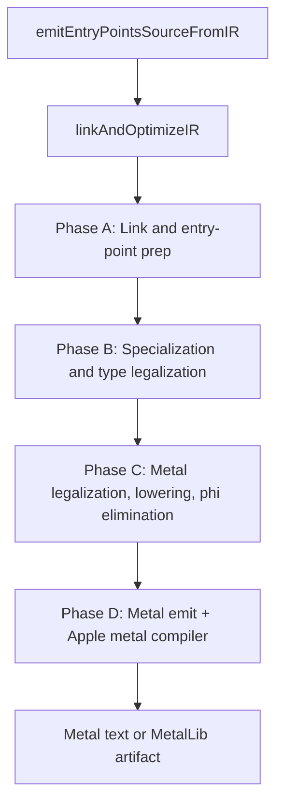
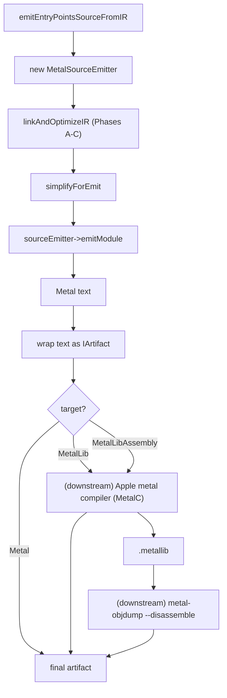

# Metal Target Pipeline

This page documents the ordered IR-pass and downstream-binary
sequence executed when Slang compiles for the Metal target family.
It is written for a compiler developer who needs to find where in
the Metal codegen pipeline a particular pass runs, what condition
selects it, and how `legalizeIRForMetal` and `MetalSourceEmitter`
cooperate. The corresponding `CodeGenTarget` values are `Metal`, `MetalLib`,
and `MetalLibAssembly`. All three share most of the Metal
legalization pipeline and differ mainly in the downstream tool
that consumes the emitted Metal text. On the normal public
emission path the IR pipeline is identical for all three: a
`MetalLibAssembly` request first emits an intermediate `MetalLib`,
and a `MetalLib` request first emits intermediate `Metal` source
(see `_getIntermediateTarget` at line 1062 and
`_getDefaultSourceForTarget` at line 253 of
[slang-code-gen.cpp](../../../../source/slang/slang-code-gen.cpp)),
so `linkAndOptimizeIR` always runs with `CodeGenTarget::Metal` and
the `Metal` / `MetalLib` switch arm — including
`wrapCBufferElementsForMetal` at
[slang-emit.cpp](../../../../source/slang/slang-emit.cpp)
line 2199 — fires for every Metal output. The shared predicate
inside `linkAndOptimizeIR` is
`isMetalTarget(targetRequest)` (see
[slang-type-layout.cpp](../../../../source/slang/slang-type-layout.cpp)
line 3288, which forwards to the `CodeGenTarget` overload at line
3274). This page complements
[../pipeline/05-ir-passes.md](../pipeline/05-ir-passes.md), which
is an unordered topical catalog of every IR pass. Branches in
`linkAndOptimizeIR` gated on a sibling target (SPIR-V, HLSL,
WGSL, CUDA, CPU, GLSL, PyTorch) are filtered out of the diagrams
and tables below.

**The backend pipeline is not an unconditional ordered list.** A
large and growing fraction of the passes below run only when the
linked IR module actually contains the construct the pass handles.
The predicate is a `RequiredLoweringPassSet` (declared at
[slang-code-gen.h](../../../../source/slang/slang-code-gen.h)
line 52), computed by `calcRequiredLoweringPassSet`
([slang-emit.cpp](../../../../source/slang/slang-emit.cpp)
line 409) — a recursive walk over every instruction in the module
that sets one `bool` per lowering construct. `linkAndOptimizeIR`
resets the set and runs the walk twice: once immediately after
`linkIR` (line 1085) and again after specialization (line 1666).
The flags **accumulate** across the two scans; they are not reset
between them, so a construct seen by the first scan still gates a
pass that runs after the second. Each gate is only sound because
the flagged opcode has no producer between the last scan and the
gated call site; the source comments at each gate name the
producer and argue the flag cannot be a false-negative (see the
call-site comments at lines 1466-1472, 1578-1590, 1605-1609,
1728-1736, 1748-1756, and 1922-1935). A stale-true flag is harmless — the pass runs and
finds nothing. Every `Gate` column entry of the form
`reqSet.<flag>` in the phase tables below is one of these flags.

## Source

- [slang-emit.cpp](../../../../source/slang/slang-emit.cpp) —
  `linkAndOptimizeIR` (line 1015) is the orchestrator;
  `emitEntryPointsSourceFromIR` (line 2968) constructs the
  `MetalSourceEmitter` and emits Metal text.
  `calcRequiredLoweringPassSet` (line 409) computes the flag set
  that gates most of the pipeline.
- [slang-emit-metal.cpp](../../../../source/slang/slang-emit-metal.cpp)
  — `MetalSourceEmitter` implementation.
- [slang-emit-metal-prelude.cpp](../../../../source/slang/slang-emit-metal-prelude.cpp)
  — Metal-specific prelude emission.
- [slang-emit-c-like.cpp](../../../../source/slang/slang-emit-c-like.cpp)
  — shared C-like emitter base class.
- [slang-ir-metal-legalize.cpp](../../../../source/slang/slang-ir-metal-legalize.cpp)
  — `legalizeIRForMetal` (line 433) is the central Metal
  legalization driver.
- [slang-ir-legalize-varying-params.cpp](../../../../source/slang/slang-ir-legalize-varying-params.cpp)
  — `legalizeEntryPointVaryingParamsForMetal` (line 5555) and
  `legalizeShaderOutputParamsForMetal` (line 5509).
- [slang-ir-legalize-binary-operator.cpp](../../../../source/slang/slang-ir-legalize-binary-operator.cpp)
  — `legalizeLogicalAndOr` runs for Metal; `legalizeBinaryOp` is also
  called from `legalizeIRForMetal`.
- [slang-target-program.h](../../../../source/slang/slang-target-program.h)
  / [slang-compiler-options.h](../../../../source/slang/slang-compiler-options.h)
  — gate sources.

## High-level phase diagram



Metal takes the `default` arm of nearly every per-target switch in
Phases A and B, so most of what runs there is the shared shader
pipeline. Metal's divergence is concentrated in
Phase C (`legalizeIRForMetal`, `specializeAddressSpaceForMetal`,
the late `MetalPointerLowering` block) plus a handful of Phase-B
decisions that are Metal-only
(`wrapCBufferElementsForMetal`, `expandAutodiffParameterContexts`,
the `legalizeEmptyTypes` Metal arm, the `MetalParameterBlock`
buffer-element policy) and the coverage counter-width cap in
Phase A.

## Phase A: Link and entry-point prep

Spans roughly lines 1050-1486 of
[slang-emit.cpp](../../../../source/slang/slang-emit.cpp). Metal
hits the `default` arm of every per-target switch in this phase.
Like WGSL, Metal is non-Khronos, so the
`!isKhronosTarget && reqSet.glslSSBO` gate lets
`lowerGLSLShaderStorageBufferObjectsToStructuredBuffers` fire.

```mermaid
flowchart TD
  linkIRn[linkIR]
  reqSet1[calcRequiredLoweringPassSet]
  aaGate{reqSet.assumeAddress}
  vaaa[validateAndRemoveAssumeAddress]
  diGate{reqSet.debugInfo and DebugInfoLevel::None}
  stripDI[stripDebugInfo]
  ssboGate{"!isKhronosTarget and reqSet.glslSSBO"}
  ssbo[lowerGLSLShaderStorageBufferObjectsToStructuredBuffers]
  tEPInBorrow[translateEntryPointInParamToBorrow]
  rGC[replaceGlobalConstants]
  beGate{reqSet.bindExistential}
  bES[bindExistentialSlots]
  covGate{reqSet.coverageTracing}
  iC[instrumentCoverage]
  cGUP[collectGlobalUniformParameters]
  cEPD[checkEntryPointDecorations]
  aDMD[addDenormalModeDecorations]
  cEPUP[collectEntryPointUniformParams]
  mEPUP[moveEntryPointUniformParamsToGlobalScope]
  rTCEP[removeTorchAndCUDAEntryPoints]
  covGate2{reqSet.coverageTracing}
  fCIM[finalizeCoverageInstrumentationMetadata]
  lvcGate{reqSet.lValueCast}
  lLVC[lowerLValueCast]
  mlGate{reqSet.unresolvedMatrixLayout}
  sML[specializeMatrixLayout]
  enumGate{reqSet.enumType}
  lET[lowerEnumType]

  linkIRn --> reqSet1 --> aaGate
  aaGate -->|true| vaaa --> diGate
  aaGate -->|false| diGate
  diGate -->|true| stripDI --> ssboGate
  diGate -->|false| ssboGate
  ssboGate -->|true| ssbo --> tEPInBorrow
  ssboGate -->|false| tEPInBorrow
  tEPInBorrow --> rGC --> beGate
  beGate -->|true| bES --> covGate
  beGate -->|false| covGate
  covGate -->|true| iC --> cGUP
  covGate -->|false| cGUP
  cGUP --> cEPD --> aDMD --> cEPUP --> mEPUP --> rTCEP --> covGate2
  covGate2 -->|true| fCIM --> lvcGate
  covGate2 -->|false| lvcGate
  lvcGate -->|true| lLVC --> mlGate
  lvcGate -->|false| mlGate
  mlGate -->|true| sML --> enumGate
  mlGate -->|false| enumGate
  enumGate -->|true| lET
```



`validateIRModuleIfEnabled` checkpoints, omitted from the nodes above, sit at lines 1080, 1111, 1123, 1365, 1369, 1377, 1413, 1422, and 1451.

| # | Pass | File | Gate | Notes |
| --- | --- | --- | --- | --- |
| 1 | `linkIR` | [slang-ir-link.cpp](../../../../source/slang/slang-ir-link.cpp) | (always) | Line 1050. |
| 2 | `validateAndRemoveAssumeAddress` | [slang-ir-validate.cpp](../../../../source/slang/slang-ir-validate.cpp) | `reqSet.assumeAddress` | Line 1090, after the first `calcRequiredLoweringPassSet` scan (line 1085). `validate=true` (Metal is non-CPU/CUDA). The flag is set by `kIROp_AssumeAddress`. |
| 3 | `stripDebugInfo` | [slang-ir-strip-debug-info.cpp](../../../../source/slang/slang-ir-strip-debug-info.cpp) | `reqSet.debugInfo && DebugInfoLevel::None` | |
| 4 | `lowerGLSLShaderStorageBufferObjectsToStructuredBuffers` | [slang-ir-lower-glsl-ssbo-types.cpp](../../../../source/slang/slang-ir-lower-glsl-ssbo-types.cpp) | `!isKhronosTarget && reqSet.glslSSBO` | Metal is non-Khronos. |
| 5 | `translateEntryPointInParamToBorrow` | [slang-ir-transform-params-to-constref.cpp](../../../../source/slang/slang-ir-transform-params-to-constref.cpp) | (always) | |
| 6 | `replaceGlobalConstants` | [slang-ir-link.cpp](../../../../source/slang/slang-ir-link.cpp) | (always) | |
| 7 | `bindExistentialSlots` | [slang-ir-bind-existentials.cpp](../../../../source/slang/slang-ir-bind-existentials.cpp) | `reqSet.bindExistential` | |
| 8 | `instrumentCoverage` | [slang-ir-coverage-instrument.cpp](../../../../source/slang/slang-ir-coverage-instrument.cpp) | `reqSet.coverageTracing` | `SLANG_PASS` at line 1351. Takes a `counterByteWidth` (default `kDefaultCoverageCounterByteWidth`, overridable via `CompilerOptionName::TraceCoverageCounterByteWidth`; must be 4 or 8 or the API path raises `Diagnostics::CoverageCounterWidthBytesInvalid` / `E45114`, the API-path counterpart to the CLI's `E45113`) and a `coverageBoolean` flag (`CompilerOptionName::TraceCoverageBoolean`, off by default). **Metal-specific**: lines 1345-1350 cap `counterByteWidth` to 4 for Metal targets — see [Metal caps coverage counters to 32 bits](#metal-caps-coverage-counters-to-32-bits). |
| 9 | `collectGlobalUniformParameters` | [slang-ir-collect-global-uniforms.cpp](../../../../source/slang/slang-ir-collect-global-uniforms.cpp) | (always) | |
| 10 | `checkEntryPointDecorations` | [slang-ir-entry-point-decorations.cpp](../../../../source/slang/slang-ir-entry-point-decorations.cpp) | (always) | |
| 11 | `addDenormalModeDecorations` | [slang-emit.cpp](../../../../source/slang/slang-emit.cpp) | (always) | Static helper defined at line 801, called at line 1376. |
| 12 | `collectEntryPointUniformParams` | [slang-ir-entry-point-uniforms.cpp](../../../../source/slang/slang-ir-entry-point-uniforms.cpp) | (always, Metal via `default` arm) | Line 1412. |
| 13 | `moveEntryPointUniformParamsToGlobalScope` | [slang-ir-entry-point-uniforms.cpp](../../../../source/slang/slang-ir-entry-point-uniforms.cpp) | (always, Metal via `default` arm) | Line 1421. |
| 14 | `removeTorchAndCUDAEntryPoints` | [slang-ir-pytorch-cpp-binding.cpp](../../../../source/slang/slang-ir-pytorch-cpp-binding.cpp) | (always, Metal via `default` arm) | Line 1447. |
| 15 | `finalizeCoverageInstrumentationMetadata` | [slang-ir-coverage-instrument.cpp](../../../../source/slang/slang-ir-coverage-instrument.cpp) | `reqSet.coverageTracing` | Runs after entry-point uniform packing; fills CPU/CUDA uniform-marshaling fields on the coverage `ArtifactPostEmitMetadata` produced by step 8. No-op for Metal in practice. |
| 16 | `lowerLValueCast` | [slang-ir-lower-l-value-cast.cpp](../../../../source/slang/slang-ir-lower-l-value-cast.cpp) | `reqSet.lValueCast` | Line 1474. The flag is set by `kIROp_InOutImplicitCast` / `kIROp_OutImplicitCast`, both produced only by the front end, so the gate cannot be a false-negative. |
| 17 | `specializeMatrixLayout` | [slang-ir-specialize-matrix-layout.cpp](../../../../source/slang/slang-ir-specialize-matrix-layout.cpp) | `reqSet.unresolvedMatrixLayout` | Line 1480. Fills in the default matrix layout where the source left it unspecified; it runs before `specializeModule` so `row_major float4x4` and `float4x4` match as one type, and before `lowerEnumType`, which erases the `MatrixLayoutMode` type the pass looks for. The flag is set by a `kIROp_MatrixType` whose layout operand is non-literal or `SLANG_MATRIX_LAYOUT_MODE_UNKNOWN`. |
| 18 | `lowerEnumType` | [slang-ir-lower-enum-type.cpp](../../../../source/slang/slang-ir-lower-enum-type.cpp) | `reqSet.enumType` | Line 1486. The flag is set by `kIROp_EnumType` **and** by the three surviving-cast opcodes `kIROp_CastEnumToInt` / `kIROp_CastIntToEnum` / `kIROp_EnumCast` (`calcRequiredLoweringPassSet`, lines 474-490), so constant folding that eliminates the last live `IREnumType` while leaving a degenerate cast behind no longer strands that cast at emit. The `Constexpr*` cast variants are deliberately excluded. |

Filtered out for Metal in this phase: the CUDA / CUDAHeader arm
of the entry-point-param switch
(`collectOptiXEntryPointUniformParams`); the CPP / Host* arms.

## Phase B: Specialization and type legalization

Spans roughly lines 1499-2199 of `slang-emit.cpp`. Metal hits the
`default` arm at most decision points and runs
`lowerCooperativeVectors` (the `default` arm at line 1865).
Metal-specific decisions:

- `expandAutodiffParameterContexts` runs only for CUDA source and
  Metal (`target == CUDASource || isMetalTarget(target)`, line
  1821), right after `lowerTuples` and before aggregate parameters
  are converted to references; the source comment states that the
  other target pipelines are left unchanged.
- `lowerCombinedTextureSamplers` fires (Metal is in the
  HLSL / Metal / WGSL arm at lines 1941-1955), still subject to
  `reqSet.combinedTextureSamplers`.
- `lowerAppendConsumeStructuredBuffers` fires when the module
  contains one of those buffer types: the gate is
  `target != HLSL && reqSet.appendConsumeStructuredBuffer`
  (line 1936).
- Inside the `shouldLegalizeExistentialAndResourceTypes` block,
  `legalizeRayTracingPayloads` runs first (line 1989), and then the
  `isMetalTarget(targetRequest)` arm runs an
  extra `lowerBufferElementTypeToStorageType` with
  `BufferElementTypeLoweringPolicyKind::MetalParameterBlock`
  (lines 1991-2007) to translate resource-typed fields inside
  parameter blocks into descriptor handles before the general
  resource legalization.
- `legalizeEmptyTypes` runs in two places for Metal:
  - The Metal arm of the inner switch at line 2063 (after
    `legalizeResourceTypes`, under
    `shouldLegalizeExistentialAndResourceTypes`).
  - The unconditional invocation later in Phase C (line 2754).
- `translateGlobalVaryingVar`, `fixEntryPointCallsites`,
  `moveGlobalVarInitializationToEntryPoints`, and
  `legalizeResourceGlobalVars` run in this phase, after type
  legalization (lines 2079-2103), so global initializers are moved
  into entry points before resource specialization.
- `wrapCBufferElementsForMetal` fires (line 2199).
  The case list (lines 2195-2196) contains only `Metal` and
  `MetalLib`, but `MetalLibAssembly` is never seen here directly:
  on the public emission path it is produced by disassembling an
  intermediate `MetalLib` artifact, so `linkAndOptimizeIR` runs
  with `CodeGenTarget::Metal` and this pass always fires.

```mermaid
flowchart TD
  s1[simplifyIR default]
  vuGate{"getBoolOption(ValidateUniformity)"}
  vu[validateUniformity]
  fscGate{"!shouldPerformMinimumOptimizations"}
  fSC[fuseCallsToSaturatedCooperation]
  adGate{reqSet.autodiff}
  cAP[checkAutodiffPatterns]
  dCC[diagnoseCircularConformances]
  sdGate{"!isSpecializationDisabled()"}
  sM[specializeModule]
  vMG["validateMutableGlobalVariableTypes (direct call)"]
  hofGate{reqSet.higherOrderFunc}
  sHOP[specializeHigherOrderParameters]
  adGate2{reqSet.autodiff}
  fADP[finalizeAutoDiffPass]
  sADD[stripAutoDiffDecorations]
  mssGate{reqSet.matrixSwizzleStore}
  lMSS[lowerMatrixSwizzleStores]
  dce1[eliminateDeadCode]
  fS[finalizeSpecialization]
  adGate3{reqSet.autodiff}
  lDTI[lowerDiffTypeInfoInsts]
  ctGate{reqSet.conditionalType}
  lCT[lowerConditionalType]
  roGate{reqSet.optionalType}
  lRO[lowerReinterpretOptional]
  nevGate1{shouldRunNonEssentialValidation}
  cONU[checkForOptionalNoneUsage]
  otGate{reqSet.optionalType}
  lOT[lowerOptionalType]
  rtGate{reqSet.resultType}
  lRT[lowerResultType]
  reqSet2[calcRequiredLoweringPassSet]
  dUR[detectUninitializedResources]
  raidGate{removeAvailableInDownstreamIR}
  rAIDD[removeAvailableInDownstreamModuleDecorations]
  nevGate2{shouldRunNonEssentialValidation}
  cRT[checkForRecursiveTypes]
  cRF[checkForRecursiveFunctions]
  cOBA[checkForOutOfBoundAccess]
  mrGate{reqSet.missingReturn}
  cMR[checkForMissingReturns]
  cISPT[checkForInvalidShaderParameterType]
  iAVS[inferAnyValueSizeWhereNecessary]
  uPWT[unpinWitnessTables]
  svmGate{reqSet.sumVectorMatrix}
  lSVMI[lowerSumVectorMatrixInsts]
  minOptGate1{"!minimalOptimization"}
  s2a[simplifyIR fast]
  genGate{reqSet.generics}
  dceGen[eliminateDeadCode]
  tuGate{reqSet.taggedUnion}
  lTUT[lowerTaggedUnionTypes]
  utGate{reqSet.untaggedUnion}
  lUUT[lowerUntaggedUnionTypes]
  reinterpretGate{reqSet.reinterpret}
  lR[lowerReinterpret]
  lSIDC[lowerSequentialIDTagCasts]
  toGate{reqSet.tagOps}
  lTI[lowerTagInsts]
  ttGate{reqSet.tagType}
  lTT[lowerTagTypes]
  dce3[eliminateDeadCode]
  lE[lowerExistentials]
  rWUI[removeWeakUseInsts]
  pTIN[performTypeInlining]
  nevGate3{shouldRunNonEssentialValidation}
  cGSHI[checkGetStringHashInsts]
  dce4["eliminateDeadCode (direct call)"]
  lTu[lowerTuples]
  eAPC[expandAutodiffParameterContexts]
  gAVMF[generateAnyValueMarshallingFunctions]
  ssGate{reqSet.specializeStageSwitch}
  sSS[specializeStageSwitch]
  lCV[lowerCooperativeVectors]
  pFI1[performForceInlining]
  minOptGate2{minimalOptimization}
  aSCCP[applySparseConditionalConstantPropagation]
  dceScp[eliminateDeadCode]
  s2b[simplifyIR default]
  tSCP[threadSwitchOnConstantPhi]
  acsbGate{"target != HLSL and reqSet.appendConsumeStructuredBuffer"}
  lACSB[lowerAppendConsumeStructuredBuffers]
  ctsGate{reqSet.combinedTextureSamplers}
  lCTS[lowerCombinedTextureSamplers]
  vERGate{getBoolOption VulkanEmitReflection}
  aUTHD[addUserTypeHintDecorations]
  lEA[legalizeEmptyArray]
  lVT[legalizeVectorTypes]
  existGate{shouldLegalizeExistentialAndResourceTypes}
  iGC[inlineGlobalConstantsForLegalization]
  lRTP[legalizeRayTracingPayloads]
  lBETST_Metal["lowerBufferElementTypeToStorageType<br/>(MetalParameterBlock policy)"]
  etlGate{reqSet.existentialTypeLayout}
  lETL[legalizeExistentialTypeLayout]
  vSBRT[validateStructuredBufferResourceTypes]
  lRTR[legalizeResourceTypes]
  lET_Metal["legalizeEmptyTypes (Metal arm)"]
  lET_else["legalizeEmptyTypes (else path)"]
  gvvGate{reqSet.globalVaryingVar}
  tGVV[translateGlobalVaryingVar]
  fEPC[fixEntryPointCallsites]
  mGVI[moveGlobalVarInitializationToEntryPoints]
  lRGV[legalizeResourceGlobalVars]
  minOptGate3{"!minimalOptimization"}
  s2c[simplifyIR fast]
  dceMin3[eliminateDeadCode]
  urhGate{reqSet.untypedResourceHandle}
  lURH[lowerUntypedResourceHandleToUInt]
  drhGate{reqSet.dynamicResourceHeap}
  lDRH[lowerDynamicResourceHeap]
  sRU[specializeResourceUsage]
  sFBLA1[specializeFuncsForBufferLoadArgs]
  dBL[deferBufferLoad]
  sAP[specializeArrayParameters]
  cSA[checkStaticAssert]
  wCBE[wrapCBufferElementsForMetal]

  s1 --> vuGate
  vuGate -->|true| vu --> fscGate
  vuGate -->|false| fscGate
  fscGate -->|true| fSC --> adGate
  fscGate -->|false| adGate
  adGate -->|true| cAP --> dCC
  adGate -->|false| dCC
  dCC --> sdGate
  sdGate -->|true| sM --> vMG --> hofGate
  sdGate -->|false| vMG
  hofGate -->|true| sHOP --> adGate2
  hofGate -->|false| adGate2
  adGate2 -->|true| fADP --> mssGate
  adGate2 -->|false| sADD --> mssGate
  mssGate -->|true| lMSS --> dce1
  mssGate -->|false| dce1
  dce1 --> fS --> adGate3
  adGate3 -->|true| lDTI --> ctGate
  adGate3 -->|false| ctGate
  ctGate -->|true| lCT --> roGate
  ctGate -->|false| roGate
  roGate -->|true| lRO --> nevGate1
  roGate -->|false| nevGate1
  nevGate1 -->|true| cONU --> otGate
  nevGate1 -->|false| otGate
  otGate -->|true| lOT --> rtGate
  otGate -->|false| rtGate
  rtGate -->|true| lRT --> reqSet2
  rtGate -->|false| reqSet2
  reqSet2 --> dUR --> raidGate
  raidGate -->|true| rAIDD --> nevGate2
  raidGate -->|false| nevGate2
  nevGate2 -->|true| cRT --> cRF --> cOBA --> mrGate
  nevGate2 -->|false| iAVS
  mrGate -->|true| cMR --> cISPT
  mrGate -->|false| cISPT
  cISPT --> iAVS
  iAVS --> uPWT --> svmGate
  svmGate -->|true| lSVMI --> minOptGate1
  svmGate -->|false| minOptGate1
  minOptGate1 -->|true| s2a --> tuGate
  minOptGate1 -->|false| genGate
  genGate -->|true| dceGen --> tuGate
  genGate -->|false| tuGate
  tuGate -->|true| lTUT --> utGate
  tuGate -->|false| utGate
  utGate -->|true| lUUT --> reinterpretGate
  utGate -->|false| reinterpretGate
  reinterpretGate -->|true| lR --> lSIDC
  reinterpretGate -->|false| lSIDC
  lSIDC --> toGate
  toGate -->|true| lTI --> ttGate
  toGate -->|false| ttGate
  ttGate -->|true| lTT --> dce3
  ttGate -->|false| dce3
  dce3 --> lE --> rWUI --> pTIN --> dce4 --> nevGate3
  nevGate3 -->|true| cGSHI --> lTu
  nevGate3 -->|false| lTu
  lTu --> eAPC --> gAVMF --> ssGate
  ssGate -->|true| sSS --> lCV
  ssGate -->|false| lCV
  lCV --> pFI1 --> minOptGate2
  minOptGate2 -->|true| aSCCP --> dceScp --> tSCP
  minOptGate2 -->|false| s2b --> tSCP
  tSCP --> acsbGate
  acsbGate -->|true| lACSB --> ctsGate
  acsbGate -->|false| ctsGate
  ctsGate -->|true| lCTS --> vERGate
  ctsGate -->|false| vERGate
  vERGate -->|true| aUTHD --> lEA
  vERGate -->|false| lEA
  lEA --> lVT --> existGate
  existGate -->|true| iGC --> lRTP --> lBETST_Metal --> etlGate
  etlGate -->|true| lETL --> vSBRT
  etlGate -->|false| vSBRT
  vSBRT --> lRTR --> lET_Metal --> gvvGate
  existGate -->|false| lET_else --> gvvGate
  gvvGate -->|true| tGVV --> fEPC
  gvvGate -->|false| fEPC
  fEPC --> mGVI --> lRGV --> minOptGate3
  minOptGate3 -->|true| s2c --> urhGate
  minOptGate3 -->|false| dceMin3 --> urhGate
  urhGate -->|true| lURH --> drhGate
  urhGate -->|false| drhGate
  drhGate -->|true| lDRH --> sRU
  drhGate -->|false| sRU
  sRU --> sFBLA1 --> dBL --> sAP --> cSA --> wCBE
```



`validateIRModuleIfEnabled` checkpoints, omitted from the nodes above, sit at lines 1717, 1849, 1913, 2039 and 2067 (inside the existential/resource block), 2149, and 2174.

Diamonds are conditional gates: the `true` arm runs the gated pass
and the `false` arm falls through. Target-constant gates that are
always taken for Metal (e.g. `isMetalTarget`, `target != HLSL`,
`!isCpuLikeTarget`, the Metal arms of the legalization switches) are
drawn as unconditional nodes, per the filtered-branch convention for
target-pipeline diagrams. The companion table below lists every pass
with its exact gate expression.

| # | Pass | File | Gate | Notes |
| --- | --- | --- | --- | --- |
| 1 | `simplifyIR` | [slang-ir-ssa-simplification.cpp](../../../../source/slang/slang-ir-ssa-simplification.cpp) | (always) | `defaultIRSimplificationOptions`; line 1499. |
| 2 | `validateUniformity` | [slang-ir-uniformity.cpp](../../../../source/slang/slang-ir-uniformity.cpp) | `getBoolOption(ValidateUniformity)` | |
| 3 | `fuseCallsToSaturatedCooperation` | [slang-ir-fuse-satcoop.cpp](../../../../source/slang/slang-ir-fuse-satcoop.cpp) | `!shouldPerformMinimumOptimizations` | |
| 4 | `checkAutodiffPatterns` | [slang-ir-check-differentiability.cpp](../../../../source/slang/slang-ir-check-differentiability.cpp) | `reqSet.autodiff` | |
| 5 | `diagnoseCircularConformances` | [slang-ir-any-value-inference.cpp](../../../../source/slang/slang-ir-any-value-inference.cpp) | (always) | |
| 6 | `specializeModule` | [slang-ir-specialize.cpp](../../../../source/slang/slang-ir-specialize.cpp) | `!isSpecializationDisabled()` | |
| 7 | `validateMutableGlobalVariableTypes` | [slang-ir-validate.cpp](../../../../source/slang/slang-ir-validate.cpp) | (always) | Direct call at line 1571, not a `SLANG_PASS`; returns `SLANG_FAIL` on failure. |
| 8 | `specializeHigherOrderParameters` | [slang-ir-defunctionalization.cpp](../../../../source/slang/slang-ir-defunctionalization.cpp) | `reqSet.higherOrderFunc` | |
| 9 | `finalizeAutoDiffPass` | [slang-ir-autodiff.cpp](../../../../source/slang/slang-ir-autodiff.cpp) | `reqSet.autodiff` (line 1592) | Builds an `AutoDiffSharedContext` over the whole module; skipped when no autodiff IR is present. Exactly one of this row and the next runs. |
| 10 | `stripAutoDiffDecorations` | [slang-ir-autodiff.cpp](../../../../source/slang/slang-ir-autodiff.cpp) | `!reqSet.autodiff` (the `else` arm at line 1596) | Still has to strip the `Export`/`HLSLExport`/`KeepAlive` pins that the core module's `[__AutoDiffBuiltin]` types (e.g. `NullDifferential`) carry, or the DCE two rows below could not drop them. |
| 11 | `lowerMatrixSwizzleStores` | [slang-ir-lower-matrix-swizzle-store.cpp](../../../../source/slang/slang-ir-lower-matrix-swizzle-store.cpp) | `reqSet.matrixSwizzleStore` | |
| 12 | `eliminateDeadCode` | [slang-ir-dce.cpp](../../../../source/slang/slang-ir-dce.cpp) | (always) | |
| 13 | `finalizeSpecialization` | [slang-ir-specialize.cpp](../../../../source/slang/slang-ir-specialize.cpp) | (always) | |
| 14 | `lowerDiffTypeInfoInsts` | [slang-ir-autodiff.cpp](../../../../source/slang/slang-ir-autodiff.cpp) | `reqSet.autodiff` | Direct call, not a `SLANG_PASS` (line 1612). |
| 15 | `lowerConditionalType` | [slang-ir-lower-conditional-type.cpp](../../../../source/slang/slang-ir-lower-conditional-type.cpp) | `reqSet.conditionalType` | |
| 16 | `lowerReinterpretOptional` | [slang-ir-lower-reinterpret.cpp](../../../../source/slang/slang-ir-lower-reinterpret.cpp) | `reqSet.optionalType` | |
| 17 | `checkForOptionalNoneUsage` | [slang-ir-check-optional-none-usage.cpp](../../../../source/slang/slang-ir-check-optional-none-usage.cpp) | `shouldRunNonEssentialValidation()` | |
| 18 | `lowerOptionalType` | [slang-ir-lower-optional-type.cpp](../../../../source/slang/slang-ir-lower-optional-type.cpp) | `reqSet.optionalType` | |
| 19 | `lowerResultType` | [slang-ir-lower-result-type.cpp](../../../../source/slang/slang-ir-lower-result-type.cpp) | `reqSet.resultType` | Runs **after** `lowerOptionalType`: depends on accurate `getAnyValueSize()` results, which requires Optional lowering first. |
| 20 | `detectUninitializedResources` | [slang-ir-detect-uninitialized-resources.cpp](../../../../source/slang/slang-ir-detect-uninitialized-resources.cpp) | (always) | Line 1686, after the second `calcRequiredLoweringPassSet` scan (line 1666). |
| 21 | `removeAvailableInDownstreamModuleDecorations` | [slang-ir-redundancy-removal.cpp](../../../../source/slang/slang-ir-redundancy-removal.cpp) | `removeAvailableInDownstreamIR` | |
| 22 | `checkForRecursiveTypes` | [slang-ir-check-recursion.cpp](../../../../source/slang/slang-ir-check-recursion.cpp) | `shouldRunNonEssentialValidation()` | |
| 23 | `checkForRecursiveFunctions` | [slang-ir-check-recursion.cpp](../../../../source/slang/slang-ir-check-recursion.cpp) | `shouldRunNonEssentialValidation()` | |
| 24 | `checkForOutOfBoundAccess` | [slang-check-out-of-bound-access.cpp](../../../../source/slang/slang-check-out-of-bound-access.cpp) | `shouldRunNonEssentialValidation()` | |
| 25 | `checkForMissingReturns` | [slang-ir-missing-return.cpp](../../../../source/slang/slang-ir-missing-return.cpp) | `shouldRunNonEssentialValidation() && reqSet.missingReturn` | Nested inside the non-essential-validation block (lines 1693-1711). |
| 26 | `checkForInvalidShaderParameterType` | [slang-ir-check-shader-parameter-type.cpp](../../../../source/slang/slang-ir-check-shader-parameter-type.cpp) | `shouldRunNonEssentialValidation()` | |
| 27 | `inferAnyValueSizeWhereNecessary` | [slang-ir-any-value-inference.cpp](../../../../source/slang/slang-ir-any-value-inference.cpp) | (always) | |
| 28 | `unpinWitnessTables` | [slang-ir-strip-legalization-insts.cpp](../../../../source/slang/slang-ir-strip-legalization-insts.cpp) | (always) | |
| 29 | `lowerSumVectorMatrixInsts` | [slang-emit.cpp](../../../../source/slang/slang-emit.cpp) | `reqSet.sumVectorMatrix` | Static helper (line 924); gated at line 1737. `kIROp_SumVectorElements` / `kIROp_SumMatrixElements` are produced only by the autodiff transpose pass reached through row 9, which runs before the second `calcRequiredLoweringPassSet` scan. |
| 30 | `simplifyIR` | [slang-ir-ssa-simplification.cpp](../../../../source/slang/slang-ir-ssa-simplification.cpp) | `!minimalOptimization` | `fastIRSimplificationOptions`. |
| 31 | `eliminateDeadCode` | [slang-ir-dce.cpp](../../../../source/slang/slang-ir-dce.cpp) | `minimalOptimization && reqSet.generics` | `else if` arm of the simplify gate (line 1744); replaces row 30 on the minimal-optimization path. |
| 32 | `lowerTaggedUnionTypes` | [slang-ir-lower-dynamic-dispatch-insts.cpp](../../../../source/slang/slang-ir-lower-dynamic-dispatch-insts.cpp) | `reqSet.taggedUnion` | Line 1757. This is the one gate whose pass **feeds back into the flag set**: when the pass reports it changed something, the call site sets `reqSet.reinterpret = true` (line 1760) because tagged-union lowering synthesizes reinterpret instructions that row 34 must then lower. |
| 33 | `lowerUntaggedUnionTypes` | [slang-ir-lower-dynamic-dispatch-insts.cpp](../../../../source/slang/slang-ir-lower-dynamic-dispatch-insts.cpp) | `reqSet.untaggedUnion` | Line 1764. The flag is set by `kIROp_UntaggedUnionType`, `kIROp_NoneTypeElement`, and by every tagged-union opcode. |
| 34 | `lowerReinterpret` | [slang-ir-lower-reinterpret.cpp](../../../../source/slang/slang-ir-lower-reinterpret.cpp) | `reqSet.reinterpret` | |
| 35 | `lowerSequentialIDTagCasts` | [slang-ir-lower-dynamic-dispatch-insts.cpp](../../../../source/slang/slang-ir-lower-dynamic-dispatch-insts.cpp) | (always) | |
| 36 | `lowerTagInsts` | [slang-ir-lower-dynamic-dispatch-insts.cpp](../../../../source/slang/slang-ir-lower-dynamic-dispatch-insts.cpp) | `reqSet.tagOps` | Line 1771. |
| 37 | `lowerTagTypes` | [slang-ir-lower-dynamic-dispatch-insts.cpp](../../../../source/slang/slang-ir-lower-dynamic-dispatch-insts.cpp) | `reqSet.tagType` | Line 1773. |
| 38 | `eliminateDeadCode` | [slang-ir-dce.cpp](../../../../source/slang/slang-ir-dce.cpp) | (always) | |
| 39 | `lowerExistentials` | [slang-ir-lower-dynamic-dispatch-insts.cpp](../../../../source/slang/slang-ir-lower-dynamic-dispatch-insts.cpp) | (always) | |
| 40 | `removeWeakUseInsts` | [slang-ir-redundancy-removal.cpp](../../../../source/slang/slang-ir-redundancy-removal.cpp) | (always) | |
| 41 | `performTypeInlining` | [slang-ir-inline.cpp](../../../../source/slang/slang-ir-inline.cpp) | `!isCpuLikeTarget` (true for Metal) | |
| 42 | `eliminateDeadCode` | [slang-ir-dce.cpp](../../../../source/slang/slang-ir-dce.cpp) | (always) | Direct call at line 1804, not a `SLANG_PASS`; uses `fastIRSimplificationOptions.deadCodeElimOptions`. |
| 43 | `checkGetStringHashInsts` | [slang-ir-string-hash.cpp](../../../../source/slang/slang-ir-string-hash.cpp) | `!isCpuLikeTarget && shouldRunNonEssentialValidation()` | Line 1811. |
| 44 | `lowerTuples` | [slang-ir-lower-tuple-types.cpp](../../../../source/slang/slang-ir-lower-tuple-types.cpp) | (always) | |
| 45 | `expandAutodiffParameterContexts` | [slang-ir-expand-autodiff-parameter-contexts.cpp](../../../../source/slang/slang-ir-expand-autodiff-parameter-contexts.cpp) | `target == CUDASource \|\| isMetalTarget(target)` (line 1821) | Expands captured parameters after tuple lowering and before aggregate parameters are converted to references. |
| 46 | `generateAnyValueMarshallingFunctions` | [slang-ir-any-value-marshalling.cpp](../../../../source/slang/slang-ir-any-value-marshalling.cpp) | (always) | |
| 47 | `specializeStageSwitch` | [slang-ir-specialize-stage-switch.cpp](../../../../source/slang/slang-ir-specialize-stage-switch.cpp) | `reqSet.specializeStageSwitch` | |
| 48 | `lowerCooperativeVectors` | [slang-ir-lower-coopvec.cpp](../../../../source/slang/slang-ir-lower-coopvec.cpp) | (always, Metal via `default` arm at line 1865) | |
| 49 | `performForceInlining` | [slang-ir-inline.cpp](../../../../source/slang/slang-ir-inline.cpp) | (always) | |
| 50 | `applySparseConditionalConstantPropagation` | [slang-ir-sccp.cpp](../../../../source/slang/slang-ir-sccp.cpp) | `minimalOptimization` | Minimal-optimization arm (line 1875); cleans up dead branches revealed by force-inlining. |
| 51 | `eliminateDeadCode` | [slang-ir-dce.cpp](../../../../source/slang/slang-ir-dce.cpp) | `minimalOptimization` | Paired with the SCCP pass (line 1887). |
| 52 | `simplifyIR` | [slang-ir-ssa-simplification.cpp](../../../../source/slang/slang-ir-ssa-simplification.cpp) | `!minimalOptimization` | `else` arm (line 1889); `defaultIRSimplificationOptions`. |
| 53 | `threadSwitchOnConstantPhi` | [slang-ir-thread-switch-on-constant-phi.cpp](../../../../source/slang/slang-ir-thread-switch-on-constant-phi.cpp) | (always) | Line 1900. Registered outside the optimization-level branch so it runs at every level; when the switch selector is not yet a phi the pass finds nothing to thread. |
| 54 | `lowerAppendConsumeStructuredBuffers` | [slang-ir-lower-append-consume-structured-buffer.cpp](../../../../source/slang/slang-ir-lower-append-consume-structured-buffer.cpp) | `target != HLSL && reqSet.appendConsumeStructuredBuffer` | Line 1936. `AppendStructuredBuffer` / `ConsumeStructuredBuffer` come only from the front end, so the flag cannot be a false-negative; a stale-true flag (buffer dead-code-eliminated after a scan) just makes the walk a no-op. |
| 55 | `lowerCombinedTextureSamplers` | [slang-ir-lower-combined-texture-sampler.cpp](../../../../source/slang/slang-ir-lower-combined-texture-sampler.cpp) | `reqSet.combinedTextureSamplers` (Metal arm) | Line 1953. |
| 56 | `addUserTypeHintDecorations` | [slang-ir-user-type-hint.cpp](../../../../source/slang/slang-ir-user-type-hint.cpp) | `getBoolOption(VulkanEmitReflection)` (line 1957) | Not target-gated, so it is reachable on a Metal compile whenever the option is set; it carries no Metal-specific behavior. |
| 57 | `legalizeEmptyArray` | [slang-ir-legalize-empty-array.cpp](../../../../source/slang/slang-ir-legalize-empty-array.cpp) | (always) | |
| 58 | `legalizeVectorTypes` | [slang-ir-legalize-vector-types.cpp](../../../../source/slang/slang-ir-legalize-vector-types.cpp) | (always) | |
| 59 | `inlineGlobalConstantsForLegalization` | [slang-ir-legalize-global-values.cpp](../../../../source/slang/slang-ir-legalize-global-values.cpp) | `shouldLegalizeExistentialAndResourceTypes` (default `true` for Metal) | The gate at line 1974 also admits CUDA and CPU kernel targets. |
| 60 | `legalizeRayTracingPayloads` | [slang-ir-ray-tracing-legalize.cpp](../../../../source/slang/slang-ir-ray-tracing-legalize.cpp) | `shouldLegalizeExistentialAndResourceTypes` | Line 1989; first pass in the legalization block. Gives empty ray/callable payloads physical storage at native interfaces before type legalization erases their logical values. |
| 61 | `lowerBufferElementTypeToStorageType` | [slang-ir-lower-buffer-element-type.cpp](../../../../source/slang/slang-ir-lower-buffer-element-type.cpp) | `isMetalTarget` | Inside the existential/resource block at lines 1991-2007; `loweringPolicyKind = MetalParameterBlock`. **Metal-only first invocation.** |
| 62 | `legalizeExistentialTypeLayout` | [slang-ir-legalize-types.cpp](../../../../source/slang/slang-ir-legalize-types.cpp) | `reqSet.existentialTypeLayout` | |
| 63 | `validateStructuredBufferResourceTypes` | [slang-ir-validate.cpp](../../../../source/slang/slang-ir-validate.cpp) | (always) | Direct call (line 2041). |
| 64 | `legalizeResourceTypes` | [slang-ir-legalize-types.cpp](../../../../source/slang/slang-ir-legalize-types.cpp) | (always) | |
| 65 | `legalizeEmptyTypes` (Metal arm) | [slang-ir-legalize-types.cpp](../../../../source/slang/slang-ir-legalize-types.cpp) | `case Metal / MetalLib / MetalLibAssembly` (lines 2058-2065) | **Metal-only**; the `true` arm of `shouldLegalizeExistentialAndResourceTypes`. Runs again unconditionally later. |
| 66 | `legalizeEmptyTypes` (else path) | [slang-ir-legalize-types.cpp](../../../../source/slang/slang-ir-legalize-types.cpp) | `!shouldLegalizeExistentialAndResourceTypes` | `else` branch (line 2073); the only pass on the false arm, which skips rows 59-65 and rejoins before `translateGlobalVaryingVar`. |
| 67 | `translateGlobalVaryingVar` | [slang-ir-translate-global-varying-var.cpp](../../../../source/slang/slang-ir-translate-global-varying-var.cpp) | `reqSet.globalVaryingVar` | Line 2079. Materializes input parameters and their assignments before the entry point is cloned. |
| 68 | `fixEntryPointCallsites` | [slang-ir-fix-entrypoint-callsite.cpp](../../../../source/slang/slang-ir-fix-entrypoint-callsite.cpp) | (always) | Line 2085. Separates launch functions from ordinary callees before initializers are injected. |
| 69 | `moveGlobalVarInitializationToEntryPoints` | [slang-ir-explicit-global-init.cpp](../../../../source/slang/slang-ir-explicit-global-init.cpp) | (always) | Line 2091; returns `SLANG_FAIL` on errors. It is no longer reached through a fallthrough into the `ShaderLLVMIR` arm; Metal runs it here. |
| 70 | `legalizeResourceGlobalVars` | [slang-ir-legalize-resource-globals.cpp](../../../../source/slang/slang-ir-legalize-resource-globals.cpp) | (always) | Line 2099; takes `targetCaps` and `shouldRunNonEssentialValidation()`. Replaces the storage of selected resource globals with locals and generated parameters before resource specialization. |
| 71 | `eliminateDeadCode` | [slang-ir-dce.cpp](../../../../source/slang/slang-ir-dce.cpp) | `minimalOptimization` (the `if` arm at line 2132) | `deadCodeEliminationOptions`. Exactly one of this row and the next runs. |
| 72 | `simplifyIR` | [slang-ir-ssa-simplification.cpp](../../../../source/slang/slang-ir-ssa-simplification.cpp) | `!minimalOptimization` (the `else` arm at line 2134) | `fastIRSimplificationOptions`. |
| 73 | `lowerUntypedResourceHandleToUInt` | [slang-ir-lower-dynamic-resource-heap.cpp](../../../../source/slang/slang-ir-lower-dynamic-resource-heap.cpp) | `reqSet.untypedResourceHandle` | Line 2144; defined at line 96 of the linked file. Guarantees no untyped `ResourceDescriptorHeap[i]` / `SamplerDescriptorHeap[j]` handle reaches emit; lowers any the peephole did not already collapse to its `uint` index. |
| 74 | `lowerDynamicResourceHeap` | [slang-ir-lower-dynamic-resource-heap.cpp](../../../../source/slang/slang-ir-lower-dynamic-resource-heap.cpp) | `reqSet.dynamicResourceHeap` | Line 2147. |
| 75 | `specializeResourceUsage` | [slang-ir-specialize-resources.cpp](../../../../source/slang/slang-ir-specialize-resources.cpp) | (always) | |
| 76 | `specializeFuncsForBufferLoadArgs` | [slang-ir-specialize-buffer-load-arg.cpp](../../../../source/slang/slang-ir-specialize-buffer-load-arg.cpp) | (always) | |
| 77 | `deferBufferLoad` | [slang-ir-defer-buffer-load.cpp](../../../../source/slang/slang-ir-defer-buffer-load.cpp) | (always) | |
| 78 | `specializeArrayParameters` | [slang-ir-specialize-arrays.cpp](../../../../source/slang/slang-ir-specialize-arrays.cpp) | (always) | Line 2172. |
| 79 | `checkStaticAssert` | [slang-emit.cpp](../../../../source/slang/slang-emit.cpp) | (always) | Direct helper call (line 2178), not a `SLANG_PASS`; evaluates `static_assert` after specialization. |
| 80 | `wrapCBufferElementsForMetal` | [slang-ir-wrap-cbuffer-element.cpp](../../../../source/slang/slang-ir-wrap-cbuffer-element.cpp) | `target == Metal \|\| target == MetalLib` (line 2195) | **`MetalLibAssembly` is omitted from the case list.** Definition at line 127 of the linked file. |

Filtered out for Metal in this phase: the
`CUDASource / CUDAHeader / PyTorchCppBinding` derivative-wrapper
arm; CUDA / PyTorch passes; the
`legalizeNonVectorCompositeSelect` HLSL-only arm (line 1639); the
CPP/Host CPP `lowerComInterfaces` / `generateDllImportFuncs` /
`generateDllExportFuncs` arms; the HostVM early return; the
`legalizeOptiXReportIntersectionsForCUDA` CUDA arm; the HLSL
`wrapStructuredBuffersOfMatrices` arm; the
`validateBarrierFlagsForHLSL` call at line 1915, whose gate is
`(target == HLSL || isD3DTarget) && reqSet.barrierFlagValidation`;
and the `isCPUTargetViaLLVM` `lowerBufferElementTypeToStorageType`
at line 2118 (policy `LLVM`), which is **not** one of Metal's
three invocations.

## Phase C: Metal legalization, lowering, phi elimination

Spans roughly lines 2209-2961 of `slang-emit.cpp`. Metal's
central legalizer is `legalizeIRForMetal` (line 2422, defined at
line 433 of
[slang-ir-metal-legalize.cpp](../../../../source/slang/slang-ir-metal-legalize.cpp)).
Metal's parameter handling at lines 2517-2536 is more elaborate than
the other shader targets: Metal goes through `undoParameterCopy`
and then **falls through** to the
`ShaderLLVMIR / ShaderObjectCode / ShaderHostCallable` arm, which
runs `introduceExplicitGlobalContext`. The
`moveGlobalVarInitializationToEntryPoints` call that used to share
that fallthrough now runs earlier, in Phase B. Because `isMetalTarget`
is true, `transformParamsToConstRef` runs later, at line 2684, after
`legalizeMatrixTypes`.

```mermaid
flowchart TD
  babbGate{reqSet.byteAddressBuffer}
  lBABOps["legalizeByteAddressBufferOps<br/>(Metal options)"]
  vAO[validateAtomicOperations]
  rvirGate{reqSet.resolveVaryingInputRef}
  rvir[resolveVaryingInputRef]
  lIRMetal[legalizeIRForMetal]
  fNRI[floatNonUniformResourceIndex]
  lLAO[legalizeLogicalAndOr]
  lISub[legalizeImageSubscript]
  uPC[undoParameterCopy]
  iEGC[introduceExplicitGlobalContext]
  sLOI[stripLegalizationOnlyInstructions]
  vVAM[validateVectorsAndMatrices]
  dce7[eliminateDeadCode]
  lrcGate{reqSet.lateRequireCapability}
  pLRC[processLateRequireCapabilityInsts]
  cUV[cleanUpVoidType]
  bqGate{reqSet.bindingQuery}
  lBQ[lowerBindingQueries]
  meshGate{reqSet.meshOutput}
  lMO[legalizeMeshOutputTypes]
  bcGate{reqSet.bitcast}
  lBC[lowerBitCast]
  lBETST_def["lowerBufferElementTypeToStorageType<br/>(Metal policy)"]
  lMT[legalizeMatrixTypes]
  tPCRef[transformParamsToConstRef]
  sASMetal[specializeAddressSpaceForMetal]
  pFI2[performForceInlining]
  eMB[eliminateMultiLevelBreak]
  s2dGate{"!minimalOptimization"}
  s2d[simplifyIR with removeTrivialSingleIterationLoops]
  lET2[legalizeEmptyTypes]
  cUV2[cleanUpVoidType]
  livenessStartGate{shouldTrackLiveness}
  lStart["LivenessUtil::addVariableRangeStarts"]
  ePhi["eliminatePhis (default options)"]
  livenessEndGate{shouldTrackLiveness}
  lEnd["LivenessUtil::addRangeEnds"]
  sNSIR[simplifyNonSSAIR]
  lBETSTmp["lowerBufferElementTypeToStorageType<br/>(MetalPointerLowering policy)"]
  pFI3[performForceInlining]
  ePhi2["eliminatePhis (LivenessMode::Disabled)"]
  sNSIR2[simplifyNonSSAIR]
  aVSC[applyVariableScopeCorrection]
  ccmGate{cooperative_matrix or cooperative_vector caps}
  cCM[collectCooperativeMetadata]
  uneGate{EmbedDownstreamIR}
  uNEI[unexportNonEmbeddableIR]
  cM[collectMetadata]
  cURL[checkUnsupportedResourceLocals]
  cuiGate{"!shouldPerformMinimumOptimizations"}
  cUI[checkUnsupportedInst]

  babbGate -->|true| lBABOps --> vAO
  babbGate -->|false| vAO
  vAO --> rvirGate
  rvirGate -->|true| rvir --> lIRMetal
  rvirGate -->|false| lIRMetal
  lIRMetal --> fNRI --> lLAO --> lISub --> uPC --> iEGC --> sLOI --> vVAM --> dce7 --> lrcGate
  lrcGate -->|true| pLRC --> cUV
  lrcGate -->|false| cUV
  cUV --> bqGate
  bqGate -->|true| lBQ --> meshGate
  bqGate -->|false| meshGate
  meshGate -->|true| lMO --> bcGate
  meshGate -->|false| bcGate
  bcGate -->|true| lBC --> lBETST_def
  bcGate -->|false| lBETST_def
  lBETST_def --> lMT --> tPCRef --> sASMetal --> pFI2 --> eMB --> s2dGate
  s2dGate -->|true| s2d --> lET2
  s2dGate -->|false| lET2
  lET2 --> cUV2 --> livenessStartGate
  livenessStartGate -->|true| lStart --> ePhi
  livenessStartGate -->|false| ePhi
  ePhi --> livenessEndGate
  livenessEndGate -->|true| lEnd --> sNSIR
  livenessEndGate -->|false| sNSIR
  sNSIR --> lBETSTmp --> pFI3 --> ePhi2 --> sNSIR2 --> aVSC --> ccmGate
  ccmGate -->|true| cCM --> uneGate
  ccmGate -->|false| uneGate
  uneGate -->|true| uNEI --> cM
  uneGate -->|false| cM
  cM --> cURL --> cuiGate
  cuiGate -->|true| cUI
```



`validateIRModuleIfEnabled` checkpoints, omitted from the nodes above, follow the shared fallthrough arm (line 2535), the post-switch block (2568), the GLSL-inlining block (2604), line 2836, the final check (2912), and `applyVariableScopeCorrection` (2923).

| # | Pass | File | Gate | Notes |
| --- | --- | --- | --- | --- |
| 1 | `legalizeByteAddressBufferOps` | [slang-ir-byte-address-legalize.cpp](../../../../source/slang/slang-ir-byte-address-legalize.cpp) | `reqSet.byteAddressBuffer` | Line 2321; the flag is set by any `IRByteAddressBufferTypeBase` type and by `ByteAddressBufferLoad` / `ByteAddressBufferStore`. Metal options (lines 2267-2274): `scalarizeVectorLoadStore=true`, `treatGetEquivalentStructuredBufferAsGetThis=true`, `translateToStructuredBufferOps=false`, `lowerBasicTypeOps=true`. Together those leave only 4-byte word accesses for emit, and the buffer itself is emitted as a `uint32_t device*`: `MetalSourceEmitter::tryEmitInstExprImpl` renders a surviving `ByteAddressBufferLoad` as `as_type<T>(buf[(offset)>>2])` and a `ByteAddressBufferStore` as `buf[(offset)>>2] = as_type<uint32_t>(v)` ([slang-emit-metal.cpp](../../../../source/slang/slang-emit-metal.cpp) lines 979-1006), whose comments record that anything wider must already have been lowered here. |
| 2 | `validateAtomicOperations` | [slang-ir-validate.cpp](../../../../source/slang/slang-ir-validate.cpp) | `target != SPIRV && target != SPIRVAssembly` | Line 2345; `skipFuncParamValidation = true`. |
| 3 | `resolveVaryingInputRef` | [slang-ir-resolve-varying-input-ref.cpp](../../../../source/slang/slang-ir-resolve-varying-input-ref.cpp) | `reqSet.resolveVaryingInputRef` | Line 2383. |
| 4 | `legalizeIRForMetal` | [slang-ir-metal-legalize.cpp](../../../../source/slang/slang-ir-metal-legalize.cpp) | (`Metal` / `MetalLib` / `MetalLibAssembly` arm at line 2418) | The central Metal legalizer; call at line 2422. |
| 5 | `floatNonUniformResourceIndex` | [slang-ir-float-non-uniform-resource-index.cpp](../../../../source/slang/slang-ir-float-non-uniform-resource-index.cpp) | `!isSPIRV(target)` (true for Metal, line 2460) | `NonUniformResourceIndexFloatMode::Textual`, which only repositions the `NonUniformResourceIndex` wrapper onto the index expression. Both spellings reach it on Metal: the HLSL-spelled `NonUniformResourceIndex(index)` is declared with `[require(glsl_hlsl_spirv, nonuniformqualifier)]` plus a second `[require(cpp_cuda_metal_wgsl)]` ([hlsl.meta.slang](../../../../source/slang/hlsl.meta.slang) lines 15057-15058), so Metal is an accepted target, and `nonuniform(handle)` on a `DescriptorHandle<T>` (same file, line 29630) uses the same `__intrinsic_op($(kIROp_NonUniformResourceIndex))`. `CLikeSourceEmitter` emits the surviving opcode as its operand without a wrapper call (`slang-emit-c-like.cpp` line 2877). |
| 6 | `legalizeLogicalAndOr` | [slang-ir-legalize-binary-operator.cpp](../../../../source/slang/slang-ir-legalize-binary-operator.cpp) | `isD3DTarget \|\| isKhronosTarget \|\| isWGPUTarget \|\| isMetalTarget` (lines 2465-2467) | True for Metal through `isMetalTarget`. |
| 7 | `legalizeImageSubscript` | [slang-ir-legalize-image-subscript.cpp](../../../../source/slang/slang-ir-legalize-image-subscript.cpp) | (`MetalLibAssembly` / `MetalLib` / `Metal` / `GLSL` / `SPIRV` / `SPIRVAssembly` arm at lines 2474-2485) | Metal needs this because MSL uses Metal-specific texture access patterns. |
| 8 | `undoParameterCopy` | [slang-ir-undo-param-copy.cpp](../../../../source/slang/slang-ir-undo-param-copy.cpp) | (`Metal` / CPP / CUDA arm at lines 2517-2524) | Only `CodeGenTarget::Metal` appears in the case list — `MetalLib` / `MetalLibAssembly` never reach `linkAndOptimizeIR`. |
| 9 | `introduceExplicitGlobalContext` | [slang-ir-explicit-global-context.cpp](../../../../source/slang/slang-ir-explicit-global-context.cpp) | (via `[[fallthrough]]` from the Metal arm into the ShaderLLVMIR arm at line 2530) | `target = Metal`. |
| 10 | `stripLegalizationOnlyInstructions` | [slang-ir-strip-legalization-insts.cpp](../../../../source/slang/slang-ir-strip-legalization-insts.cpp) | (always) | Line 2542. |
| 11 | `validateVectorsAndMatrices` | [slang-ir-validate.cpp](../../../../source/slang/slang-ir-validate.cpp) | (always) | |
| 12 | `eliminateDeadCode` | [slang-ir-dce.cpp](../../../../source/slang/slang-ir-dce.cpp) | (always) | |
| 13 | `processLateRequireCapabilityInsts` | [slang-ir-late-require-capability.cpp](../../../../source/slang/slang-ir-late-require-capability.cpp) | `reqSet.lateRequireCapability` | Line 2593. `kIROp_LateRequireCapability` is produced only by the front end, and the pass diagnoses only from those insts, so skipping it when the flag is false drops no diagnostic. |
| 14 | `cleanUpVoidType` | [slang-ir-cleanup-void.cpp](../../../../source/slang/slang-ir-cleanup-void.cpp) | (always) | Line 2595; first of two invocations on the Metal path. |
| 15 | `lowerBindingQueries` | [slang-ir-lower-binding-query.cpp](../../../../source/slang/slang-ir-lower-binding-query.cpp) | `reqSet.bindingQuery` | |
| 16 | `legalizeMeshOutputTypes` | [slang-ir-legalize-mesh-outputs.cpp](../../../../source/slang/slang-ir-legalize-mesh-outputs.cpp) | `reqSet.meshOutput` | |
| 17 | `lowerBitCast` | [slang-ir-lower-bit-cast.cpp](../../../../source/slang/slang-ir-lower-bit-cast.cpp) | `reqSet.bitcast` | |
| 18 | `lowerBufferElementTypeToStorageType` | [slang-ir-lower-buffer-element-type.cpp](../../../../source/slang/slang-ir-lower-buffer-element-type.cpp) | (always) (line 2648) | The call is unconditional; `isMetalTarget` (lines 2642-2644) only selects `BufferElementTypeLoweringPolicyKind::Metal` for it. `loweringPolicyKind = Metal` (the `MetalBufferElementTypeLoweringPolicy`) lowers matrices in `device` buffers to arrays of `packed_T<N>` (`IRMetalPackedVectorType`, catalogued on [../ir-reference/types.md](../ir-reference/types.md)) using Metal's natural scalar-aligned layout. |
| 19 | `legalizeMatrixTypes` | [slang-ir-legalize-matrix-types.cpp](../../../../source/slang/slang-ir-legalize-matrix-types.cpp) | (always) | Line 2674; this pass was previously listed in Phase B. |
| 20 | `transformParamsToConstRef` | [slang-ir-transform-params-to-constref.cpp](../../../../source/slang/slang-ir-transform-params-to-constref.cpp) | `(isCPUTarget && !isCPUTargetViaLLVM) \|\| isCUDATarget \|\| isMetalTarget` (lines 2682-2684) | |
| 21 | `specializeAddressSpaceForMetal` | [slang-ir-metal-legalize.cpp](../../../../source/slang/slang-ir-metal-legalize.cpp) | `isMetalTarget` (line 2701) | Call at line 2703. |
| 22 | `performForceInlining` | [slang-ir-inline.cpp](../../../../source/slang/slang-ir-inline.cpp) | (always) | Line 2729. |
| 23 | `eliminateMultiLevelBreak` | [slang-ir-eliminate-multilevel-break.cpp](../../../../source/slang/slang-ir-eliminate-multilevel-break.cpp) | (always) | |
| 24 | `simplifyIR` | [slang-ir-ssa-simplification.cpp](../../../../source/slang/slang-ir-ssa-simplification.cpp) | `!minimalOptimization` | With `removeTrivialSingleIterationLoops = true`. |
| 25 | `legalizeEmptyTypes` | [slang-ir-legalize-types.cpp](../../../../source/slang/slang-ir-legalize-types.cpp) | (always; for AD 2.0) | Second invocation (line 2754); first ran in Phase B. |
| 26 | `cleanUpVoidType` | [slang-ir-cleanup-void.cpp](../../../../source/slang/slang-ir-cleanup-void.cpp) | (always) | Second invocation (line 2760); removes void placeholders that row 25 can introduce. |
| 27 | `LivenessUtil::addVariableRangeStarts` | [slang-ir-liveness.cpp](../../../../source/slang/slang-ir-liveness.cpp) | `codeGenContext->shouldTrackLiveness()` | Inserts `IRLiveRangeStart` markers immediately before `eliminatePhis` ([slang-emit.cpp line 2784](../../../../source/slang/slang-emit.cpp)). |
| 28 | `eliminatePhis` | [slang-ir-eliminate-phis.cpp](../../../../source/slang/slang-ir-eliminate-phis.cpp) | (always) | Line 2794; **default options** (`eliminateCompositeTypedPhiOnly = false`, `useRegisterAllocation = true`). |
| 29 | `LivenessUtil::addRangeEnds` | [slang-ir-liveness.cpp](../../../../source/slang/slang-ir-liveness.cpp) | `codeGenContext->shouldTrackLiveness()` | Inserts `IRLiveRangeEnd` markers after phi elimination. |
| 30 | `simplifyNonSSAIR` | [slang-ir-ssa-simplification.cpp](../../../../source/slang/slang-ir-ssa-simplification.cpp) | (always) | Line 2839. |
| 31 | `lowerBufferElementTypeToStorageType` | [slang-ir-lower-buffer-element-type.cpp](../../../../source/slang/slang-ir-lower-buffer-element-type.cpp) | `isMetalTarget` (line 2870) | **Metal-only late block** (lines 2870-2906). `loweringPolicyKind = MetalPointerLowering`; converts pointer fields to `UIntPtr`. |
| 32 | `performForceInlining` | [slang-ir-inline.cpp](../../../../source/slang/slang-ir-inline.cpp) | `isMetalTarget` (inside the block at line 2870) | Line 2883. Materializes the `[ForceInline]` pack/unpack helpers created by row 31. |
| 33 | `eliminatePhis` | [slang-ir-eliminate-phis.cpp](../../../../source/slang/slang-ir-eliminate-phis.cpp) | `isMetalTarget` (inside the block at line 2870) | Line 2896; second invocation; `LivenessMode::Disabled`, default options; removes phis introduced by the array pack/unpack loops. |
| 34 | `simplifyNonSSAIR` | [slang-ir-ssa-simplification.cpp](../../../../source/slang/slang-ir-ssa-simplification.cpp) | `isMetalTarget` (inside the block at line 2870) | Line 2905; second invocation; `fastIRSimplificationOptions`; leaves IR non-SSA for emit. |
| 35 | `applyVariableScopeCorrection` | [slang-ir-variable-scope-correction.cpp](../../../../source/slang/slang-ir-variable-scope-correction.cpp) | `target != SPIRV && target != SPIRVAssembly` (line 2914) | Call at line 2922. |
| 36 | `collectCooperativeMetadata` | [slang-ir-metadata.cpp](../../../../source/slang/slang-ir-metadata.cpp) | `targetCaps implies cooperative_matrix or cooperative_vector` | Line 2936. |
| 37 | `unexportNonEmbeddableIR` | [slang-emit.cpp](../../../../source/slang/slang-emit.cpp) | `EmbedDownstreamIR` | Line 2942. |
| 38 | `collectMetadata` | [slang-ir-metadata.cpp](../../../../source/slang/slang-ir-metadata.cpp) | (always) | Takes `targetProgram` (line 2955). When `targetCaps` implies `descriptor_handle`, `linkAndOptimizeIR` first forces `targetProgram->getOrCreateLayout(sink)` (line 2951) so the layout exists before metadata collection. |
| 39 | `checkUnsupportedResourceLocals` | [slang-ir-check-unsupported-inst.cpp](../../../../source/slang/slang-ir-check-unsupported-inst.cpp) | (always; the pass itself returns early unless the target is compiled D3D or Metal) | Line 2959. Validates resource-typed locals after every pass that can create mutable storage, using Metal storage rules for Metal; it runs even in minimum-optimization mode. |
| 40 | `checkUnsupportedInst` | [slang-ir-check-unsupported-inst.cpp](../../../../source/slang/slang-ir-check-unsupported-inst.cpp) | `!shouldPerformMinimumOptimizations()` | Line 2961. |

Filtered out for Metal in this phase: `lowerCPUResourceTypes`
(CPU LLVM only); `synthesizeActiveMask` (CUDA only);
`resolveTextureFormat` (GLSL / SPIR-V / WGSL only);
`legalizeEntryPointsForGLSL` (GLSL/SPIR-V only);
`legalizeEntryPointVaryingParamsForCPU` /
`legalizeEntryPointVaryingParamsForCUDA` / `legalizeIRForWGSL`
(their respective targets); `legalizeDynamicResourcesForGLSL`
(Khronos only);
`performGLSLResourceReturnFunctionInlining`
(Khronos only, line 2597); `legalizeConstantBufferLoadForGLSL` /
`legalizeDispatchMeshPayloadForGLSL` (GLSL/SPIR-V only);
`legalizeUniformBufferLoad` / `invertYOfPositionOutput` /
`rcpWOfPositionInput` (Khronos / HLSL only); `lowerCopyLogical`
(GLSL only);
`legalizeArrayReturnType` (`!isMetalTarget && !isSPIRV` excludes
Metal, line 2690); `specializeFuncsForBufferLoadArgs` second
invocation (SPIR-V direct emit only); `lowerImmutableBufferLoadForCUDA`
(CUDA only); `performIntrinsicFunctionInlining` (SPIR-V direct
emit only);
`legalizeModesOfNonCopyableOpaqueTypedParamsForGLSL` (via-GLSL
only); `applyGLSLLiveness` (Khronos only);
`replaceLocationIntrinsicsWithRaytracingObject` (SPIR-V only);
`removeRawDefaultConstructors` (SPIR-V direct emit and CPU via LLVM
only); `convertEntryPointPtrParamsToRawPtrs` (CPP only).

## Phase D: Metal emit and downstream tools

Phase D begins immediately after `linkAndOptimizeIR` returns to
`emitEntryPointsSourceFromIR`. The `MetalSourceEmitter`
(constructed at line 3068 of `slang-emit.cpp`) walks the IR and
produces Metal text. `MetalSourceEmitter::emitFuncParamLayoutImpl`
(line 145 of
[slang-emit-metal.cpp](../../../../source/slang/slang-emit-metal.cpp))
unwraps `IRDescriptorHandleType` (through the file-local
`unwrapDescriptorHandle`, line 135) before the per-resource-kind
attribute selection, so bindless `DescriptorHandle<T>`-wrapped
buffer / texture / sampler parameters still receive their
`[[buffer(N)]]` / `[[texture(N)]]` / `[[sampler(N)]]` MSL
attribute (otherwise they would render as plain pointer arguments
with no binding slot, even though their layout record carries one).
For an unlayout-decorated parameter that carries a
`TargetSystemValueDecoration`, `emitFuncParamLayoutImpl` now falls
through to `maybeEmitSystemSemantic`, which is what emits the
`[[color(N)]]` attribute for the fragment parameters
synthesized by `legalizeSubpassInputsForMetal`.
`MetalSourceEmitter::emitSimpleTypeImpl` (line 1326) renders the
`kIROp_MetalPackedVectorType` introduced by the Phase-C `Metal`
buffer-element policy as MSL `packed_T<N>` (e.g. `packed_float3`)
at line 1382. `tryEmitInstStmtImpl` (line 422) rejects any
surviving `kIROp_SubpassLoad`
with `SLANG_DIAGNOSE_UNEXPECTED("SubpassLoad should have been
lowered before Metal emission")` at line 465 (and again in
`tryEmitInstExprImpl` at line 1133) — by the time emit
runs, every `SubpassLoad` should already have been replaced by the
lowering pass above.

Three emitter behaviors are worth calling out because they change
what valid Slang produces on Metal specifically:

- **`printf` becomes MSL shader logging.** `tryEmitInstExprImpl`
  handles `kIROp_Printf` at line 956 by emitting
  `os_log_default.log(...)` and pulling in `<metal_logging>`
  through `ensurePrelude(kMetalBuiltinPreludeLogging)`. That
  prelude string is defined at line 85 of
  [slang-emit-metal-prelude.cpp](../../../../source/slang/slang-emit-metal-prelude.cpp)
  and is included on demand rather than in the front matter,
  because the header only exists from MSL 3.2 onward. Metal has no
  `printf`, and the
  call was previously dropped entirely. Because the logging
  facility only exists from MSL 3.2 onward, the emitter records
  the requirement on the shared `MetalExtensionTracker`
  ([slang-emit-metal.h](../../../../source/slang/slang-emit-metal.h)
  line 9) via `requireMetalLanguageVersion(SemanticVersion(3, 2))`
  and `requireLogging()`. The emitter no longer owns that tracker:
  it is obtained from `codeGenContext->getExtensionTracker()` so
  the downstream compile step can read it back. The corresponding
  capability atom `metallib_3_2` is defined in
  [slang-capabilities.capdef](../../../../source/slang/slang-capabilities.capdef).
- **`precise` is dropped with a warning.**
  `MetalSourceEmitter::emitTempModifiers` (line 221) overrides
  the shared `CLikeSourceEmitter::emitTempModifiers`
  ([slang-emit-c-like.cpp](../../../../source/slang/slang-emit-c-like.cpp)
  line 4827) so that a `precise` local does not emit the HLSL/GLSL
  keyword into MSL, which the Metal compiler rejects. When an
  `IRPreciseDecoration` is present the emitter instead reports
  `Diagnostics::PreciseQualifierUnsupportedOnTarget` (warning
  `56005`, defined in
  [slang-diagnostics.lua](../../../../source/slang/slang-diagnostics.lua)),
  naming the target, and emits nothing.
- **Half and float literals get an explicit suffix.**
  `MetalSourceEmitter::emitSimpleValueImpl` (line 1232) appends
  `h` for `BaseType::Half` and `f` for `BaseType::Float` to finite
  floating-point literals, because MSL otherwise types a bare
  decimal as `double` and breaks constructs such as
  `as_type<ushort>(h)`. Non-finite literals are handled earlier in
  the same function and stay bare, spelled as divisions —
  `(0.0 / 0.0)`, `(1.0 / 0.0)`, `(-1.0 / 0.0)` (lines 1241-1257);
  the source notes non-finite half/float as a known remaining gap.
  The `BaseType::Double` arm of the suffix switch falls through to
  no suffix, but it is unreachable in practice, because `double`
  is not an emittable Metal type at all:
  `MetalSourceEmitter::emitSimpleTypeImpl` answers
  `kIROp_DoubleType` with
  `SLANG_UNEXPECTED("'double' type emitted")` (line 1372). A
  shader that carries a `double` to Metal emit therefore aborts
  with an internal error (`E99997`) rather than being rejected by
  a capability diagnostic — a known gap, not a designed
  behaviour.

The bare `Metal` target stops at this text artifact.
For `MetalLib`, the text is handed to Apple's `metal` command-line
compiler (the `Metal` → `MetalLib` `MetalC` transition) to produce
a `.metallib`. For `MetalLibAssembly`, Slang first produces an
intermediate `MetalLib` and then disassembles it with
`metal-objdump --disassemble` (the `MetalLib` → `MetalLibAssembly`
transition); see `_emitEntryPoints` in
[slang-code-gen.cpp](../../../../source/slang/slang-code-gen.cpp)
and the disassembler in
[slang-metal-compiler.cpp](../../../../source/compiler-core/slang-metal-compiler.cpp).



| # | Pass / step | File | Gate | Notes |
| --- | --- | --- | --- | --- |
| 1 | `emitEntryPointsSourceFromIR` | [slang-emit.cpp](../../../../source/slang/slang-emit.cpp) | (entry point) | |
| 2 | `new MetalSourceEmitter` | [slang-emit-metal.cpp](../../../../source/slang/slang-emit-metal.cpp) | `case SourceLanguage::Metal` | Constructed at line 3068; takes its `MetalExtensionTracker` from `codeGenContext->getExtensionTracker()` rather than allocating its own. |
| 3 | `sourceEmitter->init` | [slang-emit-c-like.cpp](../../../../source/slang/slang-emit-c-like.cpp) | (always) | |
| 4 | `linkAndOptimizeIR` | [slang-emit.cpp](../../../../source/slang/slang-emit.cpp) | (always) | Runs Phases A-C. |
| 5 | `simplifyForEmit` | [slang-ir-ssa-simplification.cpp](../../../../source/slang/slang-ir-ssa-simplification.cpp) | (always) | |
| 6 | `sourceEmitter->emitModule` | [slang-emit-c-like.cpp](../../../../source/slang/slang-emit-c-like.cpp) (+ overrides in `slang-emit-metal.cpp`) | (always) | Walks IR and writes Metal text; Metal prelude comes from `slang-emit-metal-prelude.cpp`. |
| 7 | wrap text as `IArtifact` | [slang-emit.cpp](../../../../source/slang/slang-emit.cpp) | (always) | Inside `emitEntryPointsSourceFromIR` (lines 3185-3194): front matter, prelude and module text are concatenated and wrapped with `ArtifactUtil::createArtifactForCompileTarget`, with the post-emit metadata attached. `createArtifactFromIR` (line 3528) belongs to the direct SPIR-V path and is not used for Metal. |
| 8 | `compile` (Apple `metal`, `MetalC`) | (downstream) | `target == MetalLib \|\| target == MetalLibAssembly` | `Metal` → `MetalLib` transition; compiles the Metal text into a `.metallib`. Command-line construction lives in [slang-gcc-compiler-util.cpp](../../../../source/compiler-core/slang-gcc-compiler-util.cpp) lines 970-994 — see [Downstream Apple `metal` compiler](#downstream-apple-metal-compiler) for the `-std=metal*` / `-fmetal-enable-logging` selection. |
| 9 | `metal-objdump --disassemble` | [slang-metal-compiler.cpp](../../../../source/compiler-core/slang-metal-compiler.cpp) | `target == MetalLibAssembly` | `MetalLib` → `MetalLibAssembly` transition; disassembles the intermediate `.metallib`. |

The bare `Metal` target stops at the text artifact; `MetalLib`
adds the Apple `metal` compile step, and `MetalLibAssembly` adds a
further `metal-objdump --disassemble` step on the intermediate
`.metallib`.

### Entry-point shape

Two emitter decisions shape every Metal signature before any
parameter is considered.
`CLikeSourceEmitter::maybeMakeEntryPointNameValid`
([slang-emit-c-like.cpp](../../../../source/slang/slang-emit-c-like.cpp)
lines 1130-1144) renames an entry point named exactly `main` on
Metal (and on CPU / CUDA), routing it through `_generateUniqueName`
so it becomes `main_0`, and reports
`Diagnostics::MainEntryPointRenamed` (warning `40100`). Entry
points with any other name are left alone.

`MetalSourceEmitter::emitEntryPointAttributesImpl`
([slang-emit-metal.cpp](../../../../source/slang/slang-emit-metal.cpp)
lines 239-300) then writes the stage attribute — `[[vertex]]`,
`[[fragment]]`, `[[kernel]]`, `[[mesh]]`, or `[[object]]`; any
other stage is a `SLANG_ABORT_COMPILATION("unsupported stage.")`.
The HLSL `[numthreads(X,Y,Z)]` attribute has no unconditional MSL
counterpart and is *not* emitted; Metal normally takes the
threadgroup size from the dispatch call. It reappears only when
`targetCaps` implies `metallib_4_0`, in which case the compute,
mesh, and amplification arms prefix the stage attribute with
`[[required_threads_per_threadgroup(X, Y, Z)]]` built from
`getComputeThreadGroupSize`. A compute entry point therefore
emits as `[[kernel]] void main_0(...)` at the default language
version.

### Resource-type spellings

`emitSimpleTypeImpl` and its `_emitHLSLTextureType` helper
([slang-emit-metal.cpp](../../../../source/slang/slang-emit-metal.cpp)
lines 58-133 and 1326-1625) map Slang's resource types onto MSL
spellings, and `emitFuncParamLayoutImpl` (lines 145-219) picks the
attribute from the layout's resource kind, applying it only when
the parameter's type matches that kind.

Throughout the table, `T` in an emitted MSL spelling means the
**scalar component** of the declared element type, not the element type
itself. MSL texture types take a scalar type argument, so the vector is
dropped: `Texture2D<float4>` emits as `texture2d<float, access::sample>`
and `Texture2DMS<float4>` as `texture2d_ms<float, access::read>`.

| Slang type | Emitted MSL | Attribute |
| --- | --- | --- |
| `Texture1D` / `Texture2D` / `Texture3D` / `TextureCube` | `texture1d` / `texture2d` / `texture3d` / `texturecube`, each `<T, access::sample>` — e.g. `Texture2D<float4>` becomes `texture2d<float, access::sample>` | `[[texture(N)]]` |
| `Texture2DMS<T>`, `Texture2DArray<T>` | the same stem plus `_ms` and/or `_array`, in that order — e.g. `texture2d_ms_array<T, ...>` | `[[texture(N)]]` |
| `RWTexture*<T>` (also the append / consume / feedback / rasterizer-ordered access modes) | the same stem with `access::read_write`; a write-only access mode gives `access::write` | `[[texture(N)]]` |
| a shadow / comparison texture | the `texture` prefix becomes `depth` — e.g. `depth2d<T, access::sample>` | `[[texture(N)]]` |
| `Buffer<T>` (`IRTextureBufferType`) | `texture_buffer<T>`; a read-access texture buffer or multisampled texture takes `access::read` rather than `access::sample` | `[[texture(N)]]` |
| `StructuredBuffer<T>` / `RWStructuredBuffer<T>` | `T device*` | `[[buffer(N)]]` |
| `ByteAddressBuffer` and its RW / rasterizer-ordered forms | `uint32_t device*` | `[[buffer(N)]]` |
| `ConstantBuffer<T>` / `ParameterBlock<T>` | `T constant*` | `[[buffer(N)]]` |
| `RaytracingAccelerationStructure` | `metal::raytracing::acceleration_structure<metal::raytracing::instancing>` | `[[buffer(N)]]` |
| `SamplerState` / `SamplerComparisonState` | `sampler` | `[[sampler(N)]]` |
| `RayQuery` | `raytracing::intersection_query<raytracing::triangle_data, raytracing::instancing>` | — |

`LayoutResourceKind::VaryingInput` and `MetalPayload` put
`[[stage_in]]` and `[[payload]]` on the parameter instead of a
numbered slot.

For `[[texture(N)]]` and `[[sampler(N)]]`, `emitFuncParamLayoutImpl`
tests the element type of a fixed-size array parameter (one sized
array level, with `DescriptorHandle` unwrapped), so an array of
textures or samplers takes the attribute with its base slot. Nested
and unsized arrays get no attribute. For `[[buffer(N)]]` it tests
the whole parameter type, so an array of buffers is left unbound
(source comment at lines 185-187 cites issue #12291).

The `depth*` spelling is not produced by declaring a depth
texture. MSL splits colour and depth textures into distinct types
and only `depth2d` offers `sample_compare`, so a `SampleCmp*` on
an ordinary `Texture2D` goes through the core-module-declared
`MetalCastToDepthTexture` opcode, which `tryEmitInstStmtImpl`
renders as a local of the depth type initialized by reinterpreting
the declared texture through a `thread*` cast (lines 697-712).

## Conditional gates

### `requiredLoweringPassSet.*` flags

Every flag below is a `bool` on `RequiredLoweringPassSet`
([slang-code-gen.h](../../../../source/slang/slang-code-gen.h)
lines 52-96). The struct declares 40 flags at `source_commit`; the
35 listed here gate at least one pass on the Metal path, and the
other five are called out underneath.

| Gate | Passes it controls |
| --- | --- |
| `assumeAddress` | `validateAndRemoveAssumeAddress` (Phase A). Set by `kIROp_AssumeAddress`. |
| `debugInfo` | `stripDebugInfo` (Phase A) with `DebugInfoLevel::None`. |
| `glslSSBO` | `lowerGLSLShaderStorageBufferObjectsToStructuredBuffers` (Phase A) — fires for Metal (non-Khronos). |
| `globalVaryingVar` | `translateGlobalVaryingVar` (Phase B). |
| `resolveVaryingInputRef` | `resolveVaryingInputRef`. |
| `bindExistential` | `bindExistentialSlots`. |
| `coverageTracing` | `instrumentCoverage` and `finalizeCoverageInstrumentationMetadata` (Phase A). |
| `lValueCast` | `lowerLValueCast` (Phase A). Set by `kIROp_InOutImplicitCast` / `kIROp_OutImplicitCast`. |
| `unresolvedMatrixLayout` | `specializeMatrixLayout` (Phase A). Set by a `kIROp_MatrixType` whose layout operand is non-literal or `SLANG_MATRIX_LAYOUT_MODE_UNKNOWN`. |
| `enumType` | `lowerEnumType`. Set by `kIROp_EnumType` and by the surviving-cast opcodes `kIROp_CastEnumToInt` / `kIROp_CastIntToEnum` / `kIROp_EnumCast`. |
| `autodiff` | `checkAutodiffPatterns`; `finalizeAutoDiffPass` (whose `else` arm runs `stripAutoDiffDecorations`); `lowerDiffTypeInfoInsts`. |
| `higherOrderFunc` | `specializeHigherOrderParameters`. |
| `matrixSwizzleStore` | `lowerMatrixSwizzleStores`. |
| `resultType` | `lowerResultType`. |
| `conditionalType` | `lowerConditionalType`. |
| `optionalType` | `lowerReinterpretOptional`, `lowerOptionalType`. |
| `missingReturn` | `checkForMissingReturns`, nested under `shouldRunNonEssentialValidation()`. |
| `sumVectorMatrix` | `lowerSumVectorMatrixInsts`. Set by `kIROp_SumVectorElements` / `kIROp_SumMatrixElements`, produced only by the autodiff transpose pass. |
| `generics` | The `eliminateDeadCode` that replaces `simplifyIR` on the minimal-optimization path (Phase B row 31). |
| `taggedUnion` | `lowerTaggedUnionTypes`. The tagged-union opcodes also set `untaggedUnion`, `tagOps`, and `tagType`. |
| `untaggedUnion` | `lowerUntaggedUnionTypes`. Also set by `kIROp_UntaggedUnionType` and `kIROp_NoneTypeElement`. |
| `tagOps` | `lowerTagInsts`. Also set by `kIROp_GetTagOfElementInSet`, `kIROp_GetTagForSuperSet`, `kIROp_GetTagForSubSet`, and `kIROp_GetTagForMappedSet`. |
| `tagType` | `lowerTagTypes`. Also set by those four opcodes and by `kIROp_SetTagType`. |
| `reinterpret` | `lowerReinterpret`. Uniquely, this flag can be **set during** the pipeline: `lowerTaggedUnionTypes` sets it when it reports a change. |
| `specializeStageSwitch` | `specializeStageSwitch`. |
| `appendConsumeStructuredBuffer` | `lowerAppendConsumeStructuredBuffers` (together with `target != HLSL`). |
| `existentialTypeLayout` | `legalizeExistentialTypeLayout`. |
| `combinedTextureSamplers` | `lowerCombinedTextureSamplers`. |
| `untypedResourceHandle` | `lowerUntypedResourceHandleToUInt`. |
| `dynamicResourceHeap` | `lowerDynamicResourceHeap`. |
| `byteAddressBuffer` | `legalizeByteAddressBufferOps`. Set by any `IRByteAddressBufferTypeBase` type and by `ByteAddressBufferLoad` / `ByteAddressBufferStore`. |
| `lateRequireCapability` | `processLateRequireCapabilityInsts` (Phase C). |
| `bindingQuery` | `lowerBindingQueries`. |
| `meshOutput` | `legalizeMeshOutputTypes`. |
| `bitcast` | `lowerBitCast`. |
| `shouldLegalizeExistentialAndResourceTypes` (`options`) | Branch at line 1982: `legalizeRayTracingPayloads`, `lowerBufferElementTypeToStorageType` (Metal policy), `legalizeExistentialTypeLayout`, `validateStructuredBufferResourceTypes`, `legalizeResourceTypes`, the Metal `legalizeEmptyTypes` arm; the false arm runs only `legalizeEmptyTypes`. Also gates `inlineGlobalConstantsForLegalization`. |
| `shouldEmitSeparateDebugInfo()` | Emit `IRBuildIdentifier`. |
| `getBoolOption(ValidateUniformity)` | `validateUniformity`. |
| `getBoolOption(PreserveParameters)` | DCE keep-alive option. |
| `getBoolOption(EmbedDownstreamIR)` | `unexportNonEmbeddableIR`. |
| `getBoolOption(EnableExperimentalPasses)` | (would gate `introduceExplicitGlobalContext` for SPIR-V; **Metal already runs the pass via fallthrough**). |
| `getBoolOption(VulkanEmitReflection)` | `addUserTypeHintDecorations` (Phase B, line 1957). Not target-gated, so technically reachable on a Metal compile. |
| `TraceCoverageCounterByteWidth` / `TraceCoverageBoolean` | Configure `instrumentCoverage`; Metal caps the counter width (see below). |
| `shouldRunNonEssentialValidation()` | `checkForOptionalNoneUsage`, `checkForRecursive*`, `checkForOutOfBoundAccess`, `checkForInvalidShaderParameterType`, `checkForMissingReturns` (with `reqSet.missingReturn`), `checkGetStringHashInsts`. |
| `shouldPerformMinimumOptimizations()` | Gates `fuseCallsToSaturatedCooperation` and `checkUnsupportedInst`. `checkUnsupportedResourceLocals` is not gated by it. |
| `fastIRSimplificationOptions.minimalOptimization` | Selects between full `simplifyIR` and minimal SCCP+DCE. |
| `!codeGenContext->isSpecializationDisabled()` | `specializeModule`. |
| `codeGenContext->shouldTrackLiveness()` | `LivenessUtil::addVariableRangeStarts/addRangeEnds`. |
| `codeGenContext->removeAvailableInDownstreamIR` | `removeAvailableInDownstreamModuleDecorations`. |
| `targetCaps` implies `cooperative_matrix` or `cooperative_vector` | `collectCooperativeMetadata`. Metal supports cooperative matrices under specific extensions. |

Flags that exist but **never gate a Metal pass**:
`nonVectorCompositeSelect` (HLSL only),
`derivativePyBindWrapper` (PyTorch),
`dynamicResource` (Khronos only),
`barrierFlagValidation` (`validateBarrierFlagsForHLSL`, HLSL / D3D
only),
`rayTracingLocationOperand` (`replaceLocationIntrinsicsWithRaytracingObject`,
SPIR-V direct emit only).

Metal-specific runtime predicates (gate, where evaluated, effect):

| Gate | Where evaluated | Effect |
| --- | --- | --- |
| `isMetalTarget(targetRequest)` | Multiple sites (lines 1345, 1821 (`isMetalTarget(target)`), 1991, 2466, 2642, 2683, 2690, 2701, 2870) | Selects Metal-specific arms: the coverage counter-width cap, `expandAutodiffParameterContexts`, `lowerBufferElementTypeToStorageType` with `MetalParameterBlock` policy in Phase B, `legalizeLogicalAndOr`, the `Metal` buffer-element policy, `transformParamsToConstRef`, suppression of `legalizeArrayReturnType`, `specializeAddressSpaceForMetal`, and the late `MetalPointerLowering` block. `checkUnsupportedResourceLocals` also tests it internally. |
| `target == Metal / MetalLib` (lines 2195-2196) | `wrapCBufferElementsForMetal` switch | Fires for every Metal output: `MetalLibAssembly` is produced from an intermediate `MetalLib`, which compiles intermediate `Metal` source, so `linkAndOptimizeIR` always sees `CodeGenTarget::Metal`. |
| `target == Metal / MetalLib / MetalLibAssembly` (lines 2060-2062) | `legalizeEmptyTypes` Metal arm inside existential/resource block | Distinct from the unconditional `legalizeEmptyTypes` later. |
| `target == Metal` (line 2517) | The `undoParameterCopy` / `transformParamsToConstRef` / fallthrough arm | The case list names only bare `Metal`, which is sufficient because `MetalLib` / `MetalLibAssembly` never reach `linkAndOptimizeIR`. |
| `MetalExtensionTracker::getRequiredMetalLanguageVersion()` / `getRequiresLogging()` | `CodeGenContext` → downstream `MetalC` options ([slang-code-gen.cpp](../../../../source/slang/slang-code-gen.cpp) lines 771-789) | Emitter-driven, not IR-driven: what the Metal emitter actually emitted decides the `-std=metal*` and `-fmetal-enable-logging` flags. |
| `target == MetalLib / MetalLibAssembly` | Downstream compile | Triggers the Apple `metal` (`MetalC`) compile to `.metallib`; `MetalLibAssembly` additionally runs `metal-objdump --disassemble` on that intermediate. |

## Loops in the pipeline

Metal has **no iterative passes** in `linkAndOptimizeIR`: no pass
on the Metal path is invoked inside a fixed-point or
bounded-repeat loop, in contrast to SPIR-V's
`simplifyIRForSpirvLegalization`. Like WGSL, the central
`legalizeIRForMetal` driver is single-pass — the only loops in
[slang-ir-metal-legalize.cpp](../../../../source/slang/slang-ir-metal-legalize.cpp)
are `for` loops that walk instruction and field lists once, with no
`while` loop and no re-run-until-stable construct.

Two passes do run twice on the Metal path, but as distinct
call sites rather than as a loop: `eliminatePhis` (Phase C rows 28
and 33) and `simplifyNonSSAIR` (rows 30 and 34), both because the
late `MetalPointerLowering` block introduces new phis after the
main elimination. `legalizeEmptyTypes`, `cleanUpVoidType`, and
`lowerBufferElementTypeToStorageType` likewise appear more than
once with different configurations; see their callouts below.

The downstream Apple `metal` compiler may run its own
optimization loops, but those are out of scope.

## Notable passes

### `legalizeIRForMetal`

The single Metal-only legalization driver, defined at line 433
of
[slang-ir-metal-legalize.cpp](../../../../source/slang/slang-ir-metal-legalize.cpp).
It makes one pass over the module's global instructions (calling
`legalizeFuncBody` on each function), then runs three steps in
sequence: `legalizeSubpassInputsForMetal`,
`legalizeEntryPointVaryingParamsForMetal`, and a recursive
`processInst` walk over the module. It performs:

- **Subpass-input lowering for frame-buffer fetch** via
  `legalizeSubpassInputsForMetal` (defined in the same file).
  Each `IRGlobalParam` of type `IRSubpassInputType` is turned
  into an entry-point fragment parameter with a
  `[[color(N)]]` system-value decoration (where `N` is the
  `InputAttachmentIndex` from the layout decoration), and every
  `kIROp_SubpassLoad` use is rewritten into a direct reference
  to that new parameter. A subpass-input global that no fragment
  entry point reaches produces
  `Diagnostics::SubpassInputUsedOutsideEntryPoint` (line 325), as
  does any individual use for which no lowered parameter was
  created (line 391) and any user that is not a `SubpassLoad`
  (line 416); multisampled subpass loads produce
  `Diagnostics::MultisampledSubpassInputNotSupportedOnMetal`
  (line 408).
  The first of those is defence in depth rather than the message
  a user normally sees: `__SubpassImpl` and its `SubpassLoad`
  method both carry `[require(glsl_hlsl_metal_spirv, subpass)]`
  ([hlsl.meta.slang](../../../../source/slang/hlsl.meta.slang)
  lines 24149-24150 and 24161) and `subpass` is a fragment-only
  capability, so a `SubpassLoad` written into a non-fragment
  entry point is rejected by the entry-point capability check
  with `error 36107: unavailable features in entry point` well
  before this pass runs. The pass's own diagnostic covers IR that
  arrives by some other route.
  Metal does not have a native `subpassLoad` intrinsic; instead
  Slang maps the construct onto Metal's frame-buffer-fetch
  feature (the per-fragment `[[color(N)]]` input).
- Entry-point varying-param legalization via
  `legalizeEntryPointVaryingParamsForMetal` (line 5555 of
  [slang-ir-legalize-varying-params.cpp](../../../../source/slang/slang-ir-legalize-varying-params.cpp)).
  Metal models stage outputs as fields of the entry point's return
  struct (`[[color(N)]]`, `[[position]]`, ...), so a pointer-typed
  `out` / `inout` parameter cannot survive to emit.
  `legalizeShaderOutputParamsForMetal` (line 5509) rewrites those
  parameters into a return struct and builds a wrapper that becomes
  the new entry point; the downstream
  `wrapReturnValueInStruct` / `fixFieldSemanticsOfFlatStruct` path
  then maps each field's semantic to the Metal attribute (for
  example `SV_Target` to `[[color(N)]]`).

  The trigger differs by stage, and getting this wrong was a real
  crash. The dispatch at lines 5572-5574 now calls the function for
  **both** `Stage::Vertex` and `Stage::Fragment` (it previously ran
  for vertex only), because a fragment entry point that writes its
  color through `out float4 : SV_Target` otherwise reached emit as
  a pointer with an unmapped address space and failed with
  "Unknown addressspace encountered". Inside the function, an
  `out` / `inout` parameter triggers the lowering on either stage,
  but a by-value struct return triggers it only for vertex: a
  fragment that already returns its outputs by value is handled
  correctly downstream, and re-wrapping it here would strip the
  field semantics.

  The observable shape for the fragment case is a synthesized
  result struct returned by value. This fragment

  ```slang
  [shader("fragment")]
  void main(float4 pos : SV_Position, out float4 color : SV_Target)
  { color = float4(pos.x, 1, 0, 1); }
  ```

  emits as

  ```cpp
  struct main_Result_0
  {
      float4 color_0 [[color(0)]];
  };
  [[fragment]] main_Result_0 main_0(/* ... */ [[position]])
  ```

  where the `_<N>` suffixes are the emitter's name uniquing and
  `main_0` is the renamed entry point (see
  [Entry-point shape](#entry-point-shape)).

  Because global `uniform` params
  hoisted in Phase A carry an `IREntryPointParamDecoration` naming
  the *original* function, the wrapper-swap calls
  `retargetEntryPointParamDecorations(oldFunc, newFunc)` (defined
  at line 5484, called at line 5536) to
  re-point those decorations at the wrapper. Without this,
  `introduceExplicitGlobalContext` (which binds a global uniform
  to an entry point only when the decoration names it) silently
  drops the uniform, so a `uniform T*` parameter would receive no
  `[[buffer(N)]]` argument and read uninitialized memory.
- After the output-parameter rewrite,
  `legalizeEntryPointVaryingParamsForMetal` constructs a
  `LegalizeMetalEntryPointContext` (class at line 4355 of
  [slang-ir-legalize-varying-params.cpp](../../../../source/slang/slang-ir-legalize-varying-params.cpp))
  and calls its `legalizeEntryPoints` over every entry point; that
  context is where Metal system-value names such as `position` and
  the `color(N)` return-value decoration are assigned.
- `legalizeFuncBody` (line 63) rewrites a call argument that
  takes the address of a vector element into a temporary with a
  copy-in/copy-out, because Metal cannot take the address of a
  vector element, and widens an `IRImageStore` value to four
  components (`legalizeImageStoreValue`, line 19), because Metal
  texture writes take 4-component values.
- `processInst` (line 236) calls `legalizeBinaryOp` for the
  arithmetic, bitwise, shift, and comparison opcodes (see
  [slang-ir-legalize-binary-operator.cpp](../../../../source/slang/slang-ir-legalize-binary-operator.cpp)),
  reports `Diagnostics::AssignToRefNotSupported` for
  `kIROp_MeshOutputRef`, splits a `kIROp_BitCast` between a vector
  and a pointer through a `uint64_t` scalar
  (`legalizeVectorPointerBitCast`, line 219), because MSL rejects a
  direct vector/pointer cast, and removes a
  `kIROp_MetalCastToDepthTexture` whose operand is already a depth
  texture.

### `specializeAddressSpaceForMetal`

Runs at line 2703 of `slang-emit.cpp`. Metal has explicit
address spaces (`device`, `constant`, `threadgroup`, `thread`)
that must annotate IR pointers before emit. Like WGSL, Metal does
this in `linkAndOptimizeIR`, whereas SPIR-V defers it to
`legalizeIRForSPIRV`. The driver is `MetalAddressSpaceAssigner` in
[slang-ir-metal-legalize.cpp](../../../../source/slang/slang-ir-metal-legalize.cpp);
its `getAddressSpaceFromVarType` maps the abstract
`AddressSpace::StorageBuffer` (carried by buffer-element pointers
created by `lowerBufferElementTypeToStorageType`) to
`AddressSpace::Global`, because Metal has no distinct
storage-buffer address space — such pointers live in `device`
memory, which the emitter renders as `device*`.

### Metal's three `lowerBufferElementTypeToStorageType` invocations

Metal buffer-element-type lowering is split across **three**
`lowerBufferElementTypeToStorageType` calls, each with a distinct
`BufferElementTypeLoweringPolicyKind`
([slang-ir-lower-buffer-element-type.h](../../../../source/slang/slang-ir-lower-buffer-element-type.h)).
They target orthogonal field kinds within the same buffer-element
struct types and so compose without conflict:

1. **`MetalParameterBlock`** — inside the
   `shouldLegalizeExistentialAndResourceTypes` block at
   lines 1991-2007 (Phase B), Metal alone runs this **before** the
   general `legalizeResourceTypes`. It pre-translates
   resource-typed fields inside parameter blocks into descriptor
   handles so the subsequent resource legalization does not
   disturb them. Metal is modeled as "bindful for constant
   buffers, bindless for parameter blocks", and this implements
   the bindless half (`MetalParameterBlockElementTypeLoweringPolicy`).
2. **`Metal`** — the main invocation at line 2648 (Phase C),
   whose policy is chosen by the `else if (isMetalTarget(...))`
   arm at lines 2642-2644.
   It selects `BufferElementTypeLoweringPolicyKind::Metal` (where
   a target with no dedicated policy gets plain `Default`). The
   `MetalBufferElementTypeLoweringPolicy` lowers matrices stored
   in `device` buffers into arrays of *packed* vectors —
   `IRMetalPackedVectorType`, emitted as MSL `packed_T<N>` (e.g.
   `packed_float3`, 12 bytes / 4-byte alignment) — and inserts
   pack/unpack conversion helpers so loads and stores convert
   between the native `float3` working form and the tightly
   packed storage form. This realizes Metal's natural
   (scalar-aligned) device-buffer layout, which the generic
   `Default` policy does not produce.
3. **`MetalPointerLowering`** — the late Metal-only block at
   lines 2870-2906 (Phase C). It converts pointer fields inside buffer
   pointee types to `UIntPtr`, because Metal rejects
   pointer-to-pointer (`device T* device*`) in buffer element
   types.

### `wrapCBufferElementsForMetal`

Metal disallows
`constant T*` where `T` is a `StructuredBuffer<U>` directly
(among other restrictions on constant-buffer element types).
This pass wraps such elements into a separate `struct` so that
the emitted MSL is valid.
The pass itself lives in
[slang-ir-wrap-cbuffer-element.cpp](../../../../source/slang/slang-ir-wrap-cbuffer-element.cpp)
(line 127), not in the Metal legalization file.
**Note**: the case list at lines 2195-2196 includes `Metal` and
`MetalLib` but not `MetalLibAssembly`. This is not a gap on the
public path: `MetalLibAssembly` is produced by disassembling an
intermediate `MetalLib`, which is itself emitted from intermediate
`Metal` source, so `linkAndOptimizeIR` always runs with
`CodeGenTarget::Metal` and the wrapper is always applied.

### `legalizeEmptyTypes` runs twice

Once at line 2063 inside the
`shouldLegalizeExistentialAndResourceTypes` block (Metal-only
arm), and again at line 2754 unconditionally (added for AD 2.0
empty types), followed by a second `cleanUpVoidType` (line 2760). Both invocations are real; the second is a
safety-net for empty types introduced by Phase-C passes.

### `undoParameterCopy` + `transformParamsToConstRef`

`undoParameterCopy` runs at line 2524, inside the arm of the target
switch (lines 2517-2521) that lists `Metal`, CPP, and CUDA. It
replaces variables decorated with `TempCallArgImmutableVarDecoration`
with direct references to the original parameters
([slang-ir-undo-param-copy.cpp](../../../../source/slang/slang-ir-undo-param-copy.cpp)).
`transformParamsToConstRef` ([slang-ir-transform-params-to-constref.cpp](../../../../source/slang/slang-ir-transform-params-to-constref.cpp))
runs separately, at line 2684 after `legalizeMatrixTypes`, under
`(isCPUTarget && !isCPUTargetViaLLVM) || isCUDATarget ||
isMetalTarget`. A comment at that site says struct and array
parameters use const references for performance on Metal, C++ and
CUDA, and that Metal needs array parameters created by
`legalizeMatrixTypes` passed by reference, hence the ordering. The
source does not state why `undoParameterCopy` groups Metal with CUDA.

### `legalizeImageSubscript`

Runs at line 2483 in the Metal / GLSL / SPIR-V arm. The pass
([slang-ir-legalize-image-subscript.cpp](../../../../source/slang/slang-ir-legalize-image-subscript.cpp))
rewrites stores through an `IRImageSubscript` (`legalizeStore`)
into the target-appropriate form before emit.

### `eliminatePhis` with default options

Metal uses the default `PhiEliminationOptions`
(`eliminateCompositeTypedPhiOnly = false`,
`useRegisterAllocation = true`, in
[slang-ir-eliminate-phis.h](../../../../source/slang/slang-ir-eliminate-phis.h)
lines 13-14); only the direct-SPIR-V Khronos branch assigns those
fields explicitly (lines 2789-2793).

### `DescriptorHandle<T>` parameter-binding emission

`MetalSourceEmitter::emitFuncParamLayoutImpl` (line 145 of
[slang-emit-metal.cpp](../../../../source/slang/slang-emit-metal.cpp))
unwraps `IRDescriptorHandleType` before the per-resource-kind
type tests. `DescriptorHandle<T>` is Slang's bindless wrapper for
resource types: on Metal it is laid out as if it were `T` and
must take the same `[[buffer(N)]]` / `[[texture(N)]]` /
`[[sampler(N)]]` attribute as `T` would. Without this unwrap,
the per-kind `as<IRPtrTypeBase>` / `as<IRHLSLStructuredBufferTypeBase>`
checks would fall through, the `if` body would not fire, and the
parameter would be emitted without any binding-slot annotation —
which the Apple `metal` compiler then rejects (or silently
mis-binds). The fix preserves every other entry-point layout
decision; bindless `DescriptorHandle` parameters now look
identical to their bindful equivalents in the emitted MSL.

### Metal caps coverage counters to 32 bits

Coverage instrumentation (`instrumentCoverage`, Phase A row 8) is
target-agnostic, but its counter width is not. Counting mode
increments each slot with a 64-bit atomic fetch-add by default,
and MSL has no 64-bit atomic fetch-add — its
`_valid_fetch_add_type` constraint rejects
`device atomic_ulong*`, so the Apple `metal` compiler fails every
counter increment with "no matching function for call to
`atomic_fetch_add_explicit`". Lines 1345-1350 of
[slang-emit.cpp](../../../../source/slang/slang-emit.cpp)
therefore clamp `counterByteWidth` to 4 when
`isMetalTarget(targetRequest)` holds, the width exceeds 4, and
boolean mode is off.

Two details distinguish this from the validation block just above
it (lines 1315-1321), which *rejects* out-of-contract widths with
`Diagnostics::CoverageCounterWidthBytesInvalid`. First, the cap
adjusts a *valid* width to a platform limit rather than reporting
a caller bug, so the uncapped default of 8 is clamped silently
while an explicitly requested 8 produces the warning
`Diagnostics::CoverageCounterWidthCappedForMetal` (code `45115`,
defined in
[slang-diagnostics.lua](../../../../source/slang/slang-diagnostics.lua))
so a caller who spelled out `-trace-coverage-counter-width 64`
learns their choice was not honored. Second, boolean mode
(`-trace-coverage-boolean`) is exempt: it writes plain non-atomic
stores, which MSL accepts at either width.

### Where the Metal-specific opcodes come from

Five value/resource opcodes in the IR are Metal-only — the four
declared together at lines 1383-1386 of
[slang-ir-insts.lua](../../../../source/slang/slang-ir-insts.lua)
plus `MetalAtomicCast` at line 1690 — and it is worth being precise
about which of them the pipeline can actually see, because each
arrives by a different route and only four have a producer at this
commit. The opcode catalog is
[../ir-reference/resources-and-atomics.md](../ir-reference/resources-and-atomics.md).

The three mesh-output writes — `metalSetVertex`,
`metalSetPrimitive`, and `metalSetIndices` — are produced from the
core module, not from an IR pass. `OutputVertices`,
`OutputIndices`, and `OutputPrimitives` in
[core.meta.slang](../../../../source/slang/core.meta.slang) each
declare an `__intrinsic_op($(kIROp_MetalSet...))` static helper
(lines 2739, 2779, 2817) and call it from the `case metal:` arm of
the type's `__subscript` setter (lines 2757, 2796, 2831), so a
mesh-shader assignment such as `verts[i] = v` lowers directly to
the corresponding opcode on Metal.
`MetalSourceEmitter::tryEmitInstExprImpl` then maps all three to
`_slang_mesh.set_vertex` / `set_primitive` / `set_index` (lines
1078, 1088, 1098-1108).

`MetalCastToDepthTexture` arrives the same way, from an
`__intrinsic_op` declaration in
[hlsl.meta.slang](../../../../source/slang/hlsl.meta.slang) line
1323, and is consumed both by `legalizeIRForMetal` (line 267 of
[slang-ir-metal-legalize.cpp](../../../../source/slang/slang-ir-metal-legalize.cpp))
and by the emitter.

`MetalAtomicCast` is the exception: nothing produces it at
`source_commit`. It is handled by
`MetalSourceEmitter::tryEmitInstStmtImpl` (line 471) and by
`CLikeSourceEmitter` (line 3396 of
[slang-emit-c-like.cpp](../../../../source/slang/slang-emit-c-like.cpp)),
but no `__intrinsic_op` declaration, `IRBuilder` method, or IR pass
creates it, so those two emitter arms are unreachable today.

Separately, the `IRBuilder` factories `emitMetalSetVertex`,
`emitMetalSetPrimitive`, and `emitMetalSetIndices` (lines
6199-6225 of
[slang-ir.cpp](../../../../source/slang/slang-ir.cpp)) have no
callers; the `__intrinsic_op` route above is what the compiler
actually uses.

### Downstream Apple `metal` compiler

For `MetalLib`, Slang's downstream compile path invokes Apple's
`metal` command-line tool (`PassThroughMode::MetalC`) to translate
the emitted Metal text into a `.metallib`. For `MetalLibAssembly`,
that `.metallib` is produced first and then disassembled with
`metal-objdump --disassemble` (implemented in
[slang-metal-compiler.cpp](../../../../source/compiler-core/slang-metal-compiler.cpp)).
Slang does not validate the Metal source it emits; all MSL grammar
checking and optimization is delegated to the Apple tool.

The language-standard flag is chosen from two independent inputs
while `CodeGenContext::emitWithDownstreamForEntryPoints` builds the
downstream `CompileOptions`
([slang-code-gen.cpp](../../../../source/slang/slang-code-gen.cpp)
lines 771-789). The target's capability set contributes a floor —
`metallib_4_0` implies `-std=metal4.0` — and the
`MetalExtensionTracker` contributes whatever the emitter actually
needed, taking the maximum of the two. When neither is set,
[slang-gcc-compiler-util.cpp](../../../../source/compiler-core/slang-gcc-compiler-util.cpp)
falls back to `-std=metal3.1` (lines 984-988) so no existing
Metal compile changes behavior. The same block adds
`-fmetal-enable-logging` when the tracker recorded
`requireLogging()`; without that flag the `.metallib` carries no
logging metadata and `os_log_default.log` calls are dropped at
runtime, so `printf` support depends on both halves being present.
The capability atoms involved (`metallib_3_1`, `metallib_3_2`,
`metallib_4_0`) are defined in
[slang-capabilities.capdef](../../../../source/slang/slang-capabilities.capdef).

## See also

- [../pipeline/04-ast-to-ir.md](../pipeline/04-ast-to-ir.md) —
  AST → IR lowering.
- [../pipeline/05-ir-passes.md](../pipeline/05-ir-passes.md) —
  unordered topical catalog of IR passes.
- [../pipeline/06-emit.md](../pipeline/06-emit.md) — backend emit
  overview.
- [../cross-cutting/targets.md](../cross-cutting/targets.md) —
  per-target options, capability sets, and target predicates.
- [../ir-reference/index.md](../ir-reference/index.md) —
  per-opcode catalog.
- [../../../user-guide/a2-02-metal-target-specific.md](../../../user-guide/a2-02-metal-target-specific.md)
  — user-facing Metal target documentation.
- [spirv.md](spirv.md), [hlsl.md](hlsl.md), [wgsl.md](wgsl.md),
  [cuda.md](cuda.md) — peer per-target pipeline pages.
- [index.md](index.md) — cross-target navigation hub.
