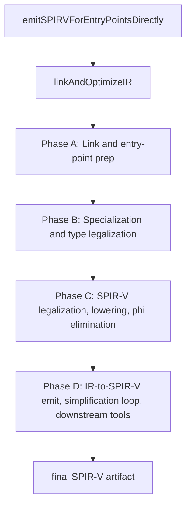

# SPIR-V Target Pipeline

This page documents the ordered IR-pass and downstream-binary sequence
executed when Slang compiles for the SPIR-V target via the
direct-emit path. It is written for a compiler developer who needs to
locate where in the SPIR-V direct-emit pipeline a particular pass runs,
what condition selects it, and which iterative passes loop until fixed
point — for example, when debugging or modifying that pipeline. The
direct-emit entry point
`emitSPIRVForEntryPointsDirectly` is invoked only from the
`CodeGenTarget::SPIRV` case of `CodeGenContext::_emitEntryPoints`
([slang-code-gen.cpp lines 1169-1175](../../../../source/slang/slang-code-gen.cpp)),
and only when the precondition
`getTargetProgram()->getOptionSet().shouldEmitSPIRVDirectly()`
holds — the `OptionSet` accessor at line 363 of
[slang-compiler-options.h](../../../../source/slang/slang-compiler-options.h).
(`TargetProgram::shouldEmitSPIRVDirectly` at line 114 of
[slang-target-program.h](../../../../source/slang/slang-target-program.h)
is the same option conjoined with `isSPIRV(target)`; the switch arm
has already established the target, so the two agree here.)
`CodeGenTarget::SPIRVAssembly` reuses this same pipeline only
indirectly: `_emitEntryPoints` first compiles an intermediate
`CodeGenTarget::SPIRV` artifact and then disassembles it
([slang-code-gen.cpp lines 1104-1167](../../../../source/slang/slang-code-gen.cpp)),
so this page is written from the `CodeGenTarget::SPIRV` perspective.
The legacy via-GLSL path (`isKhronosTarget && !emitSpirvDirectly`)
is not the subject of this page: it diverges at line 2745 of
[slang-emit.cpp](../../../../source/slang/slang-emit.cpp) where
`legalizeModesOfNonCopyableOpaqueTypedParamsForGLSL` runs only in
that mode, and the rest of the via-GLSL flow belongs to the
forthcoming GLSL target-pipeline page.

This page complements
[../pipeline/05-ir-passes.md](../pipeline/05-ir-passes.md), which is
an unordered topical catalog of every IR pass. The catalog answers
"what does pass `X` do?"; this page answers "when does pass `X` run
for SPIR-V, what gates it, and what loops iterate it?". Branches in
`linkAndOptimizeIR` gated on a sibling target (HLSL, GLSL, Metal,
WGSL, CUDA, CPU, PyTorch) are filtered out of the diagrams and
tables below; that filter is documented per-phase.

A second filter matters just as much and is easy to miss: **the
backend pipeline is not an unconditional ordered list.** Before the
first pass runs, `calcRequiredLoweringPassSet` (line 409 of
[slang-emit.cpp](../../../../source/slang/slang-emit.cpp)) walks the
whole linked module once and records, in a
`RequiredLoweringPassSet` (line 52 of
[slang-code-gen.h](../../../../source/slang/slang-code-gen.h)),
which categories of construct the IR actually contains. Most passes
in `linkAndOptimizeIR` are then guarded by the matching flag, so a
module that contains no tagged union never pays for
`lowerTaggedUnionTypes`, a module with no autodiff IR never runs
`finalizeAutoDiffPass`, and so on. The tables below give the flag in
the **Gate** column; `(always)` means genuinely unconditional. The
walk runs **twice** — once after `linkIR` (line 1085) and once again
mid-Phase-B after the optional/result-type lowerings (line 1666) —
and the flags **accumulate**: they are not cleared between scans.
That asymmetry is deliberate and is the safety argument for gating:
a flag can be *stale-true* (the construct was dead-code-eliminated
after a scan, so the pass runs and finds nothing — a harmless no-op
walk), but it should never be *false-negative*, because every gated
construct is either produced by the front end or produced by a pass
that runs before the last scan, or the later producer updates the
affected flag explicitly (for example `lowerTaggedUnionTypes`, which
runs after the second scan and sets
`requiredLoweringPassSet.reinterpret = true` when it creates
reinterpret instructions). Several gates carry that argument
verbatim as a source comment; see for example lines 1927-1934
(`appendConsumeStructuredBuffer`) and lines 1750-1756
(`taggedUnion`).

## Source

- [slang-emit.cpp](../../../../source/slang/slang-emit.cpp)
  — `linkAndOptimizeIR` (line 1015) is the orchestrator;
  `calcRequiredLoweringPassSet` (line 409) computes the
  `RequiredLoweringPassSet` predicate that gates most of the
  pipeline (see [Conditional gates](#conditional-gates));
  `emitSPIRVForEntryPointsDirectly` (line 3774) is the SPIR-V
  entry point; `createArtifactFromIR` (line 3528) wraps the
  post-emit downstream chain (spirv-link, spirv-val, the spirv-opt
  compile, the separate-debug-info split; `optimizeSPIRV` is
  currently disabled by `#if 0`).
- [slang-code-gen.h](../../../../source/slang/slang-code-gen.h)
  — declares `struct RequiredLoweringPassSet` (line 52), the
  40-flag record whose fields name the gates in the tables below.
- [slang-emit-spirv.cpp](../../../../source/slang/slang-emit-spirv.cpp)
  — `emitSPIRVFromIR` (line 12469) calls `legalizeIRForSPIRV`,
  iterates the forward-declared-pointer fixup loop, and emits the
  SPIR-V words.
- [slang-ir-spirv-legalize.cpp](../../../../source/slang/slang-ir-spirv-legalize.cpp)
  — `legalizeIRForSPIRV` (line 3433) is the top-level legalizer;
  `legalizeSPIRV` (line 3117) drives `SPIRVLegalizationContext::processModule`;
  `simplifyIRForSpirvLegalization` (line 3130) is the iterative
  simplification loop (it declares outer / inner bound constants 8 /
  16 but never increments their counters, so it iterates to a fixed
  point — see the Loops section);
  `widenNarrowAccessChainIndices`,
  `removeUnreachableCodeAfterDiscardForOpKill`, and
  `insertFragmentShaderInterlock` are SPIR-V-specific finalization
  steps.
- [slang-ir-glsl-legalize.cpp](../../../../source/slang/slang-ir-glsl-legalize.cpp)
  — `legalizeEntryPointsForGLSL` is called for SPIR-V too despite
  its name (it predates the SPIR-V direct-emit path).
- [slang-ir-legalize-binary-operator.cpp](../../../../source/slang/slang-ir-legalize-binary-operator.cpp)
  — used by `legalizeLogicalAndOr` for Khronos targets.
- [slang-ir-spirv-snippet.cpp](../../../../source/slang/slang-ir-spirv-snippet.cpp)
  — referenced by `legalizeSPIRV` for inline-asm snippet handling.
- [slang-target-program.h](../../../../source/slang/slang-target-program.h)
  — declares the forwarding `TargetProgram::shouldEmitSPIRVDirectly`
  (line 114), which combines `isSPIRV(...)` with the option-set
  predicate of the same name.
- [slang-compiler-options.h](../../../../source/slang/slang-compiler-options.h)
  — declares the `CompilerOptionSet` accessors that gate many of the
  conditional passes below, including `shouldEmitSPIRVDirectly`
  (line 363) and `shouldIncludeSourceInDebugInfo` (line 403).

## High-level phase diagram



All four `Phase *` nodes are bodies of `linkAndOptimizeIR` except
for Phase D, which starts inside `linkAndOptimizeIR`
(`collectMetadata` / `checkUnsupportedInst`) and continues through
`createArtifactFromIR` and the SPIR-V backend.

## Phase A: Link and entry-point prep

Spans roughly lines 1050-1487 of
[slang-emit.cpp](../../../../source/slang/slang-emit.cpp). The phase
takes the just-linked IR module, runs structural validators, and
prepares the entry-point shape: coverage instrumentation, layout,
uniform-parameter collection, the post-packing coverage-metadata
finalize, and the three lowerings that must precede the first
simplification (`lowerLValueCast`, `specializeMatrixLayout`,
`lowerEnumType`). The global-varying / entry-point-callsite passes that
used to be shown here actually run later, in Phase B (after
`legalizeResourceTypes`). SPIR-V is reached via the `default` arm of
every per-target switch in this phase.

```mermaid
flowchart TD
  linkIRn[linkIR]
  dbgGate{shouldEmitSeparateDebugInfo?}
  emitBuildId["emit IRBuildIdentifier"]
  reqSet1["calcRequiredLoweringPassSet (build gate set)"]
  aaGate{reqSet.assumeAddress}
  vaaa[validateAndRemoveAssumeAddress]
  diGate{"reqSet.debugInfo && targetCompilerOptions.getDebugInfoLevel() == DebugInfoLevel::None"}
  stripDI[stripDebugInfo]
  tEPInBorrow[translateEntryPointInParamToBorrow]
  rGC[replaceGlobalConstants]
  beGate{reqSet.bindExistential}
  bES[bindExistentialSlots]
  covGate{reqSet.coverageTracing}
  iC[instrumentCoverage]
  cGUP[collectGlobalUniformParameters]
  cEPD[checkEntryPointDecorations]
  aDMD[addDenormalModeDecorations]
  cEPUP[collectEntryPointUniformParams]
  mEPUP[moveEntryPointUniformParamsToGlobalScope]
  rTCEP[removeTorchAndCUDAEntryPoints]
  covGate2{reqSet.coverageTracing}
  fCIM[finalizeCoverageInstrumentationMetadata]
  lvcGate{reqSet.lValueCast}
  lLVC[lowerLValueCast]
  mlGate{reqSet.unresolvedMatrixLayout}
  sML[specializeMatrixLayout]
  enumGate{reqSet.enumType}
  lET[lowerEnumType]

  linkIRn --> dbgGate
  dbgGate -->|true| emitBuildId --> reqSet1
  dbgGate -->|false| reqSet1
  reqSet1 --> aaGate
  aaGate -->|true| vaaa --> diGate
  aaGate -->|false| diGate
  diGate -->|true| stripDI --> tEPInBorrow
  diGate -->|false| tEPInBorrow
  tEPInBorrow --> rGC --> beGate
  beGate -->|true| bES --> covGate
  beGate -->|false| covGate
  covGate -->|true| iC --> cGUP
  covGate -->|false| cGUP
  cGUP --> cEPD --> aDMD --> cEPUP --> mEPUP --> rTCEP --> covGate2
  covGate2 -->|true| fCIM --> lvcGate
  covGate2 -->|false| lvcGate
  lvcGate -->|true| lLVC --> mlGate
  lvcGate -->|false| mlGate
  mlGate -->|true| sML --> enumGate
  mlGate -->|false| enumGate
  enumGate -->|true| lET
```



Validation calls `validateIRModuleIfEnabled` run after most
`SLANG_PASS` calls but are omitted from the diagram for legibility.

| # | Pass | File | Gate | Notes |
| --- | --- | --- | --- | --- |
| 1 | `linkIR` | [slang-ir-link.cpp](../../../../source/slang/slang-ir-link.cpp) | (always) | Direct call (not `SLANG_PASS`, line 1050); pulls in IR for imported modules. The first `calcRequiredLoweringPassSet` scan (line 1085) follows the `RequiredLoweringPassSet` reset at line 1084. |
| 2 | `validateAndRemoveAssumeAddress` | [slang-ir-validate.cpp](../../../../source/slang/slang-ir-validate.cpp) | `reqSet.assumeAddress` | Line 1087. `validate=true` for SPIR-V (the argument is `!isCPUTarget && !isCUDATarget`). The flag is set by `kIROp_AssumeAddress`. |
| 3 | `stripDebugInfo` | [slang-ir-strip-debug-info.cpp](../../../../source/slang/slang-ir-strip-debug-info.cpp) | `reqSet.debugInfo && getDebugInfoLevel() == DebugInfoLevel::None` | Drops debug instructions when `-g0`. |
| 4 | `translateEntryPointInParamToBorrow` | [slang-ir-transform-params-to-constref.cpp](../../../../source/slang/slang-ir-transform-params-to-constref.cpp) | (always) | |
| 5 | `replaceGlobalConstants` | [slang-ir-link.cpp](../../../../source/slang/slang-ir-link.cpp) | (always) | |
| 6 | `bindExistentialSlots` | [slang-ir-bind-existentials.cpp](../../../../source/slang/slang-ir-bind-existentials.cpp) | `reqSet.bindExistential` | |
| 7 | `instrumentCoverage` | [slang-ir-coverage-instrument.cpp](../../../../source/slang/slang-ir-coverage-instrument.cpp) | `reqSet.coverageTracing` | Writes coverage metadata via the `ArtifactPostEmitMetadata` pointer created at line 1064. Takes a `counterByteWidth` (default `kDefaultCoverageCounterByteWidth`, overridable through `TraceCoverageCounterByteWidth`; any value other than 4 or 8 fails with `CoverageCounterWidthBytesInvalid`) and a `coverageBoolean` flag (from `TraceCoverageBoolean`, off by default). The placement options (`TraceCoverageBinding`, `TraceCoverageBindlessIndex`) are read and validated before the gate (lines 1172-1255), so a bindless index on a non-Khronos target is diagnosed even when the module has no coverage markers; SPIR-V is a Khronos target and passes that check. |
| 8 | `collectGlobalUniformParameters` | [slang-ir-collect-global-uniforms.cpp](../../../../source/slang/slang-ir-collect-global-uniforms.cpp) | (always) | |
| 9 | `checkEntryPointDecorations` | [slang-ir-entry-point-decorations.cpp](../../../../source/slang/slang-ir-entry-point-decorations.cpp) | (always) | |
| 10 | `addDenormalModeDecorations` | [slang-emit.cpp](../../../../source/slang/slang-emit.cpp) | (always) | Static helper inside `slang-emit.cpp` (line 801). |
| 11 | `collectEntryPointUniformParams` | [slang-ir-entry-point-uniforms.cpp](../../../../source/slang/slang-ir-entry-point-uniforms.cpp) | (always, SPIR-V via `default` arm) | |
| 12 | `moveEntryPointUniformParamsToGlobalScope` | [slang-ir-entry-point-uniforms.cpp](../../../../source/slang/slang-ir-entry-point-uniforms.cpp) | (always, SPIR-V via `default` arm) | |
| 13 | `removeTorchAndCUDAEntryPoints` | [slang-ir-pytorch-cpp-binding.cpp](../../../../source/slang/slang-ir-pytorch-cpp-binding.cpp) | (always, SPIR-V via `default` arm) | |
| 14 | `finalizeCoverageInstrumentationMetadata` | [slang-ir-coverage-instrument.cpp](../../../../source/slang/slang-ir-coverage-instrument.cpp) | `reqSet.coverageTracing` | Runs after entry-point uniform packing so the post-packing `globalScopeVarLayout` can fill in the CPU/CUDA uniform-marshaling fields on the coverage `ArtifactPostEmitMetadata` produced by step 7. Effectively a no-op on SPIR-V (no CPU/CUDA marshaling), but the call site is shared. |
| 15 | `lowerLValueCast` | [slang-ir-lower-l-value-cast.cpp](../../../../source/slang/slang-ir-lower-l-value-cast.cpp) | `reqSet.lValueCast` | The flag is set by `kIROp_InOutImplicitCast` / `kIROp_OutImplicitCast`, which only the front end produces. |
| 16 | `specializeMatrixLayout` | [slang-ir-specialize-matrix-layout.cpp](../../../../source/slang/slang-ir-specialize-matrix-layout.cpp) | `reqSet.unresolvedMatrixLayout` | Line 1479. Runs before the first `simplifyIR`. The flag is set by a `kIROp_MatrixType` whose layout operand is not a literal or is `SLANG_MATRIX_LAYOUT_MODE_UNKNOWN`. |
| 17 | `lowerEnumType` | [slang-ir-lower-enum-type.cpp](../../../../source/slang/slang-ir-lower-enum-type.cpp) | `reqSet.enumType` | Runs early so enum casts don't block specialization. The flag is set by `kIROp_CastEnumToInt` / `kIROp_CastIntToEnum` / `kIROp_EnumCast` as well as by `kIROp_EnumType`, so a degenerate cast that outlives the last `IREnumType` still selects the pass. |

Filtered out for SPIR-V in this phase: the
`!isKhronosTarget && reqSet.glslSSBO` branch (line 1103,
`lowerGLSLShaderStorageBufferObjectsToStructuredBuffers`); the
`CUDASource` / `CUDAHeader` arm of the entry-point-param switch
(`collectOptiXEntryPointUniformParams`).

## Phase B: Specialization and type legalization

Spans roughly lines 1499-2178 of
[slang-emit.cpp](../../../../source/slang/slang-emit.cpp). The phase
runs the main simplification pass, drives generic / existential
specialization, finalizes autodiff, lowers high-level types
(`Result`, `Optional`, `Conditional`, tagged unions, existentials,
tuples), and then performs resource legalization, global-variable
legalization (varying translation, entry-point callsite split,
initializer motion, resource-global replacement) and several rounds of
resource-usage specialization. Phase B ends at `checkStaticAssert`,
just before byte-address-buffer legalization.

```mermaid
flowchart TD
  s1[simplifyIR default]
  vuGate{"targetProgram->getOptionSet().getBoolOption(CompilerOptionName::ValidateUniformity)"}
  vu[validateUniformity]
  fscGate{not shouldPerformMinimumOptimizations}
  fSC[fuseCallsToSaturatedCooperation]
  adGate{reqSet.autodiff}
  cAP[checkAutodiffPatterns]
  dCC[diagnoseCircularConformances]
  sdGate{"!codeGenContext->isSpecializationDisabled()"}
  sM[specializeModule]
  vMGVT["validateMutableGlobalVariableTypes (direct call, returns SLANG_FAIL on error)"]
  hofGate{reqSet.higherOrderFunc}
  sHOP[specializeHigherOrderParameters]
  adGate2{reqSet.autodiff}
  fADP[finalizeAutoDiffPass]
  sADD[stripAutoDiffDecorations]
  mssGate{reqSet.matrixSwizzleStore}
  lMSS[lowerMatrixSwizzleStores]
  dce1[eliminateDeadCode]
  fS[finalizeSpecialization]
  adGate3{reqSet.autodiff}
  lDTI["lowerDiffTypeInfoInsts (direct call)"]
  ctGate{reqSet.conditionalType}
  lCT[lowerConditionalType]
  otGate1{reqSet.optionalType}
  lRO[lowerReinterpretOptional]
  nevGate{shouldRunNonEssentialValidation}
  cONU[checkForOptionalNoneUsage]
  otGate2{reqSet.optionalType}
  lOT[lowerOptionalType]
  rtGate{reqSet.resultType}
  lRT[lowerResultType]
  reqSet2["calcRequiredLoweringPassSet (rebuild gates)"]
  dUR[detectUninitializedResources]
  raidGate{removeAvailableInDownstreamIR}
  rAIDD[removeAvailableInDownstreamModuleDecorations]
  nevGate2{shouldRunNonEssentialValidation}
  cRT[checkForRecursiveTypes]
  cRF[checkForRecursiveFunctions]
  cOBA[checkForOutOfBoundAccess]
  mrGate{reqSet.missingReturn}
  cMR[checkForMissingReturns]
  cISPT[checkForInvalidShaderParameterType]
  iAVS[inferAnyValueSizeWhereNecessary]
  uPWT[unpinWitnessTables]
  svmGate{reqSet.sumVectorMatrix}
  lSVMI[lowerSumVectorMatrixInsts]
  minOptGate{not minimalOptimization}
  s2a[simplifyIR fast]
  genGate{reqSet.generics}
  dce2[eliminateDeadCode]
  tuGate{reqSet.taggedUnion}
  lTUT[lowerTaggedUnionTypes]
  utGate{reqSet.untaggedUnion}
  lUUT[lowerUntaggedUnionTypes]
  reinterpretGate{reqSet.reinterpret}
  lR[lowerReinterpret]
  lSIDC[lowerSequentialIDTagCasts]
  toGate{reqSet.tagOps}
  lTI[lowerTagInsts]
  ttGate{reqSet.tagType}
  lTT[lowerTagTypes]
  dce3[eliminateDeadCode]
  lE[lowerExistentials]
  rWUI[removeWeakUseInsts]
  cTD["clearTranslationDictionary (direct call)"]
  pTIN[performTypeInlining]
  dce4["eliminateDeadCode (direct call)"]
  nevGate3{shouldRunNonEssentialValidation}
  cGSHI[checkGetStringHashInsts]
  lTu[lowerTuples]
  gAVMF[generateAnyValueMarshallingFunctions]
  ssGate{reqSet.specializeStageSwitch}
  sSS[specializeStageSwitch]
  pFI1[performForceInlining]
  minOpt2{minimalOptimization}
  aSCCP[applySparseConditionalConstantPropagation]
  dce5[eliminateDeadCode]
  s2b[simplifyIR default]
  tSCP[threadSwitchOnConstantPhi]
  cpiGate{shouldReportCheckpointIntermediates}
  rCI["reportCheckpointIntermediates (direct call)"]
  acsbGate{reqSet.appendConsumeStructuredBuffer}
  lACSB[lowerAppendConsumeStructuredBuffers]
  vrGate{getBoolOption VulkanEmitReflection}
  aUTHD[addUserTypeHintDecorations]
  lEA[legalizeEmptyArray]
  lVT[legalizeVectorTypes]
  iGC[inlineGlobalConstantsForLegalization]
  lRTP[legalizeRayTracingPayloads]
  etlGate{reqSet.existentialTypeLayout}
  lETL[legalizeExistentialTypeLayout]
  vSBRT["validateStructuredBufferResourceTypes (returns SLANG_FAIL on error)"]
  lRTR[legalizeResourceTypes]
  gvvGate{reqSet.globalVaryingVar}
  tGVV[translateGlobalVaryingVar]
  fEPC[fixEntryPointCallsites]
  mGVI[moveGlobalVarInitializationToEntryPoints]
  lRGV[legalizeResourceGlobalVars]
  minOpt3{minimalOptimization}
  dce6[eliminateDeadCode]
  s2c[simplifyIR fast]
  urhGate{reqSet.untypedResourceHandle}
  lURH[lowerUntypedResourceHandleToUInt]
  drhGate{reqSet.dynamicResourceHeap}
  lDRH[lowerDynamicResourceHeap]
  sRU[specializeResourceUsage]
  sFBLA1[specializeFuncsForBufferLoadArgs]
  dBL[deferBufferLoad]
  sAP[specializeArrayParameters]
  cSA["checkStaticAssert (direct call)"]

  s1 --> vuGate
  vuGate -->|true| vu --> fscGate
  vuGate -->|false| fscGate
  fscGate -->|true| fSC --> adGate
  fscGate -->|false| adGate
  adGate -->|true| cAP --> dCC
  adGate -->|false| dCC
  dCC --> sdGate
  sdGate -->|true| sM --> vMGVT
  sdGate -->|false| vMGVT
  vMGVT --> hofGate
  hofGate -->|true| sHOP --> adGate2
  hofGate -->|false| adGate2
  adGate2 -->|true| fADP --> mssGate
  adGate2 -->|false| sADD --> mssGate
  mssGate -->|true| lMSS --> dce1
  mssGate -->|false| dce1
  dce1 --> fS --> adGate3
  adGate3 -->|true| lDTI --> ctGate
  adGate3 -->|false| ctGate
  ctGate -->|true| lCT --> otGate1
  ctGate -->|false| otGate1
  otGate1 -->|true| lRO --> nevGate
  otGate1 -->|false| nevGate
  nevGate -->|true| cONU --> otGate2
  nevGate -->|false| otGate2
  otGate2 -->|true| lOT --> rtGate
  otGate2 -->|false| rtGate
  rtGate -->|true| lRT --> reqSet2
  rtGate -->|false| reqSet2
  reqSet2 --> dUR --> raidGate
  raidGate -->|true| rAIDD --> nevGate2
  raidGate -->|false| nevGate2
  nevGate2 -->|true| cRT --> cRF --> cOBA --> mrGate
  nevGate2 -->|false| iAVS
  mrGate -->|true| cMR --> cISPT
  mrGate -->|false| cISPT
  cISPT --> iAVS
  iAVS --> uPWT --> svmGate
  svmGate -->|true| lSVMI --> minOptGate
  svmGate -->|false| minOptGate
  minOptGate -->|true| s2a --> tuGate
  minOptGate -->|false| genGate
  genGate -->|true| dce2 --> tuGate
  genGate -->|false| tuGate
  tuGate -->|true| lTUT --> utGate
  tuGate -->|false| utGate
  utGate -->|true| lUUT --> reinterpretGate
  utGate -->|false| reinterpretGate
  reinterpretGate -->|true| lR --> lSIDC
  reinterpretGate -->|false| lSIDC
  lSIDC --> toGate
  toGate -->|true| lTI --> ttGate
  toGate -->|false| ttGate
  ttGate -->|true| lTT --> dce3
  ttGate -->|false| dce3
  dce3 --> lE --> rWUI --> cTD --> pTIN --> dce4 --> nevGate3
  nevGate3 -->|true| cGSHI --> lTu
  nevGate3 -->|false| lTu
  lTu --> gAVMF --> ssGate
  ssGate -->|true| sSS --> pFI1
  ssGate -->|false| pFI1
  pFI1 --> minOpt2
  minOpt2 -->|true| aSCCP --> dce5 --> tSCP
  minOpt2 -->|false| s2b --> tSCP
  tSCP --> cpiGate
  cpiGate -->|true| rCI --> acsbGate
  cpiGate -->|false| acsbGate
  acsbGate -->|true| lACSB --> vrGate
  acsbGate -->|false| vrGate
  vrGate -->|true| aUTHD --> lEA
  vrGate -->|false| lEA
  lEA --> lVT --> iGC --> lRTP --> etlGate
  etlGate -->|true| lETL --> vSBRT
  etlGate -->|false| vSBRT
  vSBRT --> lRTR --> gvvGate
  gvvGate -->|true| tGVV --> fEPC
  gvvGate -->|false| fEPC
  fEPC --> mGVI --> lRGV --> minOpt3
  minOpt3 -->|true| dce6 --> urhGate
  minOpt3 -->|false| s2c --> urhGate
  urhGate -->|true| lURH --> drhGate
  urhGate -->|false| drhGate
  drhGate -->|true| lDRH --> sRU
  drhGate -->|false| sRU
  sRU --> sFBLA1 --> dBL --> sAP --> cSA
```



| # | Pass | File | Gate | Notes |
| --- | --- | --- | --- | --- |
| 1 | `simplifyIR` | [slang-ir-ssa-simplification.cpp](../../../../source/slang/slang-ir-ssa-simplification.cpp) | (always) | `defaultIRSimplificationOptions`, line 1499. |
| 2 | `validateUniformity` | [slang-ir-uniformity.cpp](../../../../source/slang/slang-ir-uniformity.cpp) | `getBoolOption(ValidateUniformity)` | Aborts the pipeline on error. |
| 3 | `fuseCallsToSaturatedCooperation` | [slang-ir-fuse-satcoop.cpp](../../../../source/slang/slang-ir-fuse-satcoop.cpp) | `!shouldPerformMinimumOptimizations` | Must run before defunctionalization. |
| 4 | `checkAutodiffPatterns` | [slang-ir-autodiff.cpp](../../../../source/slang/slang-ir-autodiff.cpp) | `reqSet.autodiff` | |
| 5 | `diagnoseCircularConformances` | [slang-ir-any-value-inference.cpp](../../../../source/slang/slang-ir-any-value-inference.cpp) | (always) | Aborts before specialization on error. |
| 6 | `specializeModule` | [slang-ir-specialize.cpp](../../../../source/slang/slang-ir-specialize.cpp) | `!isSpecializationDisabled()` | With `specOptions.lowerWitnessLookups = true`. |
| 7 | `validateMutableGlobalVariableTypes` | [slang-ir-validate.cpp](../../../../source/slang/slang-ir-validate.cpp) | (always) | Direct call (line 1571); returns `SLANG_FAIL` if a mutable global has an invalid type. |
| 8 | `specializeHigherOrderParameters` | [slang-ir-defunctionalization.cpp](../../../../source/slang/slang-ir-defunctionalization.cpp) | `reqSet.higherOrderFunc` | |
| 9a | `finalizeAutoDiffPass` | [slang-ir-autodiff.cpp](../../../../source/slang/slang-ir-autodiff.cpp) | `reqSet.autodiff` (line 1592) | Builds an `AutoDiffSharedContext`; skipped entirely for modules with no autodiff IR. Mutually exclusive with row 9b. |
| 9b | `stripAutoDiffDecorations` | [slang-ir-autodiff.cpp](../../../../source/slang/slang-ir-autodiff.cpp) | `!reqSet.autodiff` (`else` arm, line 1596) | Runs *instead of* row 9a. A module with no autodiff constructs nonetheless links the `[__AutoDiffBuiltin]` core-module types, whose `Export` / `KeepAlive` decorations would otherwise pin them past the `eliminateDeadCode` in row 11. |
| 10 | `lowerMatrixSwizzleStores` | [slang-ir-lower-matrix-swizzle-store.cpp](../../../../source/slang/slang-ir-lower-matrix-swizzle-store.cpp) | `reqSet.matrixSwizzleStore` | |
| 11 | `eliminateDeadCode` | [slang-ir-dce.cpp](../../../../source/slang/slang-ir-dce.cpp) | (always) | `deadCodeEliminationOptions`, whose `keepGlobalParamsAlive` is set from `PreserveParameters` at line 1496. |
| 12 | `finalizeSpecialization` | [slang-ir-specialize.cpp](../../../../source/slang/slang-ir-specialize.cpp) | (always) | |
| 13 | `lowerDiffTypeInfoInsts` | [slang-emit.cpp](../../../../source/slang/slang-emit.cpp) | `reqSet.autodiff` | Direct call at line 1612; the helper is defined at line 897 of `slang-emit.cpp`. `DiffTypeInfo` is hoistable, so the pass must run after specialization. `kIROp_DiffTypeInfo` is itself one of the opcodes that sets the flag. |
| 14 | `lowerConditionalType` | [slang-ir-lower-conditional-type.cpp](../../../../source/slang/slang-ir-lower-conditional-type.cpp) | `reqSet.conditionalType` | |
| 15 | `lowerReinterpretOptional` | [slang-ir-lower-reinterpret.cpp](../../../../source/slang/slang-ir-lower-reinterpret.cpp) | `reqSet.optionalType` | |
| 16 | `checkForOptionalNoneUsage` | [slang-ir-check-optional-none-usage.cpp](../../../../source/slang/slang-ir-check-optional-none-usage.cpp) | `shouldRunNonEssentialValidation()` | Must run after `simplifyIR` but before `lowerOptionalType`. |
| 17 | `lowerOptionalType` | [slang-ir-lower-optional-type.cpp](../../../../source/slang/slang-ir-lower-optional-type.cpp) | `reqSet.optionalType` | |
| 18 | `lowerResultType` | [slang-ir-lower-result-type.cpp](../../../../source/slang/slang-ir-lower-result-type.cpp) | `reqSet.resultType` | Runs **after** `lowerOptionalType`: `lowerResultType` depends on accurate `getAnyValueSize()` results, which requires Optional types to be lowered first. The second `calcRequiredLoweringPassSet` scan (line 1666) follows the HLSL-only `legalizeNonVectorCompositeSelect` and the CPP-only COM / DLL switch, both filtered out. |
| 19 | `detectUninitializedResources` | [slang-ir-detect-uninitialized-resources.cpp](../../../../source/slang/slang-ir-detect-uninitialized-resources.cpp) | (always) | After `calcRequiredLoweringPassSet` rebuilds gates. |
| 20 | `removeAvailableInDownstreamModuleDecorations` | [slang-ir-redundancy-removal.cpp](../../../../source/slang/slang-ir-redundancy-removal.cpp) | `codeGenContext->removeAvailableInDownstreamIR` | |
| 21 | `checkForRecursiveTypes` | [slang-ir-check-recursion.cpp](../../../../source/slang/slang-ir-check-recursion.cpp) | `shouldRunNonEssentialValidation()` | Source-level recursion never reaches this run: the same function is called once already during IR generation ([slang-lower-to-ir.cpp line 15724](../../../../source/slang/slang-lower-to-ir.cpp)), a `struct` that contains itself (directly or through an array) is rejected there with error 41001, and that call site returns immediately afterwards, before `linkAndOptimizeIR` is reached. What this pass still catches is IR that never went through the earlier call — for instance a `.slang-module` serialized under `-disable-non-essential-validations` and then handed to a SPIR-V compile. |
| 22 | `checkForRecursiveFunctions` | [slang-ir-check-recursion.cpp](../../../../source/slang/slang-ir-check-recursion.cpp) | `shouldRunNonEssentialValidation()` | |
| 23 | `checkForOutOfBoundAccess` | [slang-check-out-of-bound-access.cpp](../../../../source/slang/slang-check-out-of-bound-access.cpp) | `shouldRunNonEssentialValidation()` | |
| 24 | `checkForMissingReturns` | [slang-ir-missing-return.cpp](../../../../source/slang/slang-ir-missing-return.cpp) | `reqSet.missingReturn` (under non-essential validation) | |
| 25 | `checkForInvalidShaderParameterType` | [slang-ir-check-shader-parameter-type.cpp](../../../../source/slang/slang-ir-check-shader-parameter-type.cpp) | `shouldRunNonEssentialValidation()` | |
| 26 | `inferAnyValueSizeWhereNecessary` | [slang-ir-any-value-inference.cpp](../../../../source/slang/slang-ir-any-value-inference.cpp) | (always) | |
| 27 | `unpinWitnessTables` | [slang-ir-strip-legalization-insts.cpp](../../../../source/slang/slang-ir-strip-legalization-insts.cpp) | (always) | |
| 28 | `lowerSumVectorMatrixInsts` | [slang-emit.cpp](../../../../source/slang/slang-emit.cpp) | `reqSet.sumVectorMatrix` | Helper at line 924. `kIROp_SumVectorElements` / `kIROp_SumMatrixElements` are produced only by the autodiff transpose pass, which runs before the second `calcRequiredLoweringPassSet` scan. |
| 29 | `simplifyIR` | [slang-ir-ssa-simplification.cpp](../../../../source/slang/slang-ir-ssa-simplification.cpp) | `!fastIRSimplificationOptions.minimalOptimization` | `fastIRSimplificationOptions`. |
| 30 | `eliminateDeadCode` | [slang-ir-dce.cpp](../../../../source/slang/slang-ir-dce.cpp) | `minimalOptimization && reqSet.generics` | Alternative to row 29 in minimal-opt mode. |
| 31 | `lowerTaggedUnionTypes` | [slang-ir-lower-dynamic-dispatch-insts.cpp](../../../../source/slang/slang-ir-lower-dynamic-dispatch-insts.cpp) | `reqSet.taggedUnion` | Sets `reqSet.reinterpret = true` if it returns `true`; when the gate is false the pass would create no reinterpret insts, so leaving `reinterpret` untouched is correct. |
| 32 | `lowerUntaggedUnionTypes` | [slang-ir-lower-dynamic-dispatch-insts.cpp](../../../../source/slang/slang-ir-lower-dynamic-dispatch-insts.cpp) | `reqSet.untaggedUnion` | Set by the tagged-union opcodes, `kIROp_UntaggedUnionType` and `kIROp_NoneTypeElement`. |
| 33 | `lowerReinterpret` | [slang-ir-lower-reinterpret.cpp](../../../../source/slang/slang-ir-lower-reinterpret.cpp) | `reqSet.reinterpret` | |
| 34 | `lowerSequentialIDTagCasts` | [slang-ir-lower-dynamic-dispatch-insts.cpp](../../../../source/slang/slang-ir-lower-dynamic-dispatch-insts.cpp) | (always) | |
| 35 | `lowerTagInsts` | [slang-ir-lower-dynamic-dispatch-insts.cpp](../../../../source/slang/slang-ir-lower-dynamic-dispatch-insts.cpp) | `reqSet.tagOps` | Set by the tagged-union opcodes and the `kIROp_GetTagOfElementInSet` / `GetTagForSuperSet` / `GetTagForSubSet` / `GetTagForMappedSet` tag ops. |
| 36 | `lowerTagTypes` | [slang-ir-lower-dynamic-dispatch-insts.cpp](../../../../source/slang/slang-ir-lower-dynamic-dispatch-insts.cpp) | `reqSet.tagType` | Also set by `kIROp_SetTagType`. |
| 37 | `eliminateDeadCode` | [slang-ir-dce.cpp](../../../../source/slang/slang-ir-dce.cpp) | (always) | |
| 38 | `lowerExistentials` | [slang-ir-lower-dynamic-dispatch-insts.cpp](../../../../source/slang/slang-ir-lower-dynamic-dispatch-insts.cpp) | (always) | |
| 39 | `removeWeakUseInsts` | [slang-emit.cpp](../../../../source/slang/slang-emit.cpp) | (always) | Static helper at line 1000 of `slang-emit.cpp`. |
| 40 | `performTypeInlining` | [slang-ir-inline.cpp](../../../../source/slang/slang-ir-inline.cpp) | `!isCpuLikeTarget(artifactDesc)` (true for SPIR-V) | Returns `SLANG_FAIL` if inlining fails. |
| 41 | `eliminateDeadCode` | [slang-ir-dce.cpp](../../../../source/slang/slang-ir-dce.cpp) | (always) | Direct call (line 1804) with `fastIRSimplificationOptions.deadCodeElimOptions`. It runs before row 42 because `performTypeInlining` leaves the inlined callee behind, and that leftover body can still hold a `getStringHash` on an unfolded parameter. |
| 42 | `checkGetStringHashInsts` | [slang-ir-string-hash.cpp](../../../../source/slang/slang-ir-string-hash.cpp) | `!isCpuLikeTarget && shouldRunNonEssentialValidation()` | |
| 43 | `lowerTuples` | [slang-ir-lower-tuple-types.cpp](../../../../source/slang/slang-ir-lower-tuple-types.cpp) | (always) | |
| 44 | `generateAnyValueMarshallingFunctions` | [slang-ir-any-value-marshalling.cpp](../../../../source/slang/slang-ir-any-value-marshalling.cpp) | (always) | |
| 45 | `specializeStageSwitch` | [slang-ir-specialize-stage-switch.cpp](../../../../source/slang/slang-ir-specialize-stage-switch.cpp) | `reqSet.specializeStageSwitch` | |
| 46 | `performForceInlining` | [slang-ir-inline.cpp](../../../../source/slang/slang-ir-inline.cpp) | (always) | Inlines `[__unsafeInlineEarly]` / `[ForceInline]`. |
| 47 | `applySparseConditionalConstantPropagation` | [slang-ir-sccp.cpp](../../../../source/slang/slang-ir-sccp.cpp) | `minimalOptimization` | Followed by row 48. |
| 48 | `eliminateDeadCode` | [slang-ir-dce.cpp](../../../../source/slang/slang-ir-dce.cpp) | `minimalOptimization` | |
| 49 | `simplifyIR` | [slang-ir-ssa-simplification.cpp](../../../../source/slang/slang-ir-ssa-simplification.cpp) | `!minimalOptimization` | `defaultIRSimplificationOptions`. |
| 50 | `threadSwitchOnConstantPhi` | [slang-ir-thread-switch-on-constant-phi.cpp](../../../../source/slang/slang-ir-thread-switch-on-constant-phi.cpp) | (always) | Line 1900. Registered outside the minimal-optimization branch so it runs at every optimization level; at `-O0` the switch selector becomes a phi through the SCCP + DCE step. When the selector is not a phi it finds nothing to thread. |
| 51 | `lowerAppendConsumeStructuredBuffers` | [slang-ir-lower-append-consume-structured-buffer.cpp](../../../../source/slang/slang-ir-lower-append-consume-structured-buffer.cpp) | `target != HLSL && reqSet.appendConsumeStructuredBuffer` | The flag is set by `kIROp_HLSLAppendStructuredBufferType` / `kIROp_HLSLConsumeStructuredBufferType`, which only the front end produces. |
| 52 | `addUserTypeHintDecorations` | [slang-ir-user-type-hint.cpp](../../../../source/slang/slang-ir-user-type-hint.cpp) | `getBoolOption(VulkanEmitReflection)` | |
| 53 | `legalizeEmptyArray` | [slang-ir-legalize-empty-array.cpp](../../../../source/slang/slang-ir-legalize-empty-array.cpp) | (always) | |
| 54 | `legalizeVectorTypes` | [slang-ir-legalize-vector-types.cpp](../../../../source/slang/slang-ir-legalize-vector-types.cpp) | (always) | Splits oversized / non-power-of-two vectors. |
| 55 | `inlineGlobalConstantsForLegalization` | [slang-ir-legalize-global-values.cpp](../../../../source/slang/slang-ir-legalize-global-values.cpp) | `options.shouldLegalizeExistentialAndResourceTypes` (default `true` for SPIR-V) | The gate is the disjunction with the CUDA and CPU-kernel conditions, which do not apply here. |
| 56 | `legalizeRayTracingPayloads` | [slang-ir-ray-tracing-legalize.cpp](../../../../source/slang/slang-ir-ray-tracing-legalize.cpp) | `options.shouldLegalizeExistentialAndResourceTypes` | Line 1989. Gives empty ray / callable payloads physical storage at native interfaces before type legalization erases their logical values, and wraps non-struct D3D payloads and hit attributes. |
| 57 | `legalizeExistentialTypeLayout` | [slang-ir-legalize-types.cpp](../../../../source/slang/slang-ir-legalize-types.cpp) | `reqSet.existentialTypeLayout` | |
| 58 | `validateStructuredBufferResourceTypes` | [slang-ir-validate.cpp](../../../../source/slang/slang-ir-validate.cpp) | (always, inside the `shouldLegalizeExistentialAndResourceTypes` block) | Direct call; returns `SLANG_FAIL` if invalid. |
| 59 | `legalizeResourceTypes` | [slang-ir-legalize-types.cpp](../../../../source/slang/slang-ir-legalize-types.cpp) | `options.shouldLegalizeExistentialAndResourceTypes` | Splits structs containing resource fields. |
| 60 | `translateGlobalVaryingVar` | [slang-ir-translate-global-varying-var.cpp](../../../../source/slang/slang-ir-translate-global-varying-var.cpp) | `reqSet.globalVaryingVar` | Line 2078. Materializes input parameters and their assignments before the entry point is cloned. |
| 61 | `fixEntryPointCallsites` | [slang-ir-fix-entrypoint-callsite.cpp](../../../../source/slang/slang-ir-fix-entrypoint-callsite.cpp) | (always) | Separates launch functions from ordinary callees before initializers are injected. |
| 62 | `moveGlobalVarInitializationToEntryPoints` | [slang-ir-explicit-global-init.cpp](../../../../source/slang/slang-ir-explicit-global-init.cpp) | (always) | Line 2091. Unconditional for every target; the pass owns the per-target policy. It runs after resource and empty-type legalization and before row 63. |
| 63 | `legalizeResourceGlobalVars` | [slang-ir-legalize-resource-globals.cpp](../../../../source/slang/slang-ir-legalize-resource-globals.cpp) | (always) | Line 2099. Replaces the storage of selected resource globals with locals and generated parameters before resource specialization; takes the target capabilities and `shouldRunNonEssentialValidation()`. |
| 64 | `eliminateDeadCode` | [slang-ir-dce.cpp](../../../../source/slang/slang-ir-dce.cpp) | `minimalOptimization` | |
| 65 | `simplifyIR` | [slang-ir-ssa-simplification.cpp](../../../../source/slang/slang-ir-ssa-simplification.cpp) | `!minimalOptimization` | `fastIRSimplificationOptions`. Matrix types are not legalized yet; `legalizeMatrixTypes` runs later in Phase C. |
| 66 | `lowerUntypedResourceHandleToUInt` | [slang-ir-lower-dynamic-resource-heap.cpp](../../../../source/slang/slang-ir-lower-dynamic-resource-heap.cpp) | `reqSet.untypedResourceHandle` | Line 2143; defined alongside `lowerDynamicResourceHeap` in the same file. |
| 67 | `lowerDynamicResourceHeap` | [slang-ir-lower-dynamic-resource-heap.cpp](../../../../source/slang/slang-ir-lower-dynamic-resource-heap.cpp) | `reqSet.dynamicResourceHeap` | |
| 68 | `specializeResourceUsage` | [slang-ir-specialize-resources.cpp](../../../../source/slang/slang-ir-specialize-resources.cpp) | (always) | |
| 69 | `specializeFuncsForBufferLoadArgs` | [slang-ir-specialize-buffer-load-arg.cpp](../../../../source/slang/slang-ir-specialize-buffer-load-arg.cpp) | (always, first invocation, line 2165) | See Notable passes for the second SPIR-V-only invocation in Phase C. |
| 70 | `deferBufferLoad` | [slang-ir-defer-buffer-load.cpp](../../../../source/slang/slang-ir-defer-buffer-load.cpp) | (always) | |
| 71 | `specializeArrayParameters` | [slang-ir-specialize-arrays.cpp](../../../../source/slang/slang-ir-specialize-arrays.cpp) | (always, line 2172) | |

Filtered out for SPIR-V in this phase: the
`CUDASource / CUDAHeader / PyTorchCppBinding` arm of the derivative-
wrapper switch; the `case CodeGenTarget::HLSL` arm of
`legalizeNonVectorCompositeSelect`; the `CPPSource` /
`CPPHeader` / `HostCPPSource` COM / DLL emit arms;
`generateHostFunctionsForAutoBindCuda`, `removeTorchKernels`,
`generatePyTorchCppBinding`, `handleAutoBindNames`,
`lowerBuiltinTypesForKernelEntryPoints`; the early-return at
`target == HostVM`; `lowerCooperativeVectors` (the
`CodeGenTarget::SPIRV` / `SPIRVAssembly` / `HLSL` arm breaks without
running it); `expandAutodiffParameterContexts` (CUDA / Metal only);
`legalizeOptiXReportIntersectionsForCUDA`; `validateBarrierFlagsForHLSL`;
`lowerCombinedTextureSamplers` (HLSL / Metal / WGSL / CPU-like);
the Metal-only `lowerBufferElementTypeToStorageType` with
`MetalParameterBlock` policy and `legalizeEmptyTypes` arm inside the
`shouldLegalizeExistentialAndResourceTypes` block, plus the CPU / CUDA
`else` arm that runs `legalizeEmptyTypes`; the CPU-via-LLVM
`lowerBufferElementTypeToStorageType`; and the
CPU/Metal/CUDA/PyTorch `undoParameterCopy` /
`transformParamsToConstRef` arms.

## Phase C: SPIR-V legalization, lowering, phi elimination

Spans roughly lines 2205-2963 of
[slang-emit.cpp](../../../../source/slang/slang-emit.cpp). The phase
runs the byte-address-buffer legalization (with SPIR-V-specific
options), varying-input-reference resolution, the entry-point
parameter rewriting shared with GLSL, SPIR-V-only fix-ups
(`transformParamsToConstRef`, `removeRawDefaultConstructors`), buffer
element-type lowering followed by matrix-type legalization, and
finally `eliminatePhis` with SPIR-V-specific configuration. The phase
ends with `simplifyNonSSAIR`, an optional `getOrCreateLayout` (when the
target capabilities imply `descriptor_handle`), `collectMetadata`,
`checkUnsupportedResourceLocals`, and `checkUnsupportedInst`.

```mermaid
flowchart TD
  babbGate{reqSet.byteAddressBuffer}
  lBABOps[legalizeByteAddressBufferOps]
  rTF[resolveTextureFormat]
  rvirGate{reqSet.resolveVaryingInputRef}
  rvir[resolveVaryingInputRef]
  lEPG[legalizeEntryPointsForGLSL]
  lBS[legalizeBoolSwitchForTargetsRequiringIntSwitch]
  lLAO[legalizeLogicalAndOr]
  drGate{"reqSet.dynamicResource (Khronos)"}
  lDRG[legalizeDynamicResourcesForGLSL]
  lIS[legalizeImageSubscript]
  lCBL[legalizeConstantBufferLoadForGLSL]
  lDMP[legalizeDispatchMeshPayloadForGLSL]
  expGate{getBoolOption EnableExperimentalPasses}
  iEGC[introduceExplicitGlobalContext]
  tPCR[transformParamsToConstRef]
  sLOI[stripLegalizationOnlyInstructions]
  ssdGate{shouldEmitSPIRVDirectly}
  rRDC[removeRawDefaultConstructors]
  vVAM[validateVectorsAndMatrices]
  dce7[eliminateDeadCode]
  lrcGate{reqSet.lateRequireCapability}
  pLRC[processLateRequireCapabilityInsts]
  cUV[cleanUpVoidType]
  pGRRFI[performGLSLResourceReturnFunctionInlining]
  bqGate{reqSet.bindingQuery}
  lBQ[lowerBindingQueries]
  meshGate{reqSet.meshOutput}
  lMO[legalizeMeshOutputTypes]
  bcGate{reqSet.bitcast}
  lBC[lowerBitCast]
  lUBL[legalizeUniformBufferLoad]
  invYGate{getBoolOption VulkanInvertY}
  iYOP[invertYOfPositionOutput]
  posWGate{getBoolOption VulkanUseDxPositionW}
  rcpW[rcpWOfPositionInput]
  lBETST[lowerBufferElementTypeToStorageType]
  lMT[legalizeMatrixTypes]
  sFBLA2[specializeFuncsForBufferLoadArgs]
  pFI2[performForceInlining]
  pIFI[performIntrinsicFunctionInlining]
  eMB[eliminateMultiLevelBreak]
  minOpt4{not minimalOptimization}
  s2d[simplifyIR with removeTrivialSingleIterationLoops]
  lET2[legalizeEmptyTypes]
  cUV2[cleanUpVoidType]
  livGate{shouldTrackLiveness}
  lvAvrs["LivenessUtil::addVariableRangeStarts"]
  ePhi[eliminatePhis]
  livGate2{shouldTrackLiveness}
  lvAre["LivenessUtil::addRangeEnds"]
  liveKhrGate{shouldTrackLiveness AND isKhronosTarget}
  aGL[applyGLSLLiveness]
  rtlGate{reqSet.rayTracingLocationOperand}
  rLIRO[replaceLocationIntrinsicsWithRaytracingObject]
  sNSIR[simplifyNonSSAIR]
  coopGate{cooperative_matrix or cooperative_vector capability}
  cCM[collectCooperativeMetadata]
  ediGate{getBoolOption EmbedDownstreamIR}
  uNEI[unexportNonEmbeddableIR]
  descHandleGate{"target implies descriptor_handle and not PyTorch"}
  gOCL["targetProgram->getOrCreateLayout (returns SLANG_FAIL on null)"]
  cM["collectMetadata(targetProgram, metadata)"]
  cURL[checkUnsupportedResourceLocals]
  minOpt5{not shouldPerformMinimumOptimizations}
  cUI[checkUnsupportedInst]

  babbGate -->|true| lBABOps --> rTF
  babbGate -->|false| rTF
  rTF --> rvirGate
  rvirGate -->|true| rvir --> lEPG
  rvirGate -->|false| lEPG
  lEPG --> lBS --> lLAO --> drGate
  drGate -->|true| lDRG --> lIS
  drGate -->|false| lIS
  lIS --> lCBL --> lDMP --> expGate
  expGate -->|true| iEGC --> tPCR
  expGate -->|false| tPCR
  tPCR --> sLOI --> ssdGate
  ssdGate -->|true| rRDC --> vVAM
  ssdGate -->|false| vVAM
  vVAM --> dce7 --> lrcGate
  lrcGate -->|true| pLRC --> cUV
  lrcGate -->|false| cUV
  cUV --> pGRRFI --> bqGate
  bqGate -->|true| lBQ --> meshGate
  bqGate -->|false| meshGate
  meshGate -->|true| lMO --> bcGate
  meshGate -->|false| bcGate
  bcGate -->|true| lBC --> lUBL
  bcGate -->|false| lUBL
  lUBL --> invYGate
  invYGate -->|true| iYOP --> posWGate
  invYGate -->|false| posWGate
  posWGate -->|true| rcpW --> lBETST
  posWGate -->|false| lBETST
  lBETST --> lMT --> sFBLA2 --> pFI2 --> pIFI --> eMB --> minOpt4
  minOpt4 -->|true| s2d --> lET2
  minOpt4 -->|false| lET2
  lET2 --> cUV2 --> livGate
  livGate -->|true| lvAvrs --> ePhi
  livGate -->|false| ePhi
  ePhi --> livGate2
  livGate2 -->|true| lvAre --> liveKhrGate
  livGate2 -->|false| liveKhrGate
  liveKhrGate -->|true| aGL --> rtlGate
  liveKhrGate -->|false| rtlGate
  rtlGate -->|true| rLIRO --> sNSIR
  rtlGate -->|false| sNSIR
  sNSIR --> coopGate
  coopGate -->|true| cCM --> ediGate
  coopGate -->|false| ediGate
  ediGate -->|true| uNEI --> descHandleGate
  ediGate -->|false| descHandleGate
  descHandleGate -->|true| gOCL --> cM
  descHandleGate -->|false| cM
  cM --> cURL --> minOpt5
  minOpt5 -->|true| cUI
```



| # | Pass | File | Gate | Notes |
| --- | --- | --- | --- | --- |
| 1 | `legalizeByteAddressBufferOps` | [slang-ir-byte-address-legalize.cpp](../../../../source/slang/slang-ir-byte-address-legalize.cpp) | `reqSet.byteAddressBuffer` | Line 2321. For SPIR-V: `scalarizeVectorLoadStore=false`, `translateToStructuredBufferOps=true` (the `case CodeGenTarget::GLSL` / `SPIRV` / `SPIRVAssembly` arm). The flag is also set by any `IRByteAddressBufferTypeBase` type, so a buffer that no op accesses still selects the pass. |
| 2 | `resolveTextureFormat` | [slang-ir-resolve-texture-format.cpp](../../../../source/slang/slang-ir-resolve-texture-format.cpp) | (always for SPIR-V; the switch arm matches `GLSL` / `SPIRV` / `WGSL`) | Line 2373. |
| 3 | `resolveVaryingInputRef` | [slang-ir-resolve-varying-input-ref.cpp](../../../../source/slang/slang-ir-resolve-varying-input-ref.cpp) | `reqSet.resolveVaryingInputRef` | Runs after resource specialization has inlined helpers containing interpolation operations into entry points, and before varying parameters change their address representation. |
| 4 | `legalizeEntryPointsForGLSL` | [slang-ir-glsl-legalize.cpp](../../../../source/slang/slang-ir-glsl-legalize.cpp) | (always for SPIR-V; `case GLSL` / `SPIRV` / `SPIRVAssembly` arm, line 2404) | Shared with GLSL; the name predates SPIR-V direct emit. |
| 5 | `legalizeBoolSwitchForTargetsRequiringIntSwitch` | [slang-ir-glsl-legalize.cpp](../../../../source/slang/slang-ir-glsl-legalize.cpp) | (same `GLSL` / `SPIRV` / `SPIRVAssembly` arm, line 2413) | GLSL and SPIR-V both require an integer `switch` selector, and a `switch` on a `bool` reaches here unchanged, so this rewrites it to an integer switch. It also covers a `switch` on an enum whose tag type is `bool`. The WGSL arm runs the same pass; the HLSL / Metal / CUDA / CPU arms do not. |
| 6 | `legalizeLogicalAndOr` | [slang-ir-legalize-binary-operator.cpp](../../../../source/slang/slang-ir-legalize-binary-operator.cpp) | `isD3DTarget \|\| isKhronosTarget \|\| isWGPUTarget \|\| isMetalTarget` | True for SPIR-V. |
| 7 | `legalizeDynamicResourcesForGLSL` | [slang-ir-glsl-legalize.cpp](../../../../source/slang/slang-ir-glsl-legalize.cpp) | `reqSet.dynamicResource && isKhronosTarget` | |
| 8 | `legalizeImageSubscript` | [slang-ir-legalize-image-subscript.cpp](../../../../source/slang/slang-ir-legalize-image-subscript.cpp) | (Metal / GLSL / SPIR-V arm) | |
| 9 | `legalizeConstantBufferLoadForGLSL` | [slang-ir-glsl-legalize.cpp](../../../../source/slang/slang-ir-glsl-legalize.cpp) | (`GLSL` / `SPIRV` / `SPIRVAssembly` arm) | |
| 10 | `legalizeDispatchMeshPayloadForGLSL` | [slang-ir-glsl-legalize.cpp](../../../../source/slang/slang-ir-glsl-legalize.cpp) | (`GLSL` / `SPIRV` / `SPIRVAssembly` arm) | |
| 11 | `introduceExplicitGlobalContext` | [slang-ir-explicit-global-context.cpp](../../../../source/slang/slang-ir-explicit-global-context.cpp) | `getBoolOption(EnableExperimentalPasses)` | Only fires under the experimental flag for SPIR-V (line 2514). |
| 12 | `transformParamsToConstRef` | [slang-ir-transform-params-to-constref.cpp](../../../../source/slang/slang-ir-transform-params-to-constref.cpp) | (`SPIRV` / `SPIRVAssembly` arm, line 2515) | Runs before `lowerBufferElementTypeToStorageType` on SPIR-V because it changes how that pass sees array parameters. |
| 13 | `stripLegalizationOnlyInstructions` | [slang-ir-strip-legalization-insts.cpp](../../../../source/slang/slang-ir-strip-legalization-insts.cpp) | (always) | |
| 14 | `removeRawDefaultConstructors` | [slang-ir-strip-default-construct.cpp](../../../../source/slang/slang-ir-strip-default-construct.cpp) | `shouldEmitSPIRVDirectly()` | Line 2551, in the `case CodeGenTarget::SPIRV` arm. |
| 15 | `validateVectorsAndMatrices` | [slang-ir-validate.cpp](../../../../source/slang/slang-ir-validate.cpp) | (always) | |
| 16 | `eliminateDeadCode` | [slang-ir-dce.cpp](../../../../source/slang/slang-ir-dce.cpp) | (always) | After resource specialization. |
| 17 | `processLateRequireCapabilityInsts` | [slang-ir-late-require-capability.cpp](../../../../source/slang/slang-ir-late-require-capability.cpp) | `reqSet.lateRequireCapability` | The flag is set by `kIROp_LateRequireCapability`. |
| 18 | `cleanUpVoidType` | [slang-ir-cleanup-void.cpp](../../../../source/slang/slang-ir-cleanup-void.cpp) | (always) | Line 2595; runs again as row 34. |
| 19 | `performGLSLResourceReturnFunctionInlining` | [slang-ir-inline.cpp](../../../../source/slang/slang-ir-inline.cpp) | `isKhronosTarget` | Fallback inliner for resource returns. |
| 20 | `lowerBindingQueries` | [slang-ir-lower-binding-query.cpp](../../../../source/slang/slang-ir-lower-binding-query.cpp) | `reqSet.bindingQuery` | |
| 21 | `legalizeMeshOutputTypes` | [slang-ir-legalize-mesh-outputs.cpp](../../../../source/slang/slang-ir-legalize-mesh-outputs.cpp) | `reqSet.meshOutput` | |
| 22 | `lowerBitCast` | [slang-ir-lower-bit-cast.cpp](../../../../source/slang/slang-ir-lower-bit-cast.cpp) | `reqSet.bitcast` | |
| 23 | `legalizeUniformBufferLoad` | [slang-ir-legalize-uniform-buffer-load.cpp](../../../../source/slang/slang-ir-legalize-uniform-buffer-load.cpp) | `isKhronosTarget \|\| target == HLSL` | Line 2628. Rows 24 and 25 are nested inside this gate. |
| 24 | `invertYOfPositionOutput` | [slang-ir-vk-invert-y.cpp](../../../../source/slang/slang-ir-vk-invert-y.cpp) | `getBoolOption(VulkanInvertY)` | |
| 25 | `rcpWOfPositionInput` | [slang-ir-vk-invert-y.cpp](../../../../source/slang/slang-ir-vk-invert-y.cpp) | `getBoolOption(VulkanUseDxPositionW)` | |
| 26 | `lowerBufferElementTypeToStorageType` | [slang-ir-lower-buffer-element-type.cpp](../../../../source/slang/slang-ir-lower-buffer-element-type.cpp) | (always) | `loweringPolicyKind = KhronosTarget`; line 2648. |
| 27 | `legalizeMatrixTypes` | [slang-ir-legalize-matrix-types.cpp](../../../../source/slang/slang-ir-legalize-matrix-types.cpp) | (always) | Line 2674. Rewrites int / uint / bool matrices into arrays of row vectors on SPIR-V, GLSL, WGSL and Metal. It must run after row 26, which still needs the matrix-major-ness that this pass removes. |
| 28 | `specializeFuncsForBufferLoadArgs` | [slang-ir-specialize-buffer-load-arg.cpp](../../../../source/slang/slang-ir-specialize-buffer-load-arg.cpp) | `isKhronosTarget && emitSpirvDirectly` | Second invocation, line 2719; see Notable passes. |
| 29 | `performForceInlining` | [slang-ir-inline.cpp](../../../../source/slang/slang-ir-inline.cpp) | (always) | |
| 30 | `performIntrinsicFunctionInlining` | [slang-ir-inline.cpp](../../../../source/slang/slang-ir-inline.cpp) | `emitSpirvDirectly` | |
| 31 | `eliminateMultiLevelBreak` | [slang-ir-eliminate-multilevel-break.cpp](../../../../source/slang/slang-ir-eliminate-multilevel-break.cpp) | (always) | The `SLANG_PASS` call at line 2736 of `slang-emit.cpp` is unconditional. As everywhere in these tables, `(always)` describes the call site and not the outcome: the pass only rewrites an exit that leaves more than one enclosing region, and whatever it introduces is still subject to row 32's `simplifyIR` and to Phase D's simplification loop, so a module can run the pass and show no difference. |
| 32 | `simplifyIR` | [slang-ir-ssa-simplification.cpp](../../../../source/slang/slang-ir-ssa-simplification.cpp) | `!minimalOptimization` | With `removeTrivialSingleIterationLoops = true`; line 2742. |
| 33 | `legalizeEmptyTypes` | [slang-ir-legalize-types.cpp](../../../../source/slang/slang-ir-legalize-types.cpp) | (always; required for AD 2.0) | Line 2754. |
| 34 | `cleanUpVoidType` | [slang-ir-cleanup-void.cpp](../../../../source/slang/slang-ir-cleanup-void.cpp) | (always) | Line 2760. Removes the void placeholders that empty-type legalization introduces for fields and constructor arguments. |
| 35 | `LivenessUtil::addVariableRangeStarts` | [slang-ir-liveness.cpp](../../../../source/slang/slang-ir-liveness.cpp) | `shouldTrackLiveness()` | Liveness mode gating. |
| 36 | `eliminatePhis` | [slang-ir-eliminate-phis.cpp](../../../../source/slang/slang-ir-eliminate-phis.cpp) | (always) | Line 2794. SPIR-V-specific: `eliminateCompositeTypedPhiOnly = false`, `useRegisterAllocation = true`. |
| 37 | `LivenessUtil::addRangeEnds` | [slang-ir-liveness.cpp](../../../../source/slang/slang-ir-liveness.cpp) | `shouldTrackLiveness()` | |
| 38 | `applyGLSLLiveness` | [slang-ir-glsl-liveness.cpp](../../../../source/slang/slang-ir-glsl-liveness.cpp) | `shouldTrackLiveness() && isKhronosTarget(targetRequest)` ([slang-emit.cpp line 2822](../../../../source/slang/slang-emit.cpp)) | Khronos-targets-only pass that translates the `IRLiveRangeStart`/`IRLiveRangeEnd` markers from the previous two rows into the GLSL/SPIR-V liveness encoding. SPIR-V direct-emit and SPIR-V via-GLSL both reach this row because the gate is `isKhronosTarget`, not the direct-emit predicate. |
| 39 | `replaceLocationIntrinsicsWithRaytracingObject` | [slang-ir-early-raytracing-intrinsic-simplification.cpp](../../../../source/slang/slang-ir-early-raytracing-intrinsic-simplification.cpp) | `isKhronosTarget && emitSpirvDirectly && reqSet.rayTracingLocationOperand` | Line 2830. The flag is set by any instruction for which `isRayTracingLocationOperand(op)` holds. |
| 40 | `simplifyNonSSAIR` | [slang-ir-ssa-simplification.cpp](../../../../source/slang/slang-ir-ssa-simplification.cpp) | (always) | After phi elimination; line 2839. |
| 41 | `collectCooperativeMetadata` | [slang-ir-metadata.cpp](../../../../source/slang/slang-ir-metadata.cpp) | `targetCaps implies cooperative_matrix or cooperative_vector` | Captures cooperative types that survive lowering. |
| 42 | `unexportNonEmbeddableIR` | [slang-emit.cpp](../../../../source/slang/slang-emit.cpp) | `getBoolOption(EmbedDownstreamIR)` | Static helper at line 753, invoked at line 2942. |
| 43 | `targetProgram->getOrCreateLayout` | [slang-target-program.h](../../../../source/slang/slang-target-program.h) | `target != PyTorchCppBinding && targetCaps imply descriptor_handle` | Direct call ([slang-emit.cpp line 2951](../../../../source/slang/slang-emit.cpp)); returns `SLANG_FAIL` on null. Ensures the `ProgramLayout` exists so `collectMetadata` can read `bindlessSpaceIndex` and detect bindless-resource-heap use. The Vulkan / SPIR-V `descriptor_handle` capability set selects this on the SPIR-V path. |
| 44 | `collectMetadata` | [slang-ir-metadata.cpp](../../../../source/slang/slang-ir-metadata.cpp) | (always) | Takes `targetProgram` (line 276) and reads `targetProgram->getExistingLayout()` to set `usesBindlessResourceHeap`; fills binding / exported-function fields on `metadata`. `getExistingLayout` returns `nullptr` when no layout was built, so the bindless scan is then skipped. |
| 45 | `checkUnsupportedResourceLocals` | [slang-ir-check-unsupported-inst.cpp](../../../../source/slang/slang-ir-check-unsupported-inst.cpp) | (always) | Line 2959; runs even in minimum-optimization mode so storage the target cannot represent is still rejected. |
| 46 | `checkUnsupportedInst` | [slang-ir-check-unsupported-inst.cpp](../../../../source/slang/slang-ir-check-unsupported-inst.cpp) | `!shouldPerformMinimumOptimizations()` | Last `SLANG_PASS` in `linkAndOptimizeIR`, line 2961. |

Filtered out for SPIR-V in this phase: the
`CUDASource` / `CUDAHeader` / `PTX` `synthesizeActiveMask` arm;
`legalizeIRForMetal`, `legalizeEntryPointVaryingParamsForCPU`,
`legalizeEntryPointVaryingParamsForCUDA`, `legalizeIRForWGSL`;
`lowerCPUResourceTypes` (CPU-via-LLVM);
the `case CodeGenTarget::HLSL: wrapStructuredBuffersOfMatrices`
and `Metal: wrapCBufferElementsForMetal` arms;
`floatNonUniformResourceIndex` (only runs `!isSPIRV`);
`lowerCopyLogical` (`target == GLSL`);
`legalizeArrayReturnType` (skipped for SPIR-V);
`lowerImmutableBufferLoadForCUDA`;
`specializeAddressSpace` (GLSL), `specializeAddressSpaceForMetal`,
`specializeAddressSpaceForWGSL` (SPIR-V defers address-space
propagation to its legalization pass);
`legalizeModesOfNonCopyableOpaqueTypedParamsForGLSL` (only fires
on the via-GLSL path);
the Metal-only `MetalPointerLowering` `lowerBufferElementTypeToStorageType`
/ `performForceInlining` / `eliminatePhis` / `simplifyNonSSAIR` group;
`applyVariableScopeCorrection` (skipped for `SPIRV` / `SPIRVAssembly`);
`validateAtomicOperations` (skipped here for SPIR-V and called
instead inside `SPIRVLegalizationContext::processModule`, see Notable
passes); the `CPPSource` / `HostCPPSource` branches for
`lowerComInterfaces` / `generateDllImportFuncs` /
`generateDllExportFuncs`.

## Phase D: IR-to-SPIR-V emit, simplification loop, downstream tools

Starts immediately after `linkAndOptimizeIR` returns to
`emitSPIRVForEntryPointsDirectly` (line 3774 of
[slang-emit.cpp](../../../../source/slang/slang-emit.cpp)). The
SPIR-V backend in `emitSPIRVFromIR` (line 12469 of
[slang-emit-spirv.cpp](../../../../source/slang/slang-emit-spirv.cpp))
calls the top-level `legalizeIRForSPIRV` (line 3433 of
[slang-ir-spirv-legalize.cpp](../../../../source/slang/slang-ir-spirv-legalize.cpp))
which runs the SPIR-V-specific IR passes and the iterative
`simplifyIRForSpirvLegalization` loop. After SPIR-V word emission
the artifact passes through the optional downstream chain in
`createArtifactFromIR` (line 3528): `spirv-link` for embedded-
module merging, `spirv-val` for validation, and a spirv-opt compile,
followed by the separate-debug-info split.

```mermaid
flowchart TD
  ent[emitSPIRVForEntryPointsDirectly]
  cAFIR[createArtifactFromIR]
  eFR[emitSPIRVFromIR]
  lIRSPV[legalizeIRForSPIRV]
  lSPV[legalizeSPIRV processModule]
  simpHead{"simplifyIRForSpirvLegalization while changed (iterationCounter never incremented; i<8 guard inert)"}
  sccpG[applySparseConditionalConstantPropagationForGlobalScope]
  peepG[peepholeOptimizeGlobalScope]
  funcLoop{"per-function loop while funcChanged (funcIterationCount never incremented; j<16 guard inert)"}
  sccpF[applySparseConditionalConstantPropagation]
  peepF[peepholeOptimize]
  redF[removeRedundancyInFunc]
  cfgF[simplifyCFG]
  dceF[eliminateDeadCode]
  wNAC[widenNarrowAccessChainIndices]
  discardGate{not shouldEmitDiscardAsDemote}
  rURDOK[removeUnreachableCodeAfterDiscardForOpKill]
  dceL[eliminateDeadCode]
  bEPRG[buildEntryPointReferenceGraph]
  cMPCB[checkForMultiplePushConstantBlocksPerEntryPoint]
  iFSI[insertFragmentShaderInterlock]
  legErr{"errors reported during legalization?"}
  rADMD[removeAvailableInDownstreamModuleDecorations]
  cPI[computePreciseInsts]
  emitDebug["emit IRDebugSource / IRDebugBuildIdentifier / IRDebugCompilationUnit"]
  emitParams["emit IRGlobalParam if PreserveParameters"]
  emitWholeProgram["emit IRFunc with IRDownstreamModuleExportDecoration if GenerateWholeProgram"]
  emitOpSource["emit OpSource"]
  emitEPs["emit irEntryPoints"]
  fwdHead{forward-declared pointers?}
  fwdFix[fix up forward-declared pointers]
  diagStride[diagnoseConflictingDescriptorHeapStrideOptions]
  emitExtCap[emitSPIRVAnyExtension / emitSPIRVAnyCapabilities]
  emitFront[emitFrontMatter]
  emitPhys[emitPhysicalLayout]
  spvOutDone[SPIR-V bytes done]
  optDisabled["(downstream) optimizeSPIRV [disabled]"]
  linkAllowed{"!isPrecompilation and !shouldSkipDownstreamLinking"}
  collectFiles["collect SPIR-V files from IREmbeddedDownstreamIR"]
  compilerGate{"needsLink or needsOptimization or needsValidation, and compiler loaded?"}
  multiFile{needsLink: spirvFiles.getCount > 1}
  spirvLink["(downstream) compiler->link spirv-link"]
  valGate{shouldRunSPIRVValidation}
  spirvVal["(downstream) compiler->validate spirv-val"]
  optGate{needsOptimization}
  spirvOpt["(downstream) compiler->compile spirv-opt"]
  dbgSplit{shouldEmitSeparateDebugInfo}
  stripDbg[stripDbgSpirvFromArtifact]
  failEnd["SLANG_FAIL (no artifact)"]
  artifactDone[final SPIR-V artifact]

  ent --> cAFIR --> eFR --> lIRSPV --> lSPV --> simpHead
  simpHead -->|"changed"| sccpG --> peepG --> funcLoop
  funcLoop -->|"funcChanged"| sccpF --> peepF --> redF --> cfgF --> dceF --> funcLoop
  funcLoop -->|"!funcChanged"| simpHead
  simpHead -->|"!changed (or error)"| wNAC
  wNAC --> discardGate
  discardGate -->|true| rURDOK --> dceL
  discardGate -->|false| dceL
  dceL --> bEPRG --> cMPCB --> iFSI --> legErr
  legErr -->|no| rADMD --> cPI --> emitDebug --> emitParams --> emitWholeProgram --> emitOpSource --> emitEPs --> fwdHead
  legErr -->|yes| failEnd
  fwdHead -->|yes| fwdFix --> fwdHead
  fwdHead -->|no| diagStride --> emitExtCap --> emitFront --> emitPhys --> spvOutDone --> optDisabled
  optDisabled --> linkAllowed
  linkAllowed -->|true| collectFiles --> compilerGate
  linkAllowed -->|false| compilerGate
  compilerGate -->|false| dbgSplit
  compilerGate -->|true| multiFile
  multiFile -->|yes| spirvLink --> valGate
  multiFile -->|no| valGate
  valGate -->|true| spirvVal --> optGate
  valGate -->|false| optGate
  optGate -->|true| spirvOpt --> dbgSplit
  optGate -->|false| dbgSplit
  dbgSplit -->|true| stripDbg --> artifactDone
  dbgSplit -->|false| artifactDone
```



The `legErr` node stands for the early `SLANG_FAIL` return at lines
12495-12497 of `slang-emit-spirv.cpp`: if `legalizeIRForSPIRV` raised
any error, no words are emitted and the downstream chain is skipped.
`createArtifactFromIR` likewise returns `SLANG_FAIL` before the
downstream chain if emission reported an error (lines 3540-3543 of
`slang-emit.cpp`).

| # | Pass / step | File | Gate | Notes |
| --- | --- | --- | --- | --- |
| 1 | `emitSPIRVForEntryPointsDirectly` | [slang-emit.cpp](../../../../source/slang/slang-emit.cpp) | (entry point) | Wraps `linkAndOptimizeIR` + `createArtifactFromIR`. |
| 2 | `emitSPIRVFromIR` | [slang-emit-spirv.cpp](../../../../source/slang/slang-emit-spirv.cpp) | (always) | The SPIR-V backend. |
| 3 | `legalizeIRForSPIRV` | [slang-ir-spirv-legalize.cpp](../../../../source/slang/slang-ir-spirv-legalize.cpp) | (always) | Calls the inner steps below, rows 4 through 11. |
| 4 | `legalizeSPIRV` → `SPIRVLegalizationContext::processModule` | [slang-ir-spirv-legalize.cpp](../../../../source/slang/slang-ir-spirv-legalize.cpp) | (always) | The main SPIR-V legalization driver (line 3117; `processModule` at line 2889). Per-inst dispatch includes `processAbort` for `kIROp_Abort`: it packs the format string into a `uint` array, builds an explicitly-laid-out `AbortMessage` struct (cached per payload signature in `m_abortMessageTypes`), rewrites the inst to `Abort(message)`, and ends the block with `unreachable` (the abort is a block terminator). It also rewrites descriptor-heap `ConstantBuffer<T>` loads to untyped-`Uniform` pointers and, uniquely, drains its work list a second time afterwards. Near its end it runs address-space specialization and `validateAtomicOperations`. See Notable passes. |
| 5 | `simplifyIRForSpirvLegalization` | [slang-ir-spirv-legalize.cpp](../../../../source/slang/slang-ir-spirv-legalize.cpp) | (always) | Outer / inner loops carry `kMaxIterations = 8` / `kMaxFuncIterations = 16` guards, but the counters are never incremented, so termination is fixed-point-only; see the Loops section. |
| 5a | `applySparseConditionalConstantPropagationForGlobalScope` | [slang-ir-sccp.cpp](../../../../source/slang/slang-ir-sccp.cpp) | (each outer iteration) | Global-scope SCCP. |
| 5b | `peepholeOptimizeGlobalScope` | [slang-ir-peephole.cpp](../../../../source/slang/slang-ir-peephole.cpp) | (each outer iteration) | |
| 5c | `applySparseConditionalConstantPropagation` | [slang-ir-sccp.cpp](../../../../source/slang/slang-ir-sccp.cpp) | (each inner iteration) | Per-function SCCP. |
| 5d | `peepholeOptimize` | [slang-ir-peephole.cpp](../../../../source/slang/slang-ir-peephole.cpp) | (each inner iteration) | |
| 5e | `removeRedundancyInFunc` | [slang-ir-redundancy-removal.cpp](../../../../source/slang/slang-ir-redundancy-removal.cpp) | (each inner iteration) | |
| 5f | `simplifyCFG` | [slang-ir-simplify-cfg.cpp](../../../../source/slang/slang-ir-simplify-cfg.cpp) | (each inner iteration) | `removeTrivialSingleIterationLoops = true`, `removeSideEffectFreeLoops = false`. |
| 5g | `eliminateDeadCode` | [slang-ir-dce.cpp](../../../../source/slang/slang-ir-dce.cpp) | (each inner iteration) | Its result is not folded into `funcChanged`. |
| 6 | `widenNarrowAccessChainIndices` | [slang-ir-spirv-legalize.cpp](../../../../source/slang/slang-ir-spirv-legalize.cpp) | (always) | Line 3398, called at line 3447 after the simplifier, whose redundancy removal can rematerialize a `GetElementPtr` from a narrow index. Casts a sub-32-bit index operand of `GetElementPtr`, `RWStructuredBufferGetElementPtr`, `MeshOutputRef` and `GetOffsetPtr` to a 32-bit integer of the same signedness, because an `OpAccessChain` index is read as signed. |
| 7 | `removeUnreachableCodeAfterDiscardForOpKill` | [slang-ir-spirv-legalize.cpp](../../../../source/slang/slang-ir-spirv-legalize.cpp) | `!context->shouldEmitDiscardAsDemote()` | Line 3272; the gate is the function's own early return (line 3278). Needed for SPIR-V < 1.6 without `SPV_EXT_demote_to_helper_invocation`. |
| 8 | `eliminateDeadCode` | [slang-ir-dce.cpp](../../../../source/slang/slang-ir-dce.cpp) | (always) | Cleans up after row 7. |
| 9 | `buildEntryPointReferenceGraph` | [slang-ir-spirv-legalize.cpp](../../../../source/slang/slang-ir-spirv-legalize.cpp) | (always) | Populates `m_referencingEntryPoints`. |
| 10 | `checkForMultiplePushConstantBlocksPerEntryPoint` | [slang-ir-check-push-constant-blocks.cpp](../../../../source/slang/slang-ir-check-push-constant-blocks.cpp) | (always) | Line 3463. Counts, per entry point, the globals legalized into a `PushConstant` variable (`isPushConstantGlobalForSPIRV`) and diagnoses more than one with E39033. It runs after the last dead-code elimination that could remove a block's only use. |
| 11 | `insertFragmentShaderInterlock` | [slang-ir-spirv-legalize.cpp](../../../../source/slang/slang-ir-spirv-legalize.cpp) | (always; only acts on raster-ordered resources in fragment entry points) | Line 3214. |
| 12 | `removeAvailableInDownstreamModuleDecorations` | [slang-ir-redundancy-removal.cpp](../../../../source/slang/slang-ir-redundancy-removal.cpp) | (always) | Direct call inside `emitSPIRVFromIR` (line 12511). |
| 13 | `SPIRVEmitContext::computePreciseInsts` | [slang-emit-spirv.cpp](../../../../source/slang/slang-emit-spirv.cpp) | (always) | Line 12518. Seeds from every `precise`-decorated value in a function body (and `precise` global parameters) and walks operands, phi arguments and stores to a fixpoint, recording each floating-point `Add` / `Sub` / `Mul` / `Div` / `FRem` / `Neg` in `m_preciseInsts`. `emitArithmetic` then decorates those with `NoContraction` even outside `-fp-mode precise`. See Notable passes. |
| 14 | SPIR-V word emission | [slang-emit-spirv.cpp](../../../../source/slang/slang-emit-spirv.cpp) | (always) | Sources: `IRDebugSource` / `IRDebugBuildIdentifier` / `IRDebugCompilationUnit` first (lines 12538-12545); then optional `IRGlobalParam`s under `PreserveParameters` and optional `IRFunc`s with `IRDownstreamModuleExportDecoration` under `GenerateWholeProgram` (lines 12587-12603); then the `OpSource` instruction (via `emitSource`, line 2200, called at line 12621 — see Notable passes for `-debug-info-include-source`); then every entry point (lines 12625-12629). If no symbol was emitted, `OutputSpvIsEmpty` is diagnosed and emission fails. `kIROp_Abort` emits via `emitAbort` (line 5010): it declares `SPV_KHR_abort` / `SpvCapabilityAbortKHR` and emits `OpAbortKHR` with the packed message struct as its single operand, and is treated as a block terminator (no further insts in the block are emitted). |
| 15 | Forward-declared pointer fixup loop | [slang-emit-spirv.cpp](../../../../source/slang/slang-emit-spirv.cpp) | (always; loop body when `m_forwardDeclaredPointers != 0`) | See the Loops section. |
| 16 | `diagnoseConflictingDescriptorHeapStrideOptions` | [slang-emit-spirv.cpp](../../../../source/slang/slang-emit-spirv.cpp) | (always; only diagnoses on conflict) | Direct call after the forward-pointer loop ([slang-emit-spirv.cpp line 12657](../../../../source/slang/slang-emit-spirv.cpp); the member is defined at line 7709). Re-checks the compile-API path for the `SPIRVUnifiedDescriptorHeapStride` + non-zero `SPIRVResourceHeapStride` conflict the CLI rejects at option-parse time; emits `SpirvConflictingDescriptorHeapStrideOptions`. See Notable passes. |
| 17 | `emitSPIRVAnyExtension` / `emitSPIRVAnyCapabilities` | [slang-emit-spirv.cpp](../../../../source/slang/slang-emit-spirv.cpp) | (always) | Emit deferred-choice extensions and capabilities (lines 12662-12663). |
| 18 | `emitFrontMatter` | [slang-emit-spirv.cpp](../../../../source/slang/slang-emit-spirv.cpp) | (always) | Lines 1687-1748. Emits two instructions unconditionally: `OpCapability Shader`, then `OpMemoryModel` with the module's addressing model (`Logical` unless `requirePhysicalStorageAddressing` moved it) and memory model (`GLSL450` by default, `m_memoryModel` in [slang-ir-spirv-legalize.h](../../../../source/slang/slang-ir-spirv-legalize.h)) — printing as `OpMemoryModel Logical GLSL450` on a default Vulkan compile. Two further groups are conditional: when the target capabilities imply `spvBindlessTextureNV` it requires `BindlessTextureNV`, `Int64` and `SPV_NV_bindless_texture` and emits `OpSamplerImageAddressingModeNV`; and when the legalizer switched the memory model to `Vulkan` (cooperative vector / matrix types present, or the `SPV_KHR_vulkan_memory_model` capability implied) it requires `VulkanMemoryModel` with its extension, plus `VulkanMemoryModelDeviceScope` when `spvVulkanMemoryModelDeviceScopeKHR` is implied. Called *last* (line 12665) but writing into the `Capabilities` / `MemoryModel` logical sections, so `emitPhysicalLayout` still flattens it to the front. Nothing else is unconditional front matter: `OpSource` comes from `emitSource` in step 14, and an extension such as `SPV_KHR_storage_buffer_storage_class` is requested on demand by the type needing it (line 2570, a `StorageBuffer` pointer). The `; SPIR-V` / `; Version:` lines are the disassembler rendering the module-header words written at lines 538-558, not instructions. |
| 19 | `emitPhysicalLayout` | [slang-emit-spirv.cpp](../../../../source/slang/slang-emit-spirv.cpp) | (always) | Line 532; called at line 12667. Produces the final word stream. |
| 20 | `optimizeSPIRV` | [slang-emit.cpp](../../../../source/slang/slang-emit.cpp) | `#if 0` (currently disabled) | Inline spirv-opt invocation inside `createArtifactFromIR` (lines 3548-3555), positioned before the downstream link/validate chain; left in for documentation, never executes. |
| 21 | `compiler->link` (spirv-link) | (downstream tool) | `needsLink`: `!isPrecompilation && !shouldSkipDownstreamLinking && spirvFiles.getCount() > 1` | Merges the freshly emitted SPIR-V with every `IREmbeddedDownstreamIR` of `CodeGenTarget::SPIRV` found in the program's IR modules. The file list is collected before the compiler is loaded (lines 3580-3614). |
| 22 | `compiler->validate` (spirv-val) | (downstream tool) | `needsValidation`, i.e. `shouldRunSPIRVValidation(codeGenContext)` | True only when neither `SkipSPIRVValidation` nor `IncompleteLibrary` is set and the `SLANG_RUN_SPIRV_VALIDATION` env var equals exactly `"1"` (`shouldRunSPIRVValidation`, [slang-emit.cpp line 3496](../../../../source/slang/slang-emit.cpp)). |
| 23 | downstream `compile` (spirv-opt) | (downstream tool) | `compiler != nullptr && needsOptimization` (lines 3640 and 3702) | `needsOptimization` is `getOptimizationLevel() != OptimizationLevel::None \|\| spirvOptArgs.getCount() != 0` (lines 3625-3628). `compiler` is only loaded when `needsDownstreamCompiler` — `needsLink \|\| needsOptimization \|\| needsValidation` (line 3630) — held and `getOrLoadDownstreamCompiler(PassThroughMode::SpirvOpt, ...)` succeeded. `compiler->compile` at line 3739 uses `downstreamOptions.targetType = SLANG_SPIRV`. See Notable passes for the `-Xspirv-opt` passthrough. |
| 24 | `stripDbgSpirvFromArtifact` | [slang-emit.cpp](../../../../source/slang/slang-emit.cpp) | `targetCompilerOptions.shouldEmitSeparateDebugInfo()` | Line 3763 (helper at line 3350). Slang's own word filter splits whichever module is final (emitted, linked or optimized) into a stripped main artifact and the full module as the debug artifact. It needs no downstream compiler and runs after the optimizer's diagnostics have been reported. |
| 25 | `addAssociated(metadata)` | [slang-emit.cpp](../../../../source/slang/slang-emit.cpp) | (always) | Line 3798. The `ArtifactPostEmitMetadata` produced in Phase A flows into the final artifact. |

Filtered out for SPIR-V in this phase: every non-Khronos backend
in `emitEntryPointsSourceFromIR`; the LLVM / VM / Slang / WGSL
artifact paths.

## Conditional gates

The diagrams above reference the following gates. Each gate
fires once per `linkAndOptimizeIR` call (or per
`createArtifactFromIR` call for Phase D); none are evaluated
inside a loop.

### `requiredLoweringPassSet.*` flags

The flags are filled in by `calcRequiredLoweringPassSet` (line 409 of
[slang-emit.cpp](../../../../source/slang/slang-emit.cpp)), called
twice: once at the start of Phase A (line 1085, after the set is reset
at line 1084) and once mid-Phase-B after `lowerResultType` (line
1666). The second call **adds** to the first — the
`RequiredLoweringPassSet` is not reset — so a flag set by either scan
stays set. Only the flags that gate at least one pass on the SPIR-V
path are listed.

| Gate | Passes it controls |
| --- | --- |
| `assumeAddress` | `validateAndRemoveAssumeAddress` (Phase A step 2). Set by `kIROp_AssumeAddress`. |
| `debugInfo` | `stripDebugInfo` (Phase A) when combined with `DebugInfoLevel::None`. |
| `lValueCast` | `lowerLValueCast` (Phase A step 15). |
| `unresolvedMatrixLayout` | `specializeMatrixLayout` (Phase A step 16). Set by a `kIROp_MatrixType` whose layout is missing or `SLANG_MATRIX_LAYOUT_MODE_UNKNOWN`. |
| `globalVaryingVar` | `translateGlobalVaryingVar` (Phase B). |
| `resolveVaryingInputRef` | `resolveVaryingInputRef` (Phase C). |
| `bindExistential` | `bindExistentialSlots`. |
| `coverageTracing` | `instrumentCoverage` (Phase A step 7) **and** `finalizeCoverageInstrumentationMetadata` (Phase A step 14). |
| `enumType` | `lowerEnumType`. |
| `autodiff` | `checkAutodiffPatterns`, `finalizeAutoDiffPass` (with `stripAutoDiffDecorations` on the false arm), and `lowerDiffTypeInfoInsts`. Set by `IRTranslateBase`, `IRTranslatedTypeBase`, `IRDifferentialPairTypeBase`, `IRMakeDifferentialPairBase`, `IRDifferentialPairGetDifferentialBase`, `IRDifferentialPairGetPrimalBase`, an `IRAttributedType` carrying `IRNoDiffAttr`, and the `kIROp_Annotation` / `kIROp_DetachDerivative` / `kIROp_BackwardDifferentiate` / `kIROp_ForwardDifferentiate` / `kIROp_DiffTypeInfo` opcodes — i.e. direct `DifferentialPair` or `no_diff` use counts, not just `fwd_diff` / `bwd_diff`. |
| `sumVectorMatrix` | `lowerSumVectorMatrixInsts`. |
| `taggedUnion` | `lowerTaggedUnionTypes` (and, transitively, whether that pass can set `reinterpret`). |
| `untaggedUnion` | `lowerUntaggedUnionTypes`. |
| `tagOps` | `lowerTagInsts`. |
| `tagType` | `lowerTagTypes`. |
| `untypedResourceHandle` | `lowerUntypedResourceHandleToUInt`. |
| `appendConsumeStructuredBuffer` | `lowerAppendConsumeStructuredBuffers` (conjoined with `target != HLSL`). |
| `lateRequireCapability` | `processLateRequireCapabilityInsts` (Phase C). |
| `rayTracingLocationOperand` | `replaceLocationIntrinsicsWithRaytracingObject` (Phase C), conjoined with `isKhronosTarget && emitSpirvDirectly`. Declared in [slang-code-gen.h](../../../../source/slang/slang-code-gen.h) with a `false` default. |
| `higherOrderFunc` | `specializeHigherOrderParameters`. |
| `matrixSwizzleStore` | `lowerMatrixSwizzleStores`. |
| `resultType` | `lowerResultType`. |
| `conditionalType` | `lowerConditionalType`. |
| `optionalType` | `lowerReinterpretOptional`, `lowerOptionalType`. |
| `missingReturn` | `checkForMissingReturns` (under non-essential validation). |
| `generics` | `eliminateDeadCode` (in the minimal-optimization arm). |
| `reinterpret` | `lowerReinterpret`. |
| `specializeStageSwitch` | `specializeStageSwitch`. |
| `existentialTypeLayout` | `legalizeExistentialTypeLayout`. |
| `dynamicResource` | `legalizeDynamicResourcesForGLSL` (Khronos). |
| `dynamicResourceHeap` | `lowerDynamicResourceHeap`. |
| `byteAddressBuffer` | `legalizeByteAddressBufferOps`. Set by `kIROp_ByteAddressBufferLoad` / `Store` and by any `IRByteAddressBufferTypeBase` type. |
| `bindingQuery` | `lowerBindingQueries`. |
| `meshOutput` | `legalizeMeshOutputTypes`. |
| `bitcast` | `lowerBitCast`. |

Flags that exist in `RequiredLoweringPassSet` but **never gate a
pass for SPIR-V**: `glslSSBO` (only fires for non-Khronos),
`nonVectorCompositeSelect` (only HLSL),
`derivativePyBindWrapper` (PyTorch),
`combinedTextureSamplers` (HLSL / Metal / WGSL / CPU only),
`barrierFlagValidation` (`validateBarrierFlagsForHLSL`, guarded by
`target == CodeGenTarget::HLSL || isD3DTarget(targetRequest)` at
line 1915).

The struct declares 40 flags in total; the union of the table above
and this paragraph accounts for all of them.

### Option-set toggles

| Gate | Passes it controls |
| --- | --- |
| `targetCompilerOptions.shouldEmitSeparateDebugInfo()` | Emits an `IRDebugBuildIdentifier` after linking and again as a SPIR-V instruction at emit; selects the `stripDbgSpirvFromArtifact` split at the end of `createArtifactFromIR`. |
| `targetCompilerOptions.getDebugInfoLevel() == DebugInfoLevel::None` | Together with `reqSet.debugInfo` gates `stripDebugInfo`. |
| `shouldIncludeSourceInDebugInfo()` (`-debug-info-include-source`) | Conjoined with `getDebugInfoLevel() == DebugInfoLevel::Minimal`, selects the per-file `OpSource` form in `emitSource`. See [Debug levels and `-debug-info-include-source`](#debug-levels-and--debug-info-include-source). |
| `getDownstreamArgs("spirv-opt")` non-empty | Forces `needsOptimization`, so the spirv-opt downstream compile runs even at `-O0`. |
| `getOptimizationLevel() != OptimizationLevel::None` | The other disjunct of `needsOptimization`. |
| `getBoolOption(ValidateUniformity)` | `validateUniformity`. |
| `getMatrixLayoutMode()` (`-matrix-layout-row-major` / `-matrix-layout-column-major`) | Supplies the default layout that `specializeMatrixLayout` (Phase A step 16) fills into matrix types that left it unspecified. The emitted SPIR-V member decoration is the *transpose* of the source layout — a row-major source matrix emits `ColMajor`, a column-major one emits `RowMajor` — because what SPIR-V calls columns are what Slang calls rows ([slang-emit-spirv.cpp lines 7188-7212](../../../../source/slang/slang-emit-spirv.cpp)). |
| `getBoolOption(PreserveParameters)` | Two effects. Phase B: it is what sets `deadCodeEliminationOptions.keepGlobalParamsAlive` ([slang-emit.cpp](../../../../source/slang/slang-emit.cpp) line 1496) — note the field defaults to `true` in `IRDeadCodeEliminationOptions`, so this assignment turns it *off* when the option is unset. Phase D: the global-inst loop in `emitSPIRVFromIR` ([slang-emit-spirv.cpp](../../../../source/slang/slang-emit-spirv.cpp) lines 12587-12603) calls `ensureInst` on each `IRGlobalParam` that is still in the module, emitting it with its `Binding` / `DescriptorSet` decorations but *without* listing it in the entry point's `OpEntryPoint` interface. That loop can only re-emit a parameter that survived to emit, so any earlier removal is decisive — and an unreferenced module-scope global is not reliably preserved by the option alone: the reporting bundle saw an unreferenced second `RWStructuredBuffer` emit no `OpVariable` even at `-O0`, with or without an explicit `[[vk::binding]]`. Treat the option as keeping *surviving* parameters, not as resurrecting dead ones. |
| `getBoolOption(GenerateWholeProgram)` | Phase D: emits every `IRFunc` with `IRDownstreamModuleExportDecoration`. |
| `getBoolOption(EnableExperimentalPasses)` | `introduceExplicitGlobalContext` (Phase C). |
| `getBoolOption(VulkanEmitReflection)` | `addUserTypeHintDecorations`. |
| `getBoolOption(VulkanInvertY)` | `invertYOfPositionOutput`. |
| `getBoolOption(VulkanUseDxPositionW)` | `rcpWOfPositionInput`. |
| `getBoolOption(EmbedDownstreamIR)` | `unexportNonEmbeddableIR` (Phase C); `isPrecompilation` predicate at Phase D's `spirv-link` gate. |
| `shouldRunNonEssentialValidation()` | `checkForOptionalNoneUsage`, `checkForRecursiveTypes`, `checkForRecursiveFunctions`, `checkForOutOfBoundAccess`, `checkForInvalidShaderParameterType`, `checkGetStringHashInsts`; also passed as an argument to `legalizeResourceGlobalVars`. |
| `shouldPerformMinimumOptimizations()` | Negated: gates `fuseCallsToSaturatedCooperation`; negated again at the end gates `checkUnsupportedInst`. |
| `getBoolOption(SkipSPIRVValidation)` | Negated factor of `shouldRunSPIRVValidation`. |
| Environment `SLANG_RUN_SPIRV_VALIDATION` | Factor of `shouldRunSPIRVValidation`. |

### Context predicates and capability gates

| Gate | Passes it controls |
| --- | --- |
| `!codeGenContext->isSpecializationDisabled()` | `specializeModule`. |
| `codeGenContext->shouldReportCheckpointIntermediates()` | `reportCheckpointIntermediates` (direct call, prints diagnostic info). |
| `codeGenContext->shouldTrackLiveness()` | `LivenessUtil::addVariableRangeStarts`, `LivenessUtil::addRangeEnds`, and on every Khronos target (SPIR-V direct-emit and via-GLSL) `applyGLSLLiveness`. |
| `codeGenContext->removeAvailableInDownstreamIR` | `removeAvailableInDownstreamModuleDecorations`. |
| `codeGenContext->shouldSkipDownstreamLinking()` | Negated factor of `downstreamLinkingAllowed`, which gates both collecting the embedded SPIR-V files and `needsLink`. |
| `spirvFiles.getCount() > 1` | Conjunct of `needsLink` (spirv-link invocation). |
| `targetCaps` implies `cooperative_matrix` or `cooperative_vector` | `collectCooperativeMetadata`. |
| `shouldRunSPIRVValidation(codeGenContext)` | `needsValidation`, i.e. the spirv-val invocation. |
| `target != CodeGenTarget::PyTorchCppBinding && targetCaps.atLeastOneSetImpliedInOther(CapabilitySet(CapabilityName::descriptor_handle)) == ImpliesReturnFlags::Implied` (lines 2947-2949) | Phase C's `targetProgram->getOrCreateLayout(sink)` direct call. True on the SPIR-V path, whose capability set implies `descriptor_handle`. |
| `needsLink \|\| needsOptimization \|\| needsValidation` (`needsDownstreamCompiler`, line 3630) and `getOrLoadDownstreamCompiler(PassThroughMode::SpirvOpt, ...)` succeeding (`compiler != nullptr`, line 3640) | The whole downstream block: `compiler->link` (spirv-link, further gated on `needsLink`), `compiler->validate` (spirv-val, gated on `needsValidation`), and `compiler->compile` (spirv-opt, gated on `needsOptimization`, line 3739). Separate debug info is not part of this predicate; the split at line 3763 runs regardless. |

### Simplification-mode predicates

| Gate | Passes it controls |
| --- | --- |
| `fastIRSimplificationOptions.minimalOptimization` | Selects between the post-`unpinWitnessTables` `simplifyIR` and an `eliminateDeadCode`, between the post-`performForceInlining` `simplifyIR` and an `applySparseConditionalConstantPropagation` + `eliminateDeadCode`, between the post-`legalizeResourceGlobalVars` `simplifyIR` and an `eliminateDeadCode`, and between Phase C's `simplifyIR` with `removeTrivialSingleIterationLoops = true` and no simplification. |

### SPIR-V-specific runtime predicates

| Gate | Where evaluated | Effect |
| --- | --- | --- |
| `SPIRVEmitSharedContext::shouldEmitDiscardAsDemote()` | `removeUnreachableCodeAfterDiscardForOpKill` (early return, called from `legalizeIRForSPIRV`) and the discard emit path | Negated: gates the unreachable-code removal. Returns `true` for SPIR-V ≥ 1.6 or when `SPV_EXT_demote_to_helper_invocation` is in use ([slang-ir-spirv-legalize.h line 44](../../../../source/slang/slang-ir-spirv-legalize.h)); in those cases `discard` lowers to `OpDemoteToHelperInvocation` (not a terminator) and the fix-up is unnecessary. |
| `SPIRVEmitSharedContext::isSpirv16OrLater()` | `insertFragmentShaderInterlock` | Selects which terminator opcodes trigger the inserted `OpEndInvocationInterlockEXT`. |

## Loops in the pipeline

Two iterative passes execute in the SPIR-V pipeline. No other
`SLANG_PASS` is iterated to a fixed point.

### `simplifyIRForSpirvLegalization` (Phase D, step 5)

Defined at line 3130 of
[slang-ir-spirv-legalize.cpp](../../../../source/slang/slang-ir-spirv-legalize.cpp).

- Outer loop: `while (changed && iterationCounter < kMaxIterations)`
  with `kMaxIterations = 8` and `iterationCounter` initialized to `0`.
  Each iteration runs
  `applySparseConditionalConstantPropagationForGlobalScope` then
  `peepholeOptimizeGlobalScope`, then the inner per-function loop
  below. The outer loop also breaks immediately if `sink->getErrorCount() != 0`.
- Inner per-function loop:
  `while (funcChanged && funcIterationCount < kMaxFuncIterations)`
  with `kMaxFuncIterations = 16` and `funcIterationCount` initialized
  to `0`. Each iteration runs, in order,
  `applySparseConditionalConstantPropagation`, `peepholeOptimize`,
  `removeRedundancyInFunc(func, /*aggressive=*/false)`,
  `simplifyCFG` (with `removeTrivialSingleIterationLoops = true`
  and `removeSideEffectFreeLoops = false`), and `eliminateDeadCode`.
- Fixed-point condition: the first four passes return `bool`
  indicating whether they modified the IR, and `changed` /
  `funcChanged` accumulate those returns. The result of the trailing
  per-function `eliminateDeadCode(func)` is not folded into
  `funcChanged`, and `changed` is never assigned from `funcChanged`
  (it is reset to `false` at the top of each outer iteration and set
  only by the two global-scope passes). At this source commit
  **neither `iterationCounter` nor `funcIterationCount` is
  incremented in the loop body**
  ([slang-ir-spirv-legalize.cpp lines 3133-3167](../../../../source/slang/slang-ir-spirv-legalize.cpp)),
  so the `< kMaxIterations` / `< kMaxFuncIterations` guards never
  actually bound the loops — each inner loop terminates when its
  four reporting passes report no change, and the outer loop when
  neither global-scope pass reports a change (or on a raised error
  count). The `kMaxIterations = 8` / `kMaxFuncIterations = 16`
  constants are present but inert until the counters are advanced.

Because the bound expressions are never reached, there is no
finite worst-case sub-pass count enforced by the source; both loops
rely entirely on reaching a fixed point.

### Forward-declared pointer fixup (Phase D, step 15)

Defined at lines 12638-12655 of
[slang-emit-spirv.cpp](../../../../source/slang/slang-emit-spirv.cpp).

- Form: `do { ... } while (context.m_forwardDeclaredPointers.getCount() != 0)`.
- Each iteration drains `m_forwardDeclaredPointers`, calls
  `ensureInst` on each pointee type (which can introduce *new*
  forward-declared pointer types), and moves the pointer
  instructions to the end of their parent, so the recorded
  `OpTypePointer` definitions end up at the end of the Types &
  Constants section (the `OpTypeForwardPointer` declarations are
  emitted earlier, when the pointer type is first created).
- Fixed-point condition: the set becomes empty.
- No explicit bound; relies on the type graph being finite.

## Notable passes

### `legalizeIRForSPIRV`

The single SPIR-V-only entry point inside `emitSPIRVFromIR`,
defined at line 3433 of
[slang-ir-spirv-legalize.cpp](../../../../source/slang/slang-ir-spirv-legalize.cpp).
It is *not* a single pass: it sequences `legalizeSPIRV`
(`SPIRVLegalizationContext::processModule`) followed by the
iterative `simplifyIRForSpirvLegalization`, then
`widenNarrowAccessChainIndices`,
`removeUnreachableCodeAfterDiscardForOpKill` (which returns early
under `shouldEmitDiscardAsDemote`), `eliminateDeadCode`,
`buildEntryPointReferenceGraph`,
`checkForMultiplePushConstantBlocksPerEntryPoint`, and
`insertFragmentShaderInterlock`. Each of these is an IR pass in its
own right and appears as a distinct row in the Phase D table.

### `eliminatePhis` with SPIR-V-specific options

At lines 2788-2794 of [slang-emit.cpp](../../../../source/slang/slang-emit.cpp)
the construction of `PhiEliminationOptions` checks
`isKhronosTarget(targetRequest) && emitSpirvDirectly` and sets
`eliminateCompositeTypedPhiOnly = false` and
`useRegisterAllocation = true`. Both assignments currently restate
the defaults declared in
[slang-ir-eliminate-phis.h](../../../../source/slang/slang-ir-eliminate-phis.h)
(lines 13-14), so at this commit they do not change the result. With
`eliminateCompositeTypedPhiOnly = false`, scalar phis as well as
composite phis are given temporaries
([slang-ir-eliminate-phis.cpp](../../../../source/slang/slang-ir-eliminate-phis.cpp)
lines 458-468), and `useRegisterAllocation` invokes the
[slang-ir-ssa-register-allocate.cpp](../../../../source/slang/slang-ir-ssa-register-allocate.cpp)
pass implicitly to coalesce SSA values into named temporaries
before lowering. In the emitted module that shows up as an
`OpVariable` in the `Function` storage class with an `OpStore` on
each incoming edge rather than an `OpPhi` in the merge block.

### `specializeFuncsForBufferLoadArgs` (invoked twice)

The first invocation (Phase B, step 69) is unconditional and
specializes functions whose arguments are values loaded from an
immutable location. The second invocation (Phase C, step 28) runs
only when `isKhronosTarget && emitSpirvDirectly`, and runs *after*
`lowerBufferElementTypeToStorageType` and `legalizeMatrixTypes`. The
rationale, captured in the comment at lines 2714-2718 of
`slang-emit.cpp`, is the SPIR-V rule
2.16.1 that disallows passing an access chain as a function
argument when the `VariablePointer` capability is not declared. The
second invocation eliminates any access-chain arguments that arose
from buffer-element-type lowering.

### Deferred address-space propagation

At lines 2693-2707 of `slang-emit.cpp` the address-space
specialization runs for GLSL, Metal, and WGSL, but not for
SPIR-V:

```cpp
if (target == CodeGenTarget::GLSL)            specializeAddressSpace(...);
else if (isMetalTarget(targetRequest))        specializeAddressSpaceForMetal();
else if (isWGPUTarget(targetRequest))         specializeAddressSpaceForWGSL();
```

The comment above the chain states that for SPIR-V the address-space
propagation happens during SPIR-V legalization, after
`linkAndOptimizeIR`. It runs inside
`SPIRVLegalizationContext::processModule`
([slang-ir-spirv-legalize.cpp line 3042](../../../../source/slang/slang-ir-spirv-legalize.cpp)),
which calls `specializeAddressSpace` with a `SpirvAddressSpaceAssigner`.
The `validateAtomicOperations` call that Phase C skips for SPIR-V
(line 2342 of `slang-emit.cpp`, whose comment says it is called
elsewhere so that it can happen after address-space specialization)
follows directly at line 3047 of `slang-ir-spirv-legalize.cpp`, with
`skipFuncParamValidation = false`.

### `legalizeEntryPointsForGLSL` despite the name

Phase C step 4 runs `legalizeEntryPointsForGLSL` for SPIR-V too
(line 2392 of `slang-emit.cpp` selects on `case GLSL` /
`case SPIRV` / `case SPIRVAssembly`). The name reflects history:
when the only Khronos path was via GLSL, the pass lived under that
namespace; SPIR-V direct emit reuses it because the entry-point
shape it produces is what the backend expects in both modes. After
legalizing each entry point, the driver (line 5196 of
[slang-ir-glsl-legalize.cpp](../../../../source/slang/slang-ir-glsl-legalize.cpp))
runs `assignRayPayloadHitObjectAttributeLocations` over the module
and stamps the SPIR-V version recorded in the `ShaderExtensionTracker`
onto it with `decorateModuleWithSPIRVVersion`.

Two parts of that shared entry-point shape are visible in the SPIR-V
output. First, every `SV_*` semantic is resolved by
`getGLSLSystemValueInfo`
([slang-ir-glsl-legalize.cpp line 447](../../../../source/slang/slang-ir-glsl-legalize.cpp)),
a name-match chain giving each recognized semantic a `gl_*` builtin
identity and a required type — `SV_DispatchThreadID` to
`gl_GlobalInvocationID`, `SV_IsFrontFace` to `gl_FrontFacing`, and so
on. A semantic it does not recognize falls through to
`Diagnostics::UnknownSystemValueSemantic` (line 1029), error 49999
"unknown system-value semantic", so an unrecognized `SV_*` fails the
SPIR-V compile inside this pass rather than at emit. The `gl_*` name
is not itself emitted: `maybeEmitSystemVal`
([slang-emit-spirv.cpp line 7864](../../../../source/slang/slang-emit-spirv.cpp))
re-derives a `BuiltIn` decoration from the same semantic name.

Second, the two semantics with no 1:1 Vulkan builtin are rewritten
arithmetically rather than renamed. `legalizeTargetBuiltinVar`
(line 4842, called at the end of `legalizeEntryPointForGLSL` at line
5153) replaces each load of an `SV_VertexID` parameter with
`gl_VertexIndex - gl_BaseVertex`, and each `SV_InstanceID` load with
`gl_InstanceIndex - gl_BaseInstance`: HLSL's indices are zero-based
per draw while Vulkan's include the draw's base offset, so the
subtraction is what keeps user code on HLSL semantics. In SPIR-V that
is an `OpISub` of two builtin loads, and the `BaseVertex` /
`BaseInstance` operands pull in `SpvCapabilityDrawParameters`
([slang-emit-spirv.cpp lines 7875-7881](../../../../source/slang/slang-emit-spirv.cpp)).
`SV_VulkanVertexID` / `SV_VulkanInstanceID` (lines 874 and 697) map
straight to the bare index and are not rebased.

### `transformParamsToConstRef` on the SPIR-V arm

The same pass is reached via two different places in
`linkAndOptimizeIR`. The SPIR-V arm (line 2515) runs it
unconditionally, early in Phase C and before
`lowerBufferElementTypeToStorageType`; the later call (line 2684)
runs only when the target is CPU (not via LLVM), CUDA, or Metal, and
after `legalizeMatrixTypes`. The source comment at lines 2676-2681
states that SPIR-V does the transformation earlier because the pass
changes how `lowerBufferElementTypeToStorageType` sees array
parameters. For SPIR-V it ensures that struct and array parameters
are passed by const reference, which avoids unnecessary copies in the
emitted code.

### `Abort` lowering (`processAbort` + `emitAbort`)

`kIROp_Abort` reaches the SPIR-V path with a string-literal format
operand followed by variadic arguments. The lowering is split across
two stages so the message type goes through the normal deduplicated
type-emission path. In Phase D step 4, `SPIRVLegalizationContext::processAbort`
([slang-ir-spirv-legalize.cpp lines 2149-2284](../../../../source/slang/slang-ir-spirv-legalize.cpp))
packs the format string (with its null terminator) into a `uint` array
with an explicit stride, widens `bool` argument values to `uint`
(`OpTypeBool` has no physical size), and builds an explicitly-laid-out
`AbortMessage` struct — cached per payload signature in
`m_abortMessageTypes` so identical signatures share one nominal struct
type. It rewrites the inst to `Abort(message)`, strips the trailing
unreachable code, and terminates the block with `unreachable` because
`OpAbortKHR` is itself a block terminator (mirroring the `discard` /
`OpKill` treatment). At emit time (step 14), `emitAbort`
([slang-emit-spirv.cpp line 5010](../../../../source/slang/slang-emit-spirv.cpp))
declares `SPV_KHR_abort` and `SpvCapabilityAbortKHR` and emits
`OpAbortKHR` with the prepared message struct as its single operand.

### Descriptor-heap `ConstantBuffer` and the second work-list drain

`SPIRVLegalizationContext::processModule` gained a step that is worth
calling out because it is the one place the legalizer drains its work
list twice. `processConstantBufferDescriptorHeapLoads` (line 1340 of
[slang-ir-spirv-legalize.cpp](../../../../source/slang/slang-ir-spirv-legalize.cpp))
rewrites every `IRSPIRVLoadDescriptorFromHeap` whose type is an
`IRConstantBufferType` so the fetched pointer becomes an
`IRSPIRVUntypedPtrType` in `AddressSpace::Uniform`, marking the
element struct with `kIROp_SPIRVBlockDecoration`. The `Uniform`
storage class preserves the uniform-buffer descriptor kind the
application actually binds into the heap slot, and the untyped pointer
lets nested members be reached with `OpUntypedAccessChainKHR` off the
block layout decorations instead of a typed pointer that would need a
pointer-type `ArrayStride`.

Ordering is load-bearing in both directions. The rewrite runs at line
2916, *after* `wrapRemainingConstantBufferElementTypes` (line 2911),
because a scalar, vector, or matrix element is not yet a block struct
before wrapping — the per-load helper asserts the element is an
`IRStructType` for exactly this reason. And because the rewrite
requeues each load's derived field- and element-address pointers,
which are produced after the first `processWorkList()` (line 2906) has
already finished, a second `processWorkList()` follows at line 2920 to
carry the untyped-Uniform flavor down those derived pointers.

The pointer-flavor propagation itself is why the element- and
field-address handlers no longer compare address spaces alone: an
element pointer of an untyped base is itself untyped, and that
typed-to-untyped transition happens *at the same* `Uniform` address
space, so both handlers now also compare the pointer opcode
(`as<IRSPIRVUntypedPtrType>(ptrType) ? kIROp_SPIRVUntypedPtrType :
oldResultType->getOp()`) before deciding a new pointer type is needed.

### Descriptor-heap array stride and the unified-stride option

`getDescriptorRuntimeArrayType`
([slang-emit-spirv.cpp line 7649](../../../../source/slang/slang-emit-spirv.cpp))
keys its cache on (element type, stride) rather than element type
alone, and takes a caller-chosen stride. `getDescriptorHeapArrayStride`
(line 7581) selects `SPIRVSamplerHeapStride` for sampler heaps and
`SPIRVResourceHeapStride` for texture / buffer resource heaps;
acceleration-structure heap entries are lowered to `uint64` elements
with a fixed minimum-8-byte stride (`getAccelerationStructureDescriptorHeapStride`).
When `-spirv-unified-descriptor-heap-stride` is set, every resource
descriptor-heap runtime array shares a single fixed
`max(sizeof(image descriptor), sizeof(buffer descriptor))` stride
(`getUnifiedResourceHeapStride`, emitted as an `OpSpecConstantOp` chain).
The `diagnoseConflictingDescriptorHeapStrideOptions` call (Phase D step
16) re-checks the compile-API path for the conflict between that option
and a non-zero `SPIRVResourceHeapStride` that the CLI parser already
rejects.

### `legalizeEntryPointsForGLSL`: FragDepth and geometry-primitive refinements

Beyond running for SPIR-V despite its name, this pass (Phase C step 4)
now records the `SV_DepthGreaterEqual` / `SV_DepthLessEqual` semantics as
`FragDepthGreater` / `FragDepthLess` system-value kinds (gated on
`LayoutResourceKind::VaryingOutput`) and attaches
`kIROp_GLSLFragDepthGreaterDecoration` /
`kIROp_GLSLFragDepthLessDecoration` to the *entry point* rather than the
`gl_FragDepth` var (a conservative-depth execution mode). For SPIR-V
direct emit the decoration is inert — the SPIR-V emitter derives the
mode independently, from the var layout's `IRSystemValueSemanticAttr`
rather than from the decoration — but the pass is shared with the
via-GLSL path. `getDepthOutputExecutionMode`
([slang-emit-spirv.cpp line 6168](../../../../source/slang/slang-emit-spirv.cpp))
maps `SV_DepthGreaterEqual` to `SpvExecutionModeDepthGreater` and
`SV_DepthLessEqual` to `SpvExecutionModeDepthLess`, and
`maybeEmitEntryPointDepthReplacingExecutionMode` (line 6240) also
requires `DepthReplacing`, which the Vulkan spec demands for any write
to `FragDepth`. The emitted module therefore carries
`OpExecutionMode <entry> DepthReplacing` alongside
`OpExecutionMode <entry> DepthGreater` / `DepthLess`; an entry point
mixing two depth semantics collapses to `DepthReplacing` alone — a case no Slang source can reach, since the front end rejects a second depth output with `E30705` (*a fragment entry point can declare at most one depth output, but '<x>' conflicts with the earlier '<y>'*); the collapse is a backstop for IR that already carries both, such as a linked or generated module (lines
6258-6261). The
geometry-shader default-input-primitive (`triangle`) fallback sits at
the end of `legalizeEntryPointForGLSL` (line 5079) so it runs only after
all parameters are processed and cannot clash with a real primitive
qualifier.

### Debug levels and `-debug-info-include-source`

The debug-info shape emitted in Phase D is chosen by
`getDebugInfoLevel()`, and the choice is made partly in IR
generation and partly in the emitter (the mapping is spelled out in
the comment at lines 12525-12536 of
[slang-emit-spirv.cpp](../../../../source/slang/slang-emit-spirv.cpp)).
At `None` (`-g0`) the IR carries no debug instructions at all. At
`Minimal` (`-g1`) it carries `IRDebugSource` and `IRDebugLine` plus
function and compilation-unit scope metadata, and
the emitter produces the standard SPIR-V debug instructions
`OpString`, `OpLine`, and `OpSource`. At `Standard` (`-g2`) and
`Maximal` (`-g3`) the module additionally carries `IRDebugVar` for
local variables and the emitter switches to the NonSemantic debug-info
extension; SPIR-V emit treats `Standard` and `Maximal` identically.

`-debug-info-include-source` (accessor
`shouldIncludeSourceInDebugInfo()` at line 403 of
[slang-compiler-options.h](../../../../source/slang/slang-compiler-options.h),
wrapping `CompilerOptionName::DebugInfoIncludeSource`) is an
orthogonal switch that embeds the full source text in
`IRDebugSource` **without** promoting the debug level. Its effect on
the SPIR-V side lives in `emitSource` (line 2200): when the level is
exactly `Minimal` *and* the option is set, the emitter walks every
global `IRDebugSource` that has non-empty content and emits one
File+Source form `OpSource` per file — matching what `-g2`/`-g3`
already do through per-file `DebugSource`. Otherwise (including when no `IRDebugSource` has content) it emits a
single bare language/version `OpSource`; a source larger than one SPIR-V
string operand is split across `OpSourceContinued` by `emitSourceFile`. The two forms are mutually
exclusive, so a tool extracting embedded source never sees a
spurious file-less record alongside the per-file ones.

At `-g2`/`-g3` the NonSemantic `DebugEntryPoint` instruction records
the command line that produced the entry point. That string is built
by `getDebugInfoCommandLineArgumentForEntryPoint` (line 4128), which
emits `-target spirv`, then the option set's own
`writeCommandLineArgs` rendering, then `-stage <stage>` from the
`IREntryPointDecoration`'s profile, and finally `-entry <name>` when
the parent function has a name. Deriving the stage and entry name
from the decoration rather than from ambient state is what makes the
recorded command line correct for each entry point in a
multi-entry-point module (#12220). The instruction is emitted at line
4419, with the producer string `"slangc"`.

### Capabilities and extensions decided at emit time

Several SPIR-V capabilities are not implied by the target profile
but are requested by the emitter when it sees a particular
construct. These are behavioral decisions owned by this page;
[../cross-cutting/targets.md](../cross-cutting/targets.md) owns the
declaration of the atoms themselves.

- **`ImageGatherExtended` is requested only for a non-constant
  offset.** In the `Gather` emit path the emitter tests
  `isConstantGatherOffset(offset)` (defined at line 6023, called at line
  6046). A constant offset
  uses `SpvImageOperandsConstOffsetMask` and needs no extra
  capability; only the dynamic-offset case falls through to
  `SpvImageOperandsOffsetMask` and
  `requireSPIRVCapability(SpvCapabilityImageGatherExtended)` at line
  6053. Before this split, every `Gather` with an offset dragged the
  capability in.
- **Shader-invocation reorder works from SPIR-V 1.4.**
  `requireShaderInvocationReorderExtension` (line 1914) picks the
  NVIDIA variant when the target capabilities imply
  `spvShaderInvocationReorderNV` and the cross-vendor
  `SPV_EXT_shader_invocation_reorder` otherwise, returning which one
  it chose so the caller can emit the matching `HitObject` type
  (line 2920). The 1.4 dependency on a physical-storage-buffer
  extension is handled centrally rather than at each call site:
  `requireSPIRVCapability` (line 12187) notices either reorder
  capability and calls `ensureExtensionDeclarationBeforeSpv15` for
  `SPV_KHR_physical_storage_buffer`, so every path funnelling through
  it picks the dependency up uniformly. This is a plain `OpExtension`
  only; it does **not** switch the addressing model, which stays
  `Logical GLSL450`. Contrast `requirePhysicalStorageAddressing`
  (line 2151), which does move the module to
  `SpvAddressingModelPhysicalStorageBuffer64`. At SPIR-V 1.5 and
  later the guarded call emits nothing, since the feature is core.
- **`[Shader64BitIndexing]`** lowers to a
  `kIROp_Shader64BitIndexingDecoration`, which the decoration emitter
  (line 6705) turns into an `SPV_EXT_shader_64bit_indexing`
  extension declaration, the `SpvCapabilityShader64BitIndexingEXT`
  capability, and an `SpvExecutionModeShader64BitIndexingEXT`
  execution mode on the entry point.
- **`NoContraction` under `-fp-mode precise` and for `precise`
  values.** `maybeEmitNoContraction` (line 10758) decorates the emitted
  result when `emitArithmetic` reports the instruction as precise,
  which is `isFloatingPointModePrecise(inst)` or membership in
  `m_preciseInsts` (the set filled by `computePreciseInsts`, Phase D
  step 13), but only when the *emitted opcode* is one of `OpFAdd`,
  `OpFSub`, `OpFMul`, `OpFDiv`, `OpFRem`, `OpFNegate`, or
  `OpVectorTimesScalar`. Gating on the emitted opcode rather than the
  IR instruction matters because integer, bitwise, logical, and
  floating-point-comparison operations all travel the same IR
  arithmetic path yet emit opcodes on which `NoContraction` is
  invalid. The `m_preciseInsts` path exists because the `precise`
  qualifier lowers to an `IRPreciseDecoration` on the directly
  qualified value only: for `precise float s = axy + ayz + azx;` the
  temporary `axy + ayz` carries no decoration, so
  `computePreciseInsts` walks backward from each `precise`-decorated
  value (through operands, phi arguments, and stores into pointers)
  within the function and marks every floating-point arithmetic
  instruction it reaches. Propagation does not cross function
  boundaries unless the callee has been inlined. For a matrix
  operation the per-row results are decorated individually (line
  10817); the `OpCompositeConstruct` that reassembles the matrix is
  not a valid target and is left undecorated.

### `Flat` decoration for integral fragment inputs

SPIR-V requires integral fragment-stage inputs to be flat-qualified.
`needFlatDecorationForBuiltinVar` (line 7351 of
[slang-emit-spirv.cpp](../../../../source/slang/slang-emit-spirv.cpp))
decides this. It accepts `kIROp_GlobalVar`, `kIROp_GlobalParam`, and
`kIROp_SPIRVAsmOperandBuiltinVar`, and derives the value type two
ways: for a pointer-typed instruction it requires the address space
to be `Input` or `BuiltinInput` and takes the pointee; for a
non-pointer instruction — the shape a built-in variable referenced
from a `spirv_asm` block has — it uses the instruction's own data
type. The decoration is applied when that value type is an integral
scalar or composite and the instruction is used in `Stage::Fragment`.
Accepting the `spirv_asm` built-in-var shape is what restores the
decoration for wave built-ins such as `SubgroupLocalInvocationId`,
which reach the emitter that way rather than as a global parameter
(#12064).

### `OpSwitch` case literals follow the selector width

A SPIR-V `OpSwitch` case literal must occupy the same number of
words as the selector's type. The `kIROp_Switch` emit path (line
5527 of
[slang-emit-spirv.cpp](../../../../source/slang/slang-emit-spirv.cpp))
therefore reads `getIntTypeInfo(m_targetRequest,
switchInst->getCondition()->getDataType())` and emits each case
literal via `SpvLiteralInteger::from64` when the selector is wider
than 32 bits and `from32` otherwise. Emitting a one-word literal for
a 64-bit selector produced structurally invalid SPIR-V (#12240).
Note that this is the value-switch path; the loop-lowering code also
emits an `OpSwitch` (line 8380) as a breakable region for a loop
with no back edge, and that one always uses a 32-bit zero selector.

### Emitting untyped pointers for descriptor-heap access

This is the emitter-side counterpart of the legalizer work described
under "Descriptor-heap `ConstantBuffer` and the second work-list
drain" above: the legalizer decides that a descriptor-heap
`ConstantBuffer` load yields an `IRSPIRVUntypedPtrType`, and the
emitter turns that type into actual SPIR-V.
`kIROp_SPIRVUntypedPtrType` maps to a storage class via
`addressSpaceToStorageClass` and is release-asserted to be either
`Uniform` or `StorageBuffer` (lines 2544-2546) — a `ConstantBuffer` fetched
from a descriptor heap must land on `Uniform`, i.e. a uniform-buffer
descriptor, rather than being treated as a storage buffer (#12226).
Because the pointee is still accessed through that pointer using
`OpUntypedAccessChainKHR`, the emitter calls
`requireCapabilitiesForType(untypedPtrType->getValueType(),
storageClass)` so the same 8-/16-bit storage capabilities a typed
pointer would have required are still declared. The untyped pointer
type itself is created once per storage class by
`ensureUntypedPointerType` (line 7508). Since an untyped pointer
carries no pointee type, the field-address emit path passes the
struct being indexed as an explicit Base Type operand to
`OpUntypedAccessChainKHR`.

### Float-to-bool casts

The float-to-bool cast path (line 9704 of
[slang-emit-spirv.cpp](../../../../source/slang/slang-emit-spirv.cpp))
builds the comparison against a zero constant of the *source* type.
It uses `builder.getFloatValue(fromType, 0.0)`; constructing the
zero with `getIntValue` produced an integer constant of a
floating-point type, which is not a well-formed IR value and led to
invalid SPIR-V (#12019).

### Downstream spirv-link / spirv-val / spirv-opt chain

`createArtifactFromIR` (line 3528 of `slang-emit.cpp`) wires up
three downstream tools. All three share one `IDownstreamCompiler`,
loaded from `PassThroughMode::SpirvOpt`, and that load is itself
conditional: `needsDownstreamCompiler` (line 3630) is the disjunction
of `needsLink`, `needsOptimization`, and `needsValidation`, and when it
is false `compiler` stays `nullptr` and the whole block at line 3640 is
skipped. The point of that predicate is to keep a plain `-O0` compile
from loading `slang-glslang` at all (the source cites issues #11662
and #13795). Separate debug info is deliberately not part of the
predicate: Slang splits the final module itself with
`stripDbgSpirvFromArtifact` (line 3763), which runs after the
downstream block whether or not a compiler was loaded. The same
condition also decides whether the emitted words are copied into the
artifact or moved into it (`ListBlob::create` versus
`ListBlob::moveCreate`, line 3632).

- **spirv-link** runs only when `needsLink` holds: linking is
  allowed (`!isPrecompilation && !shouldSkipDownstreamLinking`) and
  there is more than one input SPIR-V module — the freshly emitted
  module plus any `IREmbeddedDownstreamIR` whose `target` equals
  `CodeGenTarget::SPIRV`. Slang enumerates all IR modules in the
  program and pulls the embedded SPIR-V blob out of each
  matching instruction. If the linker reports `SLANG_E_NOT_AVAILABLE`,
  `DownstreamLinkingUnavailable` is diagnosed and the compile fails.
- **spirv-val** runs when `shouldRunSPIRVValidation` returns true.
  At this commit that requires the `SLANG_RUN_SPIRV_VALIDATION`
  environment variable to equal exactly `"1"`, with both the
  `SkipSPIRVValidation` (the `-skip-spirv-validation` flag) and the
  `IncompleteLibrary` options off; there is no `-validate-spirv`
  command-line flag. Even when `spirv-link` has replaced
  `artifact` with the linked module, `spirv-val` validates the
  freshly emitted `spirv` buffer (`compiler->validate(
  (uint32_t*)spirv.getBuffer(), ...)` at line 3677), not the linked
  artifact. If the validator is unavailable
  (`SLANG_E_NOT_AVAILABLE`), `SpirvValidationUnavailable` is
  diagnosed and the compile fails. On a validation failure the SPIR-V
  is disassembled, `SpirvValidationFailed` is diagnosed, and the
  function returns `SLANG_FAIL` (lines 3689-3698); no artifact is
  handed back.
- **spirv-opt** runs when `needsOptimization` holds, via the generic
  downstream-compile path (`downstreamOptions.targetType = SLANG_SPIRV`,
  `downstreamOptions.sourceLanguage = SLANG_SOURCE_LANGUAGE_SPIRV`)
  at line 3739. The earlier in-source `optimizeSPIRV` call is inside
  a `#if 0` block opening at line 3548 and never executes — it is
  shown in Phase D's diagram for documentation only, and inline
  spirv-opt is therefore not part of the active pipeline.

### `-Xspirv-opt` passthrough

`createArtifactFromIR` collects `getDownstreamArgs("spirv-opt")`
into `spirvOptArgs` at line 3623 of
[slang-emit.cpp](../../../../source/slang/slang-emit.cpp) and folds
it into `needsOptimization` at line 3625. Two consequences follow.
First, `-Xspirv-opt <flag>` names individual optimizer passes
explicitly, so the optimizer must run even at `-O0`, where the preset
pass list would otherwise be empty; the `spirvOptArgs.getCount() != 0`
disjunct is what makes that happen. Second, computing the predicate
here keeps a plain `-O0` compile — no `-Xspirv-opt`, no link, no
validation — from loading the `slang-glslang` downstream library at
all, because `needsDownstreamCompiler` stays false and `compiler`
stays null (issue #11662). The source comment adds that the same
predicate stops a compiler loaded only to link or validate from being
asked to optimize: without `-Xspirv-opt` the optimizer has no passes
and returns its input unchanged. The arguments are forwarded into
`downstreamOptions` at line 3715.

## See also

- [../pipeline/04-ast-to-ir.md](../pipeline/04-ast-to-ir.md) — how
  the AST lowers into the IR that this pipeline consumes.
- [../pipeline/05-ir-passes.md](../pipeline/05-ir-passes.md) — the
  unordered topical catalog of every IR pass; the natural follow-up
  for "what does pass `X` do?".
- [../pipeline/06-emit.md](../pipeline/06-emit.md) — overview of
  the emit stage across all targets.
- [../cross-cutting/targets.md](../cross-cutting/targets.md) —
  per-target options, capability sets, and the `TargetProgram` /
  `TargetRequest` machinery.
- [../ir-reference/index.md](../ir-reference/index.md) — the
  per-opcode catalog; the legalization passes in Phase C / D
  transform many of the opcodes catalogued there.
- [../../../user-guide/a2-01-spirv-target-specific.md](../../../user-guide/a2-01-spirv-target-specific.md)
  — user-facing notes on the SPIR-V target (command-line flags,
  capability requirements, extensions).
