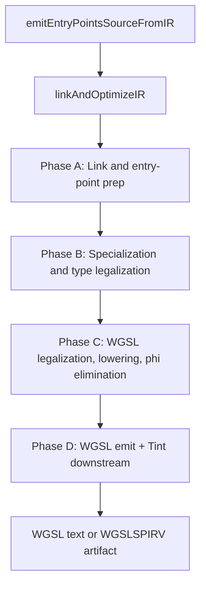
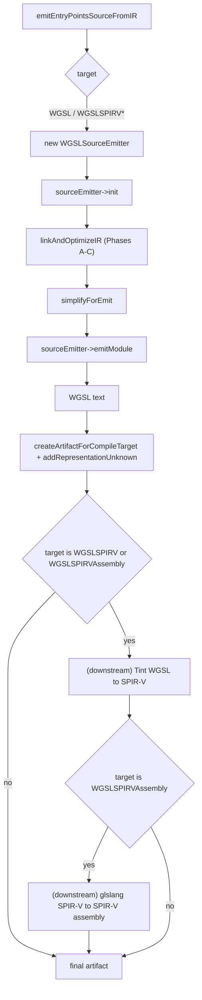

# WGSL Target Pipeline

This page documents the ordered IR-pass and downstream-binary
sequence executed when Slang compiles for the WGSL target family.
It is written for a compiler developer who needs to find where in
the WGSL codegen pipeline a particular pass runs, what condition
selects it, and how `legalizeIRForWGSL` and `WGSLSourceEmitter`
cooperate. The corresponding `CodeGenTarget` values are
`CodeGenTarget::WGSL`, `CodeGenTarget::WGSLSPIRV`, and
`CodeGenTarget::WGSLSPIRVAssembly`. The three targets share the
WGSL **source** pipeline because the back-end's source-target
mapping reduces both to source target `WGSL` in two steps:
`WGSLSPIRVAssembly` first maps to `WGSLSPIRV`
(`source/slang/slang-code-gen.cpp:1074-1075`), and `WGSLSPIRV` then
maps to `WGSL` (`source/slang/slang-code-gen.cpp:278-279`); WGSL is
emitted first, then handed to Tint to translate to SPIR-V for the
`WGSLSPIRV*` arms. Inside `linkAndOptimizeIR` the `target` local is
`codeGenContext->getTargetFormat()` (line 1034) and the shared
predicate is `isWGPUTarget(targetRequest)`, but several individual
switch arms list only `CodeGenTarget::WGSL` among the WGSL family
(for example `slang-emit.cpp:1951` and `slang-emit.cpp:2372`); those
arms still fire for the `WGSLSPIRV*` variants because of the
source-target reduction, not because the arm's case label mentions
them.

Compared with sibling target pages, the WGSL pipeline is
distinguished less by having many WGSL-only passes — there are only
four (`legalizeIRForWGSL`, `specializeAddressSpaceForWGSL`, the WGSL
arm of `legalizeBoolSwitchForTargetsRequiringIntSwitch`, and the
`BufferElementTypeLoweringPolicyKind::WGSL` configuration of
`lowerBufferElementTypeToStorageType`) — than by which of the shared
passes it opts into. Most gates below are shared with other targets.

This page complements
[../pipeline/05-ir-passes.md](../pipeline/05-ir-passes.md), which
is an unordered topical catalog of every IR pass. Branches in
`linkAndOptimizeIR` gated on a sibling target (SPIR-V, HLSL,
Metal, CUDA, CPU, GLSL, PyTorch) are filtered out of the diagrams
and tables below.

## Source

- [slang-emit.cpp](../../../../source/slang/slang-emit.cpp) —
  `linkAndOptimizeIR` (line 1015) is the orchestrator;
  `CodeGenContext::emitEntryPointsSourceFromIR` (line 2968)
  constructs the `WGSLSourceEmitter` and emits WGSL text.
  `calcRequiredLoweringPassSet` (line 409) computes the
  `RequiredLoweringPassSet` predicate that gates most of the
  pipeline.
- [slang-emit-wgsl.cpp](../../../../source/slang/slang-emit-wgsl.cpp)
  — `WGSLSourceEmitter` implementation.
- [slang-emit-wgsl.h](../../../../source/slang/slang-emit-wgsl.h)
  — the `WGSLSourceEmitter` class declaration, including the
  emitter-policy overrides (`supportsSwitchFallThrough`,
  `shouldEmitSwitchCaseTerminatingBreak`, `emitTempModifiers`).
- [slang-emit-c-like.cpp](../../../../source/slang/slang-emit-c-like.cpp)
  / [slang-emit-c-like.h](../../../../source/slang/slang-emit-c-like.h)
  — shared C-like emitter base class for `simplifyForEmit` and
  `emitModule`, and the declaration site of the virtual policy
  hooks WGSL overrides.
- [slang-ir-wgsl-legalize.cpp](../../../../source/slang/slang-ir-wgsl-legalize.cpp)
  — `legalizeIRForWGSL` (line 243) is the central WGSL
  legalization driver; `specializeAddressSpaceForWGSL` (line 352)
  and its `WGSLAddressSpaceAssigner` (line 271) live in the same
  file.
- [slang-ir-legalize-varying-params.cpp](../../../../source/slang/slang-ir-legalize-varying-params.cpp)
  — `legalizeEntryPointVaryingParamsForWGSL` (line 5584), declared
  in
  [slang-ir-legalize-varying-params.h](../../../../source/slang/slang-ir-legalize-varying-params.h)
  (line 37).
- [slang-ir-legalize-binary-operator.cpp](../../../../source/slang/slang-ir-legalize-binary-operator.cpp)
  — `legalizeLogicalAndOr` runs for WGSL (call site at line 2467 of
  `slang-emit.cpp`).
- [slang-ir-glsl-legalize.cpp](../../../../source/slang/slang-ir-glsl-legalize.cpp)
  — despite the name, `legalizeBoolSwitchForTargetsRequiringIntSwitch`
  (line 5241) is shared by the GLSL/SPIR-V and WGSL arms.
- [slang-target-program.h](../../../../source/slang/slang-target-program.h)
  / [slang-compiler-options.h](../../../../source/slang/slang-compiler-options.h)
  — gate sources.

## High-level phase diagram



Phase A and Phase B are nearly identical to the corresponding
phases on the SPIR-V page; the divergence is concentrated in
Phase C.

## Phase A: Link and entry-point prep

Spans lines 1050-1486 of
[slang-emit.cpp](../../../../source/slang/slang-emit.cpp) (the
`linkIR` call through `lowerEnumType`). WGSL hits the `default` arm
of every per-target switch in this phase. One WGSL-relevant
difference from SPIR-V: WGSL is non-Khronos, so the
`!isKhronosTarget && reqSet.glslSSBO` gate at line 1103 lets
`lowerGLSLShaderStorageBufferObjectsToStructuredBuffers` fire for
WGSL.

The first `calcRequiredLoweringPassSet` scan happens at line 1085,
right after the set is cleared (line 1084) and **before**
`validateAndRemoveAssumeAddress`, which is itself gated on the
scan's `assumeAddress` flag (line 1087). Every `reqSet.*` gate in
this phase reads the result of that scan.

```mermaid
flowchart TD
  linkIRn[linkIR]
  dbgGate{shouldEmitSeparateDebugInfo?}
  emitBuildId["emit IRBuildIdentifier"]
  reqSet1["calcRequiredLoweringPassSet"]
  aaGate{reqSet.assumeAddress}
  vaaa[validateAndRemoveAssumeAddress]
  diGate{"reqSet.debugInfo and DebugInfoLevel::None"}
  stripDI[stripDebugInfo]
  ssboGate{"!isKhronosTarget and reqSet.glslSSBO"}
  ssbo[lowerGLSLShaderStorageBufferObjectsToStructuredBuffers]
  tEPInBorrow[translateEntryPointInParamToBorrow]
  rGC[replaceGlobalConstants]
  beGate{reqSet.bindExistential}
  bES[bindExistentialSlots]
  covGate{reqSet.coverageTracing}
  iC[instrumentCoverage]
  cGUP[collectGlobalUniformParameters]
  cEPD[checkEntryPointDecorations]
  aDMD[addDenormalModeDecorations]
  cEPUP[collectEntryPointUniformParams]
  mEPUP[moveEntryPointUniformParamsToGlobalScope]
  rTCEP[removeTorchAndCUDAEntryPoints]
  covGate2{reqSet.coverageTracing}
  fCIM[finalizeCoverageInstrumentationMetadata]
  lvcGate{reqSet.lValueCast}
  lLVC[lowerLValueCast]
  mlGate{reqSet.unresolvedMatrixLayout}
  sML[specializeMatrixLayout]
  enumGate{reqSet.enumType}
  lET[lowerEnumType]

  linkIRn --> dbgGate
  dbgGate -->|true| emitBuildId --> reqSet1
  dbgGate -->|false| reqSet1
  reqSet1 --> aaGate
  aaGate -->|true| vaaa --> diGate
  aaGate -->|false| diGate
  diGate -->|true| stripDI --> ssboGate
  diGate -->|false| ssboGate
  ssboGate -->|true| ssbo --> tEPInBorrow
  ssboGate -->|false| tEPInBorrow
  tEPInBorrow --> rGC --> beGate
  beGate -->|true| bES --> covGate
  beGate -->|false| covGate
  covGate -->|true| iC --> cGUP
  covGate -->|false| cGUP
  cGUP --> cEPD --> aDMD --> cEPUP --> mEPUP --> rTCEP --> covGate2
  covGate2 -->|true| fCIM --> lvcGate
  covGate2 -->|false| lvcGate
  lvcGate -->|true| lLVC --> mlGate
  lvcGate -->|false| mlGate
  mlGate -->|true| sML --> enumGate
  mlGate -->|false| enumGate
  enumGate -->|true| lET
```



`validateIRModuleIfEnabled` summary: the call is a no-op unless
`codeGenContext->shouldValidateIR()` is set
([slang-ir-validate.cpp](../../../../source/slang/slang-ir-validate.cpp)
lines 523-530). In this phase it runs at lines 1080 (before the
first scan), 1111, 1123, 1365 (inside the coverage gate), 1369,
1377, 1413, 1422, and 1451. The CUDA-only call at line 1401 does
not apply to WGSL.

| # | Pass | File | Gate | Notes |
| --- | --- | --- | --- | --- |
| 1 | `linkIR` | [slang-ir-link.cpp](../../../../source/slang/slang-ir-link.cpp) | (always) | Direct call at line 1050. |
| 2 | `IRBuilder::emitDebugBuildIdentifier` | [slang-ir.cpp](../../../../source/slang/slang-ir.cpp) | `shouldEmitSeparateDebugInfo()` | Not a pass: an inline `IRBuilder` call at line 1077 of `slang-emit.cpp` that records a hash of the source and compile options as an `IRBuildIdentifier` on the module inst. |
| 3 | `calcRequiredLoweringPassSet` | [slang-emit.cpp](../../../../source/slang/slang-emit.cpp) | (always) | First scan: direct call at line 1085, not a `SLANG_PASS`, right after the set is cleared at line 1084. It fills the `reqSet.*` flags that gate most rows below. |
| 4 | `validateAndRemoveAssumeAddress` | [slang-ir-validate.cpp](../../../../source/slang/slang-ir-validate.cpp) | `reqSet.assumeAddress` (line 1087) | `validate=true` (WGSL is non-CPU/CUDA). Newly gated; the first scan runs before it. |
| 5 | `stripDebugInfo` | [slang-ir-strip-debug-info.cpp](../../../../source/slang/slang-ir-strip-debug-info.cpp) | `reqSet.debugInfo && getDebugInfoLevel() == DebugInfoLevel::None` | |
| 6 | `lowerGLSLShaderStorageBufferObjectsToStructuredBuffers` | [slang-ir-lower-glsl-ssbo-types.cpp](../../../../source/slang/slang-ir-lower-glsl-ssbo-types.cpp) | `!isKhronosTarget && reqSet.glslSSBO` | WGSL is non-Khronos so this fires; SPIR-V skips it. |
| 7 | `translateEntryPointInParamToBorrow` | [slang-ir-transform-params-to-constref.cpp](../../../../source/slang/slang-ir-transform-params-to-constref.cpp) | (always) | |
| 8 | `replaceGlobalConstants` | [slang-ir-link.cpp](../../../../source/slang/slang-ir-link.cpp) | (always) | |
| 9 | `bindExistentialSlots` | [slang-ir-bind-existentials.cpp](../../../../source/slang/slang-ir-bind-existentials.cpp) | `reqSet.bindExistential` | |
| 10 | `instrumentCoverage` | [slang-ir-coverage-instrument.cpp](../../../../source/slang/slang-ir-coverage-instrument.cpp) | `reqSet.coverageTracing` | |
| 11 | `collectGlobalUniformParameters` | [slang-ir-collect-global-uniforms.cpp](../../../../source/slang/slang-ir-collect-global-uniforms.cpp) | (always) | |
| 12 | `checkEntryPointDecorations` | [slang-ir-entry-point-decorations.cpp](../../../../source/slang/slang-ir-entry-point-decorations.cpp) | (always) | |
| 13 | `addDenormalModeDecorations` | [slang-emit.cpp](../../../../source/slang/slang-emit.cpp) | (always) | Static helper at line 801. |
| 14 | `collectEntryPointUniformParams` | [slang-ir-entry-point-uniforms.cpp](../../../../source/slang/slang-ir-entry-point-uniforms.cpp) | (always, WGSL via `default` arm) | |
| 15 | `moveEntryPointUniformParamsToGlobalScope` | [slang-ir-entry-point-uniforms.cpp](../../../../source/slang/slang-ir-entry-point-uniforms.cpp) | (always, WGSL via `default` arm) | |
| 16 | `removeTorchAndCUDAEntryPoints` | [slang-ir-pytorch-cpp-binding.cpp](../../../../source/slang/slang-ir-pytorch-cpp-binding.cpp) | (always, WGSL via `default` arm) | |
| 17 | `finalizeCoverageInstrumentationMetadata` | [slang-ir-coverage-instrument.cpp](../../../../source/slang/slang-ir-coverage-instrument.cpp) | `reqSet.coverageTracing` | Post-packing pass that fills CPU/CUDA uniform-marshaling fields on the coverage `ArtifactPostEmitMetadata`. No-op for WGSL. |
| 18 | `lowerLValueCast` | [slang-ir-lower-l-value-cast.cpp](../../../../source/slang/slang-ir-lower-l-value-cast.cpp) | `reqSet.lValueCast` | Gated (line 1473); `kIROp_InOutImplicitCast` / `kIROp_OutImplicitCast` are front-end-only, so the flag cannot be a false negative. |
| 19 | `specializeMatrixLayout` | [slang-ir-specialize-matrix-layout.cpp](../../../../source/slang/slang-ir-specialize-matrix-layout.cpp) | `reqSet.unresolvedMatrixLayout` (line 1479) | Moved here from Phase B: it fills in the default matrix layout before specialization (so `row_major float4x4` and `float4x4` match as one type) and before `lowerEnumType`, which erases the `MatrixLayoutMode` type the pass looks for. |
| 20 | `lowerEnumType` | [slang-ir-lower-enum-type.cpp](../../../../source/slang/slang-ir-lower-enum-type.cpp) | `reqSet.enumType` | |

Filtered out for WGSL in this phase: the CUDA / CUDAHeader arm of
the entry-point-param switch
(`collectOptiXEntryPointUniformParams`); the CPP / Host* arms.

## Phase B: Specialization and type legalization

Spans lines 1499-2178 of `slang-emit.cpp` (the first `simplifyIR`
through `checkStaticAssert`). WGSL is in the `default` arm for most
decision points; it diverges from SPIR-V at `lowerCooperativeVectors`
(which runs for WGSL via the `default` arm at line 1864), the
HLSL-or-SPIR-V byte-address-buffer arms (which don't apply), and the
various HLSL/Metal struct-wrapping passes (which don't fire).

A second `calcRequiredLoweringPassSet` scan runs at line 1666, after
specialization and the optional/result/conditional-type lowerings.
Flags **accumulate** across the two scans — the set is cleared only
once, at line 1084 — so a flag set by the first scan stays set even
if the construct that set it has since been lowered away. That makes
every `reqSet.*` gate conservatively safe (it can be stale-true,
producing a harmless no-op walk, but not false-negative), which is
the invariant the gating commits rely on.

```mermaid
flowchart TD
  s1[simplifyIR default]
  vuGate{ValidateUniformity}
  vu[validateUniformity]
  fscGate{not shouldPerformMinimumOptimizations}
  fSC[fuseCallsToSaturatedCooperation]
  adGate{reqSet.autodiff}
  cAP[checkAutodiffPatterns]
  dCC[diagnoseCircularConformances]
  sdGate{not isSpecializationDisabled}
  sM[specializeModule]
  vMG["validateMutableGlobalVariableTypes (direct call)"]
  hofGate{reqSet.higherOrderFunc}
  sHOP[specializeHigherOrderParameters]
  adGate2{reqSet.autodiff}
  fADP[finalizeAutoDiffPass]
  sADD[stripAutoDiffDecorations]
  mssGate{reqSet.matrixSwizzleStore}
  lMSS[lowerMatrixSwizzleStores]
  dce1[eliminateDeadCode]
  fS[finalizeSpecialization]
  adGate3{reqSet.autodiff}
  lDTI["lowerDiffTypeInfoInsts (direct call)"]
  ctGate{reqSet.conditionalType}
  lCT[lowerConditionalType]
  otGate1{reqSet.optionalType}
  lRO[lowerReinterpretOptional]
  nevGate{shouldRunNonEssentialValidation}
  cONU[checkForOptionalNoneUsage]
  otGate2{reqSet.optionalType}
  lOT[lowerOptionalType]
  rtGate{reqSet.resultType}
  lRT[lowerResultType]
  reqSet2[calcRequiredLoweringPassSet]
  dUR[detectUninitializedResources]
  raidGate{removeAvailableInDownstreamIR}
  rAIDD[removeAvailableInDownstreamModuleDecorations]
  nevGate2{shouldRunNonEssentialValidation}
  cRT[checkForRecursiveTypes]
  cRF[checkForRecursiveFunctions]
  cOBA[checkForOutOfBoundAccess]
  mrGate{reqSet.missingReturn}
  cMR[checkForMissingReturns]
  cISPT[checkForInvalidShaderParameterType]
  iAVS[inferAnyValueSizeWhereNecessary]
  uPWT[unpinWitnessTables]
  svmGate{reqSet.sumVectorMatrix}
  lSVMI[lowerSumVectorMatrixInsts]
  minOptGate{not minimalOptimization}
  s2a[simplifyIR fast]
  genGate{reqSet.generics}
  dce2[eliminateDeadCode]
  tuGate{reqSet.taggedUnion}
  lTUT[lowerTaggedUnionTypes]
  utGate{reqSet.untaggedUnion}
  lUUT[lowerUntaggedUnionTypes]
  reinterpretGate{reqSet.reinterpret}
  lR[lowerReinterpret]
  lSIDC[lowerSequentialIDTagCasts]
  toGate{reqSet.tagOps}
  lTI[lowerTagInsts]
  ttGate{reqSet.tagType}
  lTT[lowerTagTypes]
  dce3[eliminateDeadCode]
  lE[lowerExistentials]
  rWUI[removeWeakUseInsts]
  cTD["clearTranslationDictionary (direct call)"]
  pTIN[performTypeInlining]
  dce4["eliminateDeadCode (direct call)"]
  nevGate3{shouldRunNonEssentialValidation}
  cGSHI[checkGetStringHashInsts]
  lTu[lowerTuples]
  gAVMF[generateAnyValueMarshallingFunctions]
  ssGate{reqSet.specializeStageSwitch}
  sSS[specializeStageSwitch]
  lCV[lowerCooperativeVectors]
  pFI1[performForceInlining]
  minOpt2{minimalOptimization}
  aSCCP[applySparseConditionalConstantPropagation]
  dce5[eliminateDeadCode]
  s2b[simplifyIR default]
  tSCP[threadSwitchOnConstantPhi]
  cpiGate{shouldReportCheckpointIntermediates}
  rCI["reportCheckpointIntermediates (direct call)"]
  acsbGate{reqSet.appendConsumeStructuredBuffer}
  lACSB[lowerAppendConsumeStructuredBuffers]
  ctsGate{reqSet.combinedTextureSamplers}
  lCTS[lowerCombinedTextureSamplers]
  vrGate{VulkanEmitReflection}
  aUTHD[addUserTypeHintDecorations]
  lEA[legalizeEmptyArray]
  lVT[legalizeVectorTypes]
  iGC[inlineGlobalConstantsForLegalization]
  lRTP[legalizeRayTracingPayloads]
  etlGate{reqSet.existentialTypeLayout}
  lETL[legalizeExistentialTypeLayout]
  vSBRT["validateStructuredBufferResourceTypes (direct call)"]
  lRTR[legalizeResourceTypes]
  gvvGate{reqSet.globalVaryingVar}
  tGVV[translateGlobalVaryingVar]
  fEPC[fixEntryPointCallsites]
  mGVI[moveGlobalVarInitializationToEntryPoints]
  lRGV[legalizeResourceGlobalVars]
  minOpt3{minimalOptimization}
  dce6[eliminateDeadCode]
  s2c[simplifyIR fast]
  urhGate{reqSet.untypedResourceHandle}
  lURH[lowerUntypedResourceHandleToUInt]
  drhGate{reqSet.dynamicResourceHeap}
  lDRH[lowerDynamicResourceHeap]
  sRU[specializeResourceUsage]
  sFBLA1[specializeFuncsForBufferLoadArgs]
  dBL[deferBufferLoad]
  sAP[specializeArrayParameters]
  cSA["checkStaticAssert (direct call)"]

  s1 --> vuGate
  vuGate -->|true| vu --> fscGate
  vuGate -->|false| fscGate
  fscGate -->|true| fSC --> adGate
  fscGate -->|false| adGate
  adGate -->|true| cAP --> dCC
  adGate -->|false| dCC
  dCC --> sdGate
  sdGate -->|true| sM --> vMG
  sdGate -->|false| vMG
  vMG --> hofGate
  hofGate -->|true| sHOP --> adGate2
  hofGate -->|false| adGate2
  adGate2 -->|true| fADP --> mssGate
  adGate2 -->|false| sADD --> mssGate
  mssGate -->|true| lMSS --> dce1
  mssGate -->|false| dce1
  dce1 --> fS --> adGate3
  adGate3 -->|true| lDTI --> ctGate
  adGate3 -->|false| ctGate
  ctGate -->|true| lCT --> otGate1
  ctGate -->|false| otGate1
  otGate1 -->|true| lRO --> nevGate
  otGate1 -->|false| nevGate
  nevGate -->|true| cONU --> otGate2
  nevGate -->|false| otGate2
  otGate2 -->|true| lOT --> rtGate
  otGate2 -->|false| rtGate
  rtGate -->|true| lRT --> reqSet2
  rtGate -->|false| reqSet2
  reqSet2 --> dUR --> raidGate
  raidGate -->|true| rAIDD --> nevGate2
  raidGate -->|false| nevGate2
  nevGate2 -->|true| cRT --> cRF --> cOBA --> mrGate
  nevGate2 -->|false| iAVS
  mrGate -->|true| cMR --> cISPT
  mrGate -->|false| cISPT
  cISPT --> iAVS
  iAVS --> uPWT --> svmGate
  svmGate -->|true| lSVMI --> minOptGate
  svmGate -->|false| minOptGate
  minOptGate -->|true| s2a --> tuGate
  minOptGate -->|false| genGate
  genGate -->|true| dce2 --> tuGate
  genGate -->|false| tuGate
  tuGate -->|true| lTUT --> utGate
  tuGate -->|false| utGate
  utGate -->|true| lUUT --> reinterpretGate
  utGate -->|false| reinterpretGate
  reinterpretGate -->|true| lR --> lSIDC
  reinterpretGate -->|false| lSIDC
  lSIDC --> toGate
  toGate -->|true| lTI --> ttGate
  toGate -->|false| ttGate
  ttGate -->|true| lTT --> dce3
  ttGate -->|false| dce3
  dce3 --> lE --> rWUI --> cTD --> pTIN --> dce4 --> nevGate3
  nevGate3 -->|true| cGSHI --> lTu
  nevGate3 -->|false| lTu
  lTu --> gAVMF --> ssGate
  ssGate -->|true| sSS --> lCV
  ssGate -->|false| lCV
  lCV --> pFI1 --> minOpt2
  minOpt2 -->|true| aSCCP --> dce5 --> tSCP
  minOpt2 -->|false| s2b --> tSCP
  tSCP --> cpiGate
  cpiGate -->|true| rCI --> acsbGate
  cpiGate -->|false| acsbGate
  acsbGate -->|true| lACSB --> ctsGate
  acsbGate -->|false| ctsGate
  ctsGate -->|true| lCTS --> vrGate
  ctsGate -->|false| vrGate
  vrGate -->|true| aUTHD --> lEA
  vrGate -->|false| lEA
  lEA --> lVT --> iGC --> lRTP --> etlGate
  etlGate -->|true| lETL --> vSBRT
  etlGate -->|false| vSBRT
  vSBRT --> lRTR --> gvvGate
  gvvGate -->|true| tGVV --> fEPC
  gvvGate -->|false| fEPC
  fEPC --> mGVI --> lRGV --> minOpt3
  minOpt3 -->|true| dce6 --> urhGate
  minOpt3 -->|false| s2c --> urhGate
  urhGate -->|true| lURH --> drhGate
  urhGate -->|false| drhGate
  drhGate -->|true| lDRH --> sRU
  drhGate -->|false| sRU
  sRU --> sFBLA1 --> dBL --> sAP --> cSA
```



`validateIRModuleIfEnabled` summary: the call runs at lines 1717
(after the non-essential validation block), 1849, 1913, 2039
(after `legalizeExistentialTypeLayout`), 2067 (after the
resource-type legalization block), 2149, and 2174. The HLSL-only
barrier-flag validation at lines 1915-1921 does not apply to WGSL.
Between several rows `linkAndOptimizeIR` also returns `SLANG_FAIL`
as soon as the sink holds an error; those early exits are not drawn.

| # | Pass | File | Gate | Notes |
| --- | --- | --- | --- | --- |
| 1 | `simplifyIR` | [slang-ir-ssa-simplification.cpp](../../../../source/slang/slang-ir-ssa-simplification.cpp) | (always) | `defaultIRSimplificationOptions`. |
| 2 | `validateUniformity` | [slang-ir-uniformity.cpp](../../../../source/slang/slang-ir-uniformity.cpp) | `getBoolOption(ValidateUniformity)` | |
| 3 | `fuseCallsToSaturatedCooperation` | [slang-ir-fuse-satcoop.cpp](../../../../source/slang/slang-ir-fuse-satcoop.cpp) | `!shouldPerformMinimumOptimizations` | |
| 4 | `checkAutodiffPatterns` | [slang-ir-autodiff.cpp](../../../../source/slang/slang-ir-autodiff.cpp) | `reqSet.autodiff` | |
| 5 | `diagnoseCircularConformances` | [slang-ir-any-value-inference.cpp](../../../../source/slang/slang-ir-any-value-inference.cpp) | (always) | |
| 6 | `specializeModule` | [slang-ir-specialize.cpp](../../../../source/slang/slang-ir-specialize.cpp) | `!isSpecializationDisabled()` | `specOptions.lowerWitnessLookups = true`. |
| 7 | `validateMutableGlobalVariableTypes` | [slang-ir-validate.cpp](../../../../source/slang/slang-ir-validate.cpp) | (always) | Direct call at line 1571, not a `SLANG_PASS`; returns `SLANG_FAIL` on a rejected type. It checks mutable global storage after the linker has resolved external types, before resource legalization assumes each mutable global has a supported type. |
| 8 | `specializeHigherOrderParameters` | [slang-ir-defunctionalization.cpp](../../../../source/slang/slang-ir-defunctionalization.cpp) | `reqSet.higherOrderFunc` | |
| 9 | `finalizeAutoDiffPass` | [slang-ir-autodiff.cpp](../../../../source/slang/slang-ir-autodiff.cpp) | `reqSet.autodiff` | Gated (line 1592). Typical WGSL shaders use no autodiff, so this is normally **skipped**. |
| 10 | `stripAutoDiffDecorations` | [slang-ir-autodiff.cpp](../../../../source/slang/slang-ir-autodiff.cpp) | `!reqSet.autodiff` (else arm at line 1596) | Runs on the skip path so the `Export` / `KeepAlive` pins on core-module `[__AutoDiffBuiltin]` types are removed and the following `eliminateDeadCode` can drop them. |
| 11 | `lowerMatrixSwizzleStores` | [slang-ir-lower-matrix-swizzle-store.cpp](../../../../source/slang/slang-ir-lower-matrix-swizzle-store.cpp) | `reqSet.matrixSwizzleStore` | |
| 12 | `eliminateDeadCode` | [slang-ir-dce.cpp](../../../../source/slang/slang-ir-dce.cpp) | (always) | |
| 13 | `finalizeSpecialization` | [slang-ir-specialize.cpp](../../../../source/slang/slang-ir-specialize.cpp) | (always) | |
| 14 | `lowerDiffTypeInfoInsts` | [slang-emit.cpp](../../../../source/slang/slang-emit.cpp) | `reqSet.autodiff` | Direct call (not `SLANG_PASS`) at line 1612. Defined as a file-local helper at line 897 of `slang-emit.cpp`, not in `slang-ir-autodiff.cpp`. |
| 15 | `lowerConditionalType` | [slang-ir-lower-conditional-type.cpp](../../../../source/slang/slang-ir-lower-conditional-type.cpp) | `reqSet.conditionalType` | |
| 16 | `lowerReinterpretOptional` | [slang-ir-lower-reinterpret.cpp](../../../../source/slang/slang-ir-lower-reinterpret.cpp) | `reqSet.optionalType` | |
| 17 | `checkForOptionalNoneUsage` | [slang-ir-check-optional-none-usage.cpp](../../../../source/slang/slang-ir-check-optional-none-usage.cpp) | `shouldRunNonEssentialValidation()` | |
| 18 | `lowerOptionalType` | [slang-ir-lower-optional-type.cpp](../../../../source/slang/slang-ir-lower-optional-type.cpp) | `reqSet.optionalType` | |
| 19 | `lowerResultType` | [slang-ir-lower-result-type.cpp](../../../../source/slang/slang-ir-lower-result-type.cpp) | `reqSet.resultType` | Runs **after** `lowerOptionalType`: depends on accurate `getAnyValueSize()` results. |
| 20 | `calcRequiredLoweringPassSet` | [slang-emit.cpp](../../../../source/slang/slang-emit.cpp) | (always) | Second scan: direct call at line 1666, not a `SLANG_PASS`. It accumulates into the same `reqSet` without clearing it, so the later `reqSet.*` gates see flags from both scans. |
| 21 | `detectUninitializedResources` | [slang-ir-detect-uninitialized-resources.cpp](../../../../source/slang/slang-ir-detect-uninitialized-resources.cpp) | (always) | |
| 22 | `removeAvailableInDownstreamModuleDecorations` | [slang-ir-redundancy-removal.cpp](../../../../source/slang/slang-ir-redundancy-removal.cpp) | `codeGenContext->removeAvailableInDownstreamIR` | |
| 23 | `checkForRecursiveTypes` | [slang-ir-check-recursion.cpp](../../../../source/slang/slang-ir-check-recursion.cpp) | `shouldRunNonEssentialValidation()` | |
| 24 | `checkForRecursiveFunctions` | [slang-ir-check-recursion.cpp](../../../../source/slang/slang-ir-check-recursion.cpp) | `shouldRunNonEssentialValidation()` | |
| 25 | `checkForOutOfBoundAccess` | [slang-check-out-of-bound-access.cpp](../../../../source/slang/slang-check-out-of-bound-access.cpp) | `shouldRunNonEssentialValidation()` | A constant index outside a fixed-size array is an error: `E30029`, *array index out of bounds*. |
| 26 | `checkForMissingReturns` | [slang-ir-missing-return.cpp](../../../../source/slang/slang-ir-missing-return.cpp) | `reqSet.missingReturn` (under non-essential validation) | |
| 27 | `checkForInvalidShaderParameterType` | [slang-ir-check-shader-parameter-type.cpp](../../../../source/slang/slang-ir-check-shader-parameter-type.cpp) | `shouldRunNonEssentialValidation()` | |
| 28 | `inferAnyValueSizeWhereNecessary` | [slang-ir-any-value-inference.cpp](../../../../source/slang/slang-ir-any-value-inference.cpp) | (always) | |
| 29 | `unpinWitnessTables` | [slang-ir-strip-legalization-insts.cpp](../../../../source/slang/slang-ir-strip-legalization-insts.cpp) | (always) | |
| 30 | `lowerSumVectorMatrixInsts` | [slang-emit.cpp](../../../../source/slang/slang-emit.cpp) | `reqSet.sumVectorMatrix` | Gated (line 1737). Helper at line 924. `kIROp_SumVectorElements` / `kIROp_SumMatrixElements` come only from the autodiff transpose pass, so this is normally skipped for WGSL. |
| 31 | `simplifyIR` | [slang-ir-ssa-simplification.cpp](../../../../source/slang/slang-ir-ssa-simplification.cpp) | `!minimalOptimization` | `fastIRSimplificationOptions`. |
| 32 | `eliminateDeadCode` | [slang-ir-dce.cpp](../../../../source/slang/slang-ir-dce.cpp) | `minimalOptimization && reqSet.generics` | Alternative to row 31. |
| 33 | `lowerTaggedUnionTypes` | [slang-ir-lower-dynamic-dispatch-insts.cpp](../../../../source/slang/slang-ir-lower-dynamic-dispatch-insts.cpp) | `reqSet.taggedUnion` | Gated (line 1757). Sets `reqSet.reinterpret = true` on success, so gating it also gates row 35 transitively; the tagged-union opcodes are produced only by typeflow specialization, before the last scan. |
| 34 | `lowerUntaggedUnionTypes` | [slang-ir-lower-dynamic-dispatch-insts.cpp](../../../../source/slang/slang-ir-lower-dynamic-dispatch-insts.cpp) | `reqSet.untaggedUnion` (line 1763) | Newly gated. |
| 35 | `lowerReinterpret` | [slang-ir-lower-reinterpret.cpp](../../../../source/slang/slang-ir-lower-reinterpret.cpp) | `reqSet.reinterpret` | |
| 36 | `lowerSequentialIDTagCasts` | [slang-ir-lower-dynamic-dispatch-insts.cpp](../../../../source/slang/slang-ir-lower-dynamic-dispatch-insts.cpp) | (always) | |
| 37 | `lowerTagInsts` | [slang-ir-lower-dynamic-dispatch-insts.cpp](../../../../source/slang/slang-ir-lower-dynamic-dispatch-insts.cpp) | `reqSet.tagOps` (line 1770) | Newly gated. |
| 38 | `lowerTagTypes` | [slang-ir-lower-dynamic-dispatch-insts.cpp](../../../../source/slang/slang-ir-lower-dynamic-dispatch-insts.cpp) | `reqSet.tagType` (line 1772) | Newly gated. |
| 39 | `eliminateDeadCode` | [slang-ir-dce.cpp](../../../../source/slang/slang-ir-dce.cpp) | (always) | |
| 40 | `lowerExistentials` | [slang-ir-lower-dynamic-dispatch-insts.cpp](../../../../source/slang/slang-ir-lower-dynamic-dispatch-insts.cpp) | (always) | |
| 41 | `removeWeakUseInsts` | [slang-emit.cpp](../../../../source/slang/slang-emit.cpp) | (always) | |
| 42 | `clearTranslationDictionary` | [slang-ir-translate.cpp](../../../../source/slang/slang-ir-translate.cpp) | (always) | Direct call at line 1782, not a `SLANG_PASS`; drops the translation dictionary left on the module inst. |
| 43 | `performTypeInlining` | [slang-ir-inline.cpp](../../../../source/slang/slang-ir-inline.cpp) | `!isCpuLikeTarget(artifactDesc)` (true for WGSL) | |
| 44 | `eliminateDeadCode` | [slang-ir-dce.cpp](../../../../source/slang/slang-ir-dce.cpp) | (always) | Direct call at line 1804, not a `SLANG_PASS`; uses `fastIRSimplificationOptions.deadCodeElimOptions`. It runs **before** `checkGetStringHashInsts` because `performTypeInlining` leaves the inlined callee behind and that leftover body would otherwise be rejected. |
| 45 | `checkGetStringHashInsts` | [slang-ir-string-hash.cpp](../../../../source/slang/slang-ir-string-hash.cpp) | `!isCpuLikeTarget && shouldRunNonEssentialValidation()` | |
| 46 | `lowerTuples` | [slang-ir-lower-tuple-types.cpp](../../../../source/slang/slang-ir-lower-tuple-types.cpp) | (always) | |
| 47 | `generateAnyValueMarshallingFunctions` | [slang-ir-any-value-marshalling.cpp](../../../../source/slang/slang-ir-any-value-marshalling.cpp) | (always) | |
| 48 | `specializeStageSwitch` | [slang-ir-specialize-stage-switch.cpp](../../../../source/slang/slang-ir-specialize-stage-switch.cpp) | `reqSet.specializeStageSwitch` | |
| 49 | `lowerCooperativeVectors` | [slang-ir-lower-coopvec.cpp](../../../../source/slang/slang-ir-lower-coopvec.cpp) | (always, WGSL via `default` arm at line 1864) | |
| 50 | `performForceInlining` | [slang-ir-inline.cpp](../../../../source/slang/slang-ir-inline.cpp) | (always) | |
| 51 | `applySparseConditionalConstantPropagation` | [slang-ir-sccp.cpp](../../../../source/slang/slang-ir-sccp.cpp) | `minimalOptimization` | Plus `eliminateDeadCode`. |
| 52 | `eliminateDeadCode` | [slang-ir-dce.cpp](../../../../source/slang/slang-ir-dce.cpp) | `minimalOptimization` | |
| 53 | `simplifyIR` | [slang-ir-ssa-simplification.cpp](../../../../source/slang/slang-ir-ssa-simplification.cpp) | `!minimalOptimization` | `defaultIRSimplificationOptions`. |
| 54 | `threadSwitchOnConstantPhi` | [slang-ir-thread-switch-on-constant-phi.cpp](../../../../source/slang/slang-ir-thread-switch-on-constant-phi.cpp) | (always; line 1900) | Registered outside the minimal-optimization branch so it runs at every optimization level; when the switch selector is not yet a phi it finds nothing to thread. |
| 55 | `reportCheckpointIntermediates` | [slang-emit.cpp](../../../../source/slang/slang-emit.cpp) | `codeGenContext->shouldReportCheckpointIntermediates()` (line 1908) | Direct call at line 1910 to the static helper defined at line 230; diagnostic only, it reports autodiff checkpointing information and does not transform the IR. |
| 56 | `lowerAppendConsumeStructuredBuffers` | [slang-ir-lower-append-consume-structured-buffer.cpp](../../../../source/slang/slang-ir-lower-append-consume-structured-buffer.cpp) | `target != HLSL && reqSet.appendConsumeStructuredBuffer` (line 1936) | `AppendStructuredBuffer<T>` is **not** front-end-rejected on WGSL: the pass replaces the buffer with a two-field struct whose fields are name-hinted `elements` and `counter` (lines 30 and 33 of the pass file), which legalize into two separate storage buffers — `<name>_elements_<id> : array<T>` and `<name>_counter_<id> : array<atomic<i32>>`. `.Append(v)` becomes an `AtomicInc` on `counter[0]` (relaxed order, emitted as `atomicAdd`) followed by a store into `elements[<old counter>]`. |
| 57 | `lowerCombinedTextureSamplers` | [slang-ir-lower-combined-texture-sampler.cpp](../../../../source/slang/slang-ir-lower-combined-texture-sampler.cpp) | `reqSet.combinedTextureSamplers` (WGSL is in the HLSL / Metal / WGSL arm at lines 1947-1953) | |
| 58 | `addUserTypeHintDecorations` | [slang-ir-user-type-hint.cpp](../../../../source/slang/slang-ir-user-type-hint.cpp) | `getBoolOption(VulkanEmitReflection)` | Rare for WGSL. |
| 59 | `legalizeEmptyArray` | [slang-ir-legalize-empty-array.cpp](../../../../source/slang/slang-ir-legalize-empty-array.cpp) | (always) | |
| 60 | `legalizeVectorTypes` | [slang-ir-legalize-vector-types.cpp](../../../../source/slang/slang-ir-legalize-vector-types.cpp) | (always) | |
| 61 | `inlineGlobalConstantsForLegalization` | [slang-ir-legalize-global-values.cpp](../../../../source/slang/slang-ir-legalize-global-values.cpp) | `shouldLegalizeExistentialAndResourceTypes` (default `true` for WGSL) | |
| 62 | `legalizeRayTracingPayloads` | [slang-ir-ray-tracing-legalize.cpp](../../../../source/slang/slang-ir-ray-tracing-legalize.cpp) | `shouldLegalizeExistentialAndResourceTypes` (inside that block, line 1989) | Returns immediately unless the target is D3D or Khronos, so it is a no-op for WGSL. |
| 63 | `legalizeExistentialTypeLayout` | [slang-ir-legalize-types.cpp](../../../../source/slang/slang-ir-legalize-types.cpp) | `reqSet.existentialTypeLayout` | |
| 64 | `validateStructuredBufferResourceTypes` | [slang-ir-validate.cpp](../../../../source/slang/slang-ir-validate.cpp) | (always, inside the legalization block) | Direct call at line 2041; a failure returns `SLANG_FAIL`. |
| 65 | `legalizeResourceTypes` | [slang-ir-legalize-types.cpp](../../../../source/slang/slang-ir-legalize-types.cpp) | `shouldLegalizeExistentialAndResourceTypes` | |
| 66 | `translateGlobalVaryingVar` | [slang-ir-translate-global-varying-var.cpp](../../../../source/slang/slang-ir-translate-global-varying-var.cpp) | `reqSet.globalVaryingVar` (line 2078) | Runs here, before resource specialization; it materializes input parameters and their assignments before an entry point is cloned. |
| 67 | `fixEntryPointCallsites` | [slang-ir-fix-entrypoint-callsite.cpp](../../../../source/slang/slang-ir-fix-entrypoint-callsite.cpp) | (always; line 2085) | Separates launch functions from ordinary callees before globals' initializers are injected. |
| 68 | `moveGlobalVarInitializationToEntryPoints` | [slang-ir-explicit-global-init.cpp](../../../../source/slang/slang-ir-explicit-global-init.cpp) | (always; line 2091) | No longer under a per-target switch arm; the pass itself owns the target policy for which globals keep module-scope initializers. |
| 69 | `legalizeResourceGlobalVars` | [slang-ir-legalize-resource-globals.cpp](../../../../source/slang/slang-ir-legalize-resource-globals.cpp) | (always; line 2099) | Takes the target capability set and the non-essential-validation flag; replaces selected resource globals' storage with locals and generated parameters. |
| 70 | `eliminateDeadCode` | [slang-ir-dce.cpp](../../../../source/slang/slang-ir-dce.cpp) | `minimalOptimization` | |
| 71 | `simplifyIR` | [slang-ir-ssa-simplification.cpp](../../../../source/slang/slang-ir-ssa-simplification.cpp) | `!minimalOptimization` | `fastIRSimplificationOptions`. |
| 72 | `lowerUntypedResourceHandleToUInt` | [slang-ir-lower-dynamic-resource-heap.cpp](../../../../source/slang/slang-ir-lower-dynamic-resource-heap.cpp) | `reqSet.untypedResourceHandle` (line 2143) | Defined in the same file as row 73. |
| 73 | `lowerDynamicResourceHeap` | [slang-ir-lower-dynamic-resource-heap.cpp](../../../../source/slang/slang-ir-lower-dynamic-resource-heap.cpp) | `reqSet.dynamicResourceHeap` (line 2146) | |
| 74 | `specializeResourceUsage` | [slang-ir-specialize-resources.cpp](../../../../source/slang/slang-ir-specialize-resources.cpp) | (always) | |
| 75 | `specializeFuncsForBufferLoadArgs` | [slang-ir-specialize-buffer-load-arg.cpp](../../../../source/slang/slang-ir-specialize-buffer-load-arg.cpp) | (always, first invocation) | |
| 76 | `deferBufferLoad` | [slang-ir-defer-buffer-load.cpp](../../../../source/slang/slang-ir-defer-buffer-load.cpp) | (always) | |
| 77 | `specializeArrayParameters` | [slang-ir-specialize-arrays.cpp](../../../../source/slang/slang-ir-specialize-arrays.cpp) | (always) | |
| 78 | `checkStaticAssert` | [slang-emit.cpp](../../../../source/slang/slang-emit.cpp) | (always) | Direct call at line 2178 (helper at line 700); runs after specialization so static-assert info is available. A failed assertion is `E41400` when the `static_assert` carried a message and `E41401` when it did not; a condition that is still not a constant after specialization is `E41402`, *static assertion condition not compile-time constant*. |

Filtered out for WGSL in this phase: the
`CUDASource / CUDAHeader / PyTorchCppBinding` derivative-wrapper
arm; the CUDA/PyTorch passes
(`generateHostFunctionsForAutoBindCuda`, `generatePyTorchCppBinding`,
`handleAutoBindNames`, `lowerBuiltinTypesForKernelEntryPoints`,
`removeTorchKernels`); `expandAutodiffParameterContexts` (CUDA and
Metal only); the `legalizeNonVectorCompositeSelect` HLSL-only arm;
the CPP/Host CPP / `lowerComInterfaces` / `generateDllImportFuncs` /
`generateDllExportFuncs` arms; the HostVM early return; the CUDA
`lowerCooperativeVectors` conditional arm; both non-WGSL
`legalizeEmptyTypes` call sites in this region — the Metal-only arm
at line 2063 and the CPU/CUDA `else` arm at line 2073 (WGSL takes the
`shouldLegalizeExistentialAndResourceTypes` branch, and its own
`legalizeEmptyTypes` run is Phase C row 24); the `isMetalTarget`
`lowerBufferElementTypeToStorageType` Metal parameter-block arm; the
`isCPUTargetViaLLVM` LLVM arm; the HLSL `wrapStructuredBuffersOfMatrices`
arm; the Metal `wrapCBufferElementsForMetal` arm; the HLSL barrier-flag
validation (`validateBarrierFlagsForHLSL`).

## Phase C: WGSL legalization, lowering, phi elimination

Spans lines 2209-2961 of `slang-emit.cpp` (the
byte-address-buffer switch through `checkUnsupportedInst`, the last
statement of `linkAndOptimizeIR`). WGSL's central legalizer is
`legalizeIRForWGSL` (call site at line 2452, defined at line 243 of
[slang-ir-wgsl-legalize.cpp](../../../../source/slang/slang-ir-wgsl-legalize.cpp)),
which is treated as a single node in the diagram below. The
per-target `switch` that selects it (line 2392) runs
`legalizeBoolSwitchForTargetsRequiringIntSwitch` first, in the same
WGSL arm.

```mermaid
flowchart TD
  babbGate{reqSet.byteAddressBuffer}
  lBABOps["legalizeByteAddressBufferOps<br/>(WGSL options)"]
  vAO[validateAtomicOperations]
  rTF[resolveTextureFormat]
  rvirGate{reqSet.resolveVaryingInputRef}
  rvir[resolveVaryingInputRef]
  lBSW[legalizeBoolSwitchForTargetsRequiringIntSwitch]
  lIRWGSL[legalizeIRForWGSL]
  fNRI[floatNonUniformResourceIndex]
  lLAO[legalizeLogicalAndOr]
  sLOI[stripLegalizationOnlyInstructions]
  vVAM[validateVectorsAndMatrices]
  dce7[eliminateDeadCode]
  lrcGate{reqSet.lateRequireCapability}
  pLRC[processLateRequireCapabilityInsts]
  cUV[cleanUpVoidType]
  bqGate{reqSet.bindingQuery}
  lBQ[lowerBindingQueries]
  meshGate{reqSet.meshOutput}
  lMO[legalizeMeshOutputTypes]
  bcGate{reqSet.bitcast}
  lBC[lowerBitCast]
  lBETST["lowerBufferElementTypeToStorageType<br/>(loweringPolicyKind=WGSL)"]
  lMT[legalizeMatrixTypes]
  lART[legalizeArrayReturnType]
  sAS[specializeAddressSpaceForWGSL]
  pFI2[performForceInlining]
  eMB[eliminateMultiLevelBreak]
  minOpt4{not minimalOptimization}
  s2d[simplifyIR with removeTrivialSingleIterationLoops]
  lET2[legalizeEmptyTypes]
  cUV2["cleanUpVoidType (second call)"]
  livGate{shouldTrackLiveness}
  lvAvrs["LivenessUtil::addVariableRangeStarts"]
  ePhi["eliminatePhis (default options)"]
  livGate2{shouldTrackLiveness}
  lvAre["LivenessUtil::addRangeEnds"]
  sNSIR[simplifyNonSSAIR]
  aVSC[applyVariableScopeCorrection]
  coopGate{cooperative_matrix or cooperative_vector capability}
  cCM[collectCooperativeMetadata]
  ediGate{EmbedDownstreamIR}
  uNEI[unexportNonEmbeddableIR]
  dhGate{"descriptor_handle implied and target != PyTorchCppBinding"}
  gocl[getOrCreateLayout]
  cM["collectMetadata(targetProgram)"]
  cURL[checkUnsupportedResourceLocals]
  minOpt5{not shouldPerformMinimumOptimizations}
  cUI[checkUnsupportedInst]

  babbGate -->|true| lBABOps --> vAO
  babbGate -->|false| vAO
  vAO --> rTF --> rvirGate
  rvirGate -->|true| rvir --> lBSW
  rvirGate -->|false| lBSW
  lBSW --> lIRWGSL --> fNRI --> lLAO --> sLOI --> vVAM --> dce7 --> lrcGate
  lrcGate -->|true| pLRC --> cUV
  lrcGate -->|false| cUV
  cUV --> bqGate
  bqGate -->|true| lBQ --> meshGate
  bqGate -->|false| meshGate
  meshGate -->|true| lMO --> bcGate
  meshGate -->|false| bcGate
  bcGate -->|true| lBC --> lBETST
  bcGate -->|false| lBETST
  lBETST --> lMT --> lART --> sAS --> pFI2 --> eMB --> minOpt4
  minOpt4 -->|true| s2d --> lET2
  minOpt4 -->|false| lET2
  lET2 --> cUV2 --> livGate
  livGate -->|true| lvAvrs --> ePhi
  livGate -->|false| ePhi
  ePhi --> livGate2
  livGate2 -->|true| lvAre --> sNSIR
  livGate2 -->|false| sNSIR
  sNSIR --> aVSC --> coopGate
  coopGate -->|true| cCM --> ediGate
  coopGate -->|false| ediGate
  ediGate -->|true| uNEI --> dhGate
  ediGate -->|false| dhGate
  dhGate -->|true| gocl --> cM
  dhGate -->|false| cM
  cM --> cURL --> minOpt5
  minOpt5 -->|true| cUI
```



`validateIRModuleIfEnabled` summary: the call runs at lines 2568
(after the `stripLegalizationOnlyInstructions` switch), 2604, 2836
(before `simplifyNonSSAIR`), 2912, and 2923 (after
`applyVariableScopeCorrection`). The calls at lines 2360, 2415, 2525
and 2535 sit in CUDA, GLSL / SPIR-V, and CPU arms and do not apply
to WGSL.

| # | Pass | File | Gate | Notes |
| --- | --- | --- | --- | --- |
| 1 | `legalizeByteAddressBufferOps` | [slang-ir-byte-address-legalize.cpp](../../../../source/slang/slang-ir-byte-address-legalize.cpp) | `reqSet.byteAddressBuffer` | WGSL options (lines 2275-2285): `scalarizeVectorLoadStore=true`, `treatGetEquivalentStructuredBufferAsGetThis=true`, `translateToStructuredBufferOps=false`, `lowerBasicTypeOps=true`, `useBitCastFromUInt=true`, `minimumStoreScalarSize=4`, `loadHalfFrom32BitWords=true`. |
| 2 | `validateAtomicOperations` | [slang-ir-validate.cpp](../../../../source/slang/slang-ir-validate.cpp) | `target != SPIRV && target != SPIRVAssembly` (true for WGSL, line 2342) | `skipFuncParamValidation = true`. |
| 3 | `resolveTextureFormat` | [slang-ir-resolve-texture-format.cpp](../../../../source/slang/slang-ir-resolve-texture-format.cpp) | (`GLSL` / `SPIRV` / `WGSL` arm, line 2368) | |
| 4 | `resolveVaryingInputRef` | [slang-ir-resolve-varying-input-ref.cpp](../../../../source/slang/slang-ir-resolve-varying-input-ref.cpp) | `reqSet.resolveVaryingInputRef` (line 2382) | Runs after resource specialization may have inlined a helper containing interpolation operations into an entry point. |
| 5 | `legalizeBoolSwitchForTargetsRequiringIntSwitch` | [slang-ir-glsl-legalize.cpp](../../../../source/slang/slang-ir-glsl-legalize.cpp) | (`WGSL` / `WGSLSPIRV` / `WGSLSPIRVAssembly` arm, line 2451) | Rewrites a `switch` whose selector is `bool` into an integer switch; the GLSL / SPIR-V arm calls the same function (line 2413). |
| 6 | `legalizeIRForWGSL` | [slang-ir-wgsl-legalize.cpp](../../../../source/slang/slang-ir-wgsl-legalize.cpp) | (`WGSL` / `WGSLSPIRV` / `WGSLSPIRVAssembly` arm, line 2452) | The central WGSL legalizer; runs `legalizeEntryPointVaryingParamsForWGSL` and struct/varying fix-ups. |
| 7 | `floatNonUniformResourceIndex` | [slang-ir-float-non-uniform-resource-index.cpp](../../../../source/slang/slang-ir-float-non-uniform-resource-index.cpp) | `!isSPIRV(target)` (true for WGSL, line 2460) | `NonUniformResourceIndexFloatMode::Textual`. |
| 8 | `legalizeLogicalAndOr` | [slang-ir-legalize-binary-operator.cpp](../../../../source/slang/slang-ir-legalize-binary-operator.cpp) | `isD3DTarget \|\| isKhronosTarget \|\| isWGPUTarget \|\| isMetalTarget` (true for WGSL, lines 2465-2467) | Runs **before** `legalizeMatrixTypes` (row 18). |
| 9 | `stripLegalizationOnlyInstructions` | [slang-ir-strip-legalization-insts.cpp](../../../../source/slang/slang-ir-strip-legalization-insts.cpp) | (always) | |
| 10 | `validateVectorsAndMatrices` | [slang-ir-validate.cpp](../../../../source/slang/slang-ir-validate.cpp) | (always) | |
| 11 | `eliminateDeadCode` | [slang-ir-dce.cpp](../../../../source/slang/slang-ir-dce.cpp) | (always) | |
| 12 | `processLateRequireCapabilityInsts` | [slang-ir-late-require-capability.cpp](../../../../source/slang/slang-ir-late-require-capability.cpp) | `reqSet.lateRequireCapability` | Gated (line 2592); `kIROp_LateRequireCapability` is lowered at AST→IR time, so any instance was seen by a scan. |
| 13 | `cleanUpVoidType` | [slang-ir-cleanup-void.cpp](../../../../source/slang/slang-ir-cleanup-void.cpp) | (always) | First call (line 2595). |
| 14 | `lowerBindingQueries` | [slang-ir-lower-binding-query.cpp](../../../../source/slang/slang-ir-lower-binding-query.cpp) | `reqSet.bindingQuery` | |
| 15 | `legalizeMeshOutputTypes` | [slang-ir-legalize-mesh-outputs.cpp](../../../../source/slang/slang-ir-legalize-mesh-outputs.cpp) | `reqSet.meshOutput` | |
| 16 | `lowerBitCast` | [slang-ir-lower-bit-cast.cpp](../../../../source/slang/slang-ir-lower-bit-cast.cpp) | `reqSet.bitcast` | |
| 17 | `lowerBufferElementTypeToStorageType` | [slang-ir-lower-buffer-element-type.cpp](../../../../source/slang/slang-ir-lower-buffer-element-type.cpp) | (always; line 2648) | `loweringPolicyKind = BufferElementTypeLoweringPolicyKind::WGSL`, selected at lines 2636-2638. The policy replaces a buffer's element type with a generated storage struct named after the layout rule: `<Name>_std430` for a structured buffer and `<Name>_std140` for a `ConstantBuffer`. A matrix element gets its own wrapper, `_MatrixStorage_<elem><R>x<C>_ColMajor<rule>`, holding one field name-hinted `data` of type `array<vector<T,R>, C>` (column-major is the WGSL default, so the array runs over the Slang *columns*); the WGSL policy also overrides `shouldTranslateArrayElementTo16ByteAlignedVectorForConstantBuffer` to `true`, so the vector width of a `std140` wrapper is taken through `get16ByteAlignedVectorElementCount`. Field alignment is not part of the struct name: `WGSLSourceEmitter::emitStructFieldAttributes` writes an `@align(N)` attribute per field, computed as the GCD of the field's offset and the struct's alignment. |
| 18 | `legalizeMatrixTypes` | [slang-ir-legalize-matrix-types.cpp](../../../../source/slang/slang-ir-legalize-matrix-types.cpp) | (always; line 2674) | Moved here from Phase B: it must run after row 17 because the vector types it produces no longer keep matrix-major-ness, which the buffer-element lowering needs. |
| 19 | `legalizeArrayReturnType` | [slang-ir-legalize-array-return-type.cpp](../../../../source/slang/slang-ir-legalize-array-return-type.cpp) | `!isMetalTarget && !isSPIRV` (true for WGSL, line 2690) | Runs after row 18 because a function returning an int/uint/bool matrix returns an array once the matrix is lowered. |
| 20 | `specializeAddressSpaceForWGSL` | [slang-ir-wgsl-legalize.cpp](../../../../source/slang/slang-ir-wgsl-legalize.cpp) | `isWGPUTarget` (line 2705) | Defined at line 352 of the WGSL legalizer, **not** in `slang-ir-specialize-address-space.cpp`; it constructs a `WGSLAddressSpaceAssigner` and delegates to the shared `specializeAddressSpace`. |
| 21 | `performForceInlining` | [slang-ir-inline.cpp](../../../../source/slang/slang-ir-inline.cpp) | (always) | |
| 22 | `eliminateMultiLevelBreak` | [slang-ir-eliminate-multilevel-break.cpp](../../../../source/slang/slang-ir-eliminate-multilevel-break.cpp) | (always) | |
| 23 | `simplifyIR` | [slang-ir-ssa-simplification.cpp](../../../../source/slang/slang-ir-ssa-simplification.cpp) | `!minimalOptimization` | With `removeTrivialSingleIterationLoops = true`. |
| 24 | `legalizeEmptyTypes` | [slang-ir-legalize-types.cpp](../../../../source/slang/slang-ir-legalize-types.cpp) | (always; for AD 2.0) | |
| 25 | `cleanUpVoidType` | [slang-ir-cleanup-void.cpp](../../../../source/slang/slang-ir-cleanup-void.cpp) | (always) | Second call (line 2760), separate from row 13: empty-type legalization can introduce new void fields and constructor arguments that the earlier cleanup has not seen. |
| 26 | `LivenessUtil::addVariableRangeStarts` | [slang-ir-liveness.cpp](../../../../source/slang/slang-ir-liveness.cpp) | `shouldTrackLiveness()` | |
| 27 | `eliminatePhis` | [slang-ir-eliminate-phis.cpp](../../../../source/slang/slang-ir-eliminate-phis.cpp) | (always) | **Default options**: `eliminateCompositeTypedPhiOnly = false`, `useRegisterAllocation = true` (member initializers in `slang-ir-eliminate-phis.h`, lines 13-14). |
| 28 | `LivenessUtil::addRangeEnds` | [slang-ir-liveness.cpp](../../../../source/slang/slang-ir-liveness.cpp) | `shouldTrackLiveness()` | |
| 29 | `simplifyNonSSAIR` | [slang-ir-ssa-simplification.cpp](../../../../source/slang/slang-ir-ssa-simplification.cpp) | (always) | |
| 30 | `applyVariableScopeCorrection` | [slang-ir-variable-scope-correction.cpp](../../../../source/slang/slang-ir-variable-scope-correction.cpp) | `target != SPIRV && target != SPIRVAssembly` (true for WGSL, line 2914) | |
| 31 | `collectCooperativeMetadata` | [slang-ir-metadata.cpp](../../../../source/slang/slang-ir-metadata.cpp) | `targetCaps implies cooperative_matrix or cooperative_vector` | Rare for WGSL. |
| 32 | `unexportNonEmbeddableIR` | [slang-emit.cpp](../../../../source/slang/slang-emit.cpp) | `getBoolOption(EmbedDownstreamIR)` | Static helper at line 753. |
| 33 | `getOrCreateLayout` | [slang-emit.cpp](../../../../source/slang/slang-emit.cpp) (call site; defined in [slang-parameter-binding.cpp](../../../../source/slang/slang-parameter-binding.cpp)) | `target != PyTorchCppBinding && targetCaps imply descriptor_handle` (lines 2947-2949) | Forces the program layout to exist so `collectMetadata` can read it; returns `SLANG_FAIL` if layout creation fails. WGSL only hits this when its capability set implies `descriptor_handle`. |
| 34 | `collectMetadata` | [slang-ir-metadata.cpp](../../../../source/slang/slang-ir-metadata.cpp) | (always) | Takes `targetProgram` (line 2955); reads the layout populated above when collecting descriptor-handle metadata. |
| 35 | `checkUnsupportedResourceLocals` | [slang-ir-check-unsupported-inst.cpp](../../../../source/slang/slang-ir-check-unsupported-inst.cpp) | (always; line 2959) | Returns immediately unless the target is a D3D target other than HLSL, or Metal, so it is a no-op for WGSL. |
| 36 | `checkUnsupportedInst` | [slang-ir-check-unsupported-inst.cpp](../../../../source/slang/slang-ir-check-unsupported-inst.cpp) | `!shouldPerformMinimumOptimizations()` | |

Filtered out for WGSL in this phase: `lowerCPUResourceTypes` (CPU
LLVM only); `synthesizeActiveMask` (CUDA only);
`legalizeEntryPointsForGLSL` (GLSL/SPIR-V only);
`legalizeIRForMetal` (Metal only);
`legalizeEntryPointVaryingParamsForCPU` and
`legalizeEntryPointVaryingParamsForCUDA` (their respective
targets); `legalizeDynamicResourcesForGLSL` (Khronos only);
`legalizeImageSubscript` (Metal/GLSL/SPIR-V only);
`legalizeConstantBufferLoadForGLSL` and
`legalizeDispatchMeshPayloadForGLSL` (GLSL/SPIR-V only);
`introduceExplicitGlobalContext` (SPIR-V experimental, Metal, CPU, CUDA);
`transformParamsToConstRef` (SPIR-V / CPU / CUDA / Metal arms);
`undoParameterCopy` (Metal / CPU / CUDA arms);
`removeRawDefaultConstructors` (SPIR-V direct emit / CPU LLVM);
`performGLSLResourceReturnFunctionInlining` (Khronos only);
`legalizeUniformBufferLoad`, `invertYOfPositionOutput`,
`rcpWOfPositionInput` (Khronos / HLSL only); `lowerCopyLogical`
(GLSL only); `specializeAddressSpace` and
`specializeAddressSpaceForMetal` (GLSL / Metal arms);
`specializeFuncsForBufferLoadArgs` second invocation (SPIR-V direct
emit only); `lowerImmutableBufferLoadForCUDA` (CUDA only);
`performIntrinsicFunctionInlining` (SPIR-V direct emit only);
`legalizeModesOfNonCopyableOpaqueTypedParamsForGLSL` (via-GLSL
only); `applyGLSLLiveness` (Khronos liveness only);
`replaceLocationIntrinsicsWithRaytracingObject` (SPIR-V direct emit
only); the second `lowerBufferElementTypeToStorageType`,
`performForceInlining`, `eliminatePhis`, and `simplifyNonSSAIR`
group (Metal pointer lowering only).

## Phase D: WGSL emit and downstream tools

Phase D begins at `CodeGenContext::emitEntryPointsSourceFromIR`
(line 2968 of `slang-emit.cpp`), which constructs the
`WGSLSourceEmitter` (line 3073), calls `sourceEmitter->init()` (line
3092), and only then calls `linkAndOptimizeIR` (line 3112) — so
Phases A-C execute inside this function. After `linkAndOptimizeIR`
returns, the emitter walks the IR and produces WGSL text. After
`ArtifactUtil::createArtifactForCompileTarget` packages the
artifact (line 3197), the optional downstream chain (Tint, for
`WGSLSPIRV` / `WGSLSPIRVAssembly`) runs.



| # | Pass | File | Gate | Notes |
| --- | --- | --- | --- | --- |
| 1 | `emitEntryPointsSourceFromIR` | [slang-emit.cpp](../../../../source/slang/slang-emit.cpp) | (entry point) | Sets `LineDirectiveMode::None` for all three WGSL targets when the configured mode is `Default` (switch at lines 2988-3002; explicit modes keep their configured value) because WGSL has no `#line` directive. |
| 2 | `new WGSLSourceEmitter` | [slang-emit-wgsl.cpp](../../../../source/slang/slang-emit-wgsl.cpp) | `case SourceLanguage::WGSL` | Constructed at line 3073 of `slang-emit.cpp`. |
| 3 | `sourceEmitter->init` | [slang-emit-c-like.cpp](../../../../source/slang/slang-emit-c-like.cpp) | (always) | Called at line 3092 of `slang-emit.cpp`, before `linkAndOptimizeIR`. |
| 4 | `linkAndOptimizeIR` | [slang-emit.cpp](../../../../source/slang/slang-emit.cpp) | (always) | Runs Phases A-C (call at line 3112). |
| 5 | `simplifyForEmit` | [slang-ir-simplify-for-emit.cpp](../../../../source/slang/slang-ir-simplify-for-emit.cpp) | (always) | Final pre-emit simplification (call at line 3117). |
| 6 | `sourceEmitter->emitModule` | [slang-emit-c-like.cpp](../../../../source/slang/slang-emit-c-like.cpp) (+ WGSL overrides in [slang-emit-wgsl.cpp](../../../../source/slang/slang-emit-wgsl.cpp)) | (always) | Walks IR and writes WGSL text (call at line 3126). |
| 7 | `ArtifactUtil::createArtifactForCompileTarget` + `addRepresentationUnknown` | [slang-emit.cpp](../../../../source/slang/slang-emit.cpp) | (always) | Lines 3197-3198 of `emitEntryPointsSourceFromIR` build the textual artifact and attach the emitted WGSL string. `createArtifactFromIR` (defined at line 3528) is **not** on this path; its only call, at line 3797, belongs to direct SPIR-V emission. |
| 8 | `compile` (Tint) | (downstream; reached from `CodeGenContext::emitWithDownstreamForEntryPoints`, [slang-code-gen.cpp](../../../../source/slang/slang-code-gen.cpp) lines 360 and 1029) | `target == WGSLSPIRV \|\| target == WGSLSPIRVAssembly` | The downstream-compile path hands the WGSL text to Tint (the Dawn / Chromium WGSL implementation) which produces SPIR-V; `_emitEntryPoints` routes `WGSLSPIRV` there at line 1180-1181. |
| 9 | `dissassembleWithDownstream` (glslang) | (downstream; called from `CodeGenContext::_emitEntryPoints`, [slang-code-gen.cpp](../../../../source/slang/slang-code-gen.cpp) line 1122) | `target == WGSLSPIRVAssembly` | Disassembles the intermediate `WGSLSPIRV` module to SPIR-V assembly via glslang. |

The bare `WGSL` target stops at the text artifact; no validation
is performed inside Slang. Tint enforces WGSL's grammar and
semantic rules when invoked.

### Emitted spellings

Row 6 above ("walks IR and writes WGSL text") is where expectations
carried over from Slang syntax stop applying, so the literal and
type spellings the emitter produces are worth pinning. Line numbers
below are in
[slang-emit-wgsl.cpp](../../../../source/slang/slang-emit-wgsl.cpp).

| Slang | Emitted WGSL | Where |
| --- | --- | --- |
| `int` literal `N` | `i32(N)` — a constructor call, not a bare literal | `emitSimpleValueImpl` (line 1091), lines 1122-1128 |
| `uint` literal `N` | `u32(N)` | lines 1129-1135 |
| `int64_t` / `uint64_t` literal | `i64(N)` / `u64(N)` | lines 1136-1151 |
| `intptr_t` / `uintptr_t` literal | `i64` / `u64` or `i32` / `u32`, chosen by target pointer size | lines 1152-1181 |
| `int16_t` / `uint16_t` literal | *nothing* — reports `Int16NotSupportedInWgsl` | lines 1112-1121 |
| `float` literal `x` | `xf` | line 1238 |
| `half` literal `x` | `xh`, and `enable f16;` is added to the front matter | lines 1205-1210; front matter at line 1901 |
| `float` NaN | `_slang_getNan()`, a generated prelude function | line 1221 |
| `float` infinity | `_slang_getInfinity(true)` / `_slang_getInfinity(false)` | lines 1227 and 1233 |
| `vector<T,N>`, N > 1 | `vecN<T>` | `emitVectorTypeNameImpl`, lines 1880-1894 |
| `vector<T,1>` | the bare scalar type | lines 1880-1894 |
| `matrix<T,R,C>` | `matRxC<T>` — the same two digits in the same order, but WGSL reads `matAxB` as A *columns* by B *rows*, so the emitted matrix is deliberately the transpose of the Slang one | `kIROp_MatrixType` arm, lines 615-624; `emitMatrixType` at line 280 |
| `T[N]` | `array<T, i32(N)>` — the extent is itself an `int` literal, so it takes the constructor spelling too | lines 652-662 |
| `T[]` (unsized) | `array<T>` | lines 663-671 |
| `Texture*` / `Sampler*` array element | `binding_array<...>` instead of `array<...>`, by the same two arms | `isBindingArrayElementType`, line 303 |
| `Atomic<T>` | `atomic<T>` | line 755 |
| `Ptr<T>` in address space `A` | `ptr<A, T>` | lines 637-650 |

So `outBuf[tid.x] = float2(0.0f, -0.0f);` emits
`vec2<f32>(0.0f, -0.0f)`, and a local `int arr[1024];` emits
`array<i32, i32(1024)>`.

### Texture, sampler, and texture-intrinsic spellings

Resource surfaces are emitted by the `kIROp_TextureType` arm of
`emitSimpleTypeImpl` (lines 672-753), which assembles the WGSL type
name in pieces: `texture` or `texture_storage`, then `_depth` for a
shadow texture, `_multisampled` for a multisample texture, the shape
suffix, and `_array` for an array texture.

| Slang | Emitted WGSL |
| --- | --- |
| `Texture1D<float4>` | `texture_1d<f32>` |
| `Texture2D<float4>` | `texture_2d<f32>` |
| `Texture3D<float4>` | `texture_3d<f32>` |
| `TextureCube<float4>` | `texture_cube<f32>` |
| `Texture2DArray<float4>` | `texture_2d_array<f32>` |
| `Texture2DMS<float4>` | `texture_multisampled_2d<f32>` |
| a shadow texture (`isShadow`) | `texture_depth_2d` — no type parameter at all |
| `RWTexture2D<float4>` | `texture_storage_2d<rgba32float, read_write>` |
| `SamplerState` | `sampler` |
| `SamplerComparisonState` | `sampler_comparison` |

A sampled texture's type parameter is the *scalar* element type, not
the vector: `Texture2D<float4>` emits `texture_2d<f32>` (lines
742-747). A storage texture takes a texel format and an access mode
in that position instead. The format is the type's `[format(...)]`
attribute when it carries one, and is otherwise inferred from the
element type by `getWgslImageFormat` (line 428): `float` becomes
`r32float`, `float2` becomes `rg32float`, `float4` becomes
`rgba32float`. The access mode is `read_write` for a `RWTexture*`
and `write` for a write-only texture; `rgba16f` is not a valid
`read_write` format (`wgslFormatSupportsReadWrite`, line 412) and is
reported as `StorageTextureAccessModeNotSupportedInWgsl` (lines
723-737).

The access intrinsics are not emitter arms at all. Each is a
`case wgsl:` arm of a `__target_switch` in
[hlsl.meta.slang](../../../../source/slang/hlsl.meta.slang) whose
body is an `__intrinsic_asm` template:

| Slang method | WGSL builtin | hlsl.meta.slang |
| --- | --- | --- |
| `Sample(s, uv)` | `textureSample` | line 3119 |
| `SampleLevel(s, uv, lod)` | `textureSampleLevel` | line 4365 |
| `SampleBias` | `textureSampleBias` | line 3336 |
| `SampleGrad` | `textureSampleGrad` | line 4070 |
| `SampleCmp` | `textureSampleCompare` | line 3486 |
| `SampleCmpLevelZero` | `textureSampleCompareLevel` | line 3518 |
| `Gather*` | `textureGather` / `textureGatherCompare` | lines 4570, 4810 |
| `Load(int3(xy, lod))` | `textureLoad` | lines 5315-5319 |
| `RWTexture*` subscript store | `textureStore`, with the stored value widened to a `vec4` | lines 5959-5990 |

For an array texture the template splits the coordinate rather than
passing it whole: the trailing component becomes a separate layer
argument. `Texture2DArray.Sample(s, uvw)` emits
`textureSample(t, s, (uvw).xy, i32((uvw).z))` (line 3112), and
`Texture2DArray.Load(int4(xy, layer, lod))` emits
`textureLoad(t, (c).xy, i32((c).z), (c).w)` (line 5309). The gather
family spells that layer index `u32(...)` rather than `i32(...)`
(line 4563). WGSL has no `textureLoad` or `textureStore` for cube
textures, so those combinations are rejected by a `static_assert`
inside the intrinsic body (lines 5302 and 5959).

## Conditional gates

The backend pipeline is **not** an unconditional ordered list. Most
of it is gated on a `RequiredLoweringPassSet` bitfield
([slang-code-gen.h](../../../../source/slang/slang-code-gen.h) line
52) computed by `calcRequiredLoweringPassSet` (line 409 of
[slang-emit.cpp](../../../../source/slang/slang-emit.cpp)), which
walks the whole module and records which constructs are present; a
pass whose construct is absent is skipped entirely. The scan runs
twice for WGSL — at line 1085 (post-link) and line 1666
(post-specialization) — and the flags accumulate, so a gate can be
stale-true (a harmless no-op walk) but never false-negative.

The `autodiff` flag is worth calling out because it is the flag most
often false for a WGSL shader. It is set when the walk sees any
`IRTranslateBase`, `IRTranslatedTypeBase`,
`IRDifferentialPairTypeBase`, `IRMakeDifferentialPairBase`,
`IRDifferentialPairGetDifferentialBase`, or
`IRDifferentialPairGetPrimalBase` (lines 423-426), or an
`IRAttributedType` carrying an `IRNoDiffAttr`, or one of the
single-opcode autodiff insts in the switch below it — so direct
`DifferentialPair` or `no_diff` use counts, not just
`fwd_diff` / `bwd_diff`.

| Kind | Gate | Passes it controls |
| --- | --- | --- |
| Lowering flag | `assumeAddress` | `validateAndRemoveAssumeAddress` (`slang-emit.cpp:1087`). |
| Lowering flag | `debugInfo` | `stripDebugInfo` (Phase A) when combined with `DebugInfoLevel::None`. |
| Lowering flag | `glslSSBO` | `lowerGLSLShaderStorageBufferObjectsToStructuredBuffers` (Phase A) — fires for WGSL (non-Khronos). |
| Lowering flag | `globalVaryingVar` | `translateGlobalVaryingVar` (`slang-emit.cpp:2078`). |
| Lowering flag | `resolveVaryingInputRef` | `resolveVaryingInputRef`. |
| Lowering flag | `bindExistential` | `bindExistentialSlots`. |
| Lowering flag | `coverageTracing` | `instrumentCoverage` and `finalizeCoverageInstrumentationMetadata` (Phase A). |
| Lowering flag | `lValueCast` | `lowerLValueCast` (`slang-emit.cpp:1473`). |
| Lowering flag | `unresolvedMatrixLayout` | `specializeMatrixLayout` (`slang-emit.cpp:1479`); set by `calcRequiredLoweringPassSet` for a matrix type whose layout is unknown or not a literal. |
| Lowering flag | `enumType` | `lowerEnumType` (`slang-emit.cpp:1485`). |
| Lowering flag | `autodiff` | `checkAutodiffPatterns`, plus the autodiff finalization steps and the `DiffTypeInfo` walk (`slang-emit.cpp:1529`, `1592`, `1611`). |
| Lowering flag | `higherOrderFunc` | `specializeHigherOrderParameters`. |
| Lowering flag | `matrixSwizzleStore` | `lowerMatrixSwizzleStores`. |
| Lowering flag | `resultType` | `lowerResultType`. |
| Lowering flag | `conditionalType` | `lowerConditionalType`. |
| Lowering flag | `optionalType` | `lowerReinterpretOptional`, `lowerOptionalType`. |
| Lowering flag | `missingReturn` | `checkForMissingReturns`. |
| Lowering flag | `sumVectorMatrix` | `lowerSumVectorMatrixInsts` (`slang-emit.cpp:1737`). |
| Lowering flag | `generics` | `eliminateDeadCode` (in minimal-optimization arm). |
| Lowering flag | `taggedUnion` | `lowerTaggedUnionTypes` (`slang-emit.cpp:1757`). |
| Lowering flag | `untaggedUnion` | `lowerUntaggedUnionTypes` (`slang-emit.cpp:1763`); also set together with the other three tagged-union flags by the tagged-union opcodes. |
| Lowering flag | `reinterpret` | `lowerReinterpret`. |
| Lowering flag | `tagOps` | `lowerTagInsts` (`slang-emit.cpp:1770`). |
| Lowering flag | `tagType` | `lowerTagTypes` (`slang-emit.cpp:1772`). |
| Lowering flag | `specializeStageSwitch` | `specializeStageSwitch`. |
| Lowering flag | `appendConsumeStructuredBuffer` | `lowerAppendConsumeStructuredBuffers` (`slang-emit.cpp:1936`), which for WGSL is additionally gated on `target != CodeGenTarget::HLSL` — true for WGSL. |
| Lowering flag | `existentialTypeLayout` | `legalizeExistentialTypeLayout`. |
| Lowering flag | `combinedTextureSamplers` | `lowerCombinedTextureSamplers`. |
| Lowering flag | `untypedResourceHandle` | `lowerUntypedResourceHandleToUInt` (`slang-emit.cpp:2143`). |
| Lowering flag | `dynamicResourceHeap` | `lowerDynamicResourceHeap`. |
| Lowering flag | `byteAddressBuffer` | `legalizeByteAddressBufferOps`. |
| Lowering flag | `lateRequireCapability` | `processLateRequireCapabilityInsts` (`slang-emit.cpp:2592`). |
| Lowering flag | `bindingQuery` | `lowerBindingQueries`. |
| Lowering flag | `meshOutput` | `legalizeMeshOutputTypes`. |
| Lowering flag | `bitcast` | `lowerBitCast`. |
| Option set | `shouldEmitSeparateDebugInfo()` | Emit `IRBuildIdentifier`. |
| Option set | `getDebugInfoLevel() == DebugInfoLevel::None` | With `reqSet.debugInfo` gates `stripDebugInfo`. |
| Option set | `getBoolOption(ValidateUniformity)` | `validateUniformity`. |
| Option set | `getBoolOption(PreserveParameters)` | DCE keep-alive option. |
| Option set | `getBoolOption(VulkanEmitReflection)` | `addUserTypeHintDecorations` (rare for WGSL — usually paired with Vulkan/SPIR-V). |
| Option set | `getBoolOption(EmbedDownstreamIR)` | `unexportNonEmbeddableIR`. |
| Option set | `shouldRunNonEssentialValidation()` | `checkForOptionalNoneUsage`, `checkForRecursiveTypes`, `checkForRecursiveFunctions`, `checkForOutOfBoundAccess`, `checkForInvalidShaderParameterType`, `checkGetStringHashInsts`. |
| Option set | `shouldPerformMinimumOptimizations()` | Negated: gates `fuseCallsToSaturatedCooperation`; negated again at the end gates `checkUnsupportedInst`. |
| Option set | `fastIRSimplificationOptions.minimalOptimization` | Selects between full `simplifyIR` and minimal `SCCP + DCE` at four points. |
| Context predicate | `!codeGenContext->isSpecializationDisabled()` | `specializeModule`. |
| Context predicate | `codeGenContext->shouldValidateIR()` | Every `validateIRModuleIfEnabled` call. |
| Context predicate | `codeGenContext->shouldReportCheckpointIntermediates()` | `reportCheckpointIntermediates` (diagnostic only). |
| Context predicate | `codeGenContext->shouldTrackLiveness()` | `LivenessUtil::addVariableRangeStarts`, `LivenessUtil::addRangeEnds`. The Khronos-only `applyGLSLLiveness` does **not** apply to WGSL. |
| Context predicate | `codeGenContext->removeAvailableInDownstreamIR` | `removeAvailableInDownstreamModuleDecorations`. |
| Context predicate | `options.shouldLegalizeExistentialAndResourceTypes` | `inlineGlobalConstantsForLegalization`, `legalizeRayTracingPayloads`, `legalizeResourceTypes` and the rest of the legalization block (default `true`; only CPP / C / CUDA sources set it `false`, `slang-emit.cpp:3105-3108`). |
| Capability | `targetCaps` implies `cooperative_matrix` or `cooperative_vector` | `collectCooperativeMetadata`. |
| Capability | `targetCaps` imply `descriptor_handle` (and `target != PyTorchCppBinding`) | Forces `targetProgram->getOrCreateLayout(sink)` immediately before `collectMetadata` so descriptor-handle metadata has a layout to read. |
| WGSL runtime predicate | `isWGPUTarget(targetRequest)` | Three sites: line 2465-2467 (`legalizeLogicalAndOr`, shared with D3D / Khronos / Metal), line 2636 (`BufferElementTypeLoweringPolicyKind::WGSL`), line 2705 (`specializeAddressSpaceForWGSL`). The only predicate that treats all three WGSL `CodeGenTarget` values uniformly by name. |
| WGSL runtime predicate | `target == WGSL` / `WGSLSPIRV` / `WGSLSPIRVAssembly` (byte-address switch) | Lines 2275-2285: selects the WGSL `legalizeByteAddressBufferOps` options (`scalarizeVectorLoadStore`, `treatGetEquivalentStructuredBufferAsGetThis`, `translateToStructuredBufferOps=false`, `lowerBasicTypeOps`, `useBitCastFromUInt`, `minimumStoreScalarSize=4`, `loadHalfFrom32BitWords`). |
| WGSL runtime predicate | `WGSL` / `WGSLSPIRV` / `WGSLSPIRVAssembly` (WGSL arm of the legalization switch) | Lines 2446-2454: runs `legalizeBoolSwitchForTargetsRequiringIntSwitch` and `legalizeIRForWGSL`. |
| WGSL runtime predicate | `WGSL` / `WGSLSPIRV` / `WGSLSPIRVAssembly` (line-directive switch) | `emitEntryPointsSourceFromIR` lines 2988-3002: selects `LineDirectiveMode::None` when the configured mode is `Default` (explicit modes are kept), because WGSL has no `#line` directive ([gpuweb#606](https://github.com/gpuweb/gpuweb/issues/606)). All three WGSL targets share this arm — it is **not** a `WGSL`-versus-`WGSLSPIRV*` discriminator. |
| WGSL runtime predicate | `target == CodeGenTarget::WGSLSPIRV` / `WGSLSPIRVAssembly` | Downstream compile: triggers the Tint downstream invocation (`WGSL -> WGSLSPIRV`, registered at `slang-global-session.cpp:218`). For `WGSLSPIRVAssembly`, the target reduces to the `WGSLSPIRV` intermediate first (`slang-code-gen.cpp:1074-1075`), then glslang disassembles that intermediate to SPIR-V assembly (`slang-global-session.cpp:222-225`). |

Flags that exist but **never gate a WGSL pass**:
`nonVectorCompositeSelect` (HLSL only),
`derivativePyBindWrapper` (PyTorch),
`dynamicResource` (Khronos only — `legalizeDynamicResourcesForGLSL`),
`rayTracingLocationOperand` (direct SPIR-V only —
`replaceLocationIntrinsicsWithRaytracingObject`),
`barrierFlagValidation` (gates `validateBarrierFlagsForHLSL`, whose
arm additionally requires `target == CodeGenTarget::HLSL ||
isD3DTarget(targetRequest)`, `slang-emit.cpp:1915-1916`).

### How these gates are computed, and why WGSL sees more of them now

Each flag is a field of `RequiredLoweringPassSet`, populated by
`calcRequiredLoweringPassSet` (`slang-emit.cpp:409`) — a walk of the
whole module that records which opcodes and types actually occur.
The two scan sites and their accumulation behavior are described
under Phase A and Phase B above.

The gate list above has grown considerably since the earlier
revision of this page, and the growth is not WGSL-specific work: it
is a sustained campaign to make backend passes skip their
whole-module walks when the module contains no IR that needs them
(`lowerTaggedUnionTypes`, `lowerUntaggedUnionTypes`, `lowerTagInsts`,
`lowerTagTypes`, `lowerAppendConsumeStructuredBuffers`,
`lowerLValueCast`, `specializeMatrixLayout`,
`lowerSumVectorMatrixInsts`, `lowerUntypedResourceHandleToUInt`,
`processLateRequireCapabilityInsts`, `validateAndRemoveAssumeAddress`,
and the autodiff finalization steps). WGSL inherits all of it
because these gates sit on target-independent arms of
`linkAndOptimizeIR`.

The correctness argument each gate carries in its comment is a
*false-negative* argument: the gated opcodes must be produced only
by the front end or by a pass that runs **before** the last
`calcRequiredLoweringPassSet` scan, so a flag can never be falsely
`false`. A stale-*true* flag (the IR was dead-code-eliminated after
a scan) is harmless — the pass walks and does nothing. One gate had
to be widened after the fact: `enumType` is now also set when only
an enum *cast* survives (`kIROp_CastEnumToInt`, `kIROp_CastIntToEnum`,
`kIROp_EnumCast`), because gating solely on enum-typed values
skipped `lowerEnumType` for a module whose enum declarations had
already been folded away.

The one place the gates interact rather than acting independently is
tagged unions: `lowerTaggedUnionTypes` synthesizes `reinterpret`
instructions, so when that pass reports it changed the module it
sets `requiredLoweringPassSet.reinterpret = true` itself, arming the
downstream `lowerReinterpret` gate (`slang-emit.cpp:1757-1767`).

## Loops in the pipeline

WGSL has **no iterative passes** in `linkAndOptimizeIR`. Unlike
the SPIR-V path, there is no `simplifyIRForSpirvLegalization`
loop and no forward-declared-pointer fixup loop. The
`legalizeIRForWGSL` driver in
[slang-ir-wgsl-legalize.cpp](../../../../source/slang/slang-ir-wgsl-legalize.cpp)
runs each of its sub-passes once and returns; ripgrep finds no
`while` or `do { ... } while` loops in that file. The downstream
Tint compiler has its own optimization loops, but those are out of
scope.


## Notable passes

### `legalizeIRForWGSL`

The central WGSL-only legalization driver, defined at line 243 of
[slang-ir-wgsl-legalize.cpp](../../../../source/slang/slang-ir-wgsl-legalize.cpp).
Unlike `legalizeIRForSPIRV`, it is not a multi-stage iterative
process. It runs three steps in order:

1. Collect every global `IRFunc` carrying an
   `IREntryPointDecoration` into a list of `EntryPointInfo`
   (lines 245-259).
2. Call `legalizeEntryPointVaryingParamsForWGSL(module, sink,
   entryPoints)` (line 261), which produces the per-stage
   entry-point shapes WGSL requires — varying inputs are packed
   into a struct of `@location`/`@builtin`-tagged fields only when the
   entry point has any (an entry point can have no packed input
   struct), and a non-void result is wrapped in such a struct (a
   void-returning entry point stays void). This is the WGSL entry point into
   [slang-ir-legalize-varying-params.cpp](../../../../source/slang/slang-ir-legalize-varying-params.cpp)
   (line 5584), a file shared by the Metal, CUDA/OptiX, CPU, and
   Khronos varying-parameter legalizers; most churn in that file
   belongs to the other targets' arms and does not reach the WGSL
   one.
3. Walk the module once with `processInst` (line 264, recursing
   from the module inst) and dispatch on opcode, then inline and
   drop global-scope insts that WGSL cannot express at module scope
   via `GlobalInstInliningContext().inlineGlobalValuesAndRemoveIfUnused`
   (line 268) — most importantly global-scope function calls, which
   have no WGSL equivalent.

The `processInst` switch (line 154) handles four kinds of inst:

- `kIROp_Call` → `legalizeCall` (see below).
- `kIROp_Switch` → `legalizeSwitch` (line 126), which supplies the
  default case WGSL requires. When a switch's default label equals
  its break label — the IR spelling of "no default" — the pass
  synthesizes an empty block that branches straight to the break
  label, rebuilds the `switch` with that block as its default, and
  transfers the original decorations onto the replacement. A source
  `switch` that omits `default:` therefore still emits one — for

  ```slang
  switch (i)
  {
  case 0: v = 10; break;
  case 1: v = 20; break;
  }
  ```

  the emitted WGSL carries `case i32(0):`, `case i32(1):`, and then
  a `default :` arm holding the synthesized block.
  (`WGSLSourceEmitter::emitSwitchCaseSelectorsImpl`, lines 74-101 of
  [slang-emit-wgsl.cpp](../../../../source/slang/slang-emit-wgsl.cpp),
  writes `case ` plus the comma-separated selector values, or the
  bare keyword `default `, and then the `:`.)
- the binary arithmetic/comparison/bitwise opcodes → the shared
  `legalizeBinaryOp` from
  [slang-ir-legalize-binary-operator.cpp](../../../../source/slang/slang-ir-legalize-binary-operator.cpp),
  which equalizes the vector-ness and matrix-ness of the two
  operands.
- `kIROp_Func` → `legalizeFunc` (line 102), and then the walk
  continues into the function's children. For a function whose result
  type is integral, it inserts an `emitCast` to the declared result
  type in front of each `IRReturn` whose returned value has an
  integral type, so the returned value carries exactly the declared
  integer type.

#### `legalizeCall` and the `ptr<function, T>` address-space rule

WGSL cannot form a pointer to a sub-part of a composite value, so
`legalizeCall` (line 29) bridges such an argument through a local
temporary: it emits a `Var` in `AddressSpace::Function`, copies the
argument in, passes the temporary, and copies back after the call.

Which arguments need bridging is decided per argument, because a rule that looked at the
argument's *opcode* alone and exempted `Var`, `Param`, `GlobalVar`, and
`GlobalParam` wholesale would be wrong for a module-scope object passed to an
`out`/`inout` parameter: a `GlobalVar` (or a `Var` outside a block)
lives in a module-scope address space such as `private`, and handing
it directly to a `ptr<function, T>` parameter is exactly the
address-space mismatch WGSL rejects (issue #12173). The rule is:

| Argument | Treatment |
| --- | --- |
| `Param` | Passed directly — a by-ref `Param` is already in the `function` space. |
| `Var` whose parent is an `IRBlock` | Passed directly — a block-local `Var` is already in the `function` space. |
| `Var` outside a block, `GlobalVar`, `GlobalParam` | Bridged through the temporary **only if** the callee's corresponding parameter has copy-in/out semantics; otherwise passed directly. |
| anything else (e.g. a pointer to `s.x`) | Bridged unconditionally, as before. |

The copy-in/out test is the helper `paramHasCopyInOutSemantics`
(line 20): it fetches the callee's `IRFuncType` and asks whether the
parameter at that index is an `IROutParamType` or an
`IRBorrowInOutParamType`. The distinction matters because a
`ref`/borrow parameter must *alias* the caller's real object rather
than a copy — `workgroupUniformLoad` on groupshared memory is the
motivating case, and bridging it through a `function`-space temporary
would both change semantics and put the value in the wrong address
space. When the callee's signature is unavailable the helper returns
`false`, leaving an argument of unknown mode untouched.

### `specializeAddressSpaceForWGSL`

Runs at line 2707 of `slang-emit.cpp`, after `legalizeMatrixTypes` and `legalizeArrayReturnType`. WGSL has explicit address
spaces (`function`, `private`, `storage`, `uniform`,
`workgroup`) that the IR must annotate before
emit. Unlike SPIR-V (which defers address-space propagation to
`legalizeIRForSPIRV`), WGSL must do it here so that the
`WGSLSourceEmitter` can write the `var<X>` qualifier when
emitting global variables.

### `legalizeLogicalAndOr`

Runs at line 2467, before `lowerBufferElementTypeToStorageType` and `legalizeMatrixTypes`. WGSL is in the
`isD3DTarget || isKhronosTarget || isWGPUTarget || isMetalTarget`
arm. The pass legalizes the operand and result types of vector and
array logical `And` / `Or`: it casts non-boolean vector operands and
results to `vector<bool,N>` and rebuilds the `And` / `Or`, and it
carries a second arm for array-lowered matrices that loops over the
array elements emitting a per-element `And` / `Or` and reassembling
the array.

WGSL has no vector `&&` / `||`, so the legalized inst is emitted
with `select`, whose WGSL signature is `select(f, t, cond)`
(`slang-emit-wgsl.cpp:1554-1587`): an `And` over `vector<bool,N>`
becomes `select(vecN<bool>(false), <rhs>, <lhs>)` and an `Or`
becomes `select(<rhs>, vecN<bool>(true), <lhs>)`. For two `bool3`
values `a`, `b`, the expression `a && b` emits

```wgsl
select(vec3<bool>(false), b, a)
```

and for two `int3` values the operand casts the pass inserted show
up inline in the same `select`, as
`select(vec3<bool>(false), vec3<bool>(vec3<i32>(...)), vec3<bool>(vec3<i32>(...)))`.

`legalizeLogicalAndOr` runs while a Slang-level matrix is still an
`IRMatrixType`: `legalizeMatrixTypes` (Phase C row 18, call at line
2674) runs after it. The pass accepts a matrix-typed `And` / `Or`
(its assertions list `IRMatrixType`), but neither its vector arm nor
its array arm matches a matrix, so it rewrites nothing for that inst.
`legalizeMatrixTypes` then rewrites a matrix `And` / `Or` into one
vector `And` / `Or` per matrix row (`legalizeBinaryOperation`,
`slang-ir-legalize-matrix-types.cpp:616-619`), and those
`vector<bool,C>` operations are what the emitter turns into `select`
by the arm above. The `IRArrayType` arm of the pass
(`slang-ir-legalize-binary-operator.cpp:291-336`), including its
assertion that both operands are already `array<vector<bool,N>>`, is
not reached by a Slang-level matrix `&&` on this ordering. The
element type does not change this: `operator&&` is declared
`__generic<T : ILogical>`
([core.meta.slang](../../../../source/slang/core.meta.slang) lines
3817-3823), so an `int` or `float` matrix operand is converted to
`matrix<bool,R,C>` at the call site (warning `E30081`) and then
takes the same route.

What a reader sees is therefore one `select` per matrix row. For

```slang
bool2x2 a = bool2x2(inBuf[0] > 0.0f, inBuf[1] > 0.0f);
bool2x2 b = bool2x2(inBuf[2] > 0.0f, inBuf[3] > 0.0f);
bool2x2 c = a && b;
```

row 0 of `c` is emitted as

```wgsl
select(vec2<bool>(false), inBuf_0[i32(2)] > _S1, inBuf_0[i32(0)] > _S1)
```

and row 1 as the same call over `inBuf_0[i32(1)]` and
`inBuf_0[i32(3)]`.

### `floatNonUniformResourceIndex`

Runs at line 2462 for every `!isSPIRV` target in
`NonUniformResourceIndexFloatMode::Textual`. In textual mode the
pass only repositions the `NonUniformResourceIndex(...)` wrapper
onto the index expression and emits no decoration. For WGSL there
is nothing to carry: WGSL/WebGPU has no non-uniform-resource-index
annotation, so the `CLikeSourceEmitter` base drops the wrapper at
emit time (it emits operand 0, `slang-emit-c-like.cpp:2877-2880`).
The full decoration machinery in
[slang-ir-float-non-uniform-resource-index.cpp](../../../../source/slang/slang-ir-float-non-uniform-resource-index.cpp)
is SPIR-V-only.

A shader author writing `NonUniformResourceIndex(...)` on WGSL is not
rejected by capability checking. The core-module declaration carries
two requirements,
`[require(glsl_hlsl_spirv, nonuniformqualifier)]` and
`[require(cpp_cuda_metal_wgsl)]`
([hlsl.meta.slang](../../../../source/slang/hlsl.meta.slang) lines
15056-15059), and the second alias includes `wgsl`
([slang-capabilities.capdef](../../../../source/slang/slang-capabilities.capdef)
line 310), so the call is permitted for WGSL and reaches
`linkAndOptimizeIR` as a `kIROp_NonUniformResourceIndex` inst, which
this pass and the emitter arm above then reduce to its operand. The
core module's `nonuniform(DescriptorHandle<T>)` overload
(same file, lines 29629-29630) maps to the same opcode and carries
no `[require(...)]` clause of its own.

### `legalizeByteAddressBufferOps` with WGSL options

WGSL shares its first four flags with the Metal arm
(`scalarizeVectorLoadStore=true`,
`treatGetEquivalentStructuredBufferAsGetThis=true`,
`translateToStructuredBufferOps=false`, `lowerBasicTypeOps=true`;
lines 2267-2274 of `slang-emit.cpp`) and adds three more on top of
them (lines 2275-2285): `useBitCastFromUInt=true`,
`minimumStoreScalarSize=4`, and `loadHalfFrom32BitWords=true`. WGSL
is not the only configuration that sets `useBitCastFromUInt`: the
HLSL arm sets it too, for DX profiles up to 5.0 (lines 2294-2312).
WGSL has no byte-address buffer concept, so every byte-address
operation must be lowered to either a typed structured-buffer access
or a sequence of `uint` loads/stores with explicit bit-casts.

### `eliminatePhis` with default options

WGSL accepts the default `PhiEliminationOptions`
(`eliminateCompositeTypedPhiOnly = false`,
`useRegisterAllocation = true`, from the member initializers at
lines 13-14 of
[slang-ir-eliminate-phis.h](../../../../source/slang/slang-ir-eliminate-phis.h)),
and passes the default-constructed object through unchanged. The
`isKhronosTarget && emitSpirvDirectly` branch at lines 2788-2793 of
`slang-emit.cpp` assigns those same two values, so at this commit
there is no behavioral contrast with direct SPIR-V here. WGSL's
lack of a textual phi
construct means the emitted output uses explicit per-branch
assignments to a function-local variable, which is what the
default elimination produces. For a value merged by an
`if` / `else`:

```slang
int v;
if (cond) { v = 10; } else { v = 20; }
```

the merged value becomes a single `var` declared ahead of the
branch and written in each arm:

```wgsl
var v_0 : i32;
if(/* cond */)
{
    v_0 = i32(10);
}
else
{
    v_0 = i32(20);
}
```

The variable name is the merged value's name hint plus a uniquing
suffix, and the literals take the `i32(N)` constructor spelling
described under [Phase D](#emitted-spellings).

### `WGSLSourceEmitter` module-scope array constants

The Phase-D emitter treats module-scope constants uniformly in
[slang-emit-wgsl.cpp](../../../../source/slang/slang-emit-wgsl.cpp).
`emitVarKeywordImpl` (line 870) emits `var` for a `GlobalParam`,
`GlobalVar`, or `Var` (or `override` when the layout carries a
specialization-constant offset); for any other module-scope inst it
picks `const` or `var` from `isStaticConst`, so a `static const`
array is emitted as a module-scope `const` exactly like a scalar or
vector constant, with no `var<private>` fallback. A WGSL `const` array may be indexed by a runtime value, and
a `const` is not a variable, so it does not count against the
8192-byte limit on private variables that some implementations (for
example WebKit) enforce. This is the same rule the shared C-like
emitter applies for HLSL's `static const`. The `<private>` address
space is emitted only for a real `kIROp_GlobalVar` (the last arm of
that function, after the workgroup, uniform, and storage-buffer
arms), so descriptor arrays are unaffected.

A nested `static const` (e.g. `int g[2][3]`) emits its inner rows
inline in the outer array's initializer rather than as separate
named declarations. That folding is not WGSL-specific: the shared
`CLikeSourceEmitter` (`isInnerGlobalAggregate`, line 1469, consulted by
`getFoldPolicy` at line 1592) folds a module-scope `MakeArray` / `MakeStruct` /
`MakeArrayFromElement` inline when it is used only as a constituent of
another aggregate, and the WGSL emitter inherits it.

### `WGSLSourceEmitter` policy overrides and bool-conditioned values

Three emitter-level decisions are WGSL-specific and worth reading
together, because all three exist because WGSL (or its validators)
rejects something the shared C-like emitter would otherwise produce.
Two are one-line policy overrides in
[slang-emit-wgsl.h](../../../../source/slang/slang-emit-wgsl.h); the
third is a `tryEmitInstExprImpl` arm.

**No fall-through, and no trailing `break` either.**
`supportsSwitchFallThrough()` returns `false` (line 39 of the
header), which is consumed by `generateRegionTreeForFunc`
(`slang-emit-c-like.cpp:3968`) so the region tree never builds a
fall-through edge. Separately,
`shouldEmitSwitchCaseTerminatingBreak()` returns `false` (line 43).
Slang places a `break` at the tail of every switch case; on WGSL that
break is redundant, because reaching the end of a case already exits
the switch, and older `naga` validators reject a `break` outside a
loop. The shared emitter honors the override in the switch arm of
`emitRegion`: when the hook is `false` it calls
`findSwitchCaseTerminatingBreak` (`slang-emit-c-like.cpp:3728`) to
locate that one trailing break region and passes it as `emitRegion`'s
`breakRegionToOmit` argument (`slang-emit-c-like.cpp:3908-3921`;
the omission is applied at line 3813). Because break regions are
leaves, only the single trailing break can match, so genuine early
breaks inside a case body are still emitted. The two hooks are
deliberately independent rather than one derived from the other:
HLSL also lacks switch fall-through, yet FXC for SM 5.x *errors* on a
case that lacks a terminating break, so it needs
`shouldEmitSwitchCaseTerminatingBreak() == true` alongside
`supportsSwitchFallThrough() == false`.

**`precise` is dropped with a diagnostic.** WGSL has no `precise`
keyword. The base `CLikeSourceEmitter::emitTempModifiers`
(`slang-emit-c-like.cpp:4827`) emits `precise ` for any inst carrying
an `IRPreciseDecoration`, so `WGSLSourceEmitter` overrides it
(`slang-emit-wgsl.cpp:63`) to emit nothing and instead
`diagnose(Diagnostics::PreciseQualifierUnsupportedOnTarget)`, naming
the target via
`TypeTextUtil::getCompileTargetName` and the value's source location. This is a shared
diagnostic rather than a WGSL invention — the Metal
(`slang-emit-metal.cpp:226`) and CPU/C++
(`slang-emit-cpp.cpp:1310`) emitters use the same one for the same
reason. Note this is a *warning-style* report of a silently dropped
qualifier, not an error: compilation continues and the emitted WGSL
simply has no precision guarantee. The user-visible id is `E56005`,
*'precise' qualifier is not supported on target 'wgsl' and will be
ignored; Slang does not currently preserve it in generated code, so
the value may be optimized with fused/contracted arithmetic*. The
override calls plain `diagnose`, not `diagnoseOnce`, so the report
appears once per `precise`-qualified value rather than once per
module.

**Bool-to-int casts use `select`.** WGSL will not implicitly convert
a `bool` to an integer, and a `T(cond)` constructor call is not
valid for that conversion either, so the `kIROp_IntCast` arm of
`tryEmitInstExprImpl` (`slang-emit-wgsl.cpp:1588`) special-cases a
boolean operand and emits `select(T(0), T(1), cond)`, which maps
`false` to 0 and `true` to 1. The operand test uses
`getVectorElementType(operand->getDataType())`, so the same arm
covers a component-wise `vector<bool,N>` → `vector<int,N>` cast
(WGSL's `select` is component-wise when its condition is a vector).
For a non-boolean operand the arm returns `false` and the shared
default cast emission takes over. This reuses the emitter's existing
idiom for bool-conditioned values — the `And` / `Or` arms in the same
function already lower to `select`.

### Downstream Tint

For `WGSLSPIRV` and `WGSLSPIRVAssembly`, the Slang downstream
compile path invokes Tint with `sourceLanguage = WGSL` and
`targetType = SPIRV`. Slang does not validate the WGSL it emits;
all WGSL grammar and semantic checking is delegated to Tint. For
`WGSLSPIRV` the resulting SPIR-V module is what client code
consumes. For `WGSLSPIRVAssembly`,
`CodeGenContext::_emitEntryPoints` (`slang-code-gen.cpp:1099`) first
compiles the `WGSLSPIRV` intermediate through a nested
`_emitEntryPoints` call (`slang-code-gen.cpp:1116`, with the
`WGSLSPIRVAssembly → WGSLSPIRV` reduction at
`slang-code-gen.cpp:1074-1075`) and then disassembles it to SPIR-V
assembly through glslang. Both downstream transitions are registered
in the pass-through map: `WGSL → WGSLSPIRV` via
`PassThroughMode::Tint` (`slang-global-session.cpp:218`) and
`WGSLSPIRV → WGSLSPIRVAssembly` via `PassThroughMode::Glslang`
(`slang-global-session.cpp:222-225`), so the assembly target adds a
second downstream transition after Tint.

## See also

- [../pipeline/04-ast-to-ir.md](../pipeline/04-ast-to-ir.md) —
  AST → IR lowering.
- [../pipeline/05-ir-passes.md](../pipeline/05-ir-passes.md) —
  unordered topical catalog of IR passes.
- [../pipeline/06-emit.md](../pipeline/06-emit.md) — backend emit
  overview.
- [../cross-cutting/targets.md](../cross-cutting/targets.md) —
  per-target options, capability sets, and target predicates.
- [../../../user-guide/a2-03-wgsl-target-specific.md](../../../user-guide/a2-03-wgsl-target-specific.md) —
  user-facing WGSL target-specific documentation.
- [../ir-reference/index.md](../ir-reference/index.md) —
  per-opcode catalog.
- [spirv.md](spirv.md), [hlsl.md](hlsl.md), [metal.md](metal.md),
  [cuda.md](cuda.md) — peer per-target pipeline pages.
- [index.md](index.md) — cross-target navigation hub.

