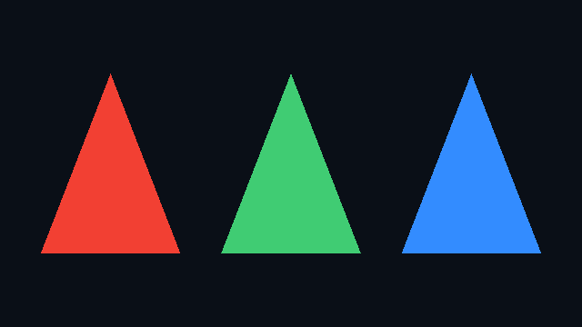

# Launch draw calls

Describe a primitive stream, attach vertex and fragment callbacks, and draw into a texture.
This complete example draws three colored triangles without a window or vertex buffer.

```slang
import slang.runtime;

struct Varyings
{
    float4 position : SV_Position;
    nointerpolation uint triangle : TEXCOORD0;
}

[host]
void main()
{
    let image = allocateTexture2D<float4, TextureFormat.rgba32Float>(640, 360);
    let targets = RenderTargets(image);
    targets.clear(float4(0.04, 0.06, 0.09, 1));

    // Set vertex count w/ VertexRange (#faces = #vertices/3)
    Primitives<Topology.TriangleList>(VertexRange(3))
        .instances(3) // Set instance count.
        .vertex((VertexInvocation v) =>
        {
            float2 p = v.vertexID == 0 ? float2(-0.24, -0.55)
                     : v.vertexID == 1 ? float2(0.24, -0.55)
                                       : float2(0.0, 0.55);
            p.x += (float(v.instanceID) - 1.0) * 0.62;
            return Varyings(float4(p, 0.5, 1), v.instanceID);
        })
        .draw(targets, (Varyings v) =>
        {
            float3 color = v.triangle == 0 ? float3(0.95, 0.25, 0.2)
                         : v.triangle == 1 ? float3(0.25, 0.8, 0.45)
                                           : float3(0.2, 0.55, 1.0);
            return float4(color, 1);
        });

    let file = openByteStream("triangles.png", ByteStreamMode.write);
    encodeImagePNG(image, file);
    closeByteStream(file);
}
```

Running the above `main()` method will produce an image file named `triangles.png` containing three instances of one triangle.



`VertexRange(3)` supplies three vertex IDs. `.instances(3)` repeats the primitive with
different instance IDs. The vertex callback returns clip-space position and varyings;
the fragment callback returns a color. Captured values bind automatically, as with compute.

## Indexed geometry and render state

For an existing index buffer and vertex callback:

```slang
// Fragment: indices, indexCount, vertexShader, and targets come from your renderer.
typealias TwoSided = RasterState<RasterizerState<FillMode.Solid, CullMode.None>>;
Primitives<Topology.TriangleList>(IndexRange(indices, 0, indexCount))
    .vertex(vertexShader)
    .draw<TwoSided>(targets, (Varyings v) => float4(1, 1, 1, 1));
```

Use `RenderTargets(color, depth)` for depth attachments and `DrawParameters` for
viewport/scissor values. See the
[primitive stream API](../../source/standard-modules/host/runtime/raster/primitive_stream.slang).
