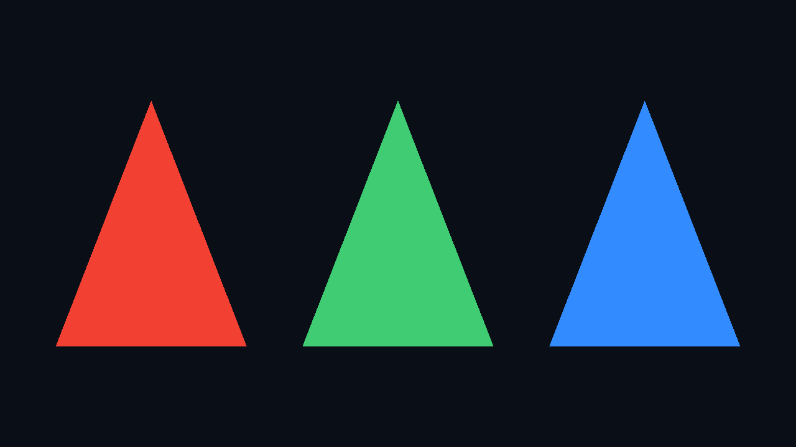
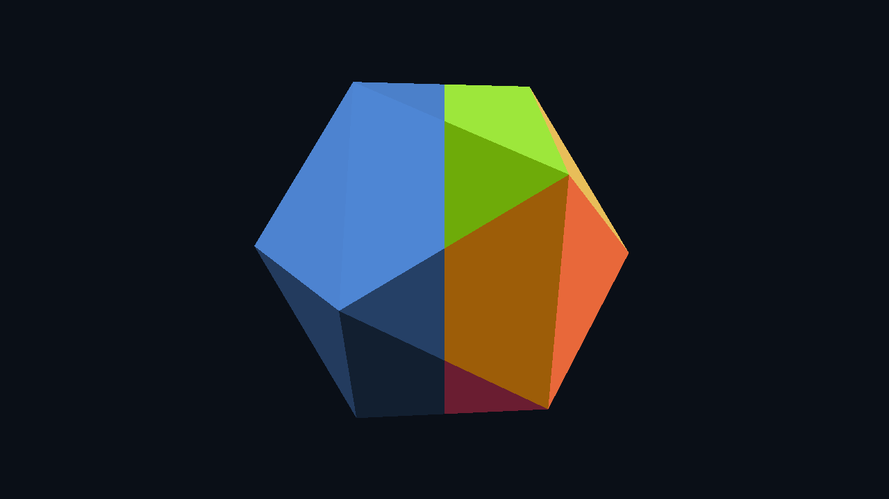

# Launch draw calls

A draw call in `h-slang` is a short chain of ordinary host values: a description of the
primitives to assemble, a vertex callback, a fragment callback, and the render state. As with
[`Grid::dispatch`](grid-dispatch.md), the callbacks are Slang lambdas, captured values bind
automatically, and the GPU work is recorded only when the chain ends in `.draw(...)`.

There are no pipeline objects, vertex input layouts, or descriptor sets to manage. The compiler
derives them from the types in the chain.

## A first draw

This complete example draws three colored triangles into a canvas, without a vertex buffer.
The image below the code is its expected output; running the example replaces it with the
live result.

<!-- runnable: render-triangles canvas=16:9 -->

```slang
import slang.runtime;

// Values passed from the vertex stage to the fragment stage ("varyings").
struct Varyings
{
    // Required: the clip-space position the rasterizer uses to place the vertex.
    float4 position : SV_Position;

    // Any other fields are interpolated across the triangle. Integers cannot be
    // interpolated, so `nointerpolation` passes the value through unchanged.
    nointerpolation uint triangle : TEXCOORD0;
}

[host]
void main(Window w)
{
    // The canvas's surface supplies the texture that is shown on screen.
    let surface = createSurface<TextureFormat::rgba8Unorm>(w);
    let presented = acquireSurfaceTexture(surface);
    uint width, height;
    presented.GetDimensions(width, height);

    // An ordinary 2D texture, sized to match the canvas, serves as the color target.
    let image = RWTexture2D<float4, 0, TextureFormat.rgba8Unorm>::alloc(width, height);
    let targets = RenderTargets(image);
    targets.clear(float4(0.04, 0.06, 0.09, 1));

    // 1. Primitive assembly: three sequential vertex IDs (0, 1, 2) assembled as a
    //    triangle list. The topology is a compile-time argument.
    Primitives<Topology.TriangleList>(VertexRange(3))
        // 2. Repeat the whole primitive three times, with instance IDs 0, 1, 2.
        .instances(3)
        // 3. Vertex stage: runs once per (vertex, instance) pair. There is no vertex
        //    buffer here, so the callback computes each position from the vertex ID.
        .vertex((VertexInvocation v) =>
        {
            float2 p = v.vertexID == 0 ? float2(-0.24, -0.55)
                     : v.vertexID == 1 ? float2(0.24, -0.55)
                                       : float2(0.0, 0.55);
            p.x += (float(v.instanceID) - 1.0) * 0.62; // Shift each instance sideways.
            return Varyings(float4(p, 0.5, 1), v.instanceID);
        })
        // 4. Fragment stage: runs once per covered pixel and returns its color.
        //    `.draw` records the GPU work; nothing before this point does.
        .draw(targets, (Varyings v) =>
        {
            float3 color = v.triangle == 0 ? float3(0.95, 0.25, 0.2)
                         : v.triangle == 1 ? float3(0.25, 0.8, 0.45)
                                           : float3(0.2, 0.55, 1.0);
            return float4(color, 1);
        });

    // Copy the result to the canvas and show it.
    blitTexture2D(presented, image);
    presentSurface(surface);
}
```



Positions are in clip space: after division by `w`, x and y span -1 to 1 across the target
(+y up) and z spans 0 to 1. The example passes no type argument to `.draw`, so it uses the
default render state: solid fill, no culling, and no depth test.

## The parts of a draw

Each method in the chain returns a new value and records no work, so a partially built draw can be
stored in a variable and reused:

| Step                             | Supplies                                    | Fixed at compile time       | Varies per draw                |
| -------------------------------- | ------------------------------------------- | --------------------------- | ------------------------------ |
| `Primitives<Topology>(source)`   | Which vertex IDs to visit and how to group them | Topology, source kind   | Vertex/index range             |
| `.instances(count, first = 0)`   | How many times to repeat the primitives     | —                           | Instance count and first ID    |
| `.vertex(callback)`              | The vertex stage                            | Callback code, varyings type | Captured values               |
| `.draw<State>(targets, callback, parameters)` | Fragment stage, state, outputs | Callback code, render state, target formats | Captured values, textures, viewport/scissor |

```slang
// Build the vertex half once...
let stream = Primitives<Topology.TriangleList>(VertexRange(3)).vertex(vertexShader);

// ...then issue several draws from it. Both draws share one pipeline.
stream.instances(2).draw(targets, fragmentShader);
stream.instances(4, 2).draw(targets, fragmentShader);
```

### Primitive sources and topology

A primitive source produces the sequence of vertex IDs that the GPU visits. The topology says how
consecutive IDs form primitives.

| Source                                                   | Vertex IDs produced                                 |
| -------------------------------------------------------- | --------------------------------------------------- |
| `VertexRange(count, firstVertex = 0)`                    | `firstVertex`, `firstVertex + 1`, …                 |
| `IndexRange(indices)`                                    | Every value in the `uint` index buffer               |
| `IndexRange(indices, firstIndex, indexCount, baseVertex = 0)` | `indices[firstIndex + i] + baseVertex` for each `i` |

`Topology` provides `TriangleList`, `TriangleStrip`, `LineList`, `LineStrip`, and `PointList`.
For `VertexRange(3)` with `TriangleList`, the three IDs form one triangle; with `LineStrip` they
would form two connected line segments.

Index buffers are `StructuredBuffer<uint>` or `RWStructuredBuffer<uint>` values. A compute
dispatch may write the index buffer immediately before the draw that reads it; the runtime orders
the two without a host round trip.

### The vertex stage

The vertex callback has the signature `(VertexInvocation v) -> Varyings`. `VertexInvocation`
holds two fields:

- `vertexID`: the effective vertex ID, already including `firstVertex` or `baseVertex`.
- `instanceID`: the effective instance ID, already including the `first` argument of
  `.instances`.

The return type of the callback becomes the draw's varyings type. It must contain an
`SV_Position` field; every other field is interpolated across each primitive and handed to the
fragment callback.

`h-slang` has no vertex input layouts. To read per-vertex data, capture a buffer and index it by
vertex ID (often called *vertex pulling*):

```slang
// Fragment: cpuPositions is a RuntimeArray<float4> filled on the host.
let positions = StructuredBuffer<float4>::alloc(vertexCount);
copy(positions, 0, cpuPositions, 0, vertexCount); // Upload the vertex data.
let vertexShader = (VertexInvocation v) => Varyings(positions[v.vertexID]);
```

Use a read-only `StructuredBuffer` for data the vertex stage reads. WebGPU does not allow
writable storage buffers in the vertex stage, so a vertex callback that captures a
`RWStructuredBuffer` fails to create its pipeline there.

### The fragment stage

The fragment callback has the signature `(Varyings v) -> Texel`, where `Varyings` is the vertex
callback's return type and `Texel` is the element type of the color target. A
`RWTexture2D<float4>` target therefore needs a fragment callback that returns `float4`. If either
type does not match, the call to `.draw` fails to type-check, so mismatched stages are caught at
compile time rather than by a validation layer.

### How the two callbacks become one pipeline

The runtime does not ask you to write `[shader("vertex")]` or `[shader("fragment")]` entry points.
The raster module defines one generic entry point for each stage and passes your callbacks to them
as uniform parameters. A simplified version of the module code:

```slang
// The vertex entry point converts system values into a VertexInvocation and calls your
// callback. `bindings` holds the callback's captures and the draw's base offsets.
[shader("vertex")]
Varyings primitiveVertexStage<Varyings, Vertex : IFunc<Varyings, VertexInvocation>>(
    uint vertexID : SV_VertexID,
    uint instanceID : SV_InstanceID,
    uniform PrimitiveVertexBindings<Vertex> bindings)
{
    return bindings.shader(VertexInvocation(
        vertexID + bindings.vertexOffset, instanceID + bindings.firstInstance));
}

// The fragment entry point receives the interpolated Varyings and writes the
// callback's result to the first color target.
[shader("fragment")]
Output primitiveFragmentStage<Varyings, Output, Fragment : IFunc<Output, Varyings>>(
    Varyings varyings,
    uniform Fragment fragment) : SV_Target0
{
    return fragment(varyings);
}
```

At each `.draw` call, Slang specializes both entry points with the concrete lambda types, and the
shared `Varyings` type links the vertex output to the fragment input. A lambda's captures are
its fields, so they become shader parameters exactly as they do for `Grid::dispatch`.

## Render state as a type

The render state covers fill mode, face culling, depth and stencil testing, blending, and
multisampling. It is passed to `.draw` as a static *type* argument, not as a runtime object, so
every pipeline it selects is known at compile time. Support for building render state from
dynamic types, with pipelines compiled just in time, is in progress.

```slang
// Draw both faces of every triangle, as a wireframe.
typealias TwoSidedWireframe =
    RasterState<RasterizerState<FillMode.Wireframe, CullMode.None>>;

stream.draw<TwoSidedWireframe>(targets, fragmentShader);
```

??? example "Deep dive: render state types"

    Graphics APIs bake render state into an immutable pipeline object, so a pipeline must be
    rebuilt or looked up whenever the state changes. Encoding the state as a type moves that work
    to compile time:

    - Every setting is a `static const` member of the type, so the compiler folds the whole state
      into a constant pipeline description and stores it in the compiled module. No state is
      hashed or validated at draw time.
    - Draws that use the same callbacks, state type, topology, and target formats share one
      pipeline. Changing captured values, instance counts, or vertex ranges does not create
      another.
    - Invalid values are type errors. A misspelled `CullMode.Bak` fails to compile instead of
      producing a broken pipeline.

    `RasterState<R, D, C, M>` groups four independent policies. Every argument has a default, and
    `RasterState<>` is the state used when `.draw` has no type argument.

    | Group         | Type                                      | Controls                                          | Default                        |
    | ------------- | ----------------------------------------- | ------------------------------------------------- | ------------------------------ |
    | Rasterizer    | `RasterizerState<Fill, Cull, FrontFace, DepthBias, DepthClip, Scissor, ...>` | Fill mode, face culling, winding, depth bias, scissor enable | Solid, no culling, counter-clockwise front faces |
    | Depth/stencil | `DepthStencilState<Test, Write, Func, Stencil, ...>` | Depth test and write, stencil ops     | Depth test **off**             |
    | Color targets | `ColorTargetStates<ColorTargetState<Blend, Logic, Mask, ColorBlend, AlphaBlend>>` | Blending and write mask for each color output | No blending, write all channels |
    | Multisample   | `MultisampleState<Mask, AlphaToCoverage, AlphaToOne>` | Sample mask and alpha-to-coverage   | All samples, both off          |

    The texture formats and sample counts are not part of the state. They come from the types of
    the textures in `RenderTargets(...)`.

    Generic arguments are positional, so a later setting requires spelling out the earlier ones.
    Common configurations look like this:

    ```slang
    // Depth test and depth write, keeping the nearest fragment.
    typealias DepthTested =
        RasterState<RasterizerState<>, DepthStencilState<true, true, ComparisonFunc.Less>>;

    // Enable the scissor test (the sixth rasterizer argument). The rectangle itself is a
    // per-draw value; see "Viewport and scissor" below.
    typealias Scissored = RasterState<RasterizerState<
        FillMode.Solid, CullMode.None, FrontFaceMode.CounterClockwise,
        0,      // depth bias
        true,   // depth clip
        true>>; // scissor test

    // Additive blending: result = source * 1 + destination * 1, for color and alpha.
    typealias Additive = RasterState<
        RasterizerState<>,
        DepthStencilState<>,
        ColorTargetStates<ColorTargetState<
            true,                     // enable blending
            LogicOp.NoOp,
            RenderTargetWriteMask.All,
            AspectBlendState<BlendFactor.One, BlendFactor.One>,   // color equation
            AspectBlendState<BlendFactor.One, BlendFactor.One>>>>; // alpha equation
    ```

    See [raster_state.slang](../../source/standard-modules/host/runtime/raster/raster_state.slang)
    for every parameter and its default.

### What is static and what is dynamic

| Kind of value                                   | Where it goes                         | Changing it…                  |
| ----------------------------------------------- | ------------------------------------- | ----------------------------- |
| Fill, cull, depth test, stencil ops, blending   | `RasterState` type argument           | Selects a different pipeline  |
| Topology                                        | `Primitives<Topology>`                | Selects a different pipeline  |
| Color and depth formats                         | Texture types in `RenderTargets`      | Selects a different pipeline  |
| Callback code                                   | The lambdas                           | Selects a different pipeline  |
| Captured buffers, textures, and scalars         | Lambda captures                       | Rebinds; same pipeline        |
| Vertex/index range, instance range              | Primitive source and `.instances`     | Same pipeline                 |
| Viewport, scissor rectangle, stencil reference  | `DrawParameters`                      | Same pipeline                 |

## Render targets and depth

`RenderTargets(color)` groups a color texture for a draw. The color texture's type must name its
format, as in `RWTexture2D<float4, 0, TextureFormat.rgba8Unorm>`, because the format is part of
the pipeline. `RenderTargets(color, depth)` adds a depth texture: `DepthTarget2D` is a `d32Float`
depth texture type, and any `Texture2D<float, 0, Format>` with a depth format also works.

```slang
// Fragment: indices, positions, and Varyings come from your renderer.
let image = RWTexture2D<float4, 0, TextureFormat.rgba32Float>::alloc(640, 360);
let depth = DepthTarget2D::alloc(640, 360);
let targets = RenderTargets(image, depth);

// Clear color to black and depth to the far plane (1.0).
targets.clear(float4(0, 0, 0, 1), 1.0);

Primitives<Topology.TriangleList>(IndexRange(indices))
    .vertex((VertexInvocation v) => Varyings(positions[v.vertexID]))
    .draw<DepthTested>(targets, (Varyings v) => float4(1, 1, 1, 1));
```

Attaching a depth texture does not enable depth testing on its own: the default
`DepthStencilState<>` has the test disabled. Pass a state such as `DepthTested` above to make
nearer fragments hide farther ones. Depth contents persist across draws, so several draws can
test against the same depth target.

## Viewport and scissor

Viewport and scissor rectangles change from draw to draw, so they are values in an optional
`DrawParameters` argument rather than part of the state type. By default, both cover the whole
target.

```slang
// Draw into the 4×4 pixel region whose top-left corner is (2, 2).
let parameters = DrawParameters().withViewport(Viewport(2, 2, 4, 4));
stream.draw(targets, fragmentShader, parameters);

// Additionally clip to pixels 3 and 4 on each axis (max is exclusive). The scissor
// rectangle only takes effect when the state enables the scissor test.
stream.draw<Scissored>(targets, fragmentShader,
                       parameters.withScissor(ScissorRect(3, 3, 5, 5)));
```

Pixels outside the viewport and scissor keep their previous contents.

## Putting it together: an icosahedron

This example combines the pieces above to draw a lit icosahedron, a solid with 20
triangular faces. It uploads vertex and index data into buffers, culls back faces, tests
depth, and uses scissor rectangles to split one image between two draws of the same
geometry.

<!-- runnable: render-icosahedron canvas=16:9 -->

```slang
import slang.runtime;

// Turn these to view the icosahedron from another side (radians).
static const float spin = 0.5;
static const float tilt = 0.35;

// The camera sits on the -z axis and looks toward the origin along +z.
static const float cameraDistance = 3.2;

struct Varyings
{
    float4 position : SV_Position;
    // The rotated position, interpolated across each face for lighting.
    float3 surface : SURFACE;
}

// Back-face culling, the depth test, and the scissor test are fixed in the pipeline type.
typealias SolidState = RasterState<
    RasterizerState<FillMode.Solid, CullMode.Back, FrontFaceMode.CounterClockwise,
                    0, true, /*ScissorEnable:*/ true>,
    DepthStencilState</*DepthTestEnable:*/ true, /*DepthWriteEnable:*/ true, ComparisonFunc.Less>>;

// Every three indices form one face. Seen from outside the solid, each face lists its
// corners counterclockwise, which the rasterizer treats as the front.
static const uint faceIndices[60] = { //!FOLD
    0, 5, 11,     0, 1, 5,      0, 7, 1,      0, 10, 7,     0, 11, 10,
    1, 9, 5,      5, 4, 11,     11, 2, 10,    10, 6, 7,     7, 8, 1,
    3, 4, 9,      3, 2, 4,      3, 6, 2,      3, 8, 6,      3, 9, 8,
    4, 5, 9,      2, 11, 4,     6, 10, 2,     8, 7, 6,      9, 1, 8,
};

/// Rotates p about the y axis by `spin`, then about the x axis by `tilt`.
float3 rotate(float3 p)
{
    float3 q = float3(cos(spin) * p.x + sin(spin) * p.z, p.y, cos(spin) * p.z - sin(spin) * p.x);
    return float3(q.x, cos(tilt) * q.y - sin(tilt) * q.z, sin(tilt) * q.y + cos(tilt) * q.z);
}

/// Returns the normal of the face containing `surface`, pointing toward the camera.
/// The screen-space derivatives of the interpolated position both lie in the face's
/// plane, so their cross product is perpendicular to the face.
float3 faceNormal(float3 surface)
{
    float3 n = normalize(cross(ddx(surface), ddy(surface)));
    float3 toCamera = float3(0, 0, -cameraDistance) - surface;
    return dot(n, toCamera) < 0 ? -n : n;
}

[host]
void main(Window w)
{
    let surface = createSurface<TextureFormat::rgba8Unorm>(w);
    let presented = acquireSurfaceTexture(surface);
    uint width, height;
    presented.GetDimensions(width, height);

    // Vertex and index data start in host arrays and are uploaded once into read-only
    // buffers. The icosahedron's 12 corners lie on three perpendicular golden rectangles.
    let phi = (1.0 + sqrt(5.0)) / 2.0;
    let cpuCorners = RuntimeArray<float4>::alloc(12);
    for (uint i = 0; i < 4; ++i)
    {
        float a = i % 2 == 0 ? -1.0 : 1.0;
        float b = i < 2 ? phi : -phi;
        cpuCorners[i] = float4(a, b, 0, 1);     // Rectangle in the xy plane.
        cpuCorners[i + 4] = float4(0, a, b, 1); // Rectangle in the yz plane.
        cpuCorners[i + 8] = float4(b, 0, a, 1); // Rectangle in the zx plane.
    }
    let corners = StructuredBuffer<float4>::alloc(12);
    copy(corners, 0, cpuCorners, 0, 12);

    let cpuIndices = RuntimeArray<uint>::alloc(60);
    for (uint i = 0; i < 60; ++i)
        cpuIndices[i] = faceIndices[i];
    let indices = StructuredBuffer<uint>::alloc(60);
    copy(indices, 0, cpuIndices, 0, 60);

    let image = RWTexture2D<float4, 0, TextureFormat.rgba8Unorm>::alloc(width, height);
    let depth = DepthTarget2D::alloc(width, height);
    let targets = RenderTargets(image, depth);
    targets.clear(float4(0.04, 0.06, 0.09, 1), 1.0);

    // The vertex stage captures the corner buffer and looks up each corner by the vertex
    // ID that the index buffer supplies. Its result is reused by both draws below.
    float aspect = float(width) / float(height);
    let solid = Primitives<Topology.TriangleList>(IndexRange(indices))
        .vertex((VertexInvocation v) =>
        {
            float3 p = rotate(normalize(corners[v.vertexID].xyz));
            // A perspective projection: x and y shrink with distance, and z maps the
            // range from 1 to 10 units in front of the camera onto depths 0 to 1.
            float z = p.z + cameraDistance;
            float4 clip = float4(p.x * 2.4 / aspect, p.y * 2.4, (z - 1.0) * 10.0 / 9.0, z);
            return Varyings(clip, p);
        });

    // Two draws share the geometry but shade it differently. Each scissor rectangle
    // limits one draw to half of the image: lighting on the left, normals on the right.
    let half = width / 2;
    solid.draw<SolidState>(targets, (Varyings v) =>
    {
        float3 n = faceNormal(v.surface);
        float light = 0.2 + 0.8 * max(dot(n, normalize(float3(-0.4, 0.7, -0.6))), 0.0);
        return float4(float3(0.35, 0.6, 0.95) * light, 1);
    }, DrawParameters().withScissor(ScissorRect(0, 0, half, height)));
    solid.draw<SolidState>(targets, (Varyings v) =>
    {
        return float4(faceNormal(v.surface) * 0.5 + 0.5, 1);
    }, DrawParameters().withScissor(ScissorRect(half, 0, width, height)));

    // Copy the result to the canvas.
    blitTexture2D(presented, image);
    presentSurface(surface);
}
```



**Vertex and index buffers.** The 12 corners and 60 indices are built in host arrays and
uploaded once with `copy` into read-only `StructuredBuffer`s. `IndexRange(indices)` visits the
indices in order, and the vertex callback captures `corners` and looks up each corner by
`v.vertexID`. A corner shared by five faces is stored once.

**Culling and depth.** [`SolidState`](cell:render-icosahedron.slang#SolidState) culls faces
whose corners appear clockwise on screen, which are the faces pointing away from the camera.
The depth test then resolves any remaining overlap, so the same state also works for shapes
that are not convex.

**Scissor rectangles.** The two `.draw` calls reuse the `solid` stream but pass different
fragment callbacks and scissor rectangles. Each draw only writes pixels inside its own rectangle,
including depth, so the right half's depth test is not affected by the left half's draw. The
two fragment callbacks produce two pipelines; drawing either again would reuse its pipeline.

**Flat shading.** [`faceNormal`](cell:render-icosahedron.slang#faceNormal) derives each face's
normal in the fragment stage from screen-space derivatives of the interpolated position,
so the vertices need no normals of their own. Change [`spin`](cell:render-icosahedron.slang#spin)
and [`tilt`](cell:render-icosahedron.slang#tilt) to turn the shape.

## Rough edges

**One color target.** `ColorTargetStates` can describe several outputs, but `.draw` currently
accepts a single color texture, written through `SV_Target0`.

**Vertex and fragment stages only.** As of right now, mesh, task, geometry, and tessellation
stages are not exposed through the draw chain.

**32-bit indices.** `IndexRange` accepts `uint` buffers only.

**Verbose state types.** Because state arguments are positional, changing a late setting such as
the scissor enable requires repeating the defaults before it. Define a `typealias` once and reuse
it.

## Behind the scenes

**Pipeline creation.** `.draw` passes the specialized vertex and fragment entry points and the
folded state description to the runtime. The pipeline description is emitted once in the compiled
module, and every draw that reaches it with the same types reuses it. Captured values, textures,
and draw ranges are recorded per draw.

**Buffering and ordering.** Draws are recorded into command batches alongside compute dispatches.
A dispatch that writes a vertex or index buffer can feed a draw without host synchronization, and
a host read of a render target flushes pending work first, as with compute.

See the [primitive stream API](../../source/standard-modules/host/runtime/raster/primitive_stream.slang),
[render targets](../../source/standard-modules/host/runtime/raster/render_targets.slang), and
[draw parameters](../../source/standard-modules/host/runtime/raster/draw_parameters.slang).
