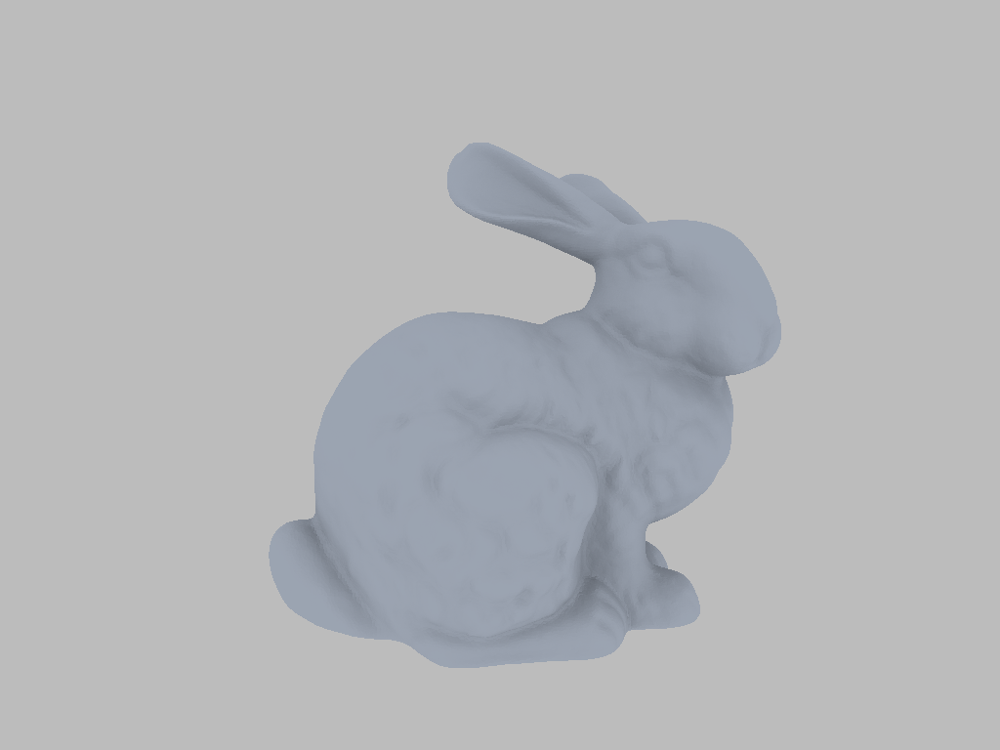

# Launch ray-tracing pipelines

`h-slang` supports both inline ray tracing and pipeline ray-tracing. For inline ray tracing, see Slang docs on `RayQuery`, which can be called in any `h-slang` compute dispatch.

Import the bundled `slang.pipeline_rt` module to use hardware raytracing pipelines.
`slang.runtime` supplies buffers, textures, and compute grids; importing it
alone does not expose the pipeline API.

Ray-tracing pipelines can be programmed with the following primitives:

1. Define ray types with custom payloads conforming to `IRayType`,
2. Create an object of `HWRaytracingContext<each RayTypes>` type with the desired ray types.
3. Register ray hit or miss handlers with `ctx.onHit<MyRayType>(id, callback|procedural-hit-group)` or `ctx.onMiss<MyRayType>(callback)`. `onHit` accepts custom procedural hit-groups (i.e., intersection shaders) as well as simple closest-hit shaders.
4. Simply pass the `context` object into a ray-gen shader and use `traceRay<RayType>` to launch rays with the desired payload. Ray-gen shaders are launched the same way as compute shaders, but via `dispatchRays` instead of `dispatch`.

## Example: Render a triangle

Choose the ray types and name their hardware context. Its child types describe acceleration
structures, geometry, and instances; their identity is shared across all hardware ray-type packs.

```slang
import slang.runtime;
import slang.pipeline_rt;

struct ColorRay : IRayType { float3 color; }
typealias RTContext = HWRaytracingContext<ColorRay>;

```

Register callbacks for the ray type. Geometry slot `0` selects our only triangle geometry.

```slang
[host]
void registerHandlers(RTContext context)
{
    context.onMiss<ColorRay>((ColorRay ray) => ColorRay(float3(0.04, 0.06, 0.09)));
    context.onHit<ColorRay>(0,
        (ColorRay ray, BuiltInTriangleIntersectionAttributes hit) => ColorRay(float3(1)));
}
```

Launch one ray-generation invocation per pixel, using explicit bindless handles:

```slang
[host]
void main()
{
    let scene = makeScene();
    let image = RWTexture2D<float4>::alloc(512, 512);
    let sceneHandle = scene.getDescriptorHandle();
    let imageHandle = image.getDescriptorHandle();
    RTContext context = {};
    registerHandlers(context);

    Grid(uint2(512, 512)).dispatchRays((uint2 p) =>
    {
        float2 uv = (float2(p) + 0.5) / 512.0;
        RayDesc ray;
        ray.Origin = float3(uv.x * 2 - 1, 1 - uv.y * 2, -1);
        ray.Direction = float3(0, 0, 1);
        ray.TMin = 0.001;
        ray.TMax = 100.0;
        ColorRay payload = { float3(0) };
        context.traceRay(*sceneHandle, ray, payload);
        imageHandle[p] = float4(payload.color, 1);
    });

    let file = openByteStream("silhouette.png", ByteStreamMode.write);
    encodeImagePNG(image, file);
    closeByteStream(file);
}
```


### Building the acceleration structure

The above example did not show the acceleration structure build; the following snippet shows the construction of a BLAS for a single triangle and a one-instance TLAS.

```slang
[host]
RTContext.AccelerationStructure makeScene()
{
    let vertices = RuntimeArray<float3>::alloc(3);
    vertices[0] = float3(-0.8, -0.7, 0);
    vertices[1] = float3(0.8, -0.7, 0);
    vertices[2] = float3(0, 0.7, 0);
    let vertexBuffer = StructuredBuffer<float3>::alloc(3);
    copy(vertexBuffer, 0, vertices, 0, 3);

    let indices = RuntimeArray<uint>::alloc(3);
    indices[0] = 0; indices[1] = 1; indices[2] = 2;
    let indexBuffer = StructuredBuffer<uint>::alloc(3);
    copy(indexBuffer, 0, indices, 0, 3);

    let geometries = RuntimeArray<RTContext.TriangleGeometry>::alloc(1);
    RTContext.TriangleGeometry geometry = RTContext.TriangleGeometry(vertexBuffer, indexBuffer);
    geometry.vertexCount = 3;
    geometry.indexCount = 3;
    geometries[0] = geometry;
    let blas = RTContext.BottomLevelAccelerationStructure::alloc();
    blas.build(geometries);
    let instances = RuntimeArray<RTContext.Instance>::alloc(1);
    instances[0] = RTContext.Instance(blas);
    let scene = RTContext.AccelerationStructure::alloc();
    scene.build(instances);
    return scene;
}
```

## Example: Multiple bounces & geometry from buffers

A primary-hit handler can read captured mesh buffers and trace a second ray type
through its owning context. This ambient-occlusion sketch abbreviates camera setup,
hemisphere sampling, and frame accumulation.

```slang
import slang.runtime;
import slang.pipeline_rt;

struct PrimaryRay : IRayType { float3 color; }
struct ShadowRay : IRayType { float visibility; }

[host]
void renderAO(
    RaytracingAccelerationStructure.Handle scene,
    StructuredBuffer<float3>.Handle vertices,
    StructuredBuffer<uint>.Handle indices,
    RWTexture2D<float4>.Handle output,
    uint2 resolution)
{
    float3 sky = float3(0.5);
    float3 albedo = float3(0.66, 0.74, 0.88);
    HWRaytracingContext<PrimaryRay, ShadowRay> context = {};

    context.onMiss<PrimaryRay>((PrimaryRay ray) => PrimaryRay(sky));
    context.onMiss<ShadowRay>((ShadowRay ray) => ShadowRay(1.0)); // Visible sky.
    context.onHit<ShadowRay>(0,
        (ShadowRay ray, BuiltInTriangleIntersectionAttributes hit) => ShadowRay(0.0));

    context.onHit<PrimaryRay>(0,
        (PrimaryRay ray, BuiltInTriangleIntersectionAttributes hit) =>
        {
            // Geometry slot 0 is this indexed mesh, with world-space positions.
            uint first = PrimitiveIndex() * 3;
            float3 a = vertices[indices[first]];
            float3 b = vertices[indices[first + 1]];
            float3 c = vertices[indices[first + 2]];
            float3 normal = normalize(cross(b - a, c - a));
            if (dot(normal, WorldRayDirection()) > 0.0)
                normal = -normal;
            float3 point = a + hit.barycentrics.x * (b - a) + hit.barycentrics.y * (c - a);

            float visibility = 0.0;
            [loop]
            for (uint sample = 0; sample < 32; ++sample)
            {
                RayDesc shadowRay;
                shadowRay.Origin = point + normal * 0.0001;
                shadowRay.Direction = /* cosine-weighted hemisphere sample about normal */;
                shadowRay.TMin = 0.0;
                shadowRay.TMax = 1e30;
                var shadow = ShadowRay(0.0);
                context.traceRay(*scene, shadowRay, shadow,
                    RAY_FLAG_ACCEPT_FIRST_HIT_AND_END_SEARCH);
                visibility += shadow.visibility;
            }
            return PrimaryRay(albedo * sky * (visibility / 32.0));
        });

    Grid(resolution).dispatchRays<2>((uint2 pixel) =>
    {
        RayDesc cameraRay = /* camera ray through pixel */;
        var primary = PrimaryRay(float3(0));
        context.traceRay(*scene, cameraRay, primary);
        output[pixel] = float4(primary.color, 1.0);
    });
    /* Accumulate the rendered frame. */
}
```

`dispatchRays<2>` allows the primary hit to trace a `ShadowRay`: a hit contributes
zero visibility, and a miss contributes sky light. The image below illustrates this
secondary-ray pattern with a bunny mesh.



_Ambient-occlusion bunny: 64 accumulated frames, with 32 visibility rays per surface pixel per frame._

## Rough edges

**Single `HWRaytracingContext<...>` instance.** A dispatch currently accepts one distinct context tracker. Copies of that context and handlers referring to their own context are supported; combining independent trackers is not.
A context supports 1–15 ray types. Set a sufficient recursion depth when handlers trace secondary rays.

Supporting multiple contexts so different ray type sets can be combined dynamically is on the roadmap but not yet implemented.

**Bindless resources only.** Convert buffers, textures, and acceleration structures with
`getDescriptorHandle()` before capture in ray-generation or hit/miss callbacks. Ordinary
resource captures are rejected here. Use `nonuniform(handle)` when descriptor selection
can vary across shader invocations.

Supporting bindful resources is on the roadmap, but not yet implemented. This can be helpful for re-using existing handlers with a SW ray tracing implementation for platforms like WebGPU.

**Record sizes.** Captured data must fit shader-binding-table record limits. The maximum size is currently limited at around 512 bytes though it can depend on the backend. Larger data should be placed in buffers and captured via descriptor handles or user-defined indices.

## Behind the scenes

**Static context detection, dynamic handlers.** Compilation identifies context values in
device arguments and captures. At dispatch, the VM enumerates the registered handlers and
snapshots their captured values; registration itself does not create a native pipeline.

**Context to binding table.** Logically, the context describes a shader binding table. The
VM creates or reuses a pipeline whose code satisfies those records, then builds the table
with the current captures. Changing capture values can reuse the pipeline. Queued work
retains its table, pipeline, and resources until completion.
