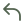

# An SDF path tracer, one step at a time

We will build an image of a sphere from a function that measures distance. Along the
way, we will learn how to describe a surface, find it along a ray, and light it.
We start with a ray tracer that finds surfaces by sphere tracing, then extend it into
a path tracer. The tutorial has four chapters on this page:

- [Chapter 1: Build an SDF ray tracer](#chapter-1-build-an-sdf-ray-tracer) — 1.1–1.4
  introduce distance functions, ray intersections, surface normals, and blended shapes.
- [Chapter 2: Add environment lighting and path tracing](#chapter-2-add-environment-lighting-and-path-tracing) — 2.1–2.6
  add an environment map, mirror reflection, diffuse sampling, a path tracer, accumulation,
  and importance sampling.
- [Chapter 3: Add realistic materials with microfacet models](#chapter-3-add-realistic-materials-with-microfacet-models) — 3.1–3.2
  introduce glossy reflection from tiny mirror-like facets, then a glossy blue sphere on
  a checkerboard floor.
- [Chapter 4: Make the path tracer interactive](#chapter-4-make-the-path-tracer-interactive) — 4.1–4.2
  turn mouse input into an orbiting camera and restart the average when the view changes.

Each code cell is an editable `h-slang` file; press 
on an example to see its image. Code links in the text jump to their definitions,
and **Ctrl+click** (**⌘+click** on macOS) does the same inside an editor.
No graphics background is needed: we introduce the concepts as we use them.

??? info "Using the examples"
    **Ctrl+Enter** (**⌘+Enter** on macOS) also runs an example; **F12** or the
    **Go to Definition** context-menu action follows a definition. Navigation opens
    collapsed sections automatically. 
    restores one cell's original code.

    [Imports](../user-guide/04-modules-and-access-control.md#importing-a-module) use
    the current code in other cells, including support modules in **Deep Dive**
    sections. These module cells have no Run button and need not be opened or run.
    After editing a cell, rerun any examples whose images you want to update.

    Each example keeps the controls for that step as `static const` values above
    its functions. Fixed setup values appear directly in constructors and calls.
    Its `main` builds the scene and passes a drawing function to the shared
    [`runFrames`](cell:frame-loop.slang#runFrames) loop. Each
    [compute dispatch](grid-dispatch.md) calculates pixels in parallel using
    [lambda expressions](../user-guide/03-convenience-features.md#lambda-expressions-experimental).
    Shared modules receive settings through arguments or fields, so each example's
    controls affect its own scene.

## Chapter 1: Build an SDF ray tracer

<!-- prettier-ignore -->
??? info "Sources"
    The sphere-tracing algorithm follows John C. Hart's
    [Sphere Tracing: A Geometric Method for the Antialiased Ray Tracing of Implicit Surfaces](https://doi.org/10.1007/s003710050084).
    The smooth union uses the polynomial smooth minimum described in Inigo Quilez's
    [Smooth Minimum](https://iquilezles.org/articles/smin/). This chapter presents
    these methods as interactive `h-slang` examples.

Start with a function that describes a sphere, then turn it into a shaded image.
By the end of this chapter, we will combine two spheres into one smooth shape.

### 1.1: Define a sphere with a distance function

A **signed distance function**, or **SDF**, takes a point in space and returns its
distance to the nearest surface. Its sign tells us which side we are on:

- **Negative:** inside the object.
- **Zero:** on its surface.
- **Positive:** outside the object.

For a sphere with centre $\mathbf c$, `length(p - center)` is the distance from the
centre to the point `p`. Subtracting the radius gives its signed distance. We start
with the centre at the origin, where this reduces to `length(p) - radius`.


Writing $\mathbf p$ for the point, $\mathbf c$ for the centre, $R$ for the radius,
and $D$ for the distance function, we have

$$
% label: Sphere signed distance
D(\mathbf p) = \|\mathbf p - \mathbf c\| - R.
$$

The bars mean vector length: `length(p - center)` in the code. The function takes
the centre and radius as arguments, so the same code describes any sphere. With the
centre at the origin and radius 1,
the centre has distance −1, the point `(1, 0, 0)` has distance 0, and `(2, 0, 0)`
has distance +1. These distances use the same units as our coordinates. In the
diagram, A is halfway from the centre to the surface, so its signed distance is −0.5.

The first image is a flat slice through this 3D function at `z = 0`.
**Orange means negative (inside); blue means positive (outside).** The thin white
boundary marks distances close to zero.

<!-- module: sphere-distance -->

```slang
public float sphereDistance(float3 position, float3 center, float radius)
{
    return length(position - center) - radius;
}
```

The following example uses [`sphereDistance`](cell:sphere-distance.slang#sphereDistance)
to colour a slice through the chosen sphere's field.

??? example "Deep Dive 1.1.1: Window management and frame rendering"
    Every example calls [`runFrames`](cell:frame-loop.slang#runFrames) with a function
    that draws the next frame. The loop owns the surface, texture allocation, resize
    events, and presentation. A small [`Frame`](cell:frame-loop.slang#Frame) record
    gives that function the output texture and image size.

    Early examples ask for one sample in one frame. Later examples accumulate many
    samples: [`firstSample`](cell:frame-loop.slang#Frame.firstSample) and
    [`sampleCount`](cell:frame-loop.slang#Frame.sampleCount) identify the next batch,
    while [`history`](cell:frame-loop.slang#Frame.history) retains the previous linear
    average. At sample zero, the drawing function must ignore old history. We explain
    this average in [2.5](#25-reduce-noise-with-sample-accumulation). The separate [`image`](cell:frame-loop.slang#Frame.image)
    texture contains the colours to present on screen.

    The acquired surface image stays local to [`drawFrame`](cell:frame-loop.slang#drawFrame), so it is released before
    the next resize. `processWindowEvents` yields between frames and allows Stop.
    Resizing restarts accumulation. This finite rendering session ends when it reaches
    the requested sample limit or the window closes.

    <!-- module: frame-loop -->

    ```slang
    import slang.runtime;

    public struct Frame
    {
        public RWTexture2D<float4> history;
        public RWTexture2D<float4> image;
        public uint2 resolution;
        public uint firstSample;
        public uint sampleCount;
    }

    // Acquired images are released when this call returns, before any resize.
    [host]
    public void drawFrame<F : IFunc<void, Frame>>(Surface<TextureFormat::rgba8Unorm> surface,
        F render, inout Frame frame, uint samplesPerFrame, uint sampleLimit)
    {
        RenderTarget2D<float4, TextureFormat::rgba8Unorm> presented;
        if (!tryAcquireSurfaceTexture(surface, presented))
            return;
        uint width, height;
        presented.GetDimensions(width, height);
        if (width != frame.resolution.x || height != frame.resolution.y)
        {
            frame.resolution = uint2(width, height);
            frame.history = RWTexture2D<float4>::alloc(width, height);
            frame.image = RWTexture2D<float4>::alloc(width, height);
            frame.firstSample = 0;
        }
        frame.sampleCount = min(samplesPerFrame, sampleLimit - frame.firstSample);
        render(frame);
        blitTexture2D(presented, frame.image);
        if (!tryPresentSurface(surface))
        {
            frame.firstSample = 0; // A resize discarded this frame; process its event next.
            return;
        }
        frame.firstSample += frame.sampleCount;
    }

    [host]
    public void runFrames<F : IFunc<void, Frame>>(Window w, F render,
        uint samplesPerFrame, uint sampleLimit)
    {
        if (samplesPerFrame == 0 || sampleLimit == 0)
            return;
        let surface = createSurface<TextureFormat::rgba8Unorm>(w);
        var frame = Frame(RWTexture2D<float4>::alloc(1, 1),
            RWTexture2D<float4>::alloc(1, 1), uint2(1u, 1u), 0u, 0u);
        bool drawable = true;
        while (frame.firstSample < sampleLimit && processWindowEvents(w))
        {
            for (;;)
            {
                InputEvent event = pollInputEvent(w);
                if (event.type == InputEventType.none)
                    break;
                if (event.type == InputEventType.windowResize)
                {
                    drawable = resizeSurface(surface, event.size.x, event.size.y);
                    frame.firstSample = 0;
                }
            }
            if (drawable)
                drawFrame(surface, render, frame, samplesPerFrame, sampleLimit);
        }
    }
    ```

    ??? note "Slang note: lambdas and function parameters"
        `(Frame frame) => { ... }` is a function value, called a
        [lambda](../user-guide/03-convenience-features.md#lambda-expressions-experimental).
        `IFunc<void, Frame>` says it accepts one frame and returns no value. The generic
        parameter lets the loop accept any such function; see the
        [interfaces and generics guide](../user-guide/06-interfaces-generics.md).
        A nested [compute dispatch](grid-dispatch.md) runs the pixel calculations on the
        GPU. These language details do not change the graphics algorithm.

<!-- runnable: render-sphere canvas=16:9 -->

```slang
import slang.runtime;
import "frame-loop";
import "sphere-distance";

static const float radius = 1.0;
static const float sliceZ = 0.0;

[host]
void main(Window w)
{
    runFrames(w, (Frame frame) =>
    {
        Grid(frame.resolution).dispatch<8, 8>((uint2 pixel) =>
        {
            float2 xy = (2.0 * (float2(pixel) + 0.5) - float2(frame.resolution))
                / float(frame.resolution.y) * 1.5;
            xy.y = -xy.y;
            float distance = sphereDistance(float3(xy, sliceZ), float3(0.0), radius);
            float3 color = distance < 0.0 ? float3(0.85, 0.32, 0.16) : float3(0.12, 0.35, 0.65);
            if (abs(distance) < 0.015)
                color = float3(1.0);
            frame.image[pixel] = float4(color, 1.0);
        });
    }, 1u, 1u);
}
```

**Try it:** change [`radius`](cell:render-sphere.slang#radius) to `0.7` and press  in the cell. Then try
[`sliceZ`](cell:render-sphere.slang#sliceZ) at `0.5`. Why does the cross-section shrink? At a
slice farther from the centre than the radius, there is no inside region at all.

### 1.2: Find the surface with sphere tracing

A **ray** starts at an origin and travels in a direction. A point along it is
`origin + t * direction`. Writing $\mathbf o$ for `origin` and $\mathbf d$ for
`direction`, we can describe every point on the ray with

$$
% label: Ray equation
\mathbf p(t) = \mathbf o + t\mathbf d, \qquad t \geq 0.
$$

Here $t$ is how far we have travelled. We normalize $\mathbf d$ to length 1 so
that $t$ measures distance in our scene's units.

Our camera starts outside the sphere. At each point along a ray, the SDF tells us
how far away the nearest surface is. We can advance by that distance without
crossing the surface. Repeating this is called **sphere tracing**. It also works
for other shapes when their functions provide valid distance bounds.


Each circle represents a slice through an empty sphere around a sample point.
We can move to that sphere's boundary in any direction, including along our ray.
The closest surface point need not be on the ray: the orange segment measures the
nearest distance, while the blue segment advances by that same distance along the ray.
That is why one safe step does not usually reach the object.

Let $t_k$ be the travelled distance after $k$ steps, starting with $t_0 = 0$.
The next step is

$$
% label: Sphere-tracing step
t_{k+1} = t_k + D\bigl(\mathbf p(t_k)\bigr).
$$

The subscript $k$ counts loop iterations. In the code, $D(\mathbf p(t_k))$ is
`distance`, and the update is simply `t += distance`.

We stop when the distance is smaller than a hit tolerance. A maximum distance and
a step budget keep rays that miss from running forever. The function reports
whether it found a hit and returns the hit position.

The tracer below uses the distance function we just defined. We give it the sphere's
centre and radius, the ray, and its numerical stopping settings. A small
[`Camera`](cell:camera.slang#Camera) makes one ray through each pixel; Deep Dive 1.2.1
shows how. The image is a
**binary intersection mask**: white pixels hit the sphere; black pixels miss.

??? example "Deep Dive 1.2.1: Pinhole camera rays and field of view"
    [`Camera`](cell:camera.slang#Camera) stores three fields.
    [`position`](cell:camera.slang#Camera.position) is the origin of every ray, and
    [`target`](cell:camera.slang#Camera.target) is a point to look toward. Moving the
    target farther along the same line does not change the view.

    

    [`focalLength`](cell:camera.slang#Camera.focalLength) places that virtual image
    plane in front of the camera. The image's half-height is 1 in our normalized
    coordinates, so increasing focal length makes the rays spread less and zooms in.
    It controls the field of view, not the distance to the target or a focus setting.

    [`direction`](cell:camera.slang#Camera.direction) maps an image
    coordinate to a unit ray direction. Call it with `float2(pixel) + 0.5` to aim
    through a pixel's centre. Later, a different offset lets us sample within a pixel.

    Dividing both screen coordinates by image height preserves the aspect ratio;
    flipping `screen.y` makes the scene's upward direction match the image. The camera
    uses world Y as up: its target must differ from its position, and its view direction
    must not be parallel to world Y. Focal length and image dimensions must be positive.

    <!-- module: camera -->

    ```slang
    public struct Camera
    {
        public float3 position;
        public float3 target;
        public float focalLength;

        public float3 direction(float2 pixel, uint2 resolution)
        {
            float3 forward = normalize(target - position);
            float3 right = normalize(cross(float3(0.0, 1.0, 0.0), forward));
            float3 up = cross(forward, right);
            float2 screen = (2.0 * pixel - float2(resolution)) / float(resolution.y);
            screen.y = -screen.y;
            return normalize(screen.x * right + screen.y * up + focalLength * forward);
        }
    }
    ```

<!-- module: simple-sphere-tracer -->

```slang
import "sphere-distance";

// Positive distances in scene units, and a positive step budget.
public struct TraceSettings
{
    public float hitTolerance;
    public float maxDistance;
    public int maxSteps;
}

// Trace a unit direction from outside this sphere. The position is valid only on a hit.
public bool sphereTrace(float3 center, float radius, float3 origin, float3 direction,
    out float3 hitPosition, TraceSettings settings)
{
    float t = 0.0;
    hitPosition = origin;

    for (int step = 0; step < settings.maxSteps; ++step)
    {
        hitPosition = origin + t * direction;
        float distance = sphereDistance(hitPosition, center, radius);
        if (distance < settings.hitTolerance)
            return true;

        t += distance; // Advance by the distance to the nearest surface.
        if (t > settings.maxDistance)
            return false;
    }
    return false; // No hit was found within the iteration budget.
}
```

<!-- runnable: render-intersection canvas=16:9 -->

```slang
import slang.runtime;
import "frame-loop";
import camera;
import "simple-sphere-tracer";

static const float radius = 1.0;
static const float hitTolerance = 0.001;
static const int maxSteps = 96;

[host]
void main(Window w)
{
    let camera = Camera(float3(0.0, 0.0, -3.0), float3(0.0), 1.5);
    let settings = TraceSettings(hitTolerance, 10.0, maxSteps);
    runFrames(w, (Frame frame) =>
    {
        Grid(frame.resolution).dispatch<8, 8>((uint2 pixel) =>
        {
            float3 direction = camera.direction(float2(pixel) + 0.5, frame.resolution);
            float3 hitPosition;
            bool hit = sphereTrace(float3(0.0), radius, camera.position, direction,
                hitPosition, settings);
            frame.image[pixel] = float4(hit ? float3(1.0) : float3(0.0), 1.0);
        });
    }, 1u, 1u);
}
```

**Try it:** change [`radius`](cell:render-intersection.slang#radius) in this example to `0.7`,
then press . The white silhouette becomes smaller
without changing the shared distance function. You can also reduce
[`maxSteps`](cell:render-intersection.slang#maxSteps) to see why rays near the edge can need
more steps. Increase [`hitTolerance`](cell:render-intersection.slang#hitTolerance) to `0.05`
to see how stopping farther from the surface enlarges the silhouette.
Keep the camera outside the sphere: this tutorial traces opaque surfaces from outside.
A `false` result means no hit was found within the distance and step limits; a budget
that is too small can miss a real surface.

### 1.3: Shade the sphere using surface normals

The mask tells us where the sphere is, but every hit has the same colour. To add
shading, we need the surface's **normal**: a unit vector pointing out of the surface.

The SDF increases as we move outwards. Its **gradient** is a vector describing how
quickly the distance changes along x, y, and z. It points in the direction of greatest
increase. At a smooth surface point, that direction is perpendicular to the surface.
We write this gradient as $\nabla D(\mathbf p)$; the symbol $\nabla$ collects those
three rates of change into a vector. Dividing by its length gives the unit normal:

$$
% label: Surface normal
\mathbf n(\mathbf p) = \frac{\nabla D(\mathbf p)}{\|\nabla D(\mathbf p)\|}.
$$

In the code this is `normalize(gradient)`. We estimate the gradient by comparing
distance samples a little to either side of the point along each axis. This is a
**central finite difference**; all three components together require six samples.

??? example "Deep Dive 1.3.1: Estimating SDF normals with finite differences"
    Let $\varepsilon$ be the small offset passed as `epsilon` to
    [`surfaceNormal`](cell:render-shading.slang#surfaceNormal), and
    $\mathbf e_x = (1, 0, 0)$ be a unit step along x. We estimate the x component
    of the gradient with

    $$
    % label: Central finite difference
    g_x \approx \frac{D(\mathbf p + \varepsilon\mathbf e_x)
                      - D(\mathbf p - \varepsilon\mathbf e_x)}{2\varepsilon}.
    $$

    The two samples are $2\varepsilon$ apart. Subtracting their distances and
    dividing by that separation measures the rate of change along x. This is
    `(distance(p + dx) - distance(p - dx)) / (2 * epsilon)`, where
    `dx = float3(epsilon, 0, 0)`. Repeat along y and z to estimate all three
    components of $\mathbf g = (g_x, g_y, g_z)$, then normalize the estimated vector. The approximation sign
    $\approx$ reminds us that finite offsets estimate the exact gradient.


We then measure how much the normal faces the light using a dot product. Let
$\boldsymbol\ell$ be the unit direction **from the surface toward the light**
(`normalize(light)` in the code), and $\theta$ the angle between it and $\mathbf n$.
For unit vectors, the dot product is the cosine of that angle. The lighting factor is

$$
% label: Diffuse lighting factor
s = \max(0,\mathbf n\cdot\boldsymbol\ell) = \max(0,\cos\theta).
$$

This becomes `max(dot(normal, normalize(light)), 0.0)` and is stored in `diffuse`. The dot
product is 1 when directly facing the light, 0 when sideways, and negative when
facing away. Clamping negative values to zero gives simple diffuse shading. We add a small
constant fill so the unlit side stays visible; it is an artistic approximation of
light from the surroundings, which [Chapter 2](#chapter-2-add-environment-lighting-and-path-tracing) will sample explicitly.

<!-- module: normal-shading -->

```slang
// normal is unit length, light is nonzero, and fill is in [0, 1].
public float3 shadeNormal(float3 normal, float3 color, float3 light, float fill)
{
    float diffuse = max(dot(normal, normalize(light)), 0.0);
    return color * (fill + (1.0 - fill) * diffuse);
}
```

At each hit, [`surfaceNormal`](cell:render-shading.slang#surfaceNormal) samples the sphere's
distance field to estimate its normal. [`shadeNormal`](cell:normal-shading.slang#shadeNormal)
then uses that normal to calculate the light-facing colour.

<!-- runnable: render-shading canvas=16:9 -->

```slang
import slang.runtime;
import "frame-loop";
import camera;
import "sphere-distance";
import "simple-sphere-tracer";
import "normal-shading";

static const float normalEpsilon = 0.002;
static const float3 lightDirection = float3(-0.6, 0.8, -1.0);
static const float3 surfaceColor = float3(0.25, 0.65, 0.35);

float3 surfaceNormal(float3 p, float3 center, float radius, float epsilon)
{
    float3 dx = float3(epsilon, 0.0, 0.0);
    float3 dy = float3(0.0, epsilon, 0.0);
    float3 dz = float3(0.0, 0.0, epsilon);
    float3 gradient = float3(
        sphereDistance(p + dx, center, radius) - sphereDistance(p - dx, center, radius),
        sphereDistance(p + dy, center, radius) - sphereDistance(p - dy, center, radius),
        sphereDistance(p + dz, center, radius) - sphereDistance(p - dz, center, radius))
        / (2.0 * epsilon);
    return normalize(gradient);
}

[host]
void main(Window w)
{
    let camera = Camera(float3(0.0, 0.0, -3.0), float3(0.0), 1.5);
    let settings = TraceSettings(0.001, 10.0, 96);
    runFrames(w, (Frame frame) =>
    {
        Grid(frame.resolution).dispatch<8, 8>((uint2 pixel) =>
        {
            float3 direction = camera.direction(float2(pixel) + 0.5, frame.resolution);
            float3 hitPosition;
            float3 color = float3(0.025, 0.035, 0.05);
            if (sphereTrace(float3(0.0), 1.0, camera.position, direction, hitPosition, settings))
            {
                float3 normal = surfaceNormal(hitPosition, float3(0.0), 1.0, normalEpsilon);
                color = shadeNormal(normal, surfaceColor, lightDirection, 0.1);
            }
            frame.image[pixel] = float4(pow(color, float3(1.0 / 2.2)), 1.0);
        });
    }, 1u, 1u);
}
```

**Try it:** change [`lightDirection`](cell:render-shading.slang#lightDirection)'s x component
from `-0.6` to `0.6`. The bright side
moves from left to right. Then choose another [`surfaceColor`](cell:render-shading.slang#surfaceColor). To explore the normal
estimate, try increasing [`normalEpsilon`](cell:render-shading.slang#normalEpsilon) to `0.2`; large offsets blur local detail, while
extremely small offsets can lose precision when subtracting nearly equal distances.

### 1.4: Combine spheres with a smooth union

To blend two spheres, the tracer must accept any distance field, not just our single
sphere function. We first make it generic, then combine two spheres.

#### The ISDF shape interface

So far, [`simple-sphere-tracer.slang`](cell:simple-sphere-tracer.slang) measures
distance to one sphere function. We now give the tracer an object with one
operation: [`distance`](cell:sdf.slang#ISDF.distance) at a point. The tracing rule
stays the same; a different object supplies a different distance field.

<!-- module: sdf -->

```slang
public interface ISDF
{
    // Negative inside, zero on the surface; outside, a conservative distance bound.
    // Positions and returned distances use the same scene units.
    float distance(float3 position);
}
```

[`SphereSDF`](cell:sphere-sdf.slang#SphereSDF) stores one sphere's centre and radius
and delegates to our distance function. Two instances can now describe two different
spheres without changing any shared code. Radius must be positive.

<!-- module: sphere-sdf -->

```slang
import sdf;
import "sphere-distance";

public struct SphereSDF : ISDF
{
    public float3 center;
    public float radius;

    public float distance(float3 position)
    {
        return sphereDistance(position, center, radius);
    }
}
```

The new [`sphereTrace`](cell:sphere-tracer.slang#sphereTrace) calls
[`sdf.distance`](cell:sdf.slang#ISDF.distance)
instead of a particular sphere function. It still expects an exterior ray origin,
a unit direction, and positive stopping settings. A `false` result means no hit was
found within the requested budgets; only a `true` result makes `hitPosition` usable.
We generalize the six-sample normal estimator in the same way and pass its finite
difference spacing explicitly. It needs a positive spacing and a surface neighborhood
with a nonzero gradient.

<!-- module: sphere-tracer -->

```slang
import sdf;

// Positive distances in scene units, and a positive step budget.
public struct TraceSettings
{
    public float hitTolerance;
    public float maxDistance;
    public int maxSteps;
}

public bool sphereTrace<S : ISDF>(S sdf, float3 origin, float3 direction,
    out float3 hitPosition, TraceSettings settings)
{
    float t = 0.0;
    hitPosition = origin;

    for (int step = 0; step < settings.maxSteps; ++step)
    {
        hitPosition = origin + t * direction;
        float distance = sdf.distance(hitPosition);
        if (distance < settings.hitTolerance)
            return true;

        t += distance;
        if (t > settings.maxDistance)
            return false;
    }
    return false;
}

public float3 surfaceNormal<S : ISDF>(S sdf, float3 p, float epsilon)
{
    float3 dx = float3(epsilon, 0.0, 0.0);
    float3 dy = float3(0.0, epsilon, 0.0);
    float3 dz = float3(0.0, 0.0, epsilon);
    float3 gradient = float3(
        sdf.distance(p + dx) - sdf.distance(p - dx),
        sdf.distance(p + dy) - sdf.distance(p - dy),
        sdf.distance(p + dz) - sdf.distance(p - dz)) / (2.0 * epsilon);
    return normalize(gradient);
}
```

The remaining examples use this generic tracer. The earlier
[sphere-only version](cell:simple-sphere-tracer.slang#sphereTrace) remains above for comparison.

??? note "Slang note: interfaces and generic SDF functions"
    [`ISDF`](cell:sdf.slang#ISDF) is an interface: it describes an operation without
    choosing the shape. `S : ISDF` says the argument's type provides that operation.
    The same function can therefore accept a sphere or a blended field. This is
    Slang's [interface and generic-function syntax](../user-guide/06-interfaces-generics.md);
    it lets us vary the geometry while keeping the algorithm in one place.

    The tracer returns a Boolean hit result and writes the position through its
    `out` parameter. Use that position only when the return value is `true`.
    See [parameter directions](../user-guide/02-conventional-features.md#functions).

#### Translate and combine distance fields

Each [`SphereSDF`](cell:sphere-sdf.slang#SphereSDF) passes its own centre to our
distance function, so we can place a sphere anywhere without changing that function.
If $D$ is our sphere function centred at the origin and $\mathbf c$ is the desired
centre, the translated function is

$$
% label: Translated distance field
D_{\mathbf c}(\mathbf p) = D(\mathbf p - \mathbf c).
$$

Subtracting $\mathbf c$ moves the query point into the sphere's own coordinates; it is
`position - center` inside the [`sphereDistance`](cell:sphere-distance.slang#sphereDistance)
function. We use two `SphereSDF` values to describe a sphere on the left and another
on the right.

The **union** of two objects contains everything inside either one. Taking
`min(left, right)` combines their distance functions, but leaves a sharp crease where
the two surfaces meet. A **smooth union** rounds that join so the spheres look as if
they are melting into each other.

If the two fields are $D_1$ and $D_2$, the ordinary union uses

$$
% label: Union of two fields
D_{\mathrm{union}}(\mathbf p) = \min\bigl(D_1(\mathbf p),D_2(\mathbf p)\bigr).
$$

Whenever either field is negative, their minimum is negative too, so the result
contains the inside of both objects. In code, `left.distance(p)` and `right.distance(p)`
sample the fields of the two spheres stored in [`BlendedSDF`](cell:render-blending.slang#BlendedSDF).


Both outlines are zero contours of their combined fields: points where the field
equals zero. The sphere positions and radii are identical in both views.

Our smooth minimum starts with the smaller distance, then subtracts a small correction
where the two distances are similar. [`blendWidth`](cell:render-blending.slang#blendWidth) sets the width of that transition
in scene units. A larger value fills out the join; zero gives the ordinary union.
This changes the geometry, so both ray intersections and normals must sample the
combined field. Blending only the pixel colours would leave the crease in place.

??? example "Deep Dive 1.4.1: The polynomial smooth-union formula"
    Let $a$ and $b$ be the two sampled distances and $k$ be the `width` argument to [`smoothUnion`](cell:render-blending.slang#smoothUnion). For $k > 0$,
    first compute how close the distances are to each other:

    $$
    % label: Smooth-union blend amount
    h = \frac{\max\bigl(k - |a - b|,\,0\bigr)}{k}.
    $$

    Here $|a-b|$ is `abs(a - b)`. When the distances agree, $h=1$; when they
    differ by at least $k$, $h=0$. Subtract a correction from the smaller distance:

    $$
    % label: Smooth union
    \operatorname{smoothUnion}(a,b,k) = \min(a,b) - \frac{k}{4}h^2.
    $$

    This is `min(a, b) - 0.25 * width * h * h`. Lowering the field expands its
    zero contour around the join, as shown above. When $k \leq 0$, the code returns
    $\min(a,b)$ directly, so it never divides by zero. The resulting field is a
    conservative distance bound outside the shape, rather than an exact signed
    distance everywhere.

Press  in this cell to replace the single sphere with a connected, shaded pair.
[`BlendedSDF`](cell:render-blending.slang#BlendedSDF) stores the two spheres and a blend
width. Its distance method combines their answers. The shared
[`sphereTrace`](cell:sphere-tracer.slang#sphereTrace) and
[`surfaceNormal`](cell:sphere-tracer.slang#surfaceNormal) both receive that same shape,
so both the silhouette and shading follow the combined surface. This example keeps
the same camera and lighting settings as before.

<!-- runnable: render-blending canvas=16:9 -->

```slang
import slang.runtime;
import "frame-loop";
import camera;
import sdf;
import "sphere-sdf";
import "sphere-tracer";
import "normal-shading";

static const float halfSeparation = 0.9;
static const float leftRadius = 1.0;
static const float rightRadius = 1.0;
static const float blendWidth = 0.6;

float smoothUnion(float a, float b, float width)
{
    if (width <= 0.0)
        return min(a, b);
    float h = max(width - abs(a - b), 0.0) / width;
    return min(a, b) - 0.25 * width * h * h;
}

public struct BlendedSDF : ISDF
{
    public SphereSDF left;
    public SphereSDF right;
    public float blendWidth;

    public float distance(float3 p)
    {
        return smoothUnion(left.distance(p), right.distance(p), blendWidth);
    }
}

[host]
void main(Window w)
{
    let shape = BlendedSDF(
        SphereSDF(float3(-halfSeparation, 0.0, 0.0), leftRadius),
        SphereSDF(float3(halfSeparation, 0.0, 0.0), rightRadius), blendWidth);
    let camera = Camera(float3(0.0, 0.0, -3.0), float3(0.0), 1.5);
    let settings = TraceSettings(0.001, 10.0, 96);
    runFrames(w, (Frame frame) =>
    {
        Grid(frame.resolution).dispatch<8, 8>((uint2 pixel) =>
        {
            float3 direction = camera.direction(float2(pixel) + 0.5, frame.resolution);
            float3 hitPosition;
            float3 color = float3(0.025, 0.035, 0.05);
            if (sphereTrace(shape, camera.position, direction, hitPosition, settings))
            {
                float3 normal = surfaceNormal(shape, hitPosition, 0.002);
                color = shadeNormal(normal, float3(0.25, 0.65, 0.35),
                    float3(-0.6, 0.8, -1.0), 0.1);
            }
            frame.image[pixel] = float4(pow(color, float3(1.0 / 2.2)), 1.0);
        });
    }, 1u, 1u);
}
```

**Try it:** set [`blendWidth`](cell:render-blending.slang#blendWidth) to `0.0` and press  again to reveal the crease. Then try
`0.3`, `0.6`, and `1.0` to see the connecting neck grow. With `blendWidth = 0.6`,
change [`halfSeparation`](cell:render-blending.slang#halfSeparation) to `1.2`: the spheres move
far enough apart for the neck to break. Change [`leftRadius`](cell:render-blending.slang#leftRadius)
independently of [`rightRadius`](cell:render-blending.slang#rightRadius) to make an uneven pair.

The combined field is a conservative distance bound outside this shape, rather than
an exact distance everywhere. It still supports our sphere-tracing steps, and its
gradient supplies normals for the blended surface.

## Chapter 2: Add environment lighting and path tracing

<!-- prettier-ignore -->
??? info "Sources"
    *Physically Based Rendering* explains [environment lighting](https://www.pbr-book.org/4ed/Light_Sources/Infinite_Area_Lights),
    [Lambertian reflection](https://www.pbr-book.org/4ed/Reflection_Models/Diffuse_Reflection),
    and [hemisphere sampling](https://www.pbr-book.org/4ed/Sampling_Algorithms/Sampling_Multidimensional_Functions).
    Its [Monte Carlo integration discussion](https://www.pbr-book.org/4ed/Monte_Carlo_Integration/Improving_Efficiency)
    covers why averaging reduces noise and how importance sampling helps. Its
    [path-tracing chapter](https://www.pbr-book.org/3ed-2018/Light_Transport_I_Surface_Reflection/Path_Tracing)
    explains multiplying bounce weights and limiting path length. The environment
    map's source is credited in [2.1](#21-surround-the-scene-with-an-environment-map).

We now have composable shapes, a ray/surface intersection, and normals for shading.
Next we will use a single sphere again so that we can concentrate on how light reflects.

### 2.1: Surround the scene with an environment map

Until now, rays that missed returned a constant background colour. An **environment
map** supplies a different colour for each direction. Imagine standing inside an
enormous painted sphere: looking up, down, or sideways reveals a different part of
the painting. We treat these surroundings as infinitely far away, so only the ray's
direction matters, not its starting position.

Our map captures a room lit by daylight through glass doors and indoor lamps. We
rotated the panorama around its vertical axis so the window sits roughly 45° to the
right of the direction from the sphere to the camera. This lights the sphere's
visible side.

<!-- prettier-ignore -->
!!! info "Environment map source"
    [Relax Inn Seaview Suite](https://polyhaven.com/a/relax_inn_seaview_suite) from
    Poly Haven, photographed by Dario Barresi and processed by Jenelle van Heerden.
    The 1024 × 512 EXR file (an image format that stores high-dynamic-range, or HDR, values) is bundled with the tutorial under
    [CC0](https://polyhaven.com/license). The rotation is baked into a separate EXR,
    preserving the original HDR values. The picture below is a display preview; the
    renderer loads the full HDR values from the EXR.


The rectangle uses **latitude–longitude mapping**. Its horizontal coordinate `u`
goes once around the horizon; its vertical coordinate `v` goes from the north pole
to the south pole. Both coordinates run from 0 to 1. `atan2` measures the angle
around the vertical axis, and `acos` measures the angle down from the top. We divide
by a full turn (`2π`) or half turn (`π`) to get texture coordinates.

The left and right edges meet, so we **wrap** horizontal coordinates. At the top
and bottom we **clamp** them to the image's edge. Four neighbouring pixels are
blended with **bilinear interpolation** so that small direction changes do not
produce visible blocks. [`environmentTexel`](cell:environment-map.slang#environmentTexel) handles the edges; the four
lookups and their interpolation are visible in [`sampleEnvironment`](cell:environment-map.slang#sampleEnvironment).

This EXR stores **linear colour**, where doubling a number doubles the amount of
light. **High dynamic range** (HDR) means its values can exceed 1: a bright window
can contribute much more light than an interior wall. We use those values directly
for interpolation, lighting, and accumulation.

[`loadEnvironment`](cell:environment-map.slang#loadEnvironment) loads the EXR's linear
HDR pixels once. [`sampleEnvironment`](cell:environment-map.slang#sampleEnvironment)
then reads light from that panorama along each ray's direction.

<!-- module: environment-map -->

```slang
import slang.runtime;

[host]
public RWTexture2D<float4> loadEnvironment(String path)
{
    return loadTexture2D(path, ImageFileFormat.EXR);
}

// Fetch a texel, wrapping around the horizon and clamping at the poles.
float3 environmentTexel(RWTexture2D<float4> environmentMap, int2 pixel, int2 size)
{
    pixel.x = (pixel.x + size.x) % size.x;
    pixel.y = clamp(pixel.y, 0, size.y - 1);
    return environmentMap[pixel].rgb;
}

// The direction is a unit vector; the result is incoming light in linear colour.
// The map uses +Y at the north pole and atan2(z, x) around the horizon.
public float3 sampleEnvironment(RWTexture2D<float4> environmentMap, float3 direction)
{
    float pi = 3.14159265;
    float2 uv = float2(
        atan2(direction.z, direction.x) / (2.0 * pi) + 0.5,
        acos(clamp(direction.y, -1.0, 1.0)) / pi);

    uint width, height;
    environmentMap.GetDimensions(width, height);
    int2 size = int2(width, height);
    float2 texel = uv * float2(size) - 0.5; // Integer coordinates are texel centres.
    int2 lower = int2(floor(texel));
    float2 weight = frac(texel);
    float3 top = lerp(environmentTexel(environmentMap, lower, size),
        environmentTexel(environmentMap, lower + int2(1, 0), size), weight.x);
    float3 bottom = lerp(environmentTexel(environmentMap, lower + int2(0, 1), size),
        environmentTexel(environmentMap, lower + int2(1, 1), size), weight.x);
    return lerp(top, bottom, weight.y);
}
```

The display cannot show the full HDR range. In [`displayColor`](cell:display.slang#displayColor), an **exposure** multiplier
first adjusts brightness. Then a simple **tone-mapping** curve, `color / (1 + color)`,
compresses each channel into the display range without abruptly clipping bright
values. Finally, we encode the result as **sRGB** for the screen. These operations
belong at the final display step, after lighting and averaging samples.

<!-- module: display -->

```slang
float encodeSRGB(float value)
{
    value = saturate(value);
    return value <= 0.0031308 ? 12.92 * value
        : 1.055 * pow(value, 1.0 / 2.4) - 0.055;
}

// Convert linear HDR radiance to an opaque, display-encoded colour.
public float4 displayColor(float3 linear, float exposure)
{
    float3 exposed = max(linear * exposure, float3(0.0));
    float3 mapped = exposed / (float3(1.0) + exposed);
    return float4(encodeSRGB(mapped.r), encodeSRGB(mapped.g), encodeSRGB(mapped.b), 1.0);
}
```

The runnable example chooses the map and camera, then displays the light arriving
along each camera ray.

<!-- runnable: render-environment canvas=16:9 -->

```slang
import slang.runtime;
import "frame-loop";
import camera;
import "environment-map";
import display;

static const float exposure = 1.0;

[host]
void main(Window w)
{
    let camera = Camera(float3(0.0, 0.0, -3.0), float3(0.0), 1.5);
    let environmentMap = loadEnvironment("/relax_inn_seaview_suite_front_1k.exr");
    runFrames(w, (Frame frame) =>
    {
        Grid(frame.resolution).dispatch<8, 8>((uint2 pixel) =>
        {
            float3 direction = camera.direction(float2(pixel) + 0.5, frame.resolution);
            frame.image[pixel] = displayColor(sampleEnvironment(environmentMap, direction), exposure);
        });
    }, 1u, 1u);
}
```

This view shows only the part of the surroundings in front of the camera, not the
entire rectangle. **Try it:** in [the environment example](cell:render-environment.slang#main),
replace `direction` in the lookup with `-direction` to look behind you. Then try
an [`exposure`](cell:render-environment.slang#exposure) of `0.5` or `2.0` to darken or brighten this view.

### 2.2: Render a mirror sphere

A perfect mirror sends each viewing ray in exactly one new direction. The component
parallel to the surface stays the same, while the component pointing into it flips.
For a unit normal $\mathbf{n}$ and incoming ray direction $\mathbf{d}$, the reflected
direction $\mathbf{r}$ is

$$
% label: Mirror reflection
\mathbf{r} = \mathbf{d} - 2(\mathbf{d} \cdot \mathbf{n})\mathbf{n}.
$$

The dot denotes a dot product. In code this is `d - 2 * dot(d, n) * n`;
Slang calls the operation `reflect(d, n)`.


The arrows follow the viewing ray: $\mathbf{d}$ points **into** the surface and
$\mathbf{r}$ points **away** from it. The two marked angles are measured above the
surface, so the incoming angle is between $-\mathbf{d}$ and $\mathbf{n}$.

We trace from the camera to the sphere, reflect the direction, and trace again.
If that second ray escapes the scene, the environment supplies its colour. We are
following the path backwards from the camera to discover the light that reaches it.
This path has **two ray segments and one surface bounce**:


The second ray starts a little outside the surface, at `position + normal * 0.004`.
Without this offset, the sphere tracer would immediately report the surface we just
left. The offset is a few times the tracer's `0.001` hit tolerance, in scene units.


Here $\varepsilon$ is the offset distance, `0.004`. The dashed ray would immediately
report a hit at its starting point. The solid ray starts outside that region.
Both the offset and the tolerance band are exaggerated in the drawing.

[`escapedLight`](cell:visibility.slang#escapedLight) traces the reflected ray, which the
caller starts just outside the surface using the offset above. It returns environment
light if the ray escapes, and black if it finds another surface, because this example
stops after one bounce. For our single, convex sphere, outward reflected rays always
escape. In [2.4](#24-turn-the-ray-tracer-into-a-path-tracer), a path tracer replaces
this fixed pair of rays with a loop whose bounce limit we can raise.

<!-- module: visibility -->

```slang
import slang.runtime;
import sdf;
import "sphere-tracer";
import "environment-map";

// Return environment light only when this ray escapes within the tracing budget.
// The caller supplies an origin already offset from any surface it just left.
public float3 escapedLight<S : ISDF>(S sdf, RWTexture2D<float4> environmentMap,
    float3 origin, float3 direction, TraceSettings tracing)
{
    float3 nextHit;
    if (sphereTrace(sdf, origin, direction, nextHit, tracing))
        return float3(0.0);
    return sampleEnvironment(environmentMap, direction);
}
```

<!-- runnable: render-mirror canvas=16:9 -->

```slang
import slang.runtime;
import "frame-loop";
import camera;
import sdf;
import "sphere-sdf";
import "sphere-tracer";
import "environment-map";
import display;
import visibility;

static const float rayOffset = 0.004;

float3 mirrorSample<S : ISDF>(S sdf, RWTexture2D<float4> environmentMap,
    float3 origin, float3 direction, TraceSettings tracing,
    float normalEpsilon, float rayOffset)
{
    float3 position;
    if (!sphereTrace(sdf, origin, direction, position, tracing))
        return sampleEnvironment(environmentMap, direction);

    float3 normal = surfaceNormal(sdf, position, normalEpsilon);
    float3 reflected = normalize(reflect(direction, normal));
    float3 reflectedOrigin = position + normal * rayOffset;
    return escapedLight(sdf, environmentMap, reflectedOrigin, reflected, tracing);
}

[host]
void main(Window w)
{
    let sphere = SphereSDF(float3(0.0), 1.0);
    let camera = Camera(float3(0.0, 0.0, -3.0), float3(0.0), 1.5);
    let tracing = TraceSettings(0.001, 10.0, 96);
    let environmentMap = loadEnvironment("/relax_inn_seaview_suite_front_1k.exr");
    runFrames(w, (Frame frame) =>
    {
        Grid(frame.resolution).dispatch<8, 8>((uint2 pixel) =>
        {
            float3 direction = camera.direction(float2(pixel) + 0.5, frame.resolution);
            float3 light = mirrorSample(sphere, environmentMap, camera.position, direction,
                tracing, 0.002, rayOffset);
            frame.image[pixel] = displayColor(light, 1.0);
        });
    }, 1u, 1u);
}
```

The sphere now reflects lights that may be behind the camera. There is no random
sampling, so rerunning gives the same image. The reflected room and windows show
the surroundings from different directions; the material itself is a perfect mirror.

**Try it:** temporarily set [`rayOffset`](cell:render-mirror.slang#rayOffset) to `0.0`. The mirror
turns black because the new ray hits its starting surface. Restore `0.004` and rerun
to let reflected rays escape again.

### 2.3: Model matte reflection with hemisphere sampling

A matte surface, such as chalk, gathers light from many incoming directions rather
than selecting one mirror direction. The directions above a point's **tangent plane**,
the flat plane that touches the surface there, form a **hemisphere**: half of a
sphere, centred on the outward normal.


This drawing shows a slice through the hemisphere; in 3D the directions also extend
in front of and behind the page. The arrows point **toward the light we want to
sample**. Light arrives at the surface along the reverse direction. The angle
$\theta$ measures how far a sampled direction tilts away from the normal.

The **BRDF** (bidirectional reflectance distribution function) describes how a
surface reflects light between incoming and outgoing directions. We will use the
simplest diffuse model, **Lambertian reflection**. Its **albedo** is the fraction of
incoming light reflected in each colour channel. For example, `(0.25, 0.65, 0.35)`
reflects more green than red or blue. Use values between 0 and 1.

Light arriving straight along the normal contributes more than grazing light: the
same beam spreads over a larger surface area at a shallow angle. This gives the
cosine factor `max(dot(normal, direction), 0)`, just as in [1.3](#13-shade-the-sphere-using-surface-normals). Now, however,
we must combine contributions from the whole hemisphere.

Instead of visiting every direction, we choose one randomly and repeat over time.
This is **Monte Carlo estimation**: individual answers vary, but their average
approaches the desired lighting. First, choose directions uniformly over solid
angle, so equal-sized patches of the hemisphere are equally likely. A full turn
chooses the azimuth, and a uniform height above the tangent plane chooses the
elevation. Choosing the elevation angle uniformly would crowd samples near the pole.

For readers who want to follow the weights: the hemisphere covers $2\pi$ steradians
(the 3D counterpart of radians), so a uniform sample has a **probability density
function** (PDF) of $p = 1 / (2\pi)$. The Lambertian BRDF is `albedo / π`. Each estimate is the incoming light
times the BRDF and cosine, divided by the sampling density. The two π factors
cancel. Writing $L_i$ for incoming light, $\rho$ for albedo, and $\theta$ for the
angle between the incoming direction and normal, one sample contributes

$$
% label: Uniform hemisphere estimate
\widehat{L}_o = \frac{L_i\,(\rho / \pi)\cos\theta}{1 / (2\pi)}
             = 2\rho L_i\cos\theta.
$$

In code, one sample's estimate is **`incomingLight * albedo * 2 * cosine`**; the matte
material in the next step computes that weight for us. Just averaging the sampled
colours without this weight would compute a different lighting model.

A shared **pseudorandom number generator** (PRNG) provides repeatable random-looking
numbers in `[0, 1)`. The pixel and sample index both affect its starting state, so
neighbouring pixels and successive samples explore different directions.

??? example "Deep Dive 2.3.1: Pseudorandom numbers for pixel samples"
    [`prng.slang`](cell:prng.slang) is our PRNG. An integer mixer
    scrambles bits; [`nextRandom`](cell:prng.slang#nextRandom) advances its state and converts the high 24 bits to
    a float in `[0, 1)`. Keeping the result below 1 matters for sampling formulas.
    [`pixelSeed`](cell:prng.slang#pixelSeed) combines the pixel position and sample number, giving repeatable
    noise that changes across both pixels and samples. There are no host random calls.
    This is a small rendering utility, not a generator for security-sensitive uses.

    <!-- module: prng -->

    ```slang
    public uint mixBits(uint value)
    {
        value ^= value >> 16;
        value *= 0x7feb352du;
        value ^= value >> 15;
        value *= 0x846ca68bu;
        return value ^ (value >> 16);
    }

    public float nextRandom(inout uint state)
    {
        state += 0x9e3779b9u;
        return float(mixBits(state) >> 8) * (1.0 / 16777216.0);
    }

    public uint pixelSeed(uint2 pixel, uint2 resolution, uint sampleIndex)
    {
        return mixBits(pixel.x + pixel.y * resolution.x) ^ mixBits(sampleIndex + 1u);
    }
    ```

??? example "Deep Dive 2.3.2: Hemisphere sampling in surface coordinates"
    [`hemisphere.slang`](cell:hemisphere.slang) supplies the direction construction discussed above.
    [`orientHemisphere`](cell:hemisphere.slang#orientHemisphere) builds two perpendicular tangent axes around the normal,
    then rotates a local direction into the scene. Both the matte sampler here and the
    glossy sampler in Chapter 3 reuse it. Each sampling function sits beside its matching probability density.
    The cosine-weighted version is the refinement explained in [2.6](#26-reduce-noise-with-cosine-weighted-sampling).

    <!-- module: hemisphere -->

    ```slang
    public enum HemisphereSampling
    {
        Uniform,
        Cosine,
    }

    // Unit local +Z maps to the unit world-space normal.
    public float3 orientHemisphere(float3 local, float3 normal)
    {
        float3 helper = abs(normal.y) < 0.999 ? float3(0.0, 1.0, 0.0) : float3(1.0, 0.0, 0.0);
        float3 tangent = normalize(cross(helper, normal));
        float3 bitangent = cross(normal, tangent);
        return normalize(local.x * tangent + local.y * bitangent + local.z * normal);
    }

    // random is in [0, 1)^2; normal and the returned direction have length 1.
    public float3 uniformHemisphere(float3 normal, float2 random)
    {
        float angle = 2.0 * 3.14159265 * random.x;
        float height = random.y;
        float radius = sqrt(max(0.0, 1.0 - height * height));
        return orientHemisphere(float3(radius * cos(angle), radius * sin(angle), height), normal);
    }

    public float uniformHemispherePDF(float3 normal, float3 light)
    {
        return dot(normal, light) > 0.0 ? 1.0 / (2.0 * 3.14159265) : 0.0;
    }

    public float3 cosineHemisphere(float3 normal, float2 random)
    {
        float angle = 2.0 * 3.14159265 * random.x;
        float height = sqrt(random.y);
        float radius = sqrt(max(0.0, 1.0 - height * height));
        return orientHemisphere(float3(radius * cos(angle), radius * sin(angle), height), normal);
    }

    public float cosineHemispherePDF(float3 normal, float3 light)
    {
        return max(dot(normal, light), 0.0) / 3.14159265;
    }
    ```

These pieces describe one matte sample: a random direction above the surface, its
probability density, and the weight that keeps the average correct. Next we build
the renderer that uses them.

### 2.4: Turn the ray tracer into a path tracer

So far, each example has traced a fixed set of rays. The mirror in
[2.2](#22-render-a-mirror-sphere) traced exactly two: one from the camera to the
sphere, and one reflected ray toward the environment. A matte surface follows the
same pattern; only the choice at the hit changes. Instead of the single mirror
direction, the material picks a random direction and supplies the weight from
[2.3](#23-model-matte-reflection-with-hemisphere-sampling). Once a scene has more
than one object, that new ray can hit another surface and need another choice.

A **path tracer** handles all of these cases with one loop. Starting from the camera
ray, it repeats three steps: find the next surface, ask that surface's material for
a new direction and weight, and continue from just outside the surface. When a ray
escapes, the environment light it reaches is the answer, scaled by the weights
collected along the way. The whole chain of rays is a **path**.

We split this work three ways. A **material** chooses directions, a **scene** says
where surfaces are and which material each has, and the **path tracer** follows rays
between them. Each piece can change without the others.

#### The IBRDF material interface

We will add more BRDFs, so separate a material from the ray-tracing algorithm.
[`IBRDF`](cell:brdf.slang#IBRDF) requires three methods:
[`evaluate`](cell:brdf.slang#IBRDF.evaluate) gives its BRDF value,
[`pdf`](cell:brdf.slang#IBRDF.pdf) gives the sampling density, and
[`sample`](cell:brdf.slang#IBRDF.sample) chooses a direction. Each method receives three
unit vectors that point away from the surface: the `normal`, the `view` direction back
along the arriving ray (`-direction`), and the `light` direction being sampled.
[`BRDFSample`](cell:brdf.slang#BRDFSample) carries the chosen direction and its complete
`BRDF * cosine / PDF` weight. A sample that cannot contribute, such as a direction
below the surface, is **rejected**: it returns zero weight. A material may also return
one exact direction, such as a perfect mirror's; one direction has no density, so its
sample supplies the weight directly.

The generic helper [`weightDirection<B : IBRDF>`](cell:brdf.slang#weightDirection) computes the
`BRDF * cosine / PDF` weight once for materials that sample from a density.
The matte material below and the glossy material in Chapter 3 both use it. Keep the returned weight
in linear colour, just like the incoming environment light.

<!-- module: brdf -->

```slang
// direction points away from the surface in world space and has length 1.
// weight is a complete linear-colour throughput multiplier. Zero means rejection.
public struct BRDFSample
{
    public float3 direction;
    public float3 weight;
}

// normal, view and light are unit world-space vectors; view and light point outward.
// evaluate returns f; pdf returns a continuous density per steradian.
// sample accepts random in [0, 1)^2 and may return a discrete mirror event.
// A discrete mirror's evaluate/pdf are zero; its sample supplies its weight directly.
public interface IBRDF
{
    float3 evaluate(float3 normal, float3 view, float3 light);
    float pdf(float3 normal, float3 view, float3 light);
    BRDFSample sample(float3 normal, float3 view, float2 random);
}

// Continuous samples use f * cosine / pdf. Discrete samples bypass this helper.
public BRDFSample weightDirection<B : IBRDF>(B material,
    float3 normal, float3 view, float3 light)
{
    float cosine = dot(normal, light);
    float density = material.pdf(normal, view, light);
    if (cosine <= 0.0 || density <= 0.0)
        return BRDFSample(light, float3(0.0));
    return BRDFSample(light, material.evaluate(normal, view, light) * cosine / density);
}
```

The [`Lambertian`](cell:lambertian.slang#Lambertian) material below is our first
`IBRDF`. It stores its albedo and a sampling choice (uniform for now; 2.6 adds
cosine-weighted sampling); its three methods implement the
BRDF value, density, and sampled weight from [2.3](#23-model-matte-reflection-with-hemisphere-sampling).

<!-- module: lambertian -->

```slang
import brdf;
import hemisphere;

public struct Lambertian : IBRDF
{
    public float3 albedo;
    public HemisphereSampling sampling;

    public float3 evaluate(float3 normal, float3 view, float3 light)
    {
        return dot(normal, view) > 0.0 && dot(normal, light) > 0.0
            ? albedo / 3.14159265 : float3(0.0);
    }

    public float pdf(float3 normal, float3 view, float3 light)
    {
        if (dot(normal, view) <= 0.0)
            return 0.0;
        return sampling == HemisphereSampling.Cosine
            ? cosineHemispherePDF(normal, light) : uniformHemispherePDF(normal, light);
    }

    public BRDFSample sample(float3 normal, float3 view, float2 random)
    {
        float3 light = sampling == HemisphereSampling.Cosine
            ? cosineHemisphere(normal, random) : uniformHemisphere(normal, random);
        return weightDirection(this, normal, view, light);
    }
}
```

??? note "Slang note: structs that implement interfaces"
    [`Lambertian`](cell:lambertian.slang#Lambertian) stores its own albedo and sampling
    choice and implements the [`IBRDF`](cell:brdf.slang#IBRDF) operations. An expression
    such as `Lambertian(albedo, HemisphereSampling.Uniform)` uses the generated
    constructor, which copies the supplied values into those fields in order. See
    [structure constructors](../user-guide/02-conventional-features.md#auto-generated-constructors---struct)
    and [interfaces](../user-guide/06-interfaces-generics.md#interfaces).

#### The IScene interface: one BRDF type per scene

The path tracer asks a scene two questions: how far away is the nearest surface, and
which material is at a hit? [`ISDF`](cell:sdf.slang#ISDF) already answers the first.
[`IScene`](cell:scene.slang#IScene) adds [`materialAt`](cell:scene.slang#IScene.materialAt)
for the second.

This is a deliberately specific kind of scene. Each scene type uses exactly one BRDF
type, its `Material`, so this path tracer works with one BRDF type at a time. Because
the tracer is generic, the compiler specializes it for each scene type, and so for
each BRDF: a matte Lambertian sphere here, a glossy sphere in Chapter 3. Surfaces in one scene
can still differ in that BRDF's parameters, such as albedo. Mixing BRDF types in one
scene would need a material that chooses between them at run time, which our scenes
do not need.

[`SingleMaterialScene`](cell:scene.slang#SingleMaterialScene) is the simplest scene:
one shape covered by one material. Its type arguments name the shape and BRDF types,
as in `SingleMaterialScene<SphereSDF, Lambertian>`.

<!-- module: scene -->

```slang
import sdf;
import brdf;

// A distance field whose surfaces all use one BRDF type, Material.
public interface IScene : ISDF
{
    associatedtype Material : IBRDF;
    Material materialAt(float3 position);
}

// One shape whose whole surface uses one material value.
public struct SingleMaterialScene<S : ISDF, B : IBRDF> : IScene
{
    public S shape;
    public B material;
    public typealias Material = B;

    public float distance(float3 position)
    {
        return shape.distance(position);
    }

    public B materialAt(float3 position)
    {
        return material;
    }
}
```

??? note "Slang note: associated types"
    An `associatedtype` is a type that each implementation of an interface chooses.
    [`SingleMaterialScene`](cell:scene.slang#SingleMaterialScene) chooses its type
    parameter `B`; Chapter 3's checkerboard scene chooses one fixed material type.
    Generic code refers to the choice as `S.Material`, so
    [`tracePath`](cell:path-tracer.slang#tracePath) needs only the scene type, which
    the compiler infers from its argument. See
    [associated types](../user-guide/06-interfaces-generics.md#associated-types).

#### The tracePath loop

[`tracePath`](cell:path-tracer.slang#tracePath) carries a colour weight called the
**throughput**, which starts at one. Each bounce multiplies it by the sampled
material's complete weight. When the ray escapes, the path returns the environment
light times that throughput. A **bounce limit** caps the path's length: a path that
reaches another surface after its last allowed bounce contributes zero. A finite
limit omits longer paths, so it is worth checking whether raising it changes the image.

The tracer starts from an explicit ray origin and unit direction. It receives the
scene, environment, random state, and numerical settings; it knows nothing about
cameras, image resolution, or sample accumulation. Each new ray starts just outside
the surface, using the offset from [2.2](#22-render-a-mirror-sphere); this assumes we
follow reflection outside solid surfaces.

The distance and step budgets bound each ray's search. A ray that exhausts those
budgets is treated as a miss and sees the environment, just as in earlier examples;
choose budgets large enough for the scene. The normal-estimation spacing and surface
offset are also explicit and should suit the scale of the geometry.

??? note "Slang note: inout parameters"
    The `inout` parameter lets each call to [`nextRandom`](cell:prng.slang#nextRandom)
    advance the path's random state, so every bounce draws fresh numbers. See
    [parameter directions](../user-guide/02-conventional-features.md#functions).

<!-- module: path-tracer -->

```slang
import slang.runtime;
import scene;
import brdf;
import "sphere-tracer";
import "environment-map";
import prng;

// Follow one path until it escapes, is rejected, or needs more than bounceLimit
// bounces. Returns the linear-colour light it carries back along the first ray.
public float3 tracePath<S : IScene>(S scene,
    RWTexture2D<float4> environmentMap, float3 origin, float3 direction,
    inout uint state, uint bounceLimit, TraceSettings tracing,
    float normalEpsilon, float rayOffset)
{
    float3 throughput = float3(1.0);
    for (uint depth = 0; depth <= bounceLimit; ++depth)
    {
        float3 position;
        if (!sphereTrace(scene, origin, direction, position, tracing))
            return throughput * sampleEnvironment(environmentMap, direction);
        if (depth == bounceLimit)
            return float3(0.0); // Another surface needs a bounce, but the budget is spent.

        float3 normal = surfaceNormal(scene, position, normalEpsilon);
        S.Material material = scene.materialAt(position);
        float u = nextRandom(state);
        float v = nextRandom(state);
        BRDFSample bounce = material.sample(normal, -direction, float2(u, v));
        throughput *= bounce.weight;
        if (all(throughput == float3(0.0)))
            return float3(0.0); // A rejected sample ends the path with no light.
        origin = position + normal * rayOffset;
        direction = bounce.direction;
    }
    return float3(0.0);
}
```

The example wraps the sphere and its Lambertian material in a scene and traces one
path per pixel. Each pixel's random state chooses the direction at the bounce.

<!-- runnable: render-diffuse canvas=16:9 -->

```slang
import slang.runtime;
import "frame-loop";
import camera;
import "sphere-sdf";
import "sphere-tracer";
import "environment-map";
import display;
import prng;
import hemisphere;
import lambertian;
import scene;
import "path-tracer";

static const float3 albedo = float3(0.25, 0.65, 0.35);
static const uint bounceLimit = 1;
static const uint sampleIndex = 0;

[host]
void main(Window w)
{
    let sphere = SphereSDF(float3(0.0), 1.0);
    let material = Lambertian(albedo, HemisphereSampling.Uniform);
    let scene = SingleMaterialScene<SphereSDF, Lambertian>(sphere, material);
    let camera = Camera(float3(0.0, 0.0, -3.0), float3(0.0), 1.5);
    let tracing = TraceSettings(0.001, 10.0, 96);
    let environmentMap = loadEnvironment("/relax_inn_seaview_suite_front_1k.exr");
    runFrames(w, (Frame frame) =>
    {
        Grid(frame.resolution).dispatch<8, 8>((uint2 pixel) =>
        {
            uint state = pixelSeed(pixel, frame.resolution, sampleIndex);
            float3 direction = camera.direction(float2(pixel) + 0.5, frame.resolution);
            float3 light = tracePath(scene, environmentMap, camera.position, direction,
                state, bounceLimit, tracing, 0.002, 0.004);
            frame.image[pixel] = displayColor(light, 1.0);
        });
    }, 1u, 1u);
}
```

The sphere is deliberately noisy: each pixel has seen only one incoming direction.
The background stays smooth because a viewing ray that misses needs no random choice.
**Try it:** change [`sampleIndex`](cell:render-diffuse.slang#sampleIndex) from `0` to `1`.
The noise changes, but the general lighting stays similar. Change
[`albedo`](cell:render-diffuse.slang#albedo) to alter the surface colour; keep each channel
between 0 and 1.

Then try [`bounceLimit`](cell:render-diffuse.slang#bounceLimit) values of `0` and `4`. At `0`
the sphere turns black: every path that reaches it needs a bounce, and none is
allowed. At `4` the image matches `1`, because a ray leaving a single convex sphere
always escapes. Extra bounces start to matter in [3.2](#32-render-a-coated-sphere-on-a-checkerboard-floor),
where light travels between the sphere and a floor.

Each pixel still sees only one path, so the sphere stays noisy. Next we average many
paths per pixel.

### 2.5: Reduce noise with sample accumulation

To reduce that noise, we keep a running average for each pixel across frames. After $n$ samples, call its running
average $\mu_n$. Given the next sample $X_{n+1}$, update the average with

$$
% label: Running average
\mu_{n+1} = \mu_n + \frac{X_{n+1} - \mu_n}{n + 1}.
$$

In code, this is `mean + (sample - mean) / (n + 1)`.
The new sample receives weight $1 / (n + 1)$;
the previous average represents the other `n` samples. Unlike a fixed blend factor,
this gives every sample equal weight.

Store that average in a floating-point texture, in **linear colour**. The HDR
environment and the sample weights can produce values above 1, so do not clamp,
tone-map, or encode them for display before averaging. A separate output texture holds the
display-encoded result. The first sample overwrites the average without reading
uninitialized memory.

Each frame below adds **32 samples per pixel** before presenting the current average.
The running-average update happens for every sample inside the GPU loop; the count
tracks samples, not frames, and includes rejected samples that returned black.
Every sample uses its own index for the random seed.
We read the previous average once and write the updated average once per frame.

The loop stops at 4,096 samples (128 frames), or when you press Stop. If fewer than
32 samples remain, the final frame computes only those remaining samples.
Resizing or pressing Run resets the accumulated image and sample count. If you add
live camera or material controls, reset the count whenever those inputs change.

[`accumulateSamples`](cell:progressive-renderer.slang#accumulateSamples) averages samples from any renderer. The
`samplePixel` callback receives a pixel, image size, and sample index, and returns
one linear-colour estimate. The loop below performs the running-average update;
display conversion happens only after the batch is complete.

<!-- module: progressive-renderer -->

```slang
import slang.runtime;
import "frame-loop";
import display;

// samplePixel returns one linear radiance sample, including zero-weight attempts.
// History must contain exactly firstSample samples of the same scene and camera.
[host]
public void accumulateSamples<F : IFunc<float3, uint2, uint2, uint>>(
    Frame frame, F samplePixel, float exposure)
{
    Grid(frame.resolution).dispatch<8, 8>((uint2 pixel) =>
    {
        float3 mean = float3(0.0);
        if (frame.firstSample != 0)
            mean = frame.history[pixel].rgb;
        for (uint offset = 0; offset < frame.sampleCount; ++offset)
        {
            uint index = frame.firstSample + offset;
            float3 sample = samplePixel(pixel, frame.resolution, index);
            mean += (sample - mean) / float(index + 1u);
        }
        frame.history[pixel] = float4(mean, 1.0);
        frame.image[pixel] = displayColor(mean, exposure);
    });
}

[host]
public void runProgressive<F : IFunc<float3, uint2, uint2, uint>>(
    Window w, F samplePixel, float exposure, uint samplesPerFrame, uint sampleLimit)
{
    runFrames(w, (Frame frame) =>
    {
        accumulateSamples(frame, samplePixel, exposure);
    }, samplesPerFrame, sampleLimit);
}
```

??? example "Deep Dive 2.5.1: Pixel sampling callbacks for accumulation"
    [`runProgressive`](cell:progressive-renderer.slang#runProgressive) connects a pixel-sampling function to the existing frame
    loop. The function carries the scene, camera, tracing settings, and environment map it needs;
    accumulation never needs to know their types. `IFunc<float3, uint2, uint2, uint>`
    describes its return value followed by its argument types. See the
    [lambda guide](../user-guide/03-convenience-features.md#lambda-expressions-experimental),
    [generic constraints](../user-guide/06-interfaces-generics.md), and
    [GPU dispatch](grid-dispatch.md) for the language details.

    The [frame loop](cell:frame-loop.slang#runFrames) calls `processWindowEvents`
    between frames so the browser can process input. It recreates textures on resize;
    a fresh Run also creates a fresh VM. See [host functions](host-functions.md) for
    the execution model.

<!-- runnable: render-accumulation canvas=16:9 -->

```slang
import slang.runtime;
import camera;
import "sphere-sdf";
import "sphere-tracer";
import "environment-map";
import prng;
import hemisphere;
import lambertian;
import scene;
import "path-tracer";
import "progressive-renderer";

static const uint samplesPerFrame = 32;
static const uint sampleLimit = 4096;

[host]
void main(Window w)
{
    let sphere = SphereSDF(float3(0.0), 1.0);
    let material = Lambertian(float3(0.25, 0.65, 0.35), HemisphereSampling.Uniform);
    let scene = SingleMaterialScene<SphereSDF, Lambertian>(sphere, material);
    let camera = Camera(float3(0.0, 0.0, -3.0), float3(0.0), 1.5);
    let tracing = TraceSettings(0.001, 10.0, 96);
    let environmentMap = loadEnvironment("/relax_inn_seaview_suite_front_1k.exr");
    runProgressive(w, (uint2 pixel, uint2 resolution, uint sampleIndex) =>
    {
        uint state = pixelSeed(pixel, resolution, sampleIndex);
        float3 direction = camera.direction(float2(pixel) + 0.5, resolution);
        return tracePath(scene, environmentMap, camera.position, direction,
            state, 1u, tracing, 0.002, 0.004);
    }, 1.0, samplesPerFrame, sampleLimit);
}
```

**Try it:** compare [`sampleLimit`](cell:render-accumulation.slang#sampleLimit) values of
`1`, `32`, `128`, and `4096`. The pattern settles into soft
lighting as more directions contribute. Random error typically falls in proportion
to $1 / \sqrt{N}$ for $N$ samples: halving the noise takes about four times as many samples.
For a fixed sample limit, changing [`samplesPerFrame`](cell:render-accumulation.slang#samplesPerFrame) changes how often the image
updates, rather than the samples used in the final average. Try `1` and `32` to
compare; larger batches do more GPU work between opportunities to handle input.
The camera ray still passes through each pixel's centre, so this step reduces lighting
noise; it does not yet smooth the silhouette through antialiasing.

Halving the noise with four times the samples is expensive. Next we make each sample
count for more.

### 2.6: Reduce noise with cosine-weighted sampling

Averaging more samples is one way to reduce noise; choosing better samples is another.
Uniform sampling spends as many samples near grazing angles as anywhere else, even
though their cosine factor makes them contribute little. **Importance sampling**
chooses directions more often where they contribute more. To keep the average
correct, each sample is still divided by the probability density of the direction
we chose.

Write $\mathbf n$ for the normal, $\mathbf v$ for the view direction, and $\mathbf l$
for the sampled light direction: the `normal`, `view`, and `light` vectors from
[2.4](#24-turn-the-ray-tracer-into-a-path-tracer). Write $f_r(\mathbf v,\mathbf l)$ for
the BRDF, $L_i(\mathbf l)$ for the light arriving from $\mathbf l$, and $p(\mathbf l)$ for
the density of the chosen direction. Every material that samples from a density then
estimates the outgoing light $\widehat L_o$ the same way:

$$
% label: Monte Carlo estimator
\widehat L_o =
\frac{L_i(\mathbf l)\,f_r(\mathbf v,\mathbf l)\,
      \max(0,\mathbf n\cdot\mathbf l)}{p(\mathbf l)}.
$$

[`weightDirection`](cell:brdf.slang#weightDirection) computes the factor
$f_r\cos\theta/p$ that multiplies $L_i$, where $\theta$ is the angle between $\mathbf n$
and $\mathbf l$. The uniform estimate in [2.3](#23-model-matte-reflection-with-hemisphere-sampling) is the case
$p = 1/(2\pi)$. **Cosine-weighted hemisphere sampling** instead chooses directions with
density $\cos\theta/\pi$, so directions near the normal come up more often.


In [`cosineHemisphere`](cell:hemisphere.slang#cosineHemisphere), using `sqrt(random.y)`
for the height produces that distribution. For the Lambertian BRDF, the cosine
cancels out of the weight:

$$
% label: Cosine-weighted sample weight
\frac{(\rho / \pi)\cos\theta}{\cos\theta / \pi} = \rho.
$$

[`weightDirection`](cell:brdf.slang#weightDirection) therefore returns the albedo in
this mode. Under a constant environment every sample would give the same answer. The
remaining noise comes from the bright windows and lamps, which we do not yet sample
preferentially.

The example below uses cosine-weighted sampling and stops after 32 samples, so you
can compare it with uniform sampling at the same count.

<!-- runnable: render-cosine-sampling canvas=16:9 -->

```slang
import slang.runtime;
import camera;
import "sphere-sdf";
import "sphere-tracer";
import "environment-map";
import prng;
import hemisphere;
import lambertian;
import scene;
import "path-tracer";
import "progressive-renderer";

static const HemisphereSampling sampling = HemisphereSampling.Cosine;
static const uint sampleLimit = 32;

[host]
void main(Window w)
{
    let sphere = SphereSDF(float3(0.0), 1.0);
    let material = Lambertian(float3(0.25, 0.65, 0.35), sampling);
    let scene = SingleMaterialScene<SphereSDF, Lambertian>(sphere, material);
    let camera = Camera(float3(0.0, 0.0, -3.0), float3(0.0), 1.5);
    let tracing = TraceSettings(0.001, 10.0, 96);
    let environmentMap = loadEnvironment("/relax_inn_seaview_suite_front_1k.exr");
    runProgressive(w, (uint2 pixel, uint2 resolution, uint sampleIndex) =>
    {
        uint state = pixelSeed(pixel, resolution, sampleIndex);
        float3 direction = camera.direction(float2(pixel) + 0.5, resolution);
        return tracePath(scene, environmentMap, camera.position, direction,
            state, 1u, tracing, 0.002, 0.004);
    }, 1.0, 32u, sampleLimit);
}
```

**Try it:** change [`sampling`](cell:render-cosine-sampling.slang#sampling) to
[`HemisphereSampling.Uniform`](cell:hemisphere.slang#HemisphereSampling.Uniform) and
rerun. Both methods estimate the same lighting, but uniform sampling is visibly
noisier after the same 32 samples. Then raise
[`sampleLimit`](cell:render-cosine-sampling.slang#sampleLimit) to `4096` to see both settle.

We now have environment lighting, a mirror, a path tracer with a matte material,
progressive accumulation, and importance sampling. Next we will give the sphere
glossy reflections, using the same camera, environment, and path tracer; only the
material changes.

## Chapter 3: Add realistic materials with microfacet models

<!-- prettier-ignore -->
??? info "Sources"
    *Physically Based Rendering* derives [microfacet sampling and its PDFs](https://www.pbr-book.org/3ed-2018/Light_Transport_I_Surface_Reflection/Sampling_Reflection_Functions).
    Walter et al.'s [Microfacet Models for Refraction through Rough Surfaces](https://www.graphics.cornell.edu/~bjw/microfacetbsdf.pdf)
    introduces the GGX name and gives the distribution and Smith masking function used here.
    Brian Karis's [Specular BRDF Reference](https://graphicrants.blogspot.com/2013/08/specular-brdf-reference.html)
    collects the GGX, separable Smith, and Schlick Fresnel formulas in shader-friendly notation.
    We use the exact Smith GGX $G_1$ expression, not its Schlick approximation.
    PBRT's [layered materials](https://www.pbr-book.org/4ed/Light_Transport_II_Volume_Rendering/Scattering_from_Layered_Materials)
    explain diffuse surfaces beneath a dielectric coat; our final material is a simple
    approximation.

The mirror shows a sharp reflection; the matte sphere spreads incoming light broadly.
Most real surfaces, such as plastic, varnished wood, and worn metal, fall in between:
they show a **glossy** reflection that softens as the surface gets rougher.
**Microfacet models** describe glossy reflection, from mirror-sharp to very rough,
with one formula. First we give our
sphere a microfacet material, then we put a glossy blue sphere on a checkerboard floor.

### 3.1: Render glossy reflections with a microfacet BRDF

Imagine zooming in until a smooth-looking surface becomes a landscape of tiny tilted
patches. Each patch is a **microfacet** that reflects like a mirror. When the patches
point in slightly different directions, their combined reflections spread out. We
describe their orientations statistically, without adding microscopic geometry to the
SDF. **Roughness** controls their spread, so the sphere's outline stays the same while
its reflection changes.


#### The microfacet BRDF

Only a facet whose normal lies halfway between the view and light directions can
mirror one into the other. That normal is the **half-vector**,
$\mathbf h = (\mathbf v + \mathbf l)/\|\mathbf v + \mathbf l\|$.


A microfacet BRDF counts how many facets face that way and corrects for what happens
at them:

$$
% label: Microfacet BRDF
f_r(\mathbf v,\mathbf l) =
\frac{D(\mathbf h)\,F(\mathbf v\cdot\mathbf h)\,G(\mathbf v,\mathbf l)}
     {4(\mathbf n\cdot\mathbf v)(\mathbf n\cdot\mathbf l)}.
$$

We evaluate it only when both directions are above the surface. Here $D$ is the
facet distribution, not Chapter 1's distance function. For $D$ we choose **GGX**, a
widely used distribution whose sharp peak and long tails match many real materials,
with its matching masking term for $G$; other distributions fit the same formula. $F$
uses Schlick's approximation. The three factors answer different questions:

| Factor | Intuition | Code |
| --- | --- | --- |
| **D**, distribution | How much facet area has the orientation needed for this reflection? | [`ggxDistribution`](cell:ggx.slang#ggxDistribution) |
| **F**, Fresnel | What fraction of light does that facet reflect at this angle? | [`fresnelSchlick`](cell:ggx.slang#fresnelSchlick) |
| **G**, masking and shadowing | How much reflection survives other facets blocking the light or the view? | [`smithGGXG1`](cell:ggx.slang#smithGGXG1) for each direction |

The denominator converts between the facet and surface geometry.


Each shaded shape, a **lobe**, shows how much light from each direction reaches the
viewer (BRDF × cosine). The matte lobe is a disc around the normal: a matte surface
gathers light from every direction above it, weighted by the cosine. The GGX lobe, at
roughness 0.35, is a narrow petal around the mirror direction, and roughness sets how
wide it is.

Two parameters control our material. **[`roughness`](cell:render-glossy.slang#roughness)**
broadens the reflection. **[`F0`](cell:render-glossy.slang#F0)** is the reflection colour when
looking straight at a facet, in linear RGB with each component in `[0, 1]`. This
material has only the **specular** (mirror-like) reflection term; it has no diffuse
albedo.

[`ggx.slang`](cell:ggx.slang) implements the formula's terms.
[`ggxAlpha`](cell:ggx.slang#ggxAlpha) maps roughness to GGX's width parameter $\alpha$,
and [`evaluateGGX`](cell:ggx.slang#evaluateGGX) combines $D$, $F$, and $G$ exactly as
in the formula.

<!-- module: ggx -->

```slang
public float ggxAlpha(float roughness)
{
    // Positive roughness has a small numerical floor. Zero takes a separate mirror path.
    return max(roughness * roughness, 0.001);
}

public float ggxDistribution(float normalHalf, float alpha)
{
    if (normalHalf <= 0.0)
        return 0.0;
    float c = saturate(normalHalf);
    float a2 = alpha * alpha;
    // This arrangement avoids subtracting nearly equal numbers for smooth surfaces.
    float denominator = (1.0 - c * c) + a2 * c * c;
    return a2 / (3.14159265 * denominator * denominator);
}

public float3 fresnelSchlick(float viewHalf, float3 F0)
{
    float x = 1.0 - saturate(viewHalf);
    return F0 + (float3(1.0) - F0) * (x * x * x * x * x);
}

public float smithGGXG1(float normalDirection, float alpha)
{
    if (normalDirection <= 0.0)
        return 0.0;
    float c = saturate(normalDirection);
    float a2 = alpha * alpha;
    return 2.0 * c / (c + sqrt(a2 + (1.0 - a2) * c * c));
}

// normal, view and light are unit vectors; view and light point away from the surface.
public float3 evaluateGGX(float3 normal, float3 view, float3 light,
    float alpha, float3 F0)
{
    float normalView = dot(normal, view);
    float normalLight = dot(normal, light);
    if (normalView <= 0.0 || normalLight <= 0.0)
        return float3(0.0); // Reflection connects directions above the surface.
    float3 halfVector = normalize(view + light);
    float D = ggxDistribution(dot(normal, halfVector), alpha);
    float3 F = fresnelSchlick(dot(view, halfVector), F0);
    float G = smithGGXG1(normalView, alpha) * smithGGXG1(normalLight, alpha);
    return D * F * G / (4.0 * normalView * normalLight);
}
```

<!-- prettier-ignore -->
!!! tip "Extra reading: microfacet theory"
    PBRT's chapter on [roughness using microfacet theory](https://www.pbr-book.org/4ed/Reflection_Models/Roughness_Using_Microfacet_Theory)
    explains microfacet models in detail: where the formula comes from, why GGX and
    its masking function have their shapes, and how single-scattering models like ours
    lose energy on very rough surfaces.

#### Render the glossy sphere

Uniform or cosine-weighted sampling would spend most of its samples outside a narrow
lobe, so the image would stay noisy for a long time. Instead, [`GGXBRDF`](cell:ggx-sampling.slang#GGXBRDF)
applies the idea from [2.6](#26-reduce-noise-with-cosine-weighted-sampling): it
chooses directions roughly in proportion to the lobe and divides by their density.
It picks a facet normal from the GGX distribution, then reflects the view direction
around that facet. Deep Dive 3.1.1 shows how.

??? example "Deep Dive 3.1.1: Importance sampling the GGX distribution"
    [`sampleGGXHalfVector`](cell:ggx-sampling.slang#sampleGGXHalfVector) draws the facet
    normal $\mathbf h$ from the GGX distribution, using two uniform random numbers in
    `[0, 1)`.

    The sampler chooses facet normals with density
    $p_h(\mathbf h)=D(\mathbf h)\max(0,\mathbf n\cdot\mathbf h)$. $D$ alone does not
    integrate to one; weighting it by $\mathbf n\cdot\mathbf h$, the facet's projected
    area, makes it a density. Reflection converts this into a density over light
    directions:

    $$
    % label: GGX direction PDF
    p(\mathbf l) =
    \frac{D(\mathbf h)\max(0,\mathbf n\cdot\mathbf h)}{4|\mathbf v\cdot\mathbf h|}.
    $$

    [`ggxReflectionPDF`](cell:ggx-sampling.slang#ggxReflectionPDF) computes it, and
    [`weightDirection`](cell:brdf.slang#weightDirection) uses it in the estimate from
    [2.6](#26-reduce-noise-with-cosine-weighted-sampling). The factor of four comes from
    the change of variables between facet normals and reflected directions;
    [PBRT derives it here](https://www.pbr-book.org/3ed-2018/Light_Transport_I_Surface_Reflection/Sampling_Reflection_Functions#MicrofacetBxDFs).
    The essential rule is that the sampling procedure and the PDF describe the same
    distribution.

    Some sampled facets face away from the viewer, or reflect below the tangent plane.
    Those attempts contribute zero and still count as samples: drawing replacements
    until a direction passes would change the distribution and require a different PDF.

    At zero roughness every facet aligns with the normal, so the material is a perfect
    mirror. A single direction has no ordinary density, so
    [`sample`](cell:ggx-sampling.slang#GGXBRDF.sample) returns the mirror direction with
    its Fresnel weight directly.

    <!-- module: ggx-sampling -->

    ```slang
    import brdf;
    import hemisphere;
    import ggx;

    public float3 sampleGGXHalfVector(float3 normal, float2 random, float alpha)
    {
        float angle = 2.0 * 3.14159265 * random.x;
        float a2 = alpha * alpha;
        // Invert the GGX distribution of facet normals. random.y is in [0, 1).
        float denominator = (1.0 - random.y) + a2 * random.y;
        float cosine = sqrt((1.0 - random.y) / denominator);
        float sine = sqrt(a2 * random.y / denominator);
        return orientHemisphere(float3(sine * cos(angle), sine * sin(angle), cosine), normal);
    }

    public float ggxReflectionPDF(float3 normal, float3 view, float3 light, float alpha)
    {
        if (dot(normal, view) <= 0.0 || dot(normal, light) <= 0.0)
            return 0.0;
        float3 halfVector = normalize(view + light);
        float normalHalf = max(dot(normal, halfVector), 0.0);
        float viewHalf = dot(view, halfVector);
        return ggxDistribution(normalHalf, alpha) * normalHalf / (4.0 * viewHalf);
    }

    public struct GGXBRDF : IBRDF
    {
        public float roughness;
        public float3 F0;

        public float3 evaluate(float3 normal, float3 view, float3 light)
        {
            if (roughness <= 0.0)
                return float3(0.0); // The discrete mirror is handled by sample().
            return evaluateGGX(normal, view, light, ggxAlpha(roughness), F0);
        }

        public float pdf(float3 normal, float3 view, float3 light)
        {
            return roughness <= 0.0 ? 0.0
                : ggxReflectionPDF(normal, view, light, ggxAlpha(roughness));
        }

        public BRDFSample sample(float3 normal, float3 view, float2 random)
        {
            if (dot(normal, view) <= 0.0)
                return BRDFSample(normal, float3(0.0));
            if (roughness <= 0.0)
                return BRDFSample(normalize(reflect(-view, normal)), fresnelSchlick(dot(normal, view), F0));
            float3 halfVector = sampleGGXHalfVector(normal, random, ggxAlpha(roughness));
            if (dot(view, halfVector) <= 0.0)
                return BRDFSample(normal, float3(0.0));
            float3 light = normalize(reflect(-view, halfVector));
            // weightDirection returns zero below the surface; the attempt still counts.
            return weightDirection(this, normal, view, light);
        }
    }
    ```

The example places the GGX material in a
[`SingleMaterialScene`](cell:scene.slang#SingleMaterialScene), whose type now names the
GGX BRDF, so the compiler specializes [`tracePath`](cell:path-tracer.slang#tracePath)
for it; the tracer's code is unchanged.

<!-- runnable: render-glossy canvas=16:9 -->

```slang
import slang.runtime;
import camera;
import "sphere-sdf";
import "sphere-tracer";
import "environment-map";
import scene;
import "path-tracer";
import "progressive-renderer";
import prng;
import "ggx-sampling";

static const float roughness = 0.35;
static const float3 F0 = float3(0.9);
static const uint sampleLimit = 4096;

[host]
void main(Window w)
{
    let sphere = SphereSDF(float3(0.0), 1.0);
    let material = GGXBRDF(roughness, F0);
    let scene = SingleMaterialScene<SphereSDF, GGXBRDF>(sphere, material);
    let camera = Camera(float3(0.0, 0.0, -3.0), float3(0.0), 1.5);
    let tracing = TraceSettings(0.001, 10.0, 96);
    let environmentMap = loadEnvironment("/relax_inn_seaview_suite_front_1k.exr");
    runProgressive(w, (uint2 pixel, uint2 resolution, uint sampleIndex) =>
    {
        uint state = pixelSeed(pixel, resolution, sampleIndex);
        float3 direction = camera.direction(float2(pixel) + 0.5, resolution);
        return tracePath(scene, environmentMap, camera.position, direction,
            state, 1u, tracing, 0.002, 0.004);
    }, 1.0, 32u, sampleLimit);
}
```

The window's reflection is now blurred. The comparison below keeps `F0 = 0.9` and
4,096 samples per pixel, and varies only roughness.


**Try it:** push [`roughness`](cell:render-glossy.slang#roughness) beyond the figure's range,
to `0.05` and `1.0`. Change [`F0`](cell:render-glossy.slang#F0) to `float3(0.9, 0.55, 0.2)` for a warm
metallic reflection. With `roughness = 0` and `F0 = float3(1.0)`, the result matches our
original mirror. Rerun after changing a parameter so accumulation starts fresh.

### 3.2: Render a coated sphere on a checkerboard floor

Let's finish with a glossy blue sphere resting on a checkerboard floor. The sphere
needs two kinds of reflection: a **diffuse base** gives it its blue colour, while a
clear GGX **coat** on top gives it the bright window highlight. A modest, neutral
`F0 = 0.04` makes this look like painted plastic. The floor is a thin box, combined
with the sphere by the ordinary union (`min`) from [1.4](#translate-and-combine-distance-fields); its
diffuse colour alternates between two greys.

The material samples both kinds of reflection. Half its attempts use the GGX
sampler and half use cosine-weighted hemisphere sampling. Those probabilities
control where we look for light, not how much of each material we see. Either sampler
could have produced a given direction, so every continuous sample uses the combined
BRDF and the **mixture PDF**, where $p_{\mathrm{GGX}}$ is the GGX sampler's density from
Deep Dive 3.1.1:

$$
% label: Mixture PDF
p(\mathbf l) = q\,p_{\mathrm{GGX}}(\mathbf l)
    + (1-q)\frac{\max(0,\mathbf n\cdot\mathbf l)}{\pi},\qquad q=\tfrac12.
$$

Now more than one bounce matters. A ray can hit the blue sphere, reflect toward a
tile, and only then reach the environment. Near where the sphere touches the floor,
most bounces from a tile hit the sphere instead of the bright room, so those tiles
receive less light: a soft contact shadow.
[`tracePath`](cell:path-tracer.slang#tracePath) already follows such paths; we only
raise its bounce limit. The scene uses the same room environment as before.

??? example "Deep Dive 3.2.1: Diffuse reflection beneath a GGX coat"
    The diffuse base receives only the light that passes through the coating, and
    its reflected light must pass through the coating again to leave. Our small
    teaching model approximates those two transmission factors with Fresnel terms.
    It omits refraction inside the coating and repeated scattering between layers.
    PBRT's [layered-material model](https://www.pbr-book.org/4ed/Light_Transport_II_Volume_Rendering/Scattering_from_Layered_Materials)
    develops those effects further.

    [`CoatedDiffuseBRDF`](cell:coated-diffuse.slang#CoatedDiffuseBRDF) owns the base
    colour, roughness, reflection colour, and coat weight. Each colour component and
    both scalar controls are in `[0, 1]`. A coat weight of zero gives a plain diffuse
    material; a weight of one applies the full coating in this approximation.

    When choosing a sampler, remap the random number into `[0, 1)` within its branch.
    Rejected GGX samples still contribute zero. At zero roughness, the mirror is a
    discrete event; its weight is divided by its selection probability instead of
    by a continuous PDF. For positive roughness, either branch uses the complete
    BRDF and the mixture PDF. When the coating is present, the half-and-half sampling choice
    controls where samples go. With no coating, every sample uses the diffuse branch.

    <!-- module: coated-diffuse -->

    ```slang
    import brdf;
    import hemisphere;
    import ggx;
    import "ggx-sampling";

    public struct CoatedDiffuseBRDF : IBRDF
    {
        public float3 albedo;
        public float roughness;
        public float3 F0;
        public float coatWeight;

        private float specularProbability()
        {
            return coatWeight > 0.0 ? 0.5 : 0.0;
        }

        public float3 evaluate(float3 normal, float3 view, float3 light)
        {
            if (dot(normal, view) <= 0.0 || dot(normal, light) <= 0.0)
                return float3(0.0);
            float3 enter = float3(1.0) - fresnelSchlick(dot(normal, light), F0);
            float3 leave = float3(1.0) - fresnelSchlick(dot(normal, view), F0);
            float3 diffuse = albedo * lerp(float3(1.0), enter * leave, coatWeight) / 3.14159265;
            let specular = GGXBRDF(roughness, F0);
            return diffuse + coatWeight * specular.evaluate(normal, view, light);
        }

        public float pdf(float3 normal, float3 view, float3 light)
        {
            if (dot(normal, view) <= 0.0 || dot(normal, light) <= 0.0)
                return 0.0;
            float q = specularProbability();
            let specular = GGXBRDF(roughness, F0);
            return (1.0 - q) * cosineHemispherePDF(normal, light)
                + q * specular.pdf(normal, view, light);
        }

        public BRDFSample sample(float3 normal, float3 view, float2 random)
        {
            if (dot(normal, view) <= 0.0)
                return BRDFSample(normal, float3(0.0));
            float q = specularProbability();
            float3 light;
            if (random.x < q)
            {
                let specular = GGXBRDF(roughness, F0);
                BRDFSample bounce = specular.sample(normal, view, float2(random.x / q, random.y));
                if (all(bounce.weight == float3(0.0)))
                    return bounce;
                if (roughness <= 0.0)
                    return BRDFSample(bounce.direction, bounce.weight * coatWeight / q);
                light = bounce.direction;
            }
            else
            {
                float2 remapped = float2((random.x - q) / (1.0 - q), random.y);
                light = cosineHemisphere(normal, remapped);
            }
            // Either continuous proposal must use the full BRDF and the mixture PDF.
            return weightDirection(this, normal, view, light);
        }
    }
    ```

??? example "Deep Dive 3.2.2: Signed distance to a box"
    The checkerboard is a **finite, thin box**. A box gives the floor real edges and
    a signed distance outside its footprint, so rays that miss the board see the
    environment. An infinite plane would keep producing ever-smaller checks all the
    way to the horizon.

    [`BoxSDF`](cell:box-sdf.slang#BoxSDF) stores a centre and positive half-sizes.
    Subtracting the centre expresses a query in the box's local coordinates.
    In [`distance`](cell:box-sdf.slang#BoxSDF.distance), $\mathbf q$ measures how far the point
    extends past each face. Outside, the length of its positive components gives the
    distance to the box, including its corners. Inside, the largest negative component
    gives the signed distance to the nearest face. Nothing in this distance function
    depends on the box being a floor.

    <!-- module: box-sdf -->

    ```slang
    import sdf;

    public struct BoxSDF : ISDF
    {
        public float3 center;
        public float3 halfSize;

        public float distance(float3 position)
        {
            float3 q = abs(position - center) - halfSize;
            return length(max(q, float3(0.0))) + min(max(q.x, max(q.y, q.z)), 0.0);
        }
    }
    ```

??? example "Deep Dive 3.2.3: Sphere and checkerboard scene construction"
    The final cell uses a unit sphere centred at $(0,1,0)$, resting on a board
    whose top lies at $y=0$. These are scene choices:
    the sphere and box distance functions both accept their own positions and sizes.
    Combine their signed distances with a **union**:

    $$
    % label: Scene distance field
    D_{\mathrm{scene}}(\mathbf p)=
    \min\bigl(D_{\mathrm{sphere}}(\mathbf p),\ D_{\mathrm{board}}(\mathbf p)\bigr).
    $$

    [`SphereCheckerScene.distance`](cell:checker-scene.slang#SphereCheckerScene.distance)
    uses that minimum. At a hit,
    [`materialAt`](cell:checker-scene.slang#SphereCheckerScene.materialAt) repeats the
    comparison to choose the sphere or board; exact ties choose the board.
    The generic [`sphereTrace`](cell:sphere-tracer.slang#sphereTrace) can march this
    combined SDF without knowing which shapes it contains.

    Like every [`IScene`](cell:scene.slang#IScene), this scene has one BRDF type:
    [`CoatedDiffuseBRDF`](cell:coated-diffuse.slang#CoatedDiffuseBRDF). The sphere and
    the board both use it, and the board sets its coat weight to zero, which leaves a
    plain diffuse surface. Different parameter values give the two objects different
    looks within that single type.

    On the board, `floor(x / checkerWidth)` and `floor(z / checkerWidth)` identify the
    tile in board-local coordinates; an even or odd sum selects its colour. Using
    `floor` keeps the pattern consistent on both sides of the origin. The standalone
    [`checkerColor`](cell:checker-scene.slang#checkerColor) function accepts coordinates,
    a positive tile width, and two colours. No texture image or extra geometry is needed
    for the checks. Because the coordinates are relative to the board, moving it also
    moves its pattern.

    <!-- module: checker-scene -->

    ```slang
    import scene;
    import "sphere-sdf";
    import "box-sdf";
    import "coated-diffuse";

    // Coordinates are in the board's local xz plane; width must be positive.
    public float3 checkerColor(float2 coordinates, float width, float3 dark, float3 light)
    {
        int2 tile = int2(floor(coordinates / width));
        return ((tile.x + tile.y) & 1) == 0 ? dark : light;
    }

    public struct SphereCheckerScene : IScene
    {
        public typealias Material = CoatedDiffuseBRDF;

        public SphereSDF sphere;
        public BoxSDF board;
        public CoatedDiffuseBRDF sphereMaterial;
        public float checkerWidth;
        public float3 darkTile;
        public float3 lightTile;

        public float distance(float3 position)
        {
            return min(sphere.distance(position), board.distance(position));
        }

        public CoatedDiffuseBRDF materialAt(float3 position)
        {
            if (sphere.distance(position) < board.distance(position))
                return sphereMaterial;
            float2 coordinates = (position - board.center).xz;
            float3 color = checkerColor(coordinates, checkerWidth, darkTile, lightTile);
            return CoatedDiffuseBRDF(color, 1.0, float3(0.0), 0.0);
        }
    }
    ```

Now assemble the geometry, material, and camera.
This time, choose a random point inside each pixel before constructing its ray.
Those subpixel samples smooth the sphere's silhouette and the checker edges as
they accumulate; this is **antialiasing**. The same [`Camera`](cell:camera.slang#Camera)
supports it: we pass a jittered pixel position instead of the pixel centre.

<!-- runnable: render-final-scene canvas=16:9 -->

```slang
import slang.runtime;
import camera;
import "sphere-sdf";
import "box-sdf";
import "coated-diffuse";
import "checker-scene";
import "path-tracer";
import "sphere-tracer";
import "environment-map";
import "progressive-renderer";
import prng;

static const float3 baseColor = float3(0.07, 0.28, 0.36);
static const float roughness = 0.12;
static const float coatWeight = 1.0;
static const float checkerWidth = 0.5;
static const float2 floorHalfSize = float2(4.0, 4.0);
static const uint bounceLimit = 4;
static const uint sampleLimit = 4096;

[host]
void main(Window w)
{
    let sphere = SphereSDF(float3(0.0, 1.0, 0.0), 1.0);
    let board = BoxSDF(float3(0.0, -0.04, 0.0), float3(floorHalfSize.x, 0.04, floorHalfSize.y));
    let material = CoatedDiffuseBRDF(baseColor, roughness, float3(0.04), coatWeight);
    let scene = SphereCheckerScene(sphere, board, material, checkerWidth,
        float3(0.12, 0.14, 0.13), float3(0.28, 0.32, 0.29));
    let camera = Camera(float3(2.4, 2.9, -4.8), float3(0.0, 1.5, 0.0), 2.6);
    let tracing = TraceSettings(0.001, 80.0, 192);
    let environmentMap = loadEnvironment("/relax_inn_seaview_suite_front_1k.exr");
    runProgressive(w, (uint2 pixel, uint2 resolution, uint sampleIndex) =>
    {
        uint state = pixelSeed(pixel, resolution, sampleIndex);
        float u = nextRandom(state);
        float v = nextRandom(state);
        float3 direction = camera.direction(float2(pixel) + float2(u, v), resolution);
        return tracePath(scene, environmentMap, camera.position, direction,
            state, bounceLimit, tracing, 0.002, 0.004);
    }, 1.0, 32u, sampleLimit);
}
```

**Try it:** change [`baseColor`](cell:render-final-scene.slang#baseColor),
[`roughness`](cell:render-final-scene.slang#roughness), or
[`checkerWidth`](cell:render-final-scene.slang#checkerWidth). Adjust
[`floorHalfSize`](cell:render-final-scene.slang#floorHalfSize) to change the board's
footprint.
Set [`coatWeight`](cell:render-final-scene.slang#coatWeight) to `0` to see the blue sphere without its glossy highlight.
Compare [`bounceLimit`](cell:render-final-scene.slang#bounceLimit) values of `1` and `4`: the extra bounces let the sphere and floor
illuminate one another. Increase [`sampleLimit`](cell:render-final-scene.slang#sampleLimit)
to average more paths. As before, rerun after editing to start a fresh average.

## Chapter 4: Make the path tracer interactive

So far, every example renders one fixed view and stops at its sample limit. In this
chapter you drag to orbit the camera around the scene and scroll to move closer or
farther away. Each change starts a fresh average, so the image is noisy while it moves
and sharpens again when you let go.

### 4.1: Orbit the camera with mouse input

The frame loop from Deep Dive 1.1.1 already reads the window's **input events**. Once
per frame, [`runFrames`](cell:frame-loop.slang#runFrames) calls `processWindowEvents`,
which waits for the next display frame, then drains the queue with `pollInputEvent`
until it returns an event of type `none`. So far it only handled `windowResize`. An
orbit camera needs a few more event types:

| Event type | Fields we use | Meaning |
| --- | --- | --- |
| `mouseButtonDown` | `button`, `pos` | A press at a position in canvas pixels (`mouseDoubleClick` for a second press) |
| `mouseMove` | `pos` | The pointer moved to a new position |
| `mouseButtonUp` | | A release ends the drag |
| `mouseScroll` | `scroll` | Wheel steps; positive `scroll.y` means scrolling up |
| `mouseCaptureLost`, `windowFocusLost` | | The drag ended without a release |

An **orbit camera** always looks at a fixed target and moves on a sphere around it.
Three numbers place it: **yaw**, its angle around the vertical axis; **pitch**, its
angle above the target's horizon; and **distance**, the sphere's radius.


Writing $\mathbf t$ for the target, $d$ for the distance, $\psi$ for yaw, and $\phi$ for
pitch, the camera sits at

$$
% label: Orbit camera position
\mathbf p = \mathbf t + d\,(\cos\phi\,\sin\psi,\ \sin\phi,\ -\cos\phi\,\cos\psi).
$$

At zero yaw and pitch, the camera is behind the target along $-z$, looking along
$+z$ like the earlier examples.

[`OrbitController`](cell:orbit-controller.slang#OrbitController) stores these numbers
with the target and focal length. [`handle`](cell:orbit-controller.slang#OrbitController.handle)
applies one event and returns `true` when the view changed. Pressing the left button
starts a drag. While dragging, horizontal motion changes yaw and vertical motion
changes pitch; scrolling scales the distance. Pitch stays short of straight up or down,
because [`Camera`](cell:camera.slang#Camera) builds its axes from the world's up
direction, and the distance stays within a sensible range.
[`camera`](cell:orbit-controller.slang#OrbitController.camera) turns the angles back
into a `Camera` using the equation above.

<!-- module: orbit-controller -->

```slang
import slang.runtime;
import camera;

static const float radiansPerPixel = 0.005;
static const float maxPitch = 1.4; // About 80 degrees.
static const float minDistance = 1.5;
static const float maxDistance = 20.0;

// Orbits a fixed target. Yaw and pitch are in radians; distance is in scene units.
public struct OrbitController
{
    public float3 target;
    public float distance;
    public float yaw;
    public float pitch;
    public float focalLength;
    bool dragging = false;
    float2 lastPosition = float2(0.0);

    // Applies one input event and returns true when the view changed.
    [mutating]
    public bool handle(InputEvent event)
    {
        if (isMouseButtonPress(event.type) && event.button == MouseButton.left)
        {
            dragging = true;
            lastPosition = event.pos;
            return false;
        }
        if (event.type == InputEventType.mouseButtonUp || event.type == InputEventType.mouseCaptureLost
            || event.type == InputEventType.windowFocusLost)
        {
            dragging = false;
            return false;
        }
        if (event.type == InputEventType.mouseMove && dragging)
        {
            float2 delta = event.pos - lastPosition;
            lastPosition = event.pos;
            // Host code uses min and max here; clamp is not yet available on the host.
            yaw -= delta.x * radiansPerPixel;
            pitch = min(max(pitch + delta.y * radiansPerPixel, -maxPitch), maxPitch);
            return delta.x != 0.0 || delta.y != 0.0;
        }
        if (event.type == InputEventType.mouseScroll && event.scroll.y != 0.0)
        {
            distance = min(max(distance * pow(0.9, event.scroll.y), minDistance), maxDistance);
            return true;
        }
        return false;
    }

    public Camera camera()
    {
        float3 offset = float3(cos(pitch) * sin(yaw), sin(pitch), -cos(pitch) * cos(yaw));
        return Camera(target + distance * offset, target, focalLength);
    }
}
```

??? note "Slang note: mutating methods and private fields"
    Struct methods cannot normally change the value they are called on. The `[mutating]`
    attribute lets [`handle`](cell:orbit-controller.slang#OrbitController.handle) update
    the controller's fields, so callers keep the controller in a `var`. See
    [mutability of member functions](../user-guide/03-convenience-features.md#mutability-of-member-functions).
    The drag state has no `public` modifier, so code outside the module cannot change it,
    and its [default values](../user-guide/02-conventional-features.md#default-values-for-struct-members)
    mean the generated constructor takes only the five public fields.

### 4.2: Restart accumulation when the view changes

The progressive renderer from [2.5](#25-reduce-noise-with-sample-accumulation) averages
every sample since the first. Once the camera moves, the earlier samples show a
different view, and averaging them with new ones smears the two together. The fix is
the one the frame loop already uses for resizing: set `frame.firstSample` back to zero,
so the next sample replaces the history instead of joining it.

[`runInteractive`](cell:interactive-renderer.slang#runInteractive) is
[`runFrames`](cell:frame-loop.slang#runFrames) with three changes:

1. It passes every event to the controller and remembers whether any of them changed
   the view.
2. If the view changed, it resets `frame.firstSample` once for that frame, however
   many mouse events arrived.
3. It keeps running after the sample limit, so you can still orbit a finished image.
   Until the next input it only waits for display frames, which costs little.

Each frame hands the current camera to the pixel-sampling function, which now takes
the camera as its first argument. [`drawFrame`](cell:frame-loop.slang#drawFrame) and
[`accumulateSamples`](cell:progressive-renderer.slang#accumulateSamples) are reused
unchanged.

<!-- module: interactive-renderer -->

```slang
import slang.runtime;
import "frame-loop";
import "progressive-renderer";
import camera;
import "orbit-controller";

// samplePixel receives the current camera, then the pixel, image size and sample index.
[host]
public void runInteractive<F : IFunc<float3, Camera, uint2, uint2, uint>>(Window w,
    OrbitController controller, F samplePixel, float exposure,
    uint samplesPerFrame, uint sampleLimit)
{
    if (samplesPerFrame == 0 || sampleLimit == 0)
        return;
    let surface = createSurface<TextureFormat::rgba8Unorm>(w);
    var frame = Frame(RWTexture2D<float4>::alloc(1, 1),
        RWTexture2D<float4>::alloc(1, 1), uint2(1u, 1u), 0u, 0u);
    var orbit = controller;
    bool drawable = true;
    while (processWindowEvents(w))
    {
        bool viewChanged = false;
        for (;;)
        {
            InputEvent event = pollInputEvent(w);
            if (event.type == InputEventType.none)
                break;
            if (event.type == InputEventType.windowResize)
            {
                drawable = resizeSurface(surface, event.size.x, event.size.y);
                frame.firstSample = 0;
            }
            if (orbit.handle(event))
                viewChanged = true;
        }
        if (viewChanged)
            frame.firstSample = 0; // Earlier samples saw a different view.
        if (!drawable || frame.firstSample >= sampleLimit)
            continue; // Minimized or finished: wait for the next input.
        let camera = orbit.camera();
        drawFrame(surface, (Frame current) =>
        {
            accumulateSamples(current, (uint2 pixel, uint2 resolution, uint index) =>
                samplePixel(camera, pixel, resolution, index), exposure);
        }, frame, samplesPerFrame, sampleLimit);
    }
}
```

The example renders the scene from [3.2](#32-render-a-coated-sphere-on-a-checkerboard-floor),
starting from the same view. Its pixel-sampling function is the one from 3.2, except
that it receives the camera instead of capturing a fixed one. It keeps running until
you press Stop.

<!-- runnable: render-interactive canvas=16:9 -->

```slang
import slang.runtime;
import camera;
import "sphere-sdf";
import "box-sdf";
import "coated-diffuse";
import "checker-scene";
import "path-tracer";
import "sphere-tracer";
import "environment-map";
import prng;
import "orbit-controller";
import "interactive-renderer";

static const uint samplesPerFrame = 8;
static const uint sampleLimit = 4096;
static const uint bounceLimit = 4;

[host]
void main(Window w)
{
    let sphere = SphereSDF(float3(0.0, 1.0, 0.0), 1.0);
    let board = BoxSDF(float3(0.0, -0.04, 0.0), float3(4.0, 0.04, 4.0));
    let material = CoatedDiffuseBRDF(float3(0.07, 0.28, 0.36), 0.12, float3(0.04), 1.0);
    let scene = SphereCheckerScene(sphere, board, material, 0.5,
        float3(0.12, 0.14, 0.13), float3(0.28, 0.32, 0.29));
    // Target, distance, yaw, pitch and focal length reproduce the view from 3.2.
    let orbit = OrbitController(float3(0.0, 1.5, 0.0), 5.55, 0.46, 0.255, 2.6);
    let tracing = TraceSettings(0.001, 80.0, 192);
    let environmentMap = loadEnvironment("/relax_inn_seaview_suite_front_1k.exr");
    runInteractive(w, orbit, (Camera camera, uint2 pixel, uint2 resolution, uint sampleIndex) =>
    {
        uint state = pixelSeed(pixel, resolution, sampleIndex);
        float u = nextRandom(state);
        float v = nextRandom(state);
        float3 direction = camera.direction(float2(pixel) + float2(u, v), resolution);
        return tracePath(scene, environmentMap, camera.position, direction,
            state, bounceLimit, tracing, 0.002, 0.004);
    }, 1.0, samplesPerFrame, sampleLimit);
}
```

**Try it:** drag across the image to orbit, and scroll to zoom. Set
[`samplesPerFrame`](cell:render-interactive.slang#samplesPerFrame) to `1` for a more responsive
drag: each frame finishes sooner, but the image is noisier while it moves. To see why
the reset matters, comment out the `frame.firstSample = 0;` line marked "Earlier samples
saw a different view" in [`runInteractive`](cell:interactive-renderer.slang#runInteractive)
and rerun: dragging now smears old views into the average. Press Reset on that cell
to restore it.

## Summary and next steps

We started from a function that measures distance to a sphere. Sphere tracing found
its surface, finite differences gave its normals, and an HDR environment map lit it.
A path tracer then followed rays from bounce to bounce through materials that choose
their own directions: a matte Lambertian surface, glossy GGX reflection, and a coated
sphere on a checkerboard floor. Progressive accumulation averaged those paths, and
cosine-weighted and GGX importance sampling put samples where they matter most.
Finally, an orbit camera made the scene interactive, restarting the average whenever
the view changes.

Bright windows and lamps still leave some noise. Useful next steps reduce it further:
[visible-normal sampling](https://www.pbr-book.org/4ed/Reflection_Models/Roughness_Using_Microfacet_Theory#SamplingtheDistributionofVisibleNormals)
helps GGX at grazing angles, sampling the bright parts of the environment directly
finds strong light sooner, and combining material and light samples gets the
benefits of both. The same input events can drive more controls: keys could move the
target or change a material while the image refines.
