<!-- Generated by extras/generate-capability-dependency.py. Do not edit this file. -->

# Slang Capability Atom Dependency

This document shows how the capability atoms in `source/slang/slang-capabilities.capdef` depend on each other.
Do not edit it by hand. To update it, run:

```bash
python3 extras/generate-capability-dependency.py
```

## How to read the diagrams

An arrow `A --> B` means that `A` requires `B`. This diagram shows all shapes and arrows:

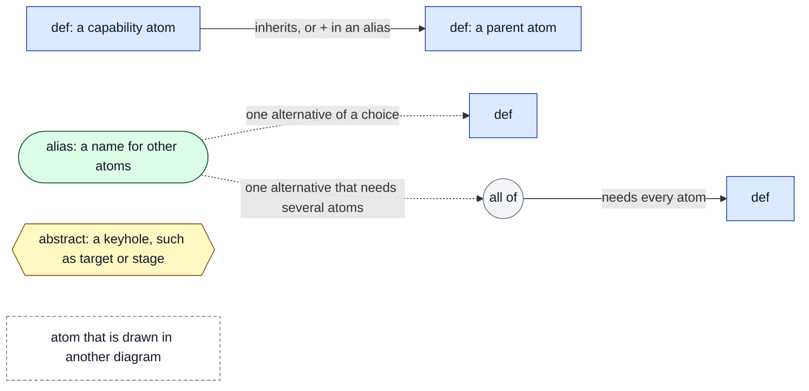

## Omitted atoms

The 56 aliases that only abbreviate a list of targets are not drawn, and the
arrows to them are removed. For example, `cuda_glsl_hlsl_spirv` is `cuda | glsl | hlsl | spirv`,
and it exists only for readability. The atom counts below do not include them.

## Summary

| Group     |   Atoms | `def` | `alias` | `abstract` |
| --------- | ------: | ----: | ------: | ---------: |
| Target    |      12 |    11 |       0 |          1 |
| Stage     |      22 |     7 |      14 |          1 |
| Version   |      79 |    15 |      64 |          0 |
| EXT       |     177 |   107 |      70 |          0 |
| Compound  |     160 |     0 |     160 |          0 |
| Other     |      32 |     0 |      32 |          0 |
| Internal  |     125 |   118 |       7 |          0 |
| **Total** | **607** |       |         |            |

## Target

Code generation targets. (12 atoms)

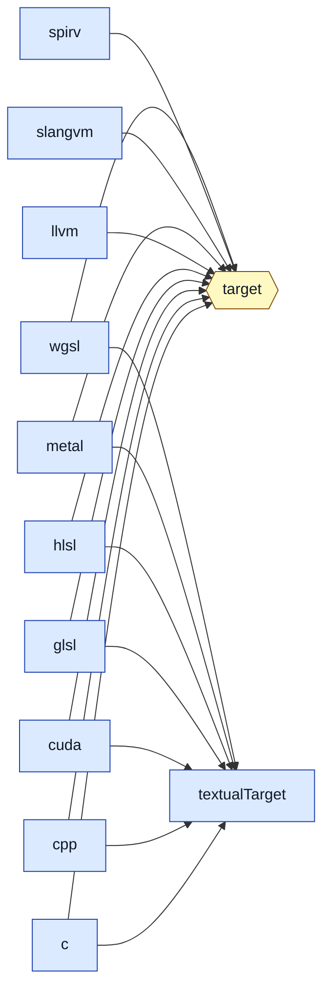

## Stage

Pipeline stages. (22 atoms)

### Stage: keyhole and stage atoms

8 atoms.

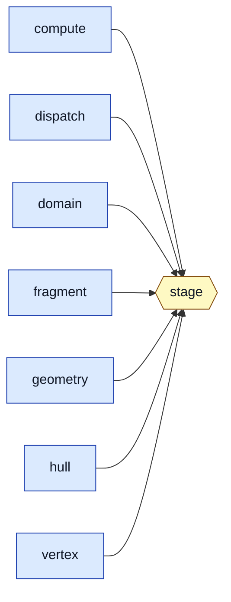

### Stage: aliases

14 atoms.

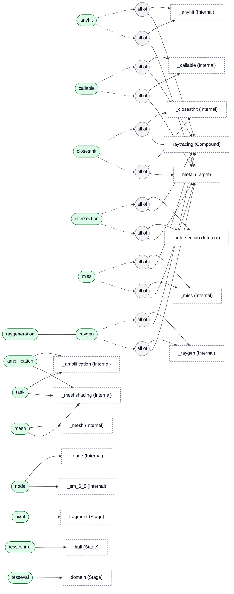

## Version

Language, shader model, SPIR-V and other version atoms. (79 atoms)

### Version: hlsl, dxil

3 atoms.

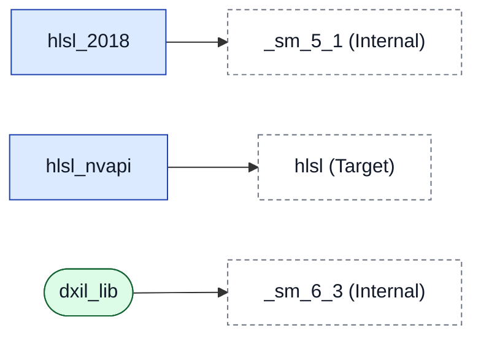

### Version: spirv

8 atoms.

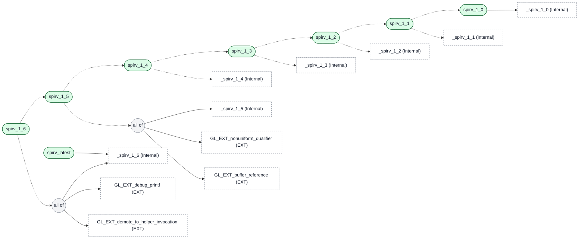

### Version: cuda

11 atoms.

```mermaid
flowchart LR
    n_cuda_sm_1_0(["cuda_sm_1_0"]):::alias
    n_cuda_sm_2_0(["cuda_sm_2_0"]):::alias
    n_cuda_sm_3_0(["cuda_sm_3_0"]):::alias
    n_cuda_sm_3_5(["cuda_sm_3_5"]):::alias
    n_cuda_sm_4_0(["cuda_sm_4_0"]):::alias
    n_cuda_sm_5_0(["cuda_sm_5_0"]):::alias
    n_cuda_sm_6_0(["cuda_sm_6_0"]):::alias
    n_cuda_sm_7_0(["cuda_sm_7_0"]):::alias
    n_cuda_sm_8_0(["cuda_sm_8_0"]):::alias
    n_cuda_sm_8_9(["cuda_sm_8_9"]):::alias
    n_cuda_sm_9_0(["cuda_sm_9_0"]):::alias
    n__cuda_sm_1_0["_cuda_sm_1_0 (Internal)"]:::external
    n__cuda_sm_2_0["_cuda_sm_2_0 (Internal)"]:::external
    n_sm_4_0["sm_4_0 (Version)"]:::external
    n__cuda_sm_3_0["_cuda_sm_3_0 (Internal)"]:::external
    n__cuda_sm_3_5["_cuda_sm_3_5 (Internal)"]:::external
    n__cuda_sm_4_0["_cuda_sm_4_0 (Internal)"]:::external
    n__cuda_sm_5_0["_cuda_sm_5_0 (Internal)"]:::external
    n__cuda_sm_6_0["_cuda_sm_6_0 (Internal)"]:::external
    n_sm_4_1["sm_4_1 (Version)"]:::external
    n__cuda_sm_7_0["_cuda_sm_7_0 (Internal)"]:::external
    n__cuda_sm_8_0["_cuda_sm_8_0 (Internal)"]:::external
    n__cuda_sm_8_9["_cuda_sm_8_9 (Internal)"]:::external
    n__cuda_sm_9_0["_cuda_sm_9_0 (Internal)"]:::external
    n_sm_5_0["sm_5_0 (Version)"]:::external
    n_cuda_sm_1_0 --> n__cuda_sm_1_0
    n_cuda_sm_2_0 -.-> n__cuda_sm_2_0
    n_cuda_sm_2_0 -.-> n_cuda_sm_1_0
    n_cuda_sm_2_0 -.-> n_sm_4_0
    n_cuda_sm_3_0 -.-> n__cuda_sm_3_0
    n_cuda_sm_3_0 -.-> n_cuda_sm_2_0
    n_cuda_sm_3_5 -.-> n__cuda_sm_3_5
    n_cuda_sm_3_5 -.-> n_cuda_sm_3_0
    n_cuda_sm_4_0 -.-> n__cuda_sm_4_0
    n_cuda_sm_4_0 -.-> n_cuda_sm_3_5
    n_cuda_sm_5_0 -.-> n__cuda_sm_5_0
    n_cuda_sm_5_0 -.-> n_cuda_sm_4_0
    n_cuda_sm_6_0 -.-> n__cuda_sm_6_0
    n_cuda_sm_6_0 -.-> n_cuda_sm_5_0
    n_cuda_sm_6_0 -.-> n_sm_4_1
    n_cuda_sm_7_0 -.-> n__cuda_sm_7_0
    n_cuda_sm_7_0 -.-> n_cuda_sm_6_0
    n_cuda_sm_8_0 -.-> n__cuda_sm_8_0
    n_cuda_sm_8_0 -.-> n_cuda_sm_7_0
    n_cuda_sm_8_9 -.-> n__cuda_sm_8_9
    n_cuda_sm_8_9 -.-> n_cuda_sm_8_0
    n_cuda_sm_9_0 -.-> n__cuda_sm_9_0
    n_cuda_sm_9_0 -.-> n_cuda_sm_8_9
    n_cuda_sm_9_0 -.-> n_sm_5_0
    classDef def fill:#dbeafe,stroke:#1e40af,color:#111827
    classDef alias fill:#dcfce7,stroke:#166534,color:#111827
    classDef abstract fill:#fef9c3,stroke:#854d0e,color:#111827
    classDef helper fill:#f3f4f6,stroke:#6b7280,color:#111827
    classDef external fill:#ffffff,stroke:#6b7280,stroke-dasharray:4 3,color:#111827
```

### Version: metallib

7 atoms.


### Version: sm 1/3

11 atoms.

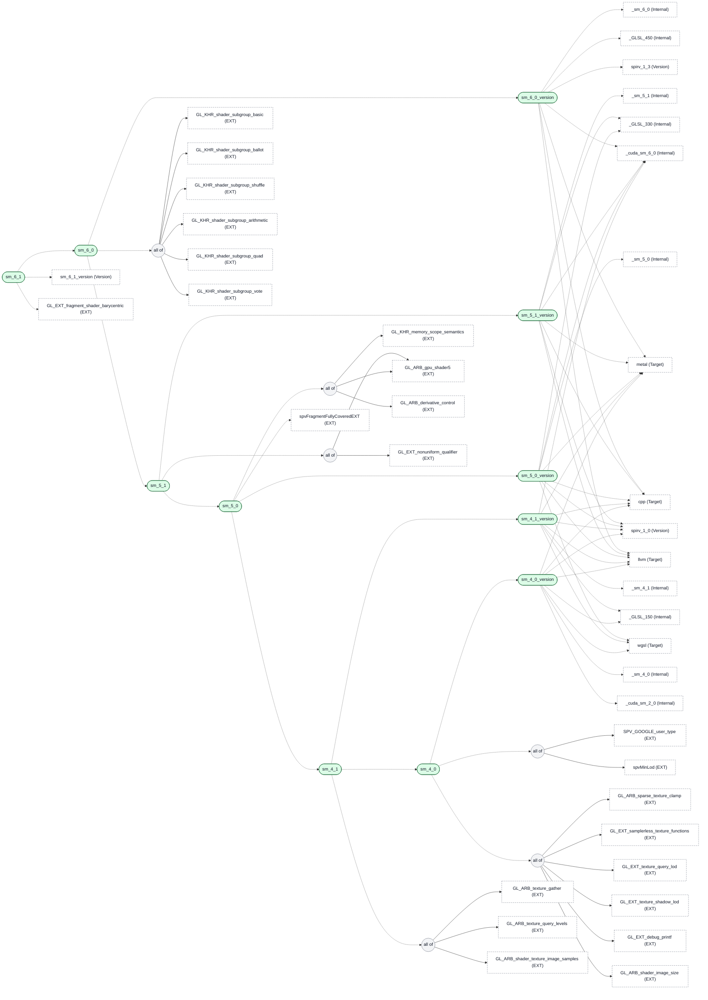

### Version: sm 2/3

14 atoms.

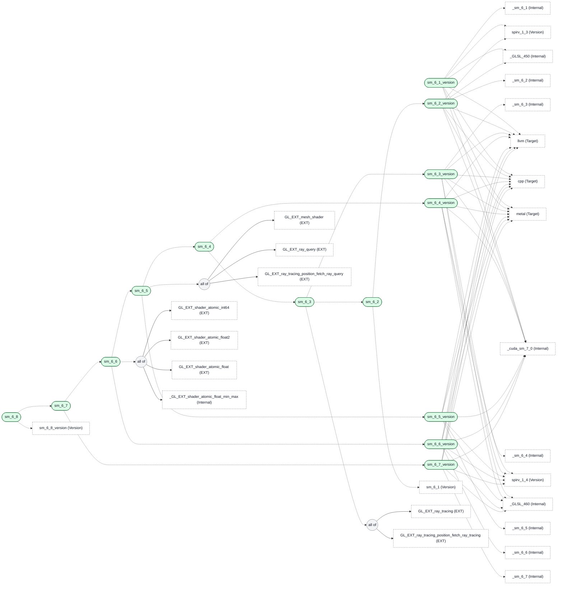

### Version: sm 3/3

6 atoms.

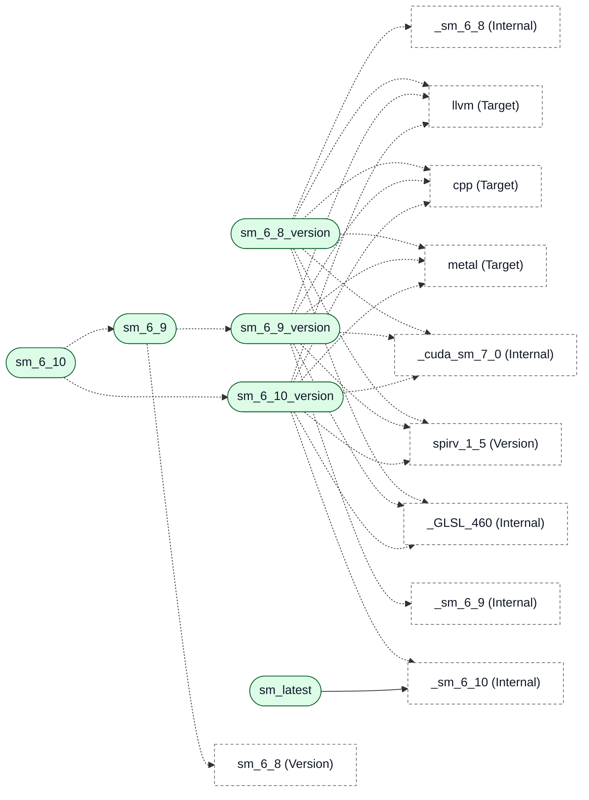

### Version: glsl 1/2

9 atoms.

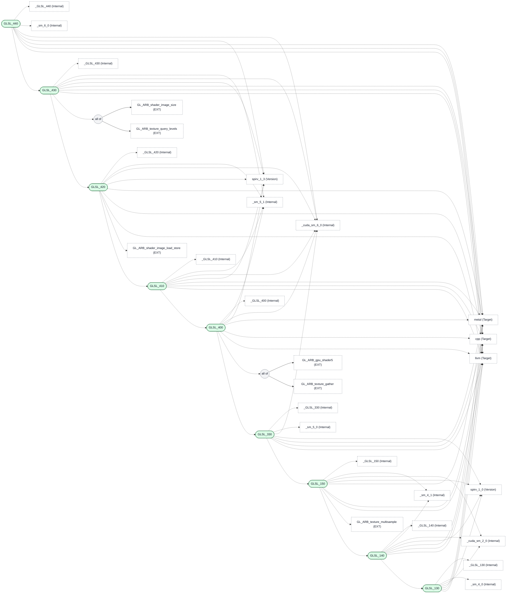

### Version: glsl 2/2

10 atoms.

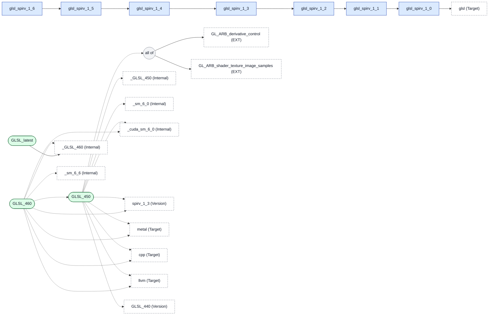

## EXT

Extensions. (177 atoms)

### EXT: gl 1/2

35 atoms.

```mermaid
flowchart LR
    n__GL_EXT_shader_abort["_GL_EXT_shader_abort"]:::def
    n_GL_ARB_derivative_control(["GL_ARB_derivative_control"]):::alias
    n_GL_ARB_fragment_shader_interlock(["GL_ARB_fragment_shader_interlock"]):::alias
    n_GL_ARB_gpu_shader5(["GL_ARB_gpu_shader5"]):::alias
    n_GL_ARB_gpu_shader_int64(["GL_ARB_gpu_shader_int64"]):::alias
    n_GL_ARB_shader_clock(["GL_ARB_shader_clock"]):::alias
    n_GL_ARB_shader_clock64(["GL_ARB_shader_clock64"]):::alias
    n_GL_ARB_shader_image_load_store(["GL_ARB_shader_image_load_store"]):::alias
    n_GL_ARB_shader_image_size(["GL_ARB_shader_image_size"]):::alias
    n_GL_ARB_shader_texture_image_samples(["GL_ARB_shader_texture_image_samples"]):::alias
    n_GL_ARB_sparse_texture(["GL_ARB_sparse_texture"]):::alias
    n_GL_ARB_sparse_texture2(["GL_ARB_sparse_texture2"]):::alias
    n_GL_ARB_sparse_texture_clamp(["GL_ARB_sparse_texture_clamp"]):::alias
    n_GL_ARB_texture_gather(["GL_ARB_texture_gather"]):::alias
    n_GL_ARB_texture_multisample(["GL_ARB_texture_multisample"]):::alias
    n_GL_ARB_texture_query_levels(["GL_ARB_texture_query_levels"]):::alias
    n_GL_EXT_buffer_reference(["GL_EXT_buffer_reference"]):::alias
    n_GL_EXT_buffer_reference_uvec2(["GL_EXT_buffer_reference_uvec2"]):::alias
    n_GL_EXT_debug_printf(["GL_EXT_debug_printf"]):::alias
    n_GL_EXT_demote_to_helper_invocation(["GL_EXT_demote_to_helper_invocation"]):::alias
    n_GL_EXT_device_group(["GL_EXT_device_group"]):::alias
    n_GL_EXT_fragment_shader_barycentric(["GL_EXT_fragment_shader_barycentric"]):::alias
    n_GL_EXT_maximal_reconvergence(["GL_EXT_maximal_reconvergence"]):::alias
    n_GL_EXT_mesh_shader(["GL_EXT_mesh_shader"]):::alias
    n_GL_EXT_nonuniform_qualifier(["GL_EXT_nonuniform_qualifier"]):::alias
    n_GL_EXT_ray_query(["GL_EXT_ray_query"]):::alias
    n_GL_EXT_ray_tracing(["GL_EXT_ray_tracing"]):::alias
    n_GL_EXT_ray_tracing_position_fetch(["GL_EXT_ray_tracing_position_fetch"]):::alias
    n_GL_EXT_ray_tracing_position_fetch_ray_query(["GL_EXT_ray_tracing_position_fetch_ray_query"]):::alias
    n_GL_EXT_ray_tracing_position_fetch_ray_tracing(["GL_EXT_ray_tracing_position_fetch_ray_tracing"]):::alias
    n_GL_EXT_samplerless_texture_functions(["GL_EXT_samplerless_texture_functions"]):::alias
    n_GL_EXT_shader_abort(["GL_EXT_shader_abort"]):::alias
    n_GL_EXT_shader_atomic_float(["GL_EXT_shader_atomic_float"]):::alias
    c_GL_EXT_shader_atomic_float_1(("all of")):::helper
    n_GL_EXT_shader_atomic_float2(["GL_EXT_shader_atomic_float2"]):::alias
    c_GL_EXT_shader_atomic_float2_1(("all of")):::helper
    n_GL_EXT_shader_atomic_float_min_max(["GL_EXT_shader_atomic_float_min_max"]):::alias
    c_GL_EXT_shader_atomic_float_min_max_1(("all of")):::helper
    n_glsl["glsl (Target)"]:::external
    n__GL_ARB_derivative_control["_GL_ARB_derivative_control (Internal)"]:::external
    n_spvDerivativeControl["spvDerivativeControl (EXT)"]:::external
    n__GL_ARB_fragment_shader_interlock["_GL_ARB_fragment_shader_interlock (Internal)"]:::external
    n_spvFragmentShaderPixelInterlockEXT["spvFragmentShaderPixelInterlockEXT (EXT)"]:::external
    n__GL_ARB_gpu_shader5["_GL_ARB_gpu_shader5 (Internal)"]:::external
    n__spirv_1_0["_spirv_1_0 (Internal)"]:::external
    n__GL_ARB_gpu_shader_int64["_GL_ARB_gpu_shader_int64 (Internal)"]:::external
    n__GL_ARB_shader_clock["_GL_ARB_shader_clock (Internal)"]:::external
    n_spvShaderClockKHR["spvShaderClockKHR (EXT)"]:::external
    n__GL_ARB_shader_clock64["_GL_ARB_shader_clock64 (Internal)"]:::external
    n_GL_EXT_shader_image_load_store["GL_EXT_shader_image_load_store (EXT)"]:::external
    n__GL_ARB_shader_image_size["_GL_ARB_shader_image_size (Internal)"]:::external
    n_spvImageQuery["spvImageQuery (EXT)"]:::external
    n_metal["metal (Target)"]:::external
    n__GL_ARB_shader_texture_image_samples["_GL_ARB_shader_texture_image_samples (Internal)"]:::external
    n__GL_ARB_sparse_texture["_GL_ARB_sparse_texture (Internal)"]:::external
    n_spvSparseResidency["spvSparseResidency (EXT)"]:::external
    n__GL_ARB_sparse_texture2["_GL_ARB_sparse_texture2 (Internal)"]:::external
    n__GL_ARB_sparse_texture_clamp["_GL_ARB_sparse_texture_clamp (Internal)"]:::external
    n__GL_ARB_texture_gather["_GL_ARB_texture_gather (Internal)"]:::external
    n_spvImageGatherExtended["spvImageGatherExtended (EXT)"]:::external
    n__GL_ARB_texture_multisample["_GL_ARB_texture_multisample (Internal)"]:::external
    n__GL_ARB_texture_query_levels["_GL_ARB_texture_query_levels (Internal)"]:::external
    n__GL_EXT_buffer_reference["_GL_EXT_buffer_reference (Internal)"]:::external
    n_SPV_EXT_physical_storage_buffer["SPV_EXT_physical_storage_buffer (EXT)"]:::external
    n__GL_EXT_buffer_reference_uvec2["_GL_EXT_buffer_reference_uvec2 (Internal)"]:::external
    n__GL_EXT_debug_printf["_GL_EXT_debug_printf (Internal)"]:::external
    n_SPV_KHR_non_semantic_info["SPV_KHR_non_semantic_info (EXT)"]:::external
    n__GL_EXT_demote_to_helper_invocation["_GL_EXT_demote_to_helper_invocation (Internal)"]:::external
    n_spvDemoteToHelperInvocationEXT["spvDemoteToHelperInvocationEXT (EXT)"]:::external
    n__GL_EXT_device_group["_GL_EXT_device_group (Internal)"]:::external
    n_spvDeviceGroup["spvDeviceGroup (EXT)"]:::external
    n__GL_EXT_fragment_shader_barycentric["_GL_EXT_fragment_shader_barycentric (Internal)"]:::external
    n_spvFragmentBarycentricKHR["spvFragmentBarycentricKHR (EXT)"]:::external
    n__GL_EXT_maximal_reconvergence["_GL_EXT_maximal_reconvergence (Internal)"]:::external
    n_spvMaximalReconvergenceKHR["spvMaximalReconvergenceKHR (EXT)"]:::external
    n__GL_EXT_mesh_shader["_GL_EXT_mesh_shader (Internal)"]:::external
    n_spvMeshShadingEXT["spvMeshShadingEXT (EXT)"]:::external
    n__GL_EXT_nonuniform_qualifier["_GL_EXT_nonuniform_qualifier (Internal)"]:::external
    n_spvShaderNonUniformEXT["spvShaderNonUniformEXT (EXT)"]:::external
    n__GL_EXT_ray_query["_GL_EXT_ray_query (Internal)"]:::external
    n_spvRayQueryKHR["spvRayQueryKHR (EXT)"]:::external
    n__GL_EXT_ray_tracing["_GL_EXT_ray_tracing (Internal)"]:::external
    n_spvRayTracingKHR["spvRayTracingKHR (EXT)"]:::external
    n__GL_EXT_ray_tracing_position_fetch["_GL_EXT_ray_tracing_position_fetch (Internal)"]:::external
    n_spvRayQueryPositionFetchKHR["spvRayQueryPositionFetchKHR (EXT)"]:::external
    n_spvRayTracingPositionFetchKHR["spvRayTracingPositionFetchKHR (EXT)"]:::external
    n__GL_EXT_samplerless_texture_functions["_GL_EXT_samplerless_texture_functions (Internal)"]:::external
    n_spvAbort["spvAbort (EXT)"]:::external
    n__GL_EXT_shader_atomic_float["_GL_EXT_shader_atomic_float (Internal)"]:::external
    n_spvAtomicFloat32AddEXT["spvAtomicFloat32AddEXT (EXT)"]:::external
    n_spvAtomicFloat32MinMaxEXT["spvAtomicFloat32MinMaxEXT (EXT)"]:::external
    n__GL_EXT_shader_atomic_float2["_GL_EXT_shader_atomic_float2 (Internal)"]:::external
    n_spvAtomicFloat16AddEXT["spvAtomicFloat16AddEXT (EXT)"]:::external
    n_spvAtomicFloat16MinMaxEXT["spvAtomicFloat16MinMaxEXT (EXT)"]:::external
    n__GL_EXT_shader_atomic_float_min_max["_GL_EXT_shader_atomic_float_min_max (Internal)"]:::external
    n__GL_EXT_shader_abort --> n_glsl
    n_GL_ARB_derivative_control -.-> n__GL_ARB_derivative_control
    n_GL_ARB_derivative_control -.-> n_spvDerivativeControl
    n_GL_ARB_fragment_shader_interlock -.-> n__GL_ARB_fragment_shader_interlock
    n_GL_ARB_fragment_shader_interlock -.-> n_spvFragmentShaderPixelInterlockEXT
    n_GL_ARB_gpu_shader5 -.-> n__GL_ARB_gpu_shader5
    n_GL_ARB_gpu_shader5 -.-> n__spirv_1_0
    n_GL_ARB_gpu_shader_int64 --> n__GL_ARB_gpu_shader_int64
    n_GL_ARB_shader_clock -.-> n__GL_ARB_shader_clock
    n_GL_ARB_shader_clock -.-> n_spvShaderClockKHR
    n_GL_ARB_shader_clock64 -.-> n__GL_ARB_shader_clock64
    n_GL_ARB_shader_clock64 -.-> n_spvShaderClockKHR
    n_GL_ARB_shader_image_load_store --> n_GL_EXT_shader_image_load_store
    n_GL_ARB_shader_image_size -.-> n__GL_ARB_shader_image_size
    n_GL_ARB_shader_image_size -.-> n_spvImageQuery
    n_GL_ARB_shader_image_size -.-> n_metal
    n_GL_ARB_shader_texture_image_samples -.-> n__GL_ARB_shader_texture_image_samples
    n_GL_ARB_shader_texture_image_samples -.-> n_spvImageQuery
    n_GL_ARB_shader_texture_image_samples -.-> n_metal
    n_GL_ARB_sparse_texture -.-> n__GL_ARB_sparse_texture
    n_GL_ARB_sparse_texture -.-> n_spvSparseResidency
    n_GL_ARB_sparse_texture2 -.-> n__GL_ARB_sparse_texture2
    n_GL_ARB_sparse_texture2 -.-> n_spvSparseResidency
    n_GL_ARB_sparse_texture_clamp -.-> n__GL_ARB_sparse_texture_clamp
    n_GL_ARB_sparse_texture_clamp -.-> n_spvSparseResidency
    n_GL_ARB_texture_gather -.-> n__GL_ARB_texture_gather
    n_GL_ARB_texture_gather -.-> n_spvImageGatherExtended
    n_GL_ARB_texture_gather -.-> n_metal
    n_GL_ARB_texture_multisample -.-> n__GL_ARB_texture_multisample
    n_GL_ARB_texture_multisample -.-> n__spirv_1_0
    n_GL_ARB_texture_query_levels -.-> n__GL_ARB_texture_query_levels
    n_GL_ARB_texture_query_levels -.-> n_spvImageQuery
    n_GL_ARB_texture_query_levels -.-> n_metal
    n_GL_EXT_buffer_reference -.-> n__GL_EXT_buffer_reference
    n_GL_EXT_buffer_reference -.-> n_SPV_EXT_physical_storage_buffer
    n_GL_EXT_buffer_reference_uvec2 -.-> n__GL_EXT_buffer_reference_uvec2
    n_GL_EXT_buffer_reference_uvec2 -.-> n__spirv_1_0
    n_GL_EXT_debug_printf -.-> n__GL_EXT_debug_printf
    n_GL_EXT_debug_printf -.-> n_SPV_KHR_non_semantic_info
    n_GL_EXT_demote_to_helper_invocation -.-> n__GL_EXT_demote_to_helper_invocation
    n_GL_EXT_demote_to_helper_invocation -.-> n_spvDemoteToHelperInvocationEXT
    n_GL_EXT_device_group -.-> n__GL_EXT_device_group
    n_GL_EXT_device_group -.-> n_spvDeviceGroup
    n_GL_EXT_fragment_shader_barycentric -.-> n__GL_EXT_fragment_shader_barycentric
    n_GL_EXT_fragment_shader_barycentric -.-> n_spvFragmentBarycentricKHR
    n_GL_EXT_maximal_reconvergence -.-> n__GL_EXT_maximal_reconvergence
    n_GL_EXT_maximal_reconvergence -.-> n_spvMaximalReconvergenceKHR
    n_GL_EXT_mesh_shader -.-> n__GL_EXT_mesh_shader
    n_GL_EXT_mesh_shader -.-> n_spvMeshShadingEXT
    n_GL_EXT_nonuniform_qualifier -.-> n__GL_EXT_nonuniform_qualifier
    n_GL_EXT_nonuniform_qualifier -.-> n_spvShaderNonUniformEXT
    n_GL_EXT_ray_query -.-> n__GL_EXT_ray_query
    n_GL_EXT_ray_query -.-> n_spvRayQueryKHR
    n_GL_EXT_ray_tracing -.-> n__GL_EXT_ray_tracing
    n_GL_EXT_ray_tracing -.-> n_spvRayTracingKHR
    n_GL_EXT_ray_tracing_position_fetch --> n_GL_EXT_ray_tracing_position_fetch_ray_tracing
    n_GL_EXT_ray_tracing_position_fetch --> n_GL_EXT_ray_tracing_position_fetch_ray_query
    n_GL_EXT_ray_tracing_position_fetch_ray_query -.-> n__GL_EXT_ray_tracing_position_fetch
    n_GL_EXT_ray_tracing_position_fetch_ray_query -.-> n_spvRayQueryPositionFetchKHR
    n_GL_EXT_ray_tracing_position_fetch_ray_tracing -.-> n__GL_EXT_ray_tracing_position_fetch
    n_GL_EXT_ray_tracing_position_fetch_ray_tracing -.-> n_spvRayTracingPositionFetchKHR
    n_GL_EXT_samplerless_texture_functions -.-> n__GL_EXT_samplerless_texture_functions
    n_GL_EXT_samplerless_texture_functions -.-> n__spirv_1_0
    n_GL_EXT_shader_abort -.-> n__GL_EXT_shader_abort
    n_GL_EXT_shader_abort -.-> n_spvAbort
    n_GL_EXT_shader_atomic_float -.-> n__GL_EXT_shader_atomic_float
    n_GL_EXT_shader_atomic_float -.-> c_GL_EXT_shader_atomic_float_1
    c_GL_EXT_shader_atomic_float_1 --> n_spvAtomicFloat32AddEXT
    c_GL_EXT_shader_atomic_float_1 --> n_spvAtomicFloat32MinMaxEXT
    n_GL_EXT_shader_atomic_float2 -.-> n__GL_EXT_shader_atomic_float2
    n_GL_EXT_shader_atomic_float2 -.-> c_GL_EXT_shader_atomic_float2_1
    c_GL_EXT_shader_atomic_float2_1 --> n_spvAtomicFloat32AddEXT
    c_GL_EXT_shader_atomic_float2_1 --> n_spvAtomicFloat32MinMaxEXT
    c_GL_EXT_shader_atomic_float2_1 --> n_spvAtomicFloat16AddEXT
    c_GL_EXT_shader_atomic_float2_1 --> n_spvAtomicFloat16MinMaxEXT
    n_GL_EXT_shader_atomic_float_min_max -.-> n__GL_EXT_shader_atomic_float_min_max
    n_GL_EXT_shader_atomic_float_min_max -.-> c_GL_EXT_shader_atomic_float_min_max_1
    c_GL_EXT_shader_atomic_float_min_max_1 --> n_spvAtomicFloat32MinMaxEXT
    c_GL_EXT_shader_atomic_float_min_max_1 --> n_spvAtomicFloat16MinMaxEXT
    classDef def fill:#dbeafe,stroke:#1e40af,color:#111827
    classDef alias fill:#dcfce7,stroke:#166534,color:#111827
    classDef abstract fill:#fef9c3,stroke:#854d0e,color:#111827
    classDef helper fill:#f3f4f6,stroke:#6b7280,color:#111827
    classDef external fill:#ffffff,stroke:#6b7280,stroke-dasharray:4 3,color:#111827
```

### EXT: gl 2/2

33 atoms.

```mermaid
flowchart LR
    n_GL_EXT_shader_atomic_int64(["GL_EXT_shader_atomic_int64"]):::alias
    n_GL_EXT_shader_explicit_arithmetic_types(["GL_EXT_shader_explicit_arithmetic_types"]):::alias
    n_GL_EXT_shader_explicit_arithmetic_types_int64(["GL_EXT_shader_explicit_arithmetic_types_int64"]):::alias
    n_GL_EXT_shader_image_load_store(["GL_EXT_shader_image_load_store"]):::alias
    n_GL_EXT_shader_invocation_reorder(["GL_EXT_shader_invocation_reorder"]):::alias
    c_GL_EXT_shader_invocation_reorder_0(("all of")):::helper
    n_GL_EXT_shader_invocation_reorder_motion(["GL_EXT_shader_invocation_reorder_motion"]):::alias
    n_GL_EXT_shader_quad_control(["GL_EXT_shader_quad_control"]):::alias
    n_GL_EXT_shader_realtime_clock(["GL_EXT_shader_realtime_clock"]):::alias
    n_GL_EXT_texture_query_lod(["GL_EXT_texture_query_lod"]):::alias
    n_GL_EXT_texture_shadow_lod(["GL_EXT_texture_shadow_lod"]):::alias
    n_GL_KHR_memory_scope_semantics(["GL_KHR_memory_scope_semantics"]):::alias
    n_GL_KHR_shader_subgroup_arithmetic(["GL_KHR_shader_subgroup_arithmetic"]):::alias
    n_GL_KHR_shader_subgroup_ballot(["GL_KHR_shader_subgroup_ballot"]):::alias
    n_GL_KHR_shader_subgroup_basic(["GL_KHR_shader_subgroup_basic"]):::alias
    n_GL_KHR_shader_subgroup_clustered(["GL_KHR_shader_subgroup_clustered"]):::alias
    n_GL_KHR_shader_subgroup_quad(["GL_KHR_shader_subgroup_quad"]):::alias
    n_GL_KHR_shader_subgroup_rotate(["GL_KHR_shader_subgroup_rotate"]):::alias
    n_GL_KHR_shader_subgroup_shuffle(["GL_KHR_shader_subgroup_shuffle"]):::alias
    n_GL_KHR_shader_subgroup_shuffle_relative(["GL_KHR_shader_subgroup_shuffle_relative"]):::alias
    n_GL_KHR_shader_subgroup_vote(["GL_KHR_shader_subgroup_vote"]):::alias
    n_GL_NV_cluster_acceleration_structure(["GL_NV_cluster_acceleration_structure"]):::alias
    n_GL_NV_compute_shader_derivatives(["GL_NV_compute_shader_derivatives"]):::alias
    n_GL_NV_cooperative_vector(["GL_NV_cooperative_vector"]):::alias
    c_GL_NV_cooperative_vector_1(("all of")):::helper
    n_GL_NV_fragment_shader_barycentric(["GL_NV_fragment_shader_barycentric"]):::alias
    n_GL_NV_gpu_shader5(["GL_NV_gpu_shader5"]):::alias
    n_GL_NV_linear_swept_spheres(["GL_NV_linear_swept_spheres"]):::alias
    n_GL_NV_ray_tracing(["GL_NV_ray_tracing"]):::alias
    n_GL_NV_ray_tracing_motion_blur(["GL_NV_ray_tracing_motion_blur"]):::alias
    n_GL_NV_shader_atomic_fp16_vector(["GL_NV_shader_atomic_fp16_vector"]):::alias
    c_GL_NV_shader_atomic_fp16_vector_0(("all of")):::helper
    n_GL_NV_shader_invocation_reorder(["GL_NV_shader_invocation_reorder"]):::alias
    c_GL_NV_shader_invocation_reorder_0(("all of")):::helper
    n_GL_NV_shader_invocation_reorder_motion(["GL_NV_shader_invocation_reorder_motion"]):::alias
    n_GL_NV_shader_subgroup_partitioned(["GL_NV_shader_subgroup_partitioned"]):::alias
    n_GL_NV_shader_texture_footprint(["GL_NV_shader_texture_footprint"]):::alias
    n__GL_EXT_shader_atomic_int64["_GL_EXT_shader_atomic_int64 (Internal)"]:::external
    n_spvInt64Atomics["spvInt64Atomics (EXT)"]:::external
    n__GL_EXT_shader_explicit_arithmetic_types["_GL_EXT_shader_explicit_arithmetic_types (Internal)"]:::external
    n__spirv_1_0["_spirv_1_0 (Internal)"]:::external
    n__GL_EXT_shader_explicit_arithmetic_types_int64["_GL_EXT_shader_explicit_arithmetic_types_int64 (Internal)"]:::external
    n__GL_EXT_shader_image_load_store["_GL_EXT_shader_image_load_store (Internal)"]:::external
    n__GL_EXT_shader_invocation_reorder["_GL_EXT_shader_invocation_reorder (Internal)"]:::external
    n__GL_EXT_buffer_reference_uvec2["_GL_EXT_buffer_reference_uvec2 (Internal)"]:::external
    n_spvShaderInvocationReorderEXT["spvShaderInvocationReorderEXT (EXT)"]:::external
    n__GL_EXT_shader_invocation_reorder_motion["_GL_EXT_shader_invocation_reorder_motion (Internal)"]:::external
    n_spvShaderInvocationReorderMotionEXT["spvShaderInvocationReorderMotionEXT (EXT)"]:::external
    n__GL_EXT_shader_quad_control["_GL_EXT_shader_quad_control (Internal)"]:::external
    n_spvQuadControlKHR["spvQuadControlKHR (EXT)"]:::external
    n__GL_EXT_shader_realtime_clock["_GL_EXT_shader_realtime_clock (Internal)"]:::external
    n_spvShaderClockKHR["spvShaderClockKHR (EXT)"]:::external
    n__GL_EXT_texture_query_lod["_GL_EXT_texture_query_lod (Internal)"]:::external
    n_spvImageQuery["spvImageQuery (EXT)"]:::external
    n_metal["metal (Target)"]:::external
    n__GL_EXT_texture_shadow_lod["_GL_EXT_texture_shadow_lod (Internal)"]:::external
    n__GL_KHR_memory_scope_semantics["_GL_KHR_memory_scope_semantics (Internal)"]:::external
    n__GL_KHR_shader_subgroup_arithmetic["_GL_KHR_shader_subgroup_arithmetic (Internal)"]:::external
    n_spvGroupNonUniformArithmetic["spvGroupNonUniformArithmetic (EXT)"]:::external
    n__GL_KHR_shader_subgroup_ballot["_GL_KHR_shader_subgroup_ballot (Internal)"]:::external
    n_spvGroupNonUniformBallot["spvGroupNonUniformBallot (EXT)"]:::external
    n__GL_KHR_shader_subgroup_basic["_GL_KHR_shader_subgroup_basic (Internal)"]:::external
    n_spvGroupNonUniform["spvGroupNonUniform (EXT)"]:::external
    n__GL_KHR_shader_subgroup_clustered["_GL_KHR_shader_subgroup_clustered (Internal)"]:::external
    n_spvGroupNonUniformClustered["spvGroupNonUniformClustered (EXT)"]:::external
    n__GL_KHR_shader_subgroup_quad["_GL_KHR_shader_subgroup_quad (Internal)"]:::external
    n_spvGroupNonUniformQuad["spvGroupNonUniformQuad (EXT)"]:::external
    n__GL_KHR_shader_subgroup_rotate["_GL_KHR_shader_subgroup_rotate (Internal)"]:::external
    n_spvGroupNonUniformRotateKHR["spvGroupNonUniformRotateKHR (EXT)"]:::external
    n__GL_KHR_shader_subgroup_shuffle["_GL_KHR_shader_subgroup_shuffle (Internal)"]:::external
    n_spvGroupNonUniformShuffle["spvGroupNonUniformShuffle (EXT)"]:::external
    n__GL_KHR_shader_subgroup_shuffle_relative["_GL_KHR_shader_subgroup_shuffle_relative (Internal)"]:::external
    n_spvGroupNonUniformShuffleRelative["spvGroupNonUniformShuffleRelative (EXT)"]:::external
    n__GL_KHR_shader_subgroup_vote["_GL_KHR_shader_subgroup_vote (Internal)"]:::external
    n_spvGroupNonUniformVote["spvGroupNonUniformVote (EXT)"]:::external
    n__GL_NV_cluster_acceleration_structure["_GL_NV_cluster_acceleration_structure (Internal)"]:::external
    n_spvRayTracingClusterAccelerationStructureNV["spvRayTracingClusterAccelerationStructureNV (EXT)"]:::external
    n__GL_NV_compute_shader_derivatives["_GL_NV_compute_shader_derivatives (Internal)"]:::external
    n_SPV_KHR_compute_shader_derivatives["SPV_KHR_compute_shader_derivatives (EXT)"]:::external
    n__sm_6_6["_sm_6_6 (Internal)"]:::external
    n__GL_NV_cooperative_vector["_GL_NV_cooperative_vector (Internal)"]:::external
    n_spvCooperativeVectorNV["spvCooperativeVectorNV (EXT)"]:::external
    n_spvCooperativeVectorTrainingNV["spvCooperativeVectorTrainingNV (EXT)"]:::external
    n_GL_EXT_fragment_shader_barycentric["GL_EXT_fragment_shader_barycentric (EXT)"]:::external
    n_GL_ARB_gpu_shader5["GL_ARB_gpu_shader5 (EXT)"]:::external
    n__GL_NV_linear_swept_spheres["_GL_NV_linear_swept_spheres (Internal)"]:::external
    n_GL_EXT_ray_tracing["GL_EXT_ray_tracing (EXT)"]:::external
    n__GL_NV_ray_tracing_motion_blur["_GL_NV_ray_tracing_motion_blur (Internal)"]:::external
    n_spvRayTracingMotionBlurNV["spvRayTracingMotionBlurNV (EXT)"]:::external
    n__GL_NV_shader_atomic_fp16_vector["_GL_NV_shader_atomic_fp16_vector (Internal)"]:::external
    n__GL_NV_gpu_shader5["_GL_NV_gpu_shader5 (Internal)"]:::external
    n__GL_NV_shader_invocation_reorder["_GL_NV_shader_invocation_reorder (Internal)"]:::external
    n_spvShaderInvocationReorderNV["spvShaderInvocationReorderNV (EXT)"]:::external
    n__GL_NV_shader_invocation_reorder_motion["_GL_NV_shader_invocation_reorder_motion (Internal)"]:::external
    n_spvShaderInvocationReorderMotionNV["spvShaderInvocationReorderMotionNV (EXT)"]:::external
    n__GL_NV_shader_subgroup_partitioned["_GL_NV_shader_subgroup_partitioned (Internal)"]:::external
    n_spvGroupNonUniformPartitionedNV["spvGroupNonUniformPartitionedNV (EXT)"]:::external
    n__GL_NV_shader_texture_footprint["_GL_NV_shader_texture_footprint (Internal)"]:::external
    n_spvImageFootprintNV["spvImageFootprintNV (EXT)"]:::external
    n_GL_EXT_shader_atomic_int64 -.-> n__GL_EXT_shader_atomic_int64
    n_GL_EXT_shader_atomic_int64 -.-> n_spvInt64Atomics
    n_GL_EXT_shader_explicit_arithmetic_types -.-> n__GL_EXT_shader_explicit_arithmetic_types
    n_GL_EXT_shader_explicit_arithmetic_types -.-> n__spirv_1_0
    n_GL_EXT_shader_explicit_arithmetic_types_int64 -.-> n__GL_EXT_shader_explicit_arithmetic_types_int64
    n_GL_EXT_shader_explicit_arithmetic_types_int64 -.-> n__spirv_1_0
    n_GL_EXT_shader_image_load_store -.-> n__GL_EXT_shader_image_load_store
    n_GL_EXT_shader_image_load_store -.-> n__spirv_1_0
    n_GL_EXT_shader_invocation_reorder -.-> c_GL_EXT_shader_invocation_reorder_0
    c_GL_EXT_shader_invocation_reorder_0 --> n__GL_EXT_shader_invocation_reorder
    c_GL_EXT_shader_invocation_reorder_0 --> n__GL_EXT_buffer_reference_uvec2
    n_GL_EXT_shader_invocation_reorder -.-> n_spvShaderInvocationReorderEXT
    n_GL_EXT_shader_invocation_reorder_motion -.-> n__GL_EXT_shader_invocation_reorder_motion
    n_GL_EXT_shader_invocation_reorder_motion -.-> n_spvShaderInvocationReorderMotionEXT
    n_GL_EXT_shader_quad_control -.-> n__GL_EXT_shader_quad_control
    n_GL_EXT_shader_quad_control -.-> n_spvQuadControlKHR
    n_GL_EXT_shader_realtime_clock -.-> n__GL_EXT_shader_realtime_clock
    n_GL_EXT_shader_realtime_clock -.-> n_spvShaderClockKHR
    n_GL_EXT_texture_query_lod -.-> n__GL_EXT_texture_query_lod
    n_GL_EXT_texture_query_lod -.-> n_spvImageQuery
    n_GL_EXT_texture_query_lod -.-> n_metal
    n_GL_EXT_texture_shadow_lod -.-> n__GL_EXT_texture_shadow_lod
    n_GL_EXT_texture_shadow_lod -.-> n__spirv_1_0
    n_GL_KHR_memory_scope_semantics -.-> n__GL_KHR_memory_scope_semantics
    n_GL_KHR_memory_scope_semantics -.-> n__spirv_1_0
    n_GL_KHR_shader_subgroup_arithmetic -.-> n__GL_KHR_shader_subgroup_arithmetic
    n_GL_KHR_shader_subgroup_arithmetic -.-> n_spvGroupNonUniformArithmetic
    n_GL_KHR_shader_subgroup_ballot -.-> n__GL_KHR_shader_subgroup_ballot
    n_GL_KHR_shader_subgroup_ballot -.-> n_spvGroupNonUniformBallot
    n_GL_KHR_shader_subgroup_basic -.-> n__GL_KHR_shader_subgroup_basic
    n_GL_KHR_shader_subgroup_basic -.-> n_spvGroupNonUniform
    n_GL_KHR_shader_subgroup_clustered -.-> n__GL_KHR_shader_subgroup_clustered
    n_GL_KHR_shader_subgroup_clustered -.-> n_spvGroupNonUniformClustered
    n_GL_KHR_shader_subgroup_quad -.-> n__GL_KHR_shader_subgroup_quad
    n_GL_KHR_shader_subgroup_quad -.-> n_spvGroupNonUniformQuad
    n_GL_KHR_shader_subgroup_rotate -.-> n__GL_KHR_shader_subgroup_rotate
    n_GL_KHR_shader_subgroup_rotate -.-> n_spvGroupNonUniformRotateKHR
    n_GL_KHR_shader_subgroup_shuffle -.-> n__GL_KHR_shader_subgroup_shuffle
    n_GL_KHR_shader_subgroup_shuffle -.-> n_spvGroupNonUniformShuffle
    n_GL_KHR_shader_subgroup_shuffle_relative -.-> n__GL_KHR_shader_subgroup_shuffle_relative
    n_GL_KHR_shader_subgroup_shuffle_relative -.-> n_spvGroupNonUniformShuffleRelative
    n_GL_KHR_shader_subgroup_vote -.-> n__GL_KHR_shader_subgroup_vote
    n_GL_KHR_shader_subgroup_vote -.-> n_spvGroupNonUniformVote
    n_GL_NV_cluster_acceleration_structure -.-> n__GL_NV_cluster_acceleration_structure
    n_GL_NV_cluster_acceleration_structure -.-> n_spvRayTracingClusterAccelerationStructureNV
    n_GL_NV_compute_shader_derivatives -.-> n__GL_NV_compute_shader_derivatives
    n_GL_NV_compute_shader_derivatives -.-> n_SPV_KHR_compute_shader_derivatives
    n_GL_NV_compute_shader_derivatives -.-> n__sm_6_6
    n_GL_NV_cooperative_vector -.-> n__GL_NV_cooperative_vector
    n_GL_NV_cooperative_vector -.-> c_GL_NV_cooperative_vector_1
    c_GL_NV_cooperative_vector_1 --> n_spvCooperativeVectorNV
    c_GL_NV_cooperative_vector_1 --> n_spvCooperativeVectorTrainingNV
    n_GL_NV_fragment_shader_barycentric --> n_GL_EXT_fragment_shader_barycentric
    n_GL_NV_gpu_shader5 --> n_GL_ARB_gpu_shader5
    n_GL_NV_linear_swept_spheres --> n__GL_NV_linear_swept_spheres
    n_GL_NV_ray_tracing --> n_GL_EXT_ray_tracing
    n_GL_NV_ray_tracing_motion_blur -.-> n__GL_NV_ray_tracing_motion_blur
    n_GL_NV_ray_tracing_motion_blur -.-> n_spvRayTracingMotionBlurNV
    n_GL_NV_shader_atomic_fp16_vector -.-> c_GL_NV_shader_atomic_fp16_vector_0
    c_GL_NV_shader_atomic_fp16_vector_0 --> n__GL_NV_shader_atomic_fp16_vector
    c_GL_NV_shader_atomic_fp16_vector_0 --> n__GL_NV_gpu_shader5
    n_GL_NV_shader_atomic_fp16_vector -.-> n__spirv_1_0
    n_GL_NV_shader_invocation_reorder -.-> c_GL_NV_shader_invocation_reorder_0
    c_GL_NV_shader_invocation_reorder_0 --> n__GL_NV_shader_invocation_reorder
    c_GL_NV_shader_invocation_reorder_0 --> n__GL_EXT_buffer_reference_uvec2
    n_GL_NV_shader_invocation_reorder -.-> n_spvShaderInvocationReorderNV
    n_GL_NV_shader_invocation_reorder_motion -.-> n__GL_NV_shader_invocation_reorder_motion
    n_GL_NV_shader_invocation_reorder_motion -.-> n_spvShaderInvocationReorderMotionNV
    n_GL_NV_shader_subgroup_partitioned -.-> n__GL_NV_shader_subgroup_partitioned
    n_GL_NV_shader_subgroup_partitioned -.-> n_spvGroupNonUniformPartitionedNV
    n_GL_NV_shader_texture_footprint -.-> n__GL_NV_shader_texture_footprint
    n_GL_NV_shader_texture_footprint -.-> n_spvImageFootprintNV
    classDef def fill:#dbeafe,stroke:#1e40af,color:#111827
    classDef alias fill:#dcfce7,stroke:#166534,color:#111827
    classDef abstract fill:#fef9c3,stroke:#854d0e,color:#111827
    classDef helper fill:#f3f4f6,stroke:#6b7280,color:#111827
    classDef external fill:#ffffff,stroke:#6b7280,stroke-dasharray:4 3,color:#111827
```

### EXT: ser

1 atoms.


### EXT: spv 1/2

72 atoms.

```mermaid
flowchart LR
    n_SPV_EXT_demote_to_helper_invocation["SPV_EXT_demote_to_helper_invocation"]:::def
    n_SPV_EXT_descriptor_heap["SPV_EXT_descriptor_heap"]:::def
    n_SPV_EXT_descriptor_indexing["SPV_EXT_descriptor_indexing"]:::def
    n_SPV_EXT_float8["SPV_EXT_float8"]:::def
    n_SPV_EXT_fragment_fully_covered["SPV_EXT_fragment_fully_covered"]:::def
    n_SPV_EXT_fragment_shader_interlock["SPV_EXT_fragment_shader_interlock"]:::def
    n_SPV_EXT_mesh_shader["SPV_EXT_mesh_shader"]:::def
    n_SPV_EXT_physical_storage_buffer["SPV_EXT_physical_storage_buffer"]:::def
    n_SPV_EXT_replicated_composites["SPV_EXT_replicated_composites"]:::def
    n_SPV_EXT_shader_64bit_indexing["SPV_EXT_shader_64bit_indexing"]:::def
    n_SPV_EXT_shader_atomic_float16_add["SPV_EXT_shader_atomic_float16_add"]:::def
    n_SPV_EXT_shader_atomic_float_add["SPV_EXT_shader_atomic_float_add"]:::def
    n_SPV_EXT_shader_atomic_float_min_max["SPV_EXT_shader_atomic_float_min_max"]:::def
    n_SPV_EXT_shader_invocation_reorder["SPV_EXT_shader_invocation_reorder"]:::def
    n_SPV_GOOGLE_user_type["SPV_GOOGLE_user_type"]:::def
    n_SPV_KHR_abort["SPV_KHR_abort"]:::def
    n_SPV_KHR_bfloat16["SPV_KHR_bfloat16"]:::def
    n_SPV_KHR_compute_shader_derivatives["SPV_KHR_compute_shader_derivatives"]:::def
    n_SPV_KHR_cooperative_matrix["SPV_KHR_cooperative_matrix"]:::def
    n_SPV_KHR_device_group["SPV_KHR_device_group"]:::def
    n_SPV_KHR_fragment_shader_barycentric["SPV_KHR_fragment_shader_barycentric"]:::def
    n_SPV_KHR_maximal_reconvergence["SPV_KHR_maximal_reconvergence"]:::def
    n_SPV_KHR_non_semantic_info["SPV_KHR_non_semantic_info"]:::def
    n_SPV_KHR_physical_storage_buffer["SPV_KHR_physical_storage_buffer"]:::def
    n_SPV_KHR_quad_control["SPV_KHR_quad_control"]:::def
    n_SPV_KHR_ray_query["SPV_KHR_ray_query"]:::def
    n_SPV_KHR_ray_tracing["SPV_KHR_ray_tracing"]:::def
    n_SPV_KHR_ray_tracing_position_fetch["SPV_KHR_ray_tracing_position_fetch"]:::def
    n_SPV_KHR_shader_clock["SPV_KHR_shader_clock"]:::def
    n_SPV_KHR_subgroup_rotate["SPV_KHR_subgroup_rotate"]:::def
    n_SPV_KHR_untyped_pointers["SPV_KHR_untyped_pointers"]:::def
    n_SPV_KHR_vulkan_memory_model["SPV_KHR_vulkan_memory_model"]:::def
    n_SPV_NV_bindless_texture["SPV_NV_bindless_texture"]:::def
    n_SPV_NV_cluster_acceleration_structure["SPV_NV_cluster_acceleration_structure"]:::def
    n_SPV_NV_compute_shader_derivatives(["SPV_NV_compute_shader_derivatives"]):::alias
    n_SPV_NV_cooperative_matrix2["SPV_NV_cooperative_matrix2"]:::def
    n_SPV_NV_cooperative_vector["SPV_NV_cooperative_vector"]:::def
    n_SPV_NV_linear_swept_spheres["SPV_NV_linear_swept_spheres"]:::def
    n_SPV_NV_ray_tracing_motion_blur["SPV_NV_ray_tracing_motion_blur"]:::def
    n_SPV_NV_shader_image_footprint["SPV_NV_shader_image_footprint"]:::def
    n_SPV_NV_shader_invocation_reorder["SPV_NV_shader_invocation_reorder"]:::def
    n_SPV_NV_shader_subgroup_partitioned["SPV_NV_shader_subgroup_partitioned"]:::def
    n_SPV_NV_tensor_addressing["SPV_NV_tensor_addressing"]:::def
    n_spvAbort["spvAbort"]:::def
    n_spvAtomicFloat16AddEXT["spvAtomicFloat16AddEXT"]:::def
    n_spvAtomicFloat16MinMaxEXT["spvAtomicFloat16MinMaxEXT"]:::def
    n_spvAtomicFloat32AddEXT["spvAtomicFloat32AddEXT"]:::def
    n_spvAtomicFloat32MinMaxEXT["spvAtomicFloat32MinMaxEXT"]:::def
    n_spvAtomicFloat64AddEXT["spvAtomicFloat64AddEXT"]:::def
    n_spvAtomicFloat64MinMaxEXT["spvAtomicFloat64MinMaxEXT"]:::def
    n_spvBFloat16KHR["spvBFloat16KHR"]:::def
    n_spvBindlessTextureNV["spvBindlessTextureNV"]:::def
    n_spvCooperativeMatrixBlockLoadsNV["spvCooperativeMatrixBlockLoadsNV"]:::def
    n_spvCooperativeMatrixConversionsNV["spvCooperativeMatrixConversionsNV"]:::def
    n_spvCooperativeMatrixKHR["spvCooperativeMatrixKHR"]:::def
    n_spvCooperativeMatrixPerElementOperationsNV["spvCooperativeMatrixPerElementOperationsNV"]:::def
    n_spvCooperativeMatrixReductionsNV["spvCooperativeMatrixReductionsNV"]:::def
    n_spvCooperativeMatrixTensorAddressingNV["spvCooperativeMatrixTensorAddressingNV"]:::def
    n_spvCooperativeVectorNV["spvCooperativeVectorNV"]:::def
    n_spvCooperativeVectorTrainingNV["spvCooperativeVectorTrainingNV"]:::def
    n_spvDemoteToHelperInvocation["spvDemoteToHelperInvocation"]:::def
    n_spvDemoteToHelperInvocationEXT["spvDemoteToHelperInvocationEXT"]:::def
    n_spvDerivativeControl["spvDerivativeControl"]:::def
    n_spvDescriptorHeapEXT["spvDescriptorHeapEXT"]:::def
    n_spvDeviceGroup["spvDeviceGroup"]:::def
    n_spvFloat8EXT["spvFloat8EXT"]:::def
    n_spvFragmentBarycentricKHR["spvFragmentBarycentricKHR"]:::def
    n_spvFragmentFullyCoveredEXT["spvFragmentFullyCoveredEXT"]:::def
    n_spvFragmentShaderPixelInterlockEXT["spvFragmentShaderPixelInterlockEXT"]:::def
    n_spvGroupNonUniform["spvGroupNonUniform"]:::def
    n_spvGroupNonUniformArithmetic["spvGroupNonUniformArithmetic"]:::def
    n_spvGroupNonUniformBallot["spvGroupNonUniformBallot"]:::def
    n__spirv_1_4["_spirv_1_4 (Internal)"]:::external
    n__spirv_1_0["_spirv_1_0 (Internal)"]:::external
    n__spirv_1_3["_spirv_1_3 (Internal)"]:::external
    n__spirv_1_6["_spirv_1_6 (Internal)"]:::external
    n_SPV_EXT_demote_to_helper_invocation --> n__spirv_1_4
    n_SPV_EXT_descriptor_heap --> n__spirv_1_0
    n_SPV_EXT_descriptor_indexing --> n__spirv_1_0
    n_SPV_EXT_float8 --> n__spirv_1_0
    n_SPV_EXT_fragment_fully_covered --> n__spirv_1_0
    n_SPV_EXT_fragment_shader_interlock --> n__spirv_1_0
    n_SPV_EXT_mesh_shader --> n__spirv_1_4
    n_SPV_EXT_physical_storage_buffer --> n__spirv_1_3
    n_SPV_EXT_replicated_composites --> n__spirv_1_0
    n_SPV_EXT_shader_64bit_indexing --> n__spirv_1_0
    n_SPV_EXT_shader_atomic_float16_add --> n_SPV_EXT_shader_atomic_float_add
    n_SPV_EXT_shader_atomic_float_add --> n__spirv_1_0
    n_SPV_EXT_shader_atomic_float_min_max --> n__spirv_1_0
    n_SPV_EXT_shader_invocation_reorder --> n__spirv_1_4
    n_SPV_EXT_shader_invocation_reorder --> n_SPV_KHR_ray_tracing
    n_SPV_EXT_shader_invocation_reorder --> n_SPV_KHR_physical_storage_buffer
    n_SPV_GOOGLE_user_type --> n__spirv_1_0
    n_SPV_KHR_abort --> n__spirv_1_0
    n_SPV_KHR_bfloat16 --> n__spirv_1_0
    n_SPV_KHR_compute_shader_derivatives --> n__spirv_1_0
    n_SPV_KHR_cooperative_matrix --> n__spirv_1_6
    n_SPV_KHR_cooperative_matrix --> n_SPV_EXT_physical_storage_buffer
    n_SPV_KHR_cooperative_matrix --> n_SPV_KHR_vulkan_memory_model
    n_SPV_KHR_device_group --> n__spirv_1_0
    n_SPV_KHR_fragment_shader_barycentric --> n__spirv_1_0
    n_SPV_KHR_maximal_reconvergence --> n__spirv_1_0
    n_SPV_KHR_non_semantic_info --> n__spirv_1_0
    n_SPV_KHR_physical_storage_buffer --> n__spirv_1_3
    n_SPV_KHR_quad_control --> n__spirv_1_3
    n_SPV_KHR_ray_query --> n__spirv_1_0
    n_SPV_KHR_ray_tracing --> n__spirv_1_4
    n_SPV_KHR_ray_tracing_position_fetch --> n__spirv_1_0
    n_SPV_KHR_shader_clock --> n__spirv_1_0
    n_SPV_KHR_subgroup_rotate --> n__spirv_1_3
    n_SPV_KHR_untyped_pointers --> n__spirv_1_0
    n_SPV_KHR_vulkan_memory_model --> n__spirv_1_3
    n_SPV_NV_bindless_texture --> n__spirv_1_0
    n_SPV_NV_cluster_acceleration_structure --> n__spirv_1_0
    n_SPV_NV_compute_shader_derivatives --> n_SPV_KHR_compute_shader_derivatives
    n_SPV_NV_cooperative_matrix2 --> n_SPV_NV_tensor_addressing
    n_SPV_NV_cooperative_matrix2 --> n_SPV_KHR_cooperative_matrix
    n_SPV_NV_cooperative_vector --> n__spirv_1_6
    n_SPV_NV_cooperative_vector --> n_SPV_EXT_replicated_composites
    n_SPV_NV_cooperative_vector --> n_SPV_KHR_vulkan_memory_model
    n_SPV_NV_linear_swept_spheres --> n__spirv_1_0
    n_SPV_NV_ray_tracing_motion_blur --> n__spirv_1_0
    n_SPV_NV_shader_image_footprint --> n__spirv_1_0
    n_SPV_NV_shader_invocation_reorder --> n_SPV_EXT_shader_invocation_reorder
    n_SPV_NV_shader_subgroup_partitioned --> n__spirv_1_0
    n_SPV_NV_tensor_addressing --> n__spirv_1_6
    n_spvAbort --> n_SPV_KHR_abort
    n_spvAtomicFloat16AddEXT --> n_SPV_EXT_shader_atomic_float16_add
    n_spvAtomicFloat16MinMaxEXT --> n_SPV_EXT_shader_atomic_float_min_max
    n_spvAtomicFloat32AddEXT --> n_SPV_EXT_shader_atomic_float_add
    n_spvAtomicFloat32MinMaxEXT --> n_SPV_EXT_shader_atomic_float_min_max
    n_spvAtomicFloat64AddEXT --> n_SPV_EXT_shader_atomic_float_add
    n_spvAtomicFloat64MinMaxEXT --> n_SPV_EXT_shader_atomic_float_min_max
    n_spvBFloat16KHR --> n_SPV_KHR_bfloat16
    n_spvBindlessTextureNV --> n_SPV_NV_bindless_texture
    n_spvCooperativeMatrixBlockLoadsNV --> n_SPV_NV_cooperative_matrix2
    n_spvCooperativeMatrixConversionsNV --> n_SPV_NV_cooperative_matrix2
    n_spvCooperativeMatrixKHR --> n_SPV_KHR_cooperative_matrix
    n_spvCooperativeMatrixPerElementOperationsNV --> n_SPV_NV_cooperative_matrix2
    n_spvCooperativeMatrixReductionsNV --> n_SPV_NV_cooperative_matrix2
    n_spvCooperativeMatrixTensorAddressingNV --> n_SPV_NV_cooperative_matrix2
    n_spvCooperativeVectorNV --> n_SPV_NV_cooperative_vector
    n_spvCooperativeVectorTrainingNV --> n_SPV_NV_cooperative_vector
    n_spvDemoteToHelperInvocation --> n_spvDemoteToHelperInvocationEXT
    n_spvDemoteToHelperInvocationEXT --> n_SPV_EXT_demote_to_helper_invocation
    n_spvDerivativeControl --> n__spirv_1_0
    n_spvDescriptorHeapEXT --> n_SPV_EXT_descriptor_heap
    n_spvDescriptorHeapEXT --> n_SPV_KHR_untyped_pointers
    n_spvDeviceGroup --> n_SPV_KHR_device_group
    n_spvFloat8EXT --> n_SPV_EXT_float8
    n_spvFragmentBarycentricKHR --> n_SPV_KHR_fragment_shader_barycentric
    n_spvFragmentFullyCoveredEXT --> n_SPV_EXT_fragment_fully_covered
    n_spvFragmentShaderPixelInterlockEXT --> n_SPV_EXT_fragment_shader_interlock
    n_spvGroupNonUniform --> n__spirv_1_3
    n_spvGroupNonUniformArithmetic --> n__spirv_1_3
    n_spvGroupNonUniformBallot --> n__spirv_1_3
    classDef def fill:#dbeafe,stroke:#1e40af,color:#111827
    classDef alias fill:#dcfce7,stroke:#166534,color:#111827
    classDef abstract fill:#fef9c3,stroke:#854d0e,color:#111827
    classDef helper fill:#f3f4f6,stroke:#6b7280,color:#111827
    classDef external fill:#ffffff,stroke:#6b7280,stroke-dasharray:4 3,color:#111827
```

### EXT: spv 2/2

36 atoms.

```mermaid
flowchart LR
    n_spvGroupNonUniformClustered["spvGroupNonUniformClustered"]:::def
    n_spvGroupNonUniformPartitionedNV["spvGroupNonUniformPartitionedNV"]:::def
    n_spvGroupNonUniformQuad["spvGroupNonUniformQuad"]:::def
    n_spvGroupNonUniformRotateKHR["spvGroupNonUniformRotateKHR"]:::def
    n_spvGroupNonUniformShuffle["spvGroupNonUniformShuffle"]:::def
    n_spvGroupNonUniformShuffleRelative["spvGroupNonUniformShuffleRelative"]:::def
    n_spvGroupNonUniformVote["spvGroupNonUniformVote"]:::def
    n_spvImageFootprintNV["spvImageFootprintNV"]:::def
    n_spvImageGatherExtended["spvImageGatherExtended"]:::def
    n_spvImageQuery["spvImageQuery"]:::def
    n_spvInt64Atomics["spvInt64Atomics"]:::def
    n_spvMaximalReconvergenceKHR["spvMaximalReconvergenceKHR"]:::def
    n_spvMeshShadingEXT["spvMeshShadingEXT"]:::def
    n_spvMinLod["spvMinLod"]:::def
    n_spvQuadControlKHR["spvQuadControlKHR"]:::def
    n_spvRayQueryKHR["spvRayQueryKHR"]:::def
    n_spvRayQueryPositionFetchKHR["spvRayQueryPositionFetchKHR"]:::def
    n_spvRayTracingClusterAccelerationStructureNV["spvRayTracingClusterAccelerationStructureNV"]:::def
    n_spvRayTracingKHR["spvRayTracingKHR"]:::def
    n_spvRayTracingLinearSweptSpheresGeometryNV["spvRayTracingLinearSweptSpheresGeometryNV"]:::def
    n_spvRayTracingMotionBlurNV["spvRayTracingMotionBlurNV"]:::def
    n_spvRayTracingPositionFetchKHR["spvRayTracingPositionFetchKHR"]:::def
    n_spvRayTracingSpheresGeometryNV["spvRayTracingSpheresGeometryNV"]:::def
    n_spvReplicatedCompositesEXT["spvReplicatedCompositesEXT"]:::def
    n_spvShader64BitIndexingEXT["spvShader64BitIndexingEXT"]:::def
    n_spvShaderClockKHR["spvShaderClockKHR"]:::def
    n_spvShaderInvocationReorderEXT["spvShaderInvocationReorderEXT"]:::def
    n_spvShaderInvocationReorderMotionEXT(["spvShaderInvocationReorderMotionEXT"]):::alias
    n_spvShaderInvocationReorderMotionNV(["spvShaderInvocationReorderMotionNV"]):::alias
    n_spvShaderInvocationReorderNV["spvShaderInvocationReorderNV"]:::def
    n_spvShaderNonUniform["spvShaderNonUniform"]:::def
    n_spvShaderNonUniformEXT["spvShaderNonUniformEXT"]:::def
    n_spvSparseResidency["spvSparseResidency"]:::def
    n_spvTensorAddressingNV["spvTensorAddressingNV"]:::def
    n_spvVulkanMemoryModelDeviceScopeKHR["spvVulkanMemoryModelDeviceScopeKHR"]:::def
    n_spvVulkanMemoryModelKHR["spvVulkanMemoryModelKHR"]:::def
    n__spirv_1_3["_spirv_1_3 (Internal)"]:::external
    n_SPV_NV_shader_subgroup_partitioned["SPV_NV_shader_subgroup_partitioned (EXT)"]:::external
    n_SPV_NV_shader_image_footprint["SPV_NV_shader_image_footprint (EXT)"]:::external
    n__spirv_1_0["_spirv_1_0 (Internal)"]:::external
    n_SPV_KHR_maximal_reconvergence["SPV_KHR_maximal_reconvergence (EXT)"]:::external
    n_SPV_EXT_mesh_shader["SPV_EXT_mesh_shader (EXT)"]:::external
    n_SPV_KHR_quad_control["SPV_KHR_quad_control (EXT)"]:::external
    n_SPV_KHR_ray_query["SPV_KHR_ray_query (EXT)"]:::external
    n_SPV_KHR_ray_tracing_position_fetch["SPV_KHR_ray_tracing_position_fetch (EXT)"]:::external
    n_SPV_NV_cluster_acceleration_structure["SPV_NV_cluster_acceleration_structure (EXT)"]:::external
    n_SPV_KHR_ray_tracing["SPV_KHR_ray_tracing (EXT)"]:::external
    n_SPV_NV_linear_swept_spheres["SPV_NV_linear_swept_spheres (EXT)"]:::external
    n_SPV_NV_ray_tracing_motion_blur["SPV_NV_ray_tracing_motion_blur (EXT)"]:::external
    n_SPV_EXT_replicated_composites["SPV_EXT_replicated_composites (EXT)"]:::external
    n_SPV_EXT_shader_64bit_indexing["SPV_EXT_shader_64bit_indexing (EXT)"]:::external
    n_SPV_KHR_shader_clock["SPV_KHR_shader_clock (EXT)"]:::external
    n_SPV_EXT_shader_invocation_reorder["SPV_EXT_shader_invocation_reorder (EXT)"]:::external
    n_SPV_NV_shader_invocation_reorder["SPV_NV_shader_invocation_reorder (EXT)"]:::external
    n_SPV_EXT_descriptor_indexing["SPV_EXT_descriptor_indexing (EXT)"]:::external
    n_SPV_NV_tensor_addressing["SPV_NV_tensor_addressing (EXT)"]:::external
    n_SPV_KHR_vulkan_memory_model["SPV_KHR_vulkan_memory_model (EXT)"]:::external
    n_spvGroupNonUniformClustered --> n__spirv_1_3
    n_spvGroupNonUniformPartitionedNV --> n__spirv_1_3
    n_spvGroupNonUniformPartitionedNV --> n_SPV_NV_shader_subgroup_partitioned
    n_spvGroupNonUniformQuad --> n__spirv_1_3
    n_spvGroupNonUniformRotateKHR --> n__spirv_1_3
    n_spvGroupNonUniformShuffle --> n__spirv_1_3
    n_spvGroupNonUniformShuffleRelative --> n__spirv_1_3
    n_spvGroupNonUniformVote --> n__spirv_1_3
    n_spvImageFootprintNV --> n_SPV_NV_shader_image_footprint
    n_spvImageGatherExtended --> n__spirv_1_0
    n_spvImageQuery --> n__spirv_1_0
    n_spvInt64Atomics --> n__spirv_1_0
    n_spvMaximalReconvergenceKHR --> n_SPV_KHR_maximal_reconvergence
    n_spvMeshShadingEXT --> n_SPV_EXT_mesh_shader
    n_spvMinLod --> n__spirv_1_0
    n_spvQuadControlKHR --> n_SPV_KHR_quad_control
    n_spvRayQueryKHR --> n_SPV_KHR_ray_query
    n_spvRayQueryPositionFetchKHR --> n_SPV_KHR_ray_tracing_position_fetch
    n_spvRayQueryPositionFetchKHR --> n_spvRayQueryKHR
    n_spvRayTracingClusterAccelerationStructureNV --> n_SPV_NV_cluster_acceleration_structure
    n_spvRayTracingKHR --> n_SPV_KHR_ray_tracing
    n_spvRayTracingLinearSweptSpheresGeometryNV --> n_SPV_NV_linear_swept_spheres
    n_spvRayTracingMotionBlurNV --> n_SPV_NV_ray_tracing_motion_blur
    n_spvRayTracingPositionFetchKHR --> n_SPV_KHR_ray_tracing_position_fetch
    n_spvRayTracingPositionFetchKHR --> n_spvRayTracingKHR
    n_spvRayTracingSpheresGeometryNV --> n_SPV_NV_linear_swept_spheres
    n_spvReplicatedCompositesEXT --> n_SPV_EXT_replicated_composites
    n_spvShader64BitIndexingEXT --> n_SPV_EXT_shader_64bit_indexing
    n_spvShaderClockKHR --> n_SPV_KHR_shader_clock
    n_spvShaderInvocationReorderEXT --> n_SPV_EXT_shader_invocation_reorder
    n_spvShaderInvocationReorderMotionEXT --> n_spvShaderInvocationReorderEXT
    n_spvShaderInvocationReorderMotionEXT --> n_spvRayTracingMotionBlurNV
    n_spvShaderInvocationReorderMotionNV --> n_spvShaderInvocationReorderNV
    n_spvShaderInvocationReorderMotionNV --> n_spvRayTracingMotionBlurNV
    n_spvShaderInvocationReorderNV --> n_SPV_NV_shader_invocation_reorder
    n_spvShaderInvocationReorderNV --> n_spvShaderInvocationReorderEXT
    n_spvShaderNonUniform --> n_spvShaderNonUniformEXT
    n_spvShaderNonUniformEXT --> n_SPV_EXT_descriptor_indexing
    n_spvSparseResidency --> n__spirv_1_0
    n_spvTensorAddressingNV --> n_SPV_NV_tensor_addressing
    n_spvVulkanMemoryModelDeviceScopeKHR --> n_SPV_KHR_vulkan_memory_model
    n_spvVulkanMemoryModelKHR --> n_SPV_KHR_vulkan_memory_model
    classDef def fill:#dbeafe,stroke:#1e40af,color:#111827
    classDef alias fill:#dcfce7,stroke:#166534,color:#111827
    classDef abstract fill:#fef9c3,stroke:#854d0e,color:#111827
    classDef helper fill:#f3f4f6,stroke:#6b7280,color:#111827
    classDef external fill:#ffffff,stroke:#6b7280,stroke-dasharray:4 3,color:#111827
```

## Compound

Compound capabilities that combine other atoms. (160 atoms)

### Compound: abort, amplification, ..., atomic

24 atoms.

```mermaid
flowchart LR
    n_abort(["abort"]):::alias
    n_amplification_mesh(["amplification_mesh"]):::alias
    n_any_stage(["any_stage"]):::alias
    n_anyhit_closesthit(["anyhit_closesthit"]):::alias
    n_anyhit_closesthit_intersection(["anyhit_closesthit_intersection"]):::alias
    n_anyhit_closesthit_intersection_miss(["anyhit_closesthit_intersection_miss"]):::alias
    n_anyhit_intersection(["anyhit_intersection"]):::alias
    n_appendstructuredbuffer(["appendstructuredbuffer"]):::alias
    n_atomic_bfloat16(["atomic_bfloat16"]):::alias
    n_atomic_glsl(["atomic_glsl"]):::alias
    n_atomic_glsl_float1(["atomic_glsl_float1"]):::alias
    n_atomic_glsl_float2(["atomic_glsl_float2"]):::alias
    n_atomic_glsl_halfvec(["atomic_glsl_halfvec"]):::alias
    n_atomic_glsl_hlsl_cuda9_int64(["atomic_glsl_hlsl_cuda9_int64"]):::alias
    n_atomic_glsl_hlsl_cuda_metal(["atomic_glsl_hlsl_cuda_metal"]):::alias
    n_atomic_glsl_hlsl_nvapi_cuda5_int64(["atomic_glsl_hlsl_nvapi_cuda5_int64"]):::alias
    c_atomic_glsl_hlsl_nvapi_cuda5_int64_1(("all of")):::helper
    n_atomic_glsl_hlsl_nvapi_cuda6_int64(["atomic_glsl_hlsl_nvapi_cuda6_int64"]):::alias
    c_atomic_glsl_hlsl_nvapi_cuda6_int64_1(("all of")):::helper
    n_atomic_glsl_hlsl_nvapi_cuda9_int64(["atomic_glsl_hlsl_nvapi_cuda9_int64"]):::alias
    c_atomic_glsl_hlsl_nvapi_cuda9_int64_1(("all of")):::helper
    n_atomic_glsl_hlsl_nvapi_cuda_metal_float1(["atomic_glsl_hlsl_nvapi_cuda_metal_float1"]):::alias
    c_atomic_glsl_hlsl_nvapi_cuda_metal_float1_1(("all of")):::helper
    n_atomic_glsl_int64(["atomic_glsl_int64"]):::alias
    n_atomic_hlsl(["atomic_hlsl"]):::alias
    n_atomic_hlsl_nvapi(["atomic_hlsl_nvapi"]):::alias
    n_atomic_hlsl_sm_6_6(["atomic_hlsl_sm_6_6"]):::alias
    n_atomic_reduce(["atomic_reduce"]):::alias
    n_GL_EXT_shader_abort["GL_EXT_shader_abort (EXT)"]:::external
    n_amplification["amplification (Stage)"]:::external
    n_mesh["mesh (Stage)"]:::external
    n_vertex["vertex (Stage)"]:::external
    n_fragment["fragment (Stage)"]:::external
    n_compute["compute (Stage)"]:::external
    n_hull["hull (Stage)"]:::external
    n_domain["domain (Stage)"]:::external
    n_geometry["geometry (Stage)"]:::external
    n_raygen["raygen (Stage)"]:::external
    n_intersection["intersection (Stage)"]:::external
    n_anyhit["anyhit (Stage)"]:::external
    n_closesthit["closesthit (Stage)"]:::external
    n_miss["miss (Stage)"]:::external
    n_callable["callable (Stage)"]:::external
    n_node["node (Stage)"]:::external
    n_sm_5_0_version["sm_5_0_version (Version)"]:::external
    n__cuda_sm_9_0["_cuda_sm_9_0 (Internal)"]:::external
    n_spirv_1_0["spirv_1_0 (Version)"]:::external
    n__GLSL_400["_GLSL_400 (Internal)"]:::external
    n_GL_EXT_shader_atomic_float["GL_EXT_shader_atomic_float (EXT)"]:::external
    n_GL_EXT_shader_atomic_float2["GL_EXT_shader_atomic_float2 (EXT)"]:::external
    n_GL_NV_shader_atomic_fp16_vector["GL_NV_shader_atomic_fp16_vector (EXT)"]:::external
    n__sm_6_6["_sm_6_6 (Internal)"]:::external
    n_metal["metal (Target)"]:::external
    n__sm_5_0["_sm_5_0 (Internal)"]:::external
    n__cuda_sm_2_0["_cuda_sm_2_0 (Internal)"]:::external
    n_hlsl_nvapi["hlsl_nvapi (Version)"]:::external
    n__sm_4_0["_sm_4_0 (Internal)"]:::external
    n__cuda_sm_6_0["_cuda_sm_6_0 (Internal)"]:::external
    n_GL_EXT_shader_atomic_int64["GL_EXT_shader_atomic_int64 (EXT)"]:::external
    n__cuda_sm_7_0["_cuda_sm_7_0 (Internal)"]:::external
    n_glsl["glsl (Target)"]:::external
    n_hlsl["hlsl (Target)"]:::external
    n_spirv["spirv (Target)"]:::external
    n_wgsl["wgsl (Target)"]:::external
    n_cpp["cpp (Target)"]:::external
    n_llvm["llvm (Target)"]:::external
    n_abort --> n_GL_EXT_shader_abort
    n_amplification_mesh -.-> n_amplification
    n_amplification_mesh -.-> n_mesh
    n_any_stage -.-> n_vertex
    n_any_stage -.-> n_fragment
    n_any_stage -.-> n_compute
    n_any_stage -.-> n_hull
    n_any_stage -.-> n_domain
    n_any_stage -.-> n_geometry
    n_any_stage -.-> n_raygen
    n_any_stage -.-> n_intersection
    n_any_stage -.-> n_anyhit
    n_any_stage -.-> n_closesthit
    n_any_stage -.-> n_miss
    n_any_stage -.-> n_mesh
    n_any_stage -.-> n_amplification
    n_any_stage -.-> n_callable
    n_any_stage -.-> n_node
    n_anyhit_closesthit -.-> n_anyhit
    n_anyhit_closesthit -.-> n_closesthit
    n_anyhit_closesthit_intersection -.-> n_anyhit
    n_anyhit_closesthit_intersection -.-> n_closesthit
    n_anyhit_closesthit_intersection -.-> n_intersection
    n_anyhit_closesthit_intersection_miss -.-> n_anyhit
    n_anyhit_closesthit_intersection_miss -.-> n_closesthit
    n_anyhit_closesthit_intersection_miss -.-> n_intersection
    n_anyhit_closesthit_intersection_miss -.-> n_miss
    n_anyhit_intersection -.-> n_anyhit
    n_anyhit_intersection -.-> n_intersection
    n_appendstructuredbuffer --> n_sm_5_0_version
    n_atomic_bfloat16 --> n__cuda_sm_9_0
    n_atomic_glsl -.-> n_spirv_1_0
    n_atomic_glsl -.-> n__GLSL_400
    n_atomic_glsl_float1 --> n_GL_EXT_shader_atomic_float
    n_atomic_glsl_float2 --> n_GL_EXT_shader_atomic_float2
    n_atomic_glsl_halfvec --> n_GL_NV_shader_atomic_fp16_vector
    n_atomic_glsl_hlsl_cuda9_int64 -.-> n_atomic_glsl_int64
    n_atomic_glsl_hlsl_cuda9_int64 -.-> n__sm_6_6
    n_atomic_glsl_hlsl_cuda9_int64 -.-> n__cuda_sm_9_0
    n_atomic_glsl_hlsl_cuda9_int64 -.-> n_metal
    n_atomic_glsl_hlsl_cuda_metal -.-> n_atomic_glsl
    n_atomic_glsl_hlsl_cuda_metal -.-> n__sm_5_0
    n_atomic_glsl_hlsl_cuda_metal -.-> n__cuda_sm_2_0
    n_atomic_glsl_hlsl_cuda_metal -.-> n_metal
    n_atomic_glsl_hlsl_nvapi_cuda5_int64 -.-> n_atomic_glsl_int64
    n_atomic_glsl_hlsl_nvapi_cuda5_int64 -.-> c_atomic_glsl_hlsl_nvapi_cuda5_int64_1
    c_atomic_glsl_hlsl_nvapi_cuda5_int64_1 --> n_hlsl_nvapi
    c_atomic_glsl_hlsl_nvapi_cuda5_int64_1 --> n__sm_4_0
    n_atomic_glsl_hlsl_nvapi_cuda5_int64 -.-> n__cuda_sm_6_0
    n_atomic_glsl_hlsl_nvapi_cuda6_int64 -.-> n_atomic_glsl_int64
    n_atomic_glsl_hlsl_nvapi_cuda6_int64 -.-> c_atomic_glsl_hlsl_nvapi_cuda6_int64_1
    c_atomic_glsl_hlsl_nvapi_cuda6_int64_1 --> n_hlsl_nvapi
    c_atomic_glsl_hlsl_nvapi_cuda6_int64_1 --> n__sm_4_0
    n_atomic_glsl_hlsl_nvapi_cuda6_int64 -.-> n__cuda_sm_6_0
    n_atomic_glsl_hlsl_nvapi_cuda9_int64 -.-> n_atomic_glsl_int64
    n_atomic_glsl_hlsl_nvapi_cuda9_int64 -.-> c_atomic_glsl_hlsl_nvapi_cuda9_int64_1
    c_atomic_glsl_hlsl_nvapi_cuda9_int64_1 --> n_hlsl_nvapi
    c_atomic_glsl_hlsl_nvapi_cuda9_int64_1 --> n__sm_4_0
    n_atomic_glsl_hlsl_nvapi_cuda9_int64 -.-> n__cuda_sm_9_0
    n_atomic_glsl_hlsl_nvapi_cuda_metal_float1 -.-> n_atomic_glsl_float1
    n_atomic_glsl_hlsl_nvapi_cuda_metal_float1 -.-> c_atomic_glsl_hlsl_nvapi_cuda_metal_float1_1
    c_atomic_glsl_hlsl_nvapi_cuda_metal_float1_1 --> n_hlsl_nvapi
    c_atomic_glsl_hlsl_nvapi_cuda_metal_float1_1 --> n__sm_4_0
    n_atomic_glsl_hlsl_nvapi_cuda_metal_float1 -.-> n__cuda_sm_2_0
    n_atomic_glsl_hlsl_nvapi_cuda_metal_float1 -.-> n_metal
    n_atomic_glsl_int64 --> n_atomic_glsl
    n_atomic_glsl_int64 --> n_GL_EXT_shader_atomic_int64
    n_atomic_hlsl --> n__sm_4_0
    n_atomic_hlsl_nvapi --> n__sm_4_0
    n_atomic_hlsl_nvapi --> n_hlsl_nvapi
    n_atomic_hlsl_sm_6_6 --> n__sm_6_6
    n_atomic_reduce -.-> n__cuda_sm_7_0
    n_atomic_reduce -.-> n_glsl
    n_atomic_reduce -.-> n_hlsl
    n_atomic_reduce -.-> n_metal
    n_atomic_reduce -.-> n_spirv
    n_atomic_reduce -.-> n_wgsl
    n_atomic_reduce -.-> n_cpp
    n_atomic_reduce -.-> n_llvm
    classDef def fill:#dbeafe,stroke:#1e40af,color:#111827
    classDef alias fill:#dcfce7,stroke:#166534,color:#111827
    classDef abstract fill:#fef9c3,stroke:#854d0e,color:#111827
    classDef helper fill:#f3f4f6,stroke:#6b7280,color:#111827
    classDef external fill:#ffffff,stroke:#6b7280,stroke-dasharray:4 3,color:#111827
```

### Compound: atomic64, atomicfloat, ..., domain

25 atoms.

```mermaid
flowchart LR
    n_atomic64(["atomic64"]):::alias
    n_atomicfloat(["atomicfloat"]):::alias
    c_atomicfloat_1(("all of")):::helper
    n_atomicfloat2(["atomicfloat2"]):::alias
    c_atomicfloat2_1(("all of")):::helper
    n_breakpoint(["breakpoint"]):::alias
    n_bufferreference(["bufferreference"]):::alias
    n_bufferreference_int64(["bufferreference_int64"]):::alias
    n_byteaddressbuffer(["byteaddressbuffer"]):::alias
    n_byteaddressbuffer_rw(["byteaddressbuffer_rw"]):::alias
    n_compute_fragment(["compute_fragment"]):::alias
    n_compute_fragment_geometry_vertex(["compute_fragment_geometry_vertex"]):::alias
    n_compute_tesscontrol_tesseval(["compute_tesscontrol_tesseval"]):::alias
    n_consumestructuredbuffer(["consumestructuredbuffer"]):::alias
    n_cooperative_matrix(["cooperative_matrix"]):::alias
    n_cooperative_matrix_2(["cooperative_matrix_2"]):::alias
    n_cooperative_matrix_block_load(["cooperative_matrix_block_load"]):::alias
    n_cooperative_matrix_conversion(["cooperative_matrix_conversion"]):::alias
    n_cooperative_matrix_map_element(["cooperative_matrix_map_element"]):::alias
    n_cooperative_matrix_reduction(["cooperative_matrix_reduction"]):::alias
    n_cooperative_matrix_spirv(["cooperative_matrix_spirv"]):::alias
    n_cooperative_matrix_tensor_addressing(["cooperative_matrix_tensor_addressing"]):::alias
    n_cooperative_vector(["cooperative_vector"]):::alias
    n_cooperative_vector_training(["cooperative_vector_training"]):::alias
    n_cuda_glsl_nvapi(["cuda_glsl_nvapi"]):::alias
    n_descriptor_handle(["descriptor_handle"]):::alias
    n_domain_hull(["domain_hull"]):::alias
    n_GL_EXT_shader_atomic_int64["GL_EXT_shader_atomic_int64 (EXT)"]:::external
    n__sm_6_6["_sm_6_6 (Internal)"]:::external
    n_cpp["cpp (Target)"]:::external
    n_cuda["cuda (Target)"]:::external
    n_GL_EXT_shader_atomic_float["GL_EXT_shader_atomic_float (EXT)"]:::external
    n__sm_6_0["_sm_6_0 (Internal)"]:::external
    n_hlsl_nvapi["hlsl_nvapi (Version)"]:::external
    n_GL_EXT_shader_atomic_float2["GL_EXT_shader_atomic_float2 (EXT)"]:::external
    n_GL_EXT_debug_printf["GL_EXT_debug_printf (EXT)"]:::external
    n_hlsl["hlsl (Target)"]:::external
    n__cuda_sm_8_0["_cuda_sm_8_0 (Internal)"]:::external
    n_llvm["llvm (Target)"]:::external
    n_GL_EXT_buffer_reference["GL_EXT_buffer_reference (EXT)"]:::external
    n_GL_EXT_shader_explicit_arithmetic_types_int64["GL_EXT_shader_explicit_arithmetic_types_int64 (EXT)"]:::external
    n_sm_4_0_version["sm_4_0_version (Version)"]:::external
    n_compute["compute (Stage)"]:::external
    n_fragment["fragment (Stage)"]:::external
    n_geometry["geometry (Stage)"]:::external
    n_vertex["vertex (Stage)"]:::external
    n_tesscontrol["tesscontrol (Stage)"]:::external
    n_tesseval["tesseval (Stage)"]:::external
    n_sm_5_0_version["sm_5_0_version (Version)"]:::external
    n_spvCooperativeMatrixKHR["spvCooperativeMatrixKHR (EXT)"]:::external
    n__sm_6_10["_sm_6_10 (Internal)"]:::external
    n_metal["metal (Target)"]:::external
    n_spvCooperativeMatrixReductionsNV["spvCooperativeMatrixReductionsNV (EXT)"]:::external
    n_spvCooperativeMatrixConversionsNV["spvCooperativeMatrixConversionsNV (EXT)"]:::external
    n_spvCooperativeMatrixPerElementOperationsNV["spvCooperativeMatrixPerElementOperationsNV (EXT)"]:::external
    n_spvCooperativeMatrixTensorAddressingNV["spvCooperativeMatrixTensorAddressingNV (EXT)"]:::external
    n_spvCooperativeMatrixBlockLoadsNV["spvCooperativeMatrixBlockLoadsNV (EXT)"]:::external
    n_spvTensorAddressingNV["spvTensorAddressingNV (EXT)"]:::external
    n__sm_6_9["_sm_6_9 (Internal)"]:::external
    n__cuda_sm_9_0["_cuda_sm_9_0 (Internal)"]:::external
    n_spvCooperativeVectorNV["spvCooperativeVectorNV (EXT)"]:::external
    n__GL_NV_cooperative_vector["_GL_NV_cooperative_vector (Internal)"]:::external
    n_spvCooperativeVectorTrainingNV["spvCooperativeVectorTrainingNV (EXT)"]:::external
    n_glsl["glsl (Target)"]:::external
    n_wgsl["wgsl (Target)"]:::external
    n_domain["domain (Stage)"]:::external
    n_hull["hull (Stage)"]:::external
    n_atomic64 -.-> n_GL_EXT_shader_atomic_int64
    n_atomic64 -.-> n__sm_6_6
    n_atomic64 -.-> n_cpp
    n_atomic64 -.-> n_cuda
    n_atomicfloat -.-> n_GL_EXT_shader_atomic_float
    n_atomicfloat -.-> c_atomicfloat_1
    c_atomicfloat_1 --> n__sm_6_0
    c_atomicfloat_1 --> n_hlsl_nvapi
    n_atomicfloat -.-> n_cpp
    n_atomicfloat -.-> n_cuda
    n_atomicfloat2 -.-> n_GL_EXT_shader_atomic_float2
    n_atomicfloat2 -.-> c_atomicfloat2_1
    c_atomicfloat2_1 --> n__sm_6_6
    c_atomicfloat2_1 --> n_hlsl_nvapi
    n_atomicfloat2 -.-> n_cpp
    n_atomicfloat2 -.-> n_cuda
    n_breakpoint -.-> n_GL_EXT_debug_printf
    n_breakpoint -.-> n_hlsl
    n_breakpoint -.-> n__cuda_sm_8_0
    n_breakpoint -.-> n_cpp
    n_breakpoint -.-> n_llvm
    n_bufferreference --> n_GL_EXT_buffer_reference
    n_bufferreference_int64 --> n_bufferreference
    n_bufferreference_int64 --> n_GL_EXT_shader_explicit_arithmetic_types_int64
    n_byteaddressbuffer --> n_sm_4_0_version
    n_byteaddressbuffer_rw --> n_sm_4_0_version
    n_compute_fragment -.-> n_compute
    n_compute_fragment -.-> n_fragment
    n_compute_fragment_geometry_vertex -.-> n_compute
    n_compute_fragment_geometry_vertex -.-> n_fragment
    n_compute_fragment_geometry_vertex -.-> n_geometry
    n_compute_fragment_geometry_vertex -.-> n_vertex
    n_compute_tesscontrol_tesseval -.-> n_compute
    n_compute_tesscontrol_tesseval -.-> n_tesscontrol
    n_compute_tesscontrol_tesseval -.-> n_tesseval
    n_consumestructuredbuffer --> n_sm_5_0_version
    n_cooperative_matrix -.-> n_spvCooperativeMatrixKHR
    n_cooperative_matrix -.-> n_cuda
    n_cooperative_matrix -.-> n__sm_6_10
    n_cooperative_matrix -.-> n_metal
    n_cooperative_matrix_2 --> n_spvCooperativeMatrixKHR
    n_cooperative_matrix_2 --> n_spvCooperativeMatrixReductionsNV
    n_cooperative_matrix_2 --> n_spvCooperativeMatrixConversionsNV
    n_cooperative_matrix_2 --> n_spvCooperativeMatrixPerElementOperationsNV
    n_cooperative_matrix_2 --> n_spvCooperativeMatrixTensorAddressingNV
    n_cooperative_matrix_2 --> n_spvCooperativeMatrixBlockLoadsNV
    n_cooperative_matrix_2 --> n_spvTensorAddressingNV
    n_cooperative_matrix_block_load --> n_spvCooperativeMatrixBlockLoadsNV
    n_cooperative_matrix_conversion -.-> n_spvCooperativeMatrixConversionsNV
    n_cooperative_matrix_conversion -.-> n_cuda
    n_cooperative_matrix_conversion -.-> n__sm_6_10
    n_cooperative_matrix_map_element --> n_spvCooperativeMatrixPerElementOperationsNV
    n_cooperative_matrix_reduction --> n_spvCooperativeMatrixReductionsNV
    n_cooperative_matrix_spirv --> n_spvCooperativeMatrixKHR
    n_cooperative_matrix_tensor_addressing --> n_spvCooperativeMatrixTensorAddressingNV
    n_cooperative_vector -.-> n__sm_6_9
    n_cooperative_vector -.-> n_cpp
    n_cooperative_vector -.-> n__cuda_sm_9_0
    n_cooperative_vector -.-> n_spvCooperativeVectorNV
    n_cooperative_vector -.-> n__GL_NV_cooperative_vector
    n_cooperative_vector_training -.-> n_spvCooperativeVectorTrainingNV
    n_cooperative_vector_training -.-> n__GL_NV_cooperative_vector
    n_cuda_glsl_nvapi -.-> n_cuda
    n_cuda_glsl_nvapi -.-> n_glsl
    n_cuda_glsl_nvapi -.-> n_hlsl_nvapi
    n_descriptor_handle -.-> n__sm_6_6
    n_descriptor_handle -.-> n_cpp
    n_descriptor_handle -.-> n_cuda
    n_descriptor_handle -.-> n_metal
    n_descriptor_handle -.-> n_wgsl
    n_domain_hull -.-> n_domain
    n_domain_hull -.-> n_hull
    classDef def fill:#dbeafe,stroke:#1e40af,color:#111827
    classDef alias fill:#dcfce7,stroke:#166534,color:#111827
    classDef abstract fill:#fef9c3,stroke:#854d0e,color:#111827
    classDef helper fill:#f3f4f6,stroke:#6b7280,color:#111827
    classDef external fill:#ffffff,stroke:#6b7280,stroke-dasharray:4 3,color:#111827
```

### Compound: fragmentprocessing, fragmentshaderbarycentric, ..., nvapi

16 atoms.

```mermaid
flowchart LR
    n_fragmentprocessing(["fragmentprocessing"]):::alias
    c_fragmentprocessing_0(("all of")):::helper
    c_fragmentprocessing_2(("all of")):::helper
    c_fragmentprocessing_3(("all of")):::helper
    c_fragmentprocessing_4(("all of")):::helper
    c_fragmentprocessing_5(("all of")):::helper
    c_fragmentprocessing_6(("all of")):::helper
    c_fragmentprocessing_7(("all of")):::helper
    n_fragmentprocessing_derivativecontrol(["fragmentprocessing_derivativecontrol"]):::alias
    c_fragmentprocessing_derivativecontrol_0(("all of")):::helper
    c_fragmentprocessing_derivativecontrol_1(("all of")):::helper
    c_fragmentprocessing_derivativecontrol_2(("all of")):::helper
    c_fragmentprocessing_derivativecontrol_3(("all of")):::helper
    n_fragmentshaderbarycentric(["fragmentshaderbarycentric"]):::alias
    n_fragmentshaderinterlock(["fragmentshaderinterlock"]):::alias
    n_getattributeatvertex(["getattributeatvertex"]):::alias
    c_getattributeatvertex_0(("all of")):::helper
    c_getattributeatvertex_1(("all of")):::helper
    n_helper_lane(["helper_lane"]):::alias
    c_helper_lane_0(("all of")):::helper
    c_helper_lane_1(("all of")):::helper
    c_helper_lane_2(("all of")):::helper
    n_image_loadstore(["image_loadstore"]):::alias
    n_image_samples(["image_samples"]):::alias
    n_image_size(["image_size"]):::alias
    n_implicit_derivatives_sampling(["implicit_derivatives_sampling"]):::alias
    c_implicit_derivatives_sampling_1(("all of")):::helper
    n_mem_model(["mem_model"]):::alias
    n_memorybarrier(["memorybarrier"]):::alias
    n_meshshading(["meshshading"]):::alias
    n_motionblur_nv(["motionblur_nv"]):::alias
    n_nonuniformqualifier(["nonuniformqualifier"]):::alias
    n_nvapi(["nvapi"]):::alias
    n_fragment["fragment (Stage)"]:::external
    n__sm_5_0["_sm_5_0 (Internal)"]:::external
    n_raytracingstages_compute_amplification_mesh["raytracingstages_compute_amplification_mesh (Compound)"]:::external
    n_GL_NV_compute_shader_derivatives["GL_NV_compute_shader_derivatives (EXT)"]:::external
    n_metal["metal (Target)"]:::external
    n_cpp["cpp (Target)"]:::external
    n_llvm["llvm (Target)"]:::external
    n_cuda["cuda (Target)"]:::external
    n_wgsl["wgsl (Target)"]:::external
    n_GL_ARB_derivative_control["GL_ARB_derivative_control (EXT)"]:::external
    n_GL_EXT_fragment_shader_barycentric["GL_EXT_fragment_shader_barycentric (EXT)"]:::external
    n__sm_6_1["_sm_6_1 (Internal)"]:::external
    n__GL_ARB_fragment_shader_interlock["_GL_ARB_fragment_shader_interlock (Internal)"]:::external
    n_hlsl_nvapi["hlsl_nvapi (Version)"]:::external
    n_spvFragmentShaderPixelInterlockEXT["spvFragmentShaderPixelInterlockEXT (EXT)"]:::external
    n__sm_6_0["_sm_6_0 (Internal)"]:::external
    n_GL_EXT_demote_to_helper_invocation["GL_EXT_demote_to_helper_invocation (EXT)"]:::external
    n_GL_EXT_shader_image_load_store["GL_EXT_shader_image_load_store (EXT)"]:::external
    n_GLSL_420["GLSL_420 (Version)"]:::external
    n_texture_sm_4_1_compute_fragment["texture_sm_4_1_compute_fragment (Compound)"]:::external
    n_GL_ARB_shader_texture_image_samples["GL_ARB_shader_texture_image_samples (EXT)"]:::external
    n_GL_ARB_shader_image_size["GL_ARB_shader_image_size (EXT)"]:::external
    n_vk_mem_model["vk_mem_model (Compound)"]:::external
    n__sm_6_10["_sm_6_10 (Internal)"]:::external
    n_sm_5_0_version["sm_5_0_version (Version)"]:::external
    n_amplification_mesh["amplification_mesh (Compound)"]:::external
    n__meshshading["_meshshading (Internal)"]:::external
    n_GL_NV_ray_tracing_motion_blur["GL_NV_ray_tracing_motion_blur (EXT)"]:::external
    n_sm_5_1["sm_5_1 (Version)"]:::external
    n_fragmentprocessing -.-> c_fragmentprocessing_0
    c_fragmentprocessing_0 --> n_fragment
    c_fragmentprocessing_0 --> n__sm_5_0
    n_fragmentprocessing -.-> n_fragment
    n_fragmentprocessing -.-> c_fragmentprocessing_2
    c_fragmentprocessing_2 --> n_raytracingstages_compute_amplification_mesh
    c_fragmentprocessing_2 --> n_GL_NV_compute_shader_derivatives
    n_fragmentprocessing -.-> c_fragmentprocessing_3
    c_fragmentprocessing_3 --> n_fragment
    c_fragmentprocessing_3 --> n_metal
    n_fragmentprocessing -.-> c_fragmentprocessing_4
    c_fragmentprocessing_4 --> n_fragment
    c_fragmentprocessing_4 --> n_cpp
    n_fragmentprocessing -.-> c_fragmentprocessing_5
    c_fragmentprocessing_5 --> n_fragment
    c_fragmentprocessing_5 --> n_llvm
    n_fragmentprocessing -.-> c_fragmentprocessing_6
    c_fragmentprocessing_6 --> n_fragment
    c_fragmentprocessing_6 --> n_cuda
    n_fragmentprocessing -.-> c_fragmentprocessing_7
    c_fragmentprocessing_7 --> n_fragment
    c_fragmentprocessing_7 --> n_wgsl
    n_fragmentprocessing_derivativecontrol -.-> c_fragmentprocessing_derivativecontrol_0
    c_fragmentprocessing_derivativecontrol_0 --> n_fragment
    c_fragmentprocessing_derivativecontrol_0 --> n__sm_5_0
    n_fragmentprocessing_derivativecontrol -.-> c_fragmentprocessing_derivativecontrol_1
    c_fragmentprocessing_derivativecontrol_1 --> n_fragment
    c_fragmentprocessing_derivativecontrol_1 --> n_GL_ARB_derivative_control
    n_fragmentprocessing_derivativecontrol -.-> c_fragmentprocessing_derivativecontrol_2
    c_fragmentprocessing_derivativecontrol_2 --> n_fragment
    c_fragmentprocessing_derivativecontrol_2 --> n_wgsl
    n_fragmentprocessing_derivativecontrol -.-> c_fragmentprocessing_derivativecontrol_3
    c_fragmentprocessing_derivativecontrol_3 --> n_raytracingstages_compute_amplification_mesh
    c_fragmentprocessing_derivativecontrol_3 --> n_GL_NV_compute_shader_derivatives
    n_fragmentshaderbarycentric -.-> n_GL_EXT_fragment_shader_barycentric
    n_fragmentshaderbarycentric -.-> n__sm_6_1
    n_fragmentshaderbarycentric -.-> n_metal
    n_fragmentshaderinterlock -.-> n__GL_ARB_fragment_shader_interlock
    n_fragmentshaderinterlock -.-> n_hlsl_nvapi
    n_fragmentshaderinterlock -.-> n_spvFragmentShaderPixelInterlockEXT
    n_getattributeatvertex -.-> c_getattributeatvertex_0
    c_getattributeatvertex_0 --> n_fragment
    c_getattributeatvertex_0 --> n__sm_6_1
    n_getattributeatvertex -.-> c_getattributeatvertex_1
    c_getattributeatvertex_1 --> n_fragment
    c_getattributeatvertex_1 --> n_GL_EXT_fragment_shader_barycentric
    n_helper_lane -.-> c_helper_lane_0
    c_helper_lane_0 --> n__sm_6_0
    c_helper_lane_0 --> n_fragment
    n_helper_lane -.-> c_helper_lane_1
    c_helper_lane_1 --> n_GL_EXT_demote_to_helper_invocation
    c_helper_lane_1 --> n_fragment
    n_helper_lane -.-> c_helper_lane_2
    c_helper_lane_2 --> n_metal
    c_helper_lane_2 --> n_fragment
    n_image_loadstore --> n_GL_EXT_shader_image_load_store
    n_image_loadstore --> n_GLSL_420
    n_image_samples -.-> n_texture_sm_4_1_compute_fragment
    n_image_samples -.-> n_GL_ARB_shader_texture_image_samples
    n_image_size -.-> n_texture_sm_4_1_compute_fragment
    n_image_size -.-> n_GL_ARB_shader_image_size
    n_implicit_derivatives_sampling -.-> n_fragment
    n_implicit_derivatives_sampling -.-> c_implicit_derivatives_sampling_1
    c_implicit_derivatives_sampling_1 --> n_raytracingstages_compute_amplification_mesh
    c_implicit_derivatives_sampling_1 --> n_GL_NV_compute_shader_derivatives
    n_mem_model -.-> n_vk_mem_model
    n_mem_model -.-> n__sm_6_10
    n_memorybarrier --> n_sm_5_0_version
    n_meshshading --> n_amplification_mesh
    n_meshshading --> n__meshshading
    n_motionblur_nv -.-> n_GL_NV_ray_tracing_motion_blur
    n_motionblur_nv -.-> n_cuda
    n_nonuniformqualifier --> n_sm_5_1
    n_nvapi --> n_hlsl_nvapi
    classDef def fill:#dbeafe,stroke:#1e40af,color:#111827
    classDef alias fill:#dcfce7,stroke:#166534,color:#111827
    classDef abstract fill:#fef9c3,stroke:#854d0e,color:#111827
    classDef helper fill:#f3f4f6,stroke:#6b7280,color:#111827
    classDef external fill:#ffffff,stroke:#6b7280,stroke-dasharray:4 3,color:#111827
```

### Compound: pack, portable, ..., rayquery

12 atoms.

```mermaid
flowchart LR
    n_pack_vector(["pack_vector"]):::alias
    n_portable_raytracing_call_shader(["portable_raytracing_call_shader"]):::alias
    c_portable_raytracing_call_shader_4(("all of")):::helper
    c_portable_raytracing_call_shader_5(("all of")):::helper
    c_portable_raytracing_call_shader_6(("all of")):::helper
    c_portable_raytracing_call_shader_7(("all of")):::helper
    c_portable_raytracing_call_shader_8(("all of")):::helper
    n_portable_raytracing_instance_motion(["portable_raytracing_instance_motion"]):::alias
    n_portable_raytracing_trace(["portable_raytracing_trace"]):::alias
    c_portable_raytracing_trace_1(("all of")):::helper
    c_portable_raytracing_trace_2(("all of")):::helper
    c_portable_raytracing_trace_3(("all of")):::helper
    n_printf(["printf"]):::alias
    n_quad_control(["quad_control"]):::alias
    c_quad_control_1(("all of")):::helper
    n_raygen_closesthit_miss(["raygen_closesthit_miss"]):::alias
    n_raygen_closesthit_miss_callable(["raygen_closesthit_miss_callable"]):::alias
    n_rayquery(["rayquery"]):::alias
    n_rayquery_lss_nv(["rayquery_lss_nv"]):::alias
    c_rayquery_lss_nv_2(("all of")):::helper
    n_rayquery_position(["rayquery_position"]):::alias
    n_rayquery_sphere_nv(["rayquery_sphere_nv"]):::alias
    c_rayquery_sphere_nv_2(("all of")):::helper
    n_GL_ARB_gpu_shader5["GL_ARB_gpu_shader5 (EXT)"]:::external
    n__sm_6_6["_sm_6_6 (Internal)"]:::external
    n__cuda_sm_6_0["_cuda_sm_6_0 (Internal)"]:::external
    n_wgsl["wgsl (Target)"]:::external
    n_metal["metal (Target)"]:::external
    n_cpp["cpp (Target)"]:::external
    n_llvm["llvm (Target)"]:::external
    n_raygen["raygen (Stage)"]:::external
    n_closesthit["closesthit (Stage)"]:::external
    n_miss["miss (Stage)"]:::external
    n_callable["callable (Stage)"]:::external
    n__raygen["_raygen (Internal)"]:::external
    n_compute["compute (Stage)"]:::external
    n__closesthit["_closesthit (Internal)"]:::external
    n__miss["_miss (Internal)"]:::external
    n__callable["_callable (Internal)"]:::external
    n_metallib_2_4["metallib_2_4 (Version)"]:::external
    n_raytracing_motionblur["raytracing_motionblur (Compound)"]:::external
    n_GL_EXT_debug_printf["GL_EXT_debug_printf (EXT)"]:::external
    n__sm_4_0["_sm_4_0 (Internal)"]:::external
    n__cuda_sm_2_0["_cuda_sm_2_0 (Internal)"]:::external
    n_metallib_3_2["metallib_3_2 (Version)"]:::external
    n__sm_6_7["_sm_6_7 (Internal)"]:::external
    n_GL_EXT_shader_quad_control["GL_EXT_shader_quad_control (EXT)"]:::external
    n_GL_EXT_maximal_reconvergence["GL_EXT_maximal_reconvergence (EXT)"]:::external
    n_GL_KHR_shader_subgroup_vote["GL_KHR_shader_subgroup_vote (EXT)"]:::external
    n__cuda_sm_5_0["_cuda_sm_5_0 (Internal)"]:::external
    n_GL_EXT_ray_query["GL_EXT_ray_query (EXT)"]:::external
    n__sm_6_3["_sm_6_3 (Internal)"]:::external
    n__GL_NV_linear_swept_spheres["_GL_NV_linear_swept_spheres (Internal)"]:::external
    n_spvRayQueryKHR["spvRayQueryKHR (EXT)"]:::external
    n_spvRayTracingLinearSweptSpheresGeometryNV["spvRayTracingLinearSweptSpheresGeometryNV (EXT)"]:::external
    n_GL_EXT_ray_tracing_position_fetch_ray_query["GL_EXT_ray_tracing_position_fetch_ray_query (EXT)"]:::external
    n_spvRayTracingSpheresGeometryNV["spvRayTracingSpheresGeometryNV (EXT)"]:::external
    n_pack_vector -.-> n_GL_ARB_gpu_shader5
    n_pack_vector -.-> n__sm_6_6
    n_pack_vector -.-> n__cuda_sm_6_0
    n_pack_vector -.-> n_wgsl
    n_pack_vector -.-> n_metal
    n_pack_vector -.-> n_cpp
    n_pack_vector -.-> n_llvm
    n_portable_raytracing_call_shader -.-> n_raygen
    n_portable_raytracing_call_shader -.-> n_closesthit
    n_portable_raytracing_call_shader -.-> n_miss
    n_portable_raytracing_call_shader -.-> n_callable
    n_portable_raytracing_call_shader -.-> c_portable_raytracing_call_shader_4
    c_portable_raytracing_call_shader_4 --> n__raygen
    c_portable_raytracing_call_shader_4 --> n_metal
    n_portable_raytracing_call_shader -.-> c_portable_raytracing_call_shader_5
    c_portable_raytracing_call_shader_5 --> n_compute
    c_portable_raytracing_call_shader_5 --> n_metal
    n_portable_raytracing_call_shader -.-> c_portable_raytracing_call_shader_6
    c_portable_raytracing_call_shader_6 --> n__closesthit
    c_portable_raytracing_call_shader_6 --> n_metal
    n_portable_raytracing_call_shader -.-> c_portable_raytracing_call_shader_7
    c_portable_raytracing_call_shader_7 --> n__miss
    c_portable_raytracing_call_shader_7 --> n_metal
    n_portable_raytracing_call_shader -.-> c_portable_raytracing_call_shader_8
    c_portable_raytracing_call_shader_8 --> n__callable
    c_portable_raytracing_call_shader_8 --> n_metal
    n_portable_raytracing_instance_motion -.-> n_metallib_2_4
    n_portable_raytracing_instance_motion -.-> n_raytracing_motionblur
    n_portable_raytracing_trace -.-> n_raygen_closesthit_miss
    n_portable_raytracing_trace -.-> c_portable_raytracing_trace_1
    c_portable_raytracing_trace_1 --> n__raygen
    c_portable_raytracing_trace_1 --> n_metal
    n_portable_raytracing_trace -.-> c_portable_raytracing_trace_2
    c_portable_raytracing_trace_2 --> n__closesthit
    c_portable_raytracing_trace_2 --> n_metal
    n_portable_raytracing_trace -.-> c_portable_raytracing_trace_3
    c_portable_raytracing_trace_3 --> n__miss
    c_portable_raytracing_trace_3 --> n_metal
    n_printf -.-> n_GL_EXT_debug_printf
    n_printf -.-> n__sm_4_0
    n_printf -.-> n__cuda_sm_2_0
    n_printf -.-> n_metallib_3_2
    n_printf -.-> n_cpp
    n_printf -.-> n_llvm
    n_quad_control -.-> n__sm_6_7
    n_quad_control -.-> c_quad_control_1
    c_quad_control_1 --> n_GL_EXT_shader_quad_control
    c_quad_control_1 --> n_GL_EXT_maximal_reconvergence
    c_quad_control_1 --> n_GL_KHR_shader_subgroup_vote
    n_quad_control -.-> n_metal
    n_quad_control -.-> n__cuda_sm_5_0
    n_raygen_closesthit_miss -.-> n_raygen
    n_raygen_closesthit_miss -.-> n_closesthit
    n_raygen_closesthit_miss -.-> n_miss
    n_raygen_closesthit_miss_callable -.-> n_raygen
    n_raygen_closesthit_miss_callable -.-> n_closesthit
    n_raygen_closesthit_miss_callable -.-> n_miss
    n_raygen_closesthit_miss_callable -.-> n_callable
    n_rayquery -.-> n_GL_EXT_ray_query
    n_rayquery -.-> n__sm_6_3
    n_rayquery -.-> n_metal
    n_rayquery_lss_nv -.-> n__GL_NV_linear_swept_spheres
    n_rayquery_lss_nv -.-> n__sm_6_3
    n_rayquery_lss_nv -.-> c_rayquery_lss_nv_2
    c_rayquery_lss_nv_2 --> n_spvRayQueryKHR
    c_rayquery_lss_nv_2 --> n_spvRayTracingLinearSweptSpheresGeometryNV
    n_rayquery_position --> n_rayquery
    n_rayquery_position --> n_GL_EXT_ray_tracing_position_fetch_ray_query
    n_rayquery_sphere_nv -.-> n__GL_NV_linear_swept_spheres
    n_rayquery_sphere_nv -.-> n__sm_6_3
    n_rayquery_sphere_nv -.-> c_rayquery_sphere_nv_2
    c_rayquery_sphere_nv_2 --> n_spvRayQueryKHR
    c_rayquery_sphere_nv_2 --> n_spvRayTracingSpheresGeometryNV
    classDef def fill:#dbeafe,stroke:#1e40af,color:#111827
    classDef alias fill:#dcfce7,stroke:#166534,color:#111827
    classDef abstract fill:#fef9c3,stroke:#854d0e,color:#111827
    classDef helper fill:#f3f4f6,stroke:#6b7280,color:#111827
    classDef external fill:#ffffff,stroke:#6b7280,stroke-dasharray:4 3,color:#111827
```

### Compound: raytracing, raytracingstages

22 atoms.

```mermaid
flowchart LR
    n_raytracing(["raytracing"]):::alias
    n_raytracing_allstages(["raytracing_allstages"]):::alias
    n_raytracing_anyhit(["raytracing_anyhit"]):::alias
    n_raytracing_anyhit_closesthit(["raytracing_anyhit_closesthit"]):::alias
    n_raytracing_anyhit_closesthit_intersection(["raytracing_anyhit_closesthit_intersection"]):::alias
    n_raytracing_anyhit_closesthit_intersection_miss(["raytracing_anyhit_closesthit_intersection_miss"]):::alias
    n_raytracing_intersection(["raytracing_intersection"]):::alias
    n_raytracing_lss(["raytracing_lss"]):::alias
    n_raytracing_lss_ho(["raytracing_lss_ho"]):::alias
    n_raytracing_motionblur(["raytracing_motionblur"]):::alias
    c_raytracing_motionblur_0(("all of")):::helper
    n_raytracing_motionblur_anyhit_closesthit_intersection_miss(["raytracing_motionblur_anyhit_closesthit_intersection_miss"]):::alias
    n_raytracing_motionblur_raygen_closesthit_miss(["raytracing_motionblur_raygen_closesthit_miss"]):::alias
    n_raytracing_object_space_ray(["raytracing_object_space_ray"]):::alias
    c_raytracing_object_space_ray_0(("all of")):::helper
    c_raytracing_object_space_ray_1(("all of")):::helper
    n_raytracing_position(["raytracing_position"]):::alias
    n_raytracing_raygen_closesthit_miss(["raytracing_raygen_closesthit_miss"]):::alias
    n_raytracing_raygen_closesthit_miss_callable(["raytracing_raygen_closesthit_miss_callable"]):::alias
    n_raytracing_stages(["raytracing_stages"]):::alias
    n_raytracingstages_compute(["raytracingstages_compute"]):::alias
    n_raytracingstages_compute_amplification_mesh(["raytracingstages_compute_amplification_mesh"]):::alias
    n_raytracingstages_compute_fragment(["raytracingstages_compute_fragment"]):::alias
    n_raytracingstages_compute_fragment_geometry_vertex(["raytracingstages_compute_fragment_geometry_vertex"]):::alias
    n_raytracingstages_fragment(["raytracingstages_fragment"]):::alias
    n_GL_EXT_ray_tracing["GL_EXT_ray_tracing (EXT)"]:::external
    n__sm_6_3["_sm_6_3 (Internal)"]:::external
    n_cuda["cuda (Target)"]:::external
    n_anyhit["anyhit (Stage)"]:::external
    n_anyhit_closesthit["anyhit_closesthit (Compound)"]:::external
    n_anyhit_closesthit_intersection["anyhit_closesthit_intersection (Compound)"]:::external
    n_anyhit_closesthit_intersection_miss["anyhit_closesthit_intersection_miss (Compound)"]:::external
    n_intersection["intersection (Stage)"]:::external
    n_spvRayTracingLinearSweptSpheresGeometryNV["spvRayTracingLinearSweptSpheresGeometryNV (EXT)"]:::external
    n_raygen["raygen (Stage)"]:::external
    n_motionblur_nv["motionblur_nv (Compound)"]:::external
    n_raygen_closesthit_miss["raygen_closesthit_miss (Compound)"]:::external
    n_anyhit_intersection["anyhit_intersection (Compound)"]:::external
    n_GL_EXT_ray_tracing_position_fetch_ray_tracing["GL_EXT_ray_tracing_position_fetch_ray_tracing (EXT)"]:::external
    n_raygen_closesthit_miss_callable["raygen_closesthit_miss_callable (Compound)"]:::external
    n_closesthit["closesthit (Stage)"]:::external
    n_miss["miss (Stage)"]:::external
    n_callable["callable (Stage)"]:::external
    n_compute["compute (Stage)"]:::external
    n_amplification_mesh["amplification_mesh (Compound)"]:::external
    n_compute_fragment["compute_fragment (Compound)"]:::external
    n_compute_fragment_geometry_vertex["compute_fragment_geometry_vertex (Compound)"]:::external
    n_fragment["fragment (Stage)"]:::external
    n_raytracing -.-> n_GL_EXT_ray_tracing
    n_raytracing -.-> n__sm_6_3
    n_raytracing -.-> n_cuda
    n_raytracing_allstages --> n_raytracing_stages
    n_raytracing_allstages --> n_raytracing
    n_raytracing_anyhit --> n_anyhit
    n_raytracing_anyhit --> n_raytracing
    n_raytracing_anyhit_closesthit --> n_anyhit_closesthit
    n_raytracing_anyhit_closesthit --> n_raytracing
    n_raytracing_anyhit_closesthit_intersection --> n_anyhit_closesthit_intersection
    n_raytracing_anyhit_closesthit_intersection --> n_raytracing
    n_raytracing_anyhit_closesthit_intersection_miss --> n_anyhit_closesthit_intersection_miss
    n_raytracing_anyhit_closesthit_intersection_miss --> n_raytracing
    n_raytracing_intersection --> n_intersection
    n_raytracing_intersection --> n_raytracing
    n_raytracing_lss -.-> n_raytracing_anyhit_closesthit
    n_raytracing_lss -.-> n_spvRayTracingLinearSweptSpheresGeometryNV
    n_raytracing_lss_ho -.-> n_raytracing_lss
    n_raytracing_lss_ho -.-> n_raygen
    n_raytracing_motionblur -.-> c_raytracing_motionblur_0
    c_raytracing_motionblur_0 --> n_raytracing
    c_raytracing_motionblur_0 --> n_motionblur_nv
    n_raytracing_motionblur -.-> n_cuda
    n_raytracing_motionblur_anyhit_closesthit_intersection_miss --> n_anyhit_closesthit_intersection_miss
    n_raytracing_motionblur_anyhit_closesthit_intersection_miss --> n_raytracing_motionblur
    n_raytracing_motionblur_raygen_closesthit_miss --> n_raygen_closesthit_miss
    n_raytracing_motionblur_raygen_closesthit_miss --> n_raytracing_motionblur
    n_raytracing_object_space_ray -.-> c_raytracing_object_space_ray_0
    c_raytracing_object_space_ray_0 --> n_cuda
    c_raytracing_object_space_ray_0 --> n_raytracing
    c_raytracing_object_space_ray_0 --> n_anyhit_intersection
    n_raytracing_object_space_ray -.-> c_raytracing_object_space_ray_1
    c_raytracing_object_space_ray_1 --> n_raytracing
    c_raytracing_object_space_ray_1 --> n_anyhit_closesthit_intersection
    n_raytracing_position --> n_raytracing
    n_raytracing_position --> n_GL_EXT_ray_tracing_position_fetch_ray_tracing
    n_raytracing_position --> n_anyhit_closesthit
    n_raytracing_raygen_closesthit_miss --> n_raygen_closesthit_miss
    n_raytracing_raygen_closesthit_miss --> n_raytracing
    n_raytracing_raygen_closesthit_miss_callable --> n_raygen_closesthit_miss_callable
    n_raytracing_raygen_closesthit_miss_callable --> n_raytracing
    n_raytracing_stages -.-> n_raygen
    n_raytracing_stages -.-> n_intersection
    n_raytracing_stages -.-> n_anyhit
    n_raytracing_stages -.-> n_closesthit
    n_raytracing_stages -.-> n_miss
    n_raytracing_stages -.-> n_callable
    n_raytracingstages_compute -.-> n_raytracing_stages
    n_raytracingstages_compute -.-> n_compute
    n_raytracingstages_compute_amplification_mesh -.-> n_raytracingstages_compute
    n_raytracingstages_compute_amplification_mesh -.-> n_amplification_mesh
    n_raytracingstages_compute_fragment -.-> n_raytracing_stages
    n_raytracingstages_compute_fragment -.-> n_compute_fragment
    n_raytracingstages_compute_fragment_geometry_vertex -.-> n_raytracing_stages
    n_raytracingstages_compute_fragment_geometry_vertex -.-> n_compute_fragment_geometry_vertex
    n_raytracingstages_fragment -.-> n_raytracing_stages
    n_raytracingstages_fragment -.-> n_fragment
    classDef def fill:#dbeafe,stroke:#1e40af,color:#111827
    classDef alias fill:#dcfce7,stroke:#166534,color:#111827
    classDef abstract fill:#fef9c3,stroke:#854d0e,color:#111827
    classDef helper fill:#f3f4f6,stroke:#6b7280,color:#111827
    classDef external fill:#ffffff,stroke:#6b7280,stroke-dasharray:4 3,color:#111827
```

### Compound: ser, shader5, ..., structuredbuffer

27 atoms.

```mermaid
flowchart LR
    n_ser(["ser"]):::alias
    c_ser_0(("all of")):::helper
    n_ser_any_closesthit_intersection_miss(["ser_any_closesthit_intersection_miss"]):::alias
    n_ser_anyhit_closesthit(["ser_anyhit_closesthit"]):::alias
    n_ser_anyhit_closesthit_intersection(["ser_anyhit_closesthit_intersection"]):::alias
    n_ser_dxr(["ser_dxr"]):::alias
    n_ser_dxr_raygen(["ser_dxr_raygen"]):::alias
    n_ser_dxr_raygen_closesthit_miss(["ser_dxr_raygen_closesthit_miss"]):::alias
    n_ser_motion(["ser_motion"]):::alias
    n_ser_motion_raygen(["ser_motion_raygen"]):::alias
    n_ser_motion_raygen_closesthit_miss(["ser_motion_raygen_closesthit_miss"]):::alias
    n_ser_nv(["ser_nv"]):::alias
    c_ser_nv_0(("all of")):::helper
    n_ser_nv_motion(["ser_nv_motion"]):::alias
    n_ser_nv_motion_raygen_closesthit_miss(["ser_nv_motion_raygen_closesthit_miss"]):::alias
    n_ser_nv_raygen(["ser_nv_raygen"]):::alias
    n_ser_nv_raygen_closesthit_miss(["ser_nv_raygen_closesthit_miss"]):::alias
    n_ser_nvapi(["ser_nvapi"]):::alias
    n_ser_position_raygen_closesthit_miss(["ser_position_raygen_closesthit_miss"]):::alias
    n_ser_raygen(["ser_raygen"]):::alias
    n_ser_raygen_closesthit_miss(["ser_raygen_closesthit_miss"]):::alias
    n_shader5_sm_4_0(["shader5_sm_4_0"]):::alias
    n_shader5_sm_5_0(["shader5_sm_5_0"]):::alias
    n_shaderclock(["shaderclock"]):::alias
    n_shaderinvocationgroup(["shaderinvocationgroup"]):::alias
    n_shadermemorycontrol(["shadermemorycontrol"]):::alias
    n_shadermemorycontrol_compute(["shadermemorycontrol_compute"]):::alias
    n_structuredbuffer(["structuredbuffer"]):::alias
    n_structuredbuffer_rw(["structuredbuffer_rw"]):::alias
    n_raytracing["raytracing (Compound)"]:::external
    n_GL_EXT_shader_invocation_reorder["GL_EXT_shader_invocation_reorder (EXT)"]:::external
    n_cuda["cuda (Target)"]:::external
    n_anyhit_closesthit_intersection_miss["anyhit_closesthit_intersection_miss (Compound)"]:::external
    n_anyhit_closesthit["anyhit_closesthit (Compound)"]:::external
    n_anyhit_closesthit_intersection["anyhit_closesthit_intersection (Compound)"]:::external
    n_ser_hlsl_native["ser_hlsl_native (EXT)"]:::external
    n_raygen["raygen (Stage)"]:::external
    n_raygen_closesthit_miss["raygen_closesthit_miss (Compound)"]:::external
    n_motionblur_nv["motionblur_nv (Compound)"]:::external
    n_GL_NV_shader_invocation_reorder["GL_NV_shader_invocation_reorder (EXT)"]:::external
    n_hlsl_nvapi["hlsl_nvapi (Version)"]:::external
    n_GL_EXT_ray_tracing_position_fetch_ray_tracing["GL_EXT_ray_tracing_position_fetch_ray_tracing (EXT)"]:::external
    n_GL_ARB_gpu_shader5["GL_ARB_gpu_shader5 (EXT)"]:::external
    n_sm_4_0_version["sm_4_0_version (Version)"]:::external
    n_sm_5_0_version["sm_5_0_version (Version)"]:::external
    n_GL_EXT_shader_realtime_clock["GL_EXT_shader_realtime_clock (EXT)"]:::external
    n_cpp["cpp (Target)"]:::external
    n_subgroup_vote["subgroup_vote (Compound)"]:::external
    n_glsl["glsl (Target)"]:::external
    n__spirv_1_0["_spirv_1_0 (Internal)"]:::external
    n__sm_5_0["_sm_5_0 (Internal)"]:::external
    n_raytracingstages_compute["raytracingstages_compute (Compound)"]:::external
    n_ser -.-> c_ser_0
    c_ser_0 --> n_raytracing
    c_ser_0 --> n_GL_EXT_shader_invocation_reorder
    n_ser -.-> n_ser_nvapi
    n_ser -.-> n_ser_dxr
    n_ser -.-> n_cuda
    n_ser_any_closesthit_intersection_miss --> n_anyhit_closesthit_intersection_miss
    n_ser_any_closesthit_intersection_miss --> n_ser
    n_ser_anyhit_closesthit --> n_anyhit_closesthit
    n_ser_anyhit_closesthit --> n_ser
    n_ser_anyhit_closesthit_intersection --> n_anyhit_closesthit_intersection
    n_ser_anyhit_closesthit_intersection --> n_ser
    n_ser_dxr --> n_raytracing
    n_ser_dxr --> n_ser_hlsl_native
    n_ser_dxr_raygen --> n_raygen
    n_ser_dxr_raygen --> n_ser_dxr
    n_ser_dxr_raygen_closesthit_miss --> n_raygen_closesthit_miss
    n_ser_dxr_raygen_closesthit_miss --> n_ser_dxr
    n_ser_motion --> n_ser
    n_ser_motion --> n_motionblur_nv
    n_ser_motion_raygen --> n_raygen
    n_ser_motion_raygen --> n_ser_motion
    n_ser_motion_raygen_closesthit_miss --> n_raygen_closesthit_miss
    n_ser_motion_raygen_closesthit_miss --> n_ser_motion
    n_ser_nv -.-> c_ser_nv_0
    c_ser_nv_0 --> n_raytracing
    c_ser_nv_0 --> n_GL_NV_shader_invocation_reorder
    n_ser_nv -.-> n_cuda
    n_ser_nv_motion --> n_ser_nv
    n_ser_nv_motion --> n_motionblur_nv
    n_ser_nv_motion_raygen_closesthit_miss --> n_raygen_closesthit_miss
    n_ser_nv_motion_raygen_closesthit_miss --> n_ser_nv_motion
    n_ser_nv_raygen --> n_raygen
    n_ser_nv_raygen --> n_ser_nv
    n_ser_nv_raygen_closesthit_miss --> n_raygen_closesthit_miss
    n_ser_nv_raygen_closesthit_miss --> n_ser_nv
    n_ser_nvapi --> n_raytracing
    n_ser_nvapi --> n_hlsl_nvapi
    n_ser_position_raygen_closesthit_miss --> n_raygen_closesthit_miss
    n_ser_position_raygen_closesthit_miss --> n_ser
    n_ser_position_raygen_closesthit_miss --> n_GL_EXT_ray_tracing_position_fetch_ray_tracing
    n_ser_raygen --> n_raygen
    n_ser_raygen --> n_ser
    n_ser_raygen_closesthit_miss --> n_raygen_closesthit_miss
    n_ser_raygen_closesthit_miss --> n_ser
    n_shader5_sm_4_0 -.-> n_GL_ARB_gpu_shader5
    n_shader5_sm_4_0 -.-> n_sm_4_0_version
    n_shader5_sm_5_0 -.-> n_GL_ARB_gpu_shader5
    n_shader5_sm_5_0 -.-> n_sm_5_0_version
    n_shaderclock -.-> n_GL_EXT_shader_realtime_clock
    n_shaderclock -.-> n_hlsl_nvapi
    n_shaderclock -.-> n_cpp
    n_shaderclock -.-> n_cuda
    n_shaderinvocationgroup --> n_subgroup_vote
    n_shadermemorycontrol -.-> n_glsl
    n_shadermemorycontrol -.-> n__spirv_1_0
    n_shadermemorycontrol -.-> n__sm_5_0
    n_shadermemorycontrol_compute --> n_raytracingstages_compute
    n_shadermemorycontrol_compute --> n_shadermemorycontrol
    n_structuredbuffer --> n_sm_4_0_version
    n_structuredbuffer_rw --> n_sm_4_0_version
    classDef def fill:#dbeafe,stroke:#1e40af,color:#111827
    classDef alias fill:#dcfce7,stroke:#166534,color:#111827
    classDef abstract fill:#fef9c3,stroke:#854d0e,color:#111827
    classDef helper fill:#f3f4f6,stroke:#6b7280,color:#111827
    classDef external fill:#ffffff,stroke:#6b7280,stroke-dasharray:4 3,color:#111827
```

### Compound: subgroup 1/2

12 atoms.

```mermaid
flowchart LR
    n_subgroup_arithmetic(["subgroup_arithmetic"]):::alias
    n_subgroup_ballot(["subgroup_ballot"]):::alias
    c_subgroup_ballot_0(("all of")):::helper
    c_subgroup_ballot_1(("all of")):::helper
    n_subgroup_ballot_activemask(["subgroup_ballot_activemask"]):::alias
    c_subgroup_ballot_activemask_0(("all of")):::helper
    c_subgroup_ballot_activemask_1(("all of")):::helper
    n_subgroup_basic(["subgroup_basic"]):::alias
    n_subgroup_basic_ballot(["subgroup_basic_ballot"]):::alias
    c_subgroup_basic_ballot_0(("all of")):::helper
    c_subgroup_basic_ballot_1(("all of")):::helper
    c_subgroup_basic_ballot_2(("all of")):::helper
    c_subgroup_basic_ballot_3(("all of")):::helper
    n_subgroup_clustered(["subgroup_clustered"]):::alias
    n_subgroup_partitioned(["subgroup_partitioned"]):::alias
    c_subgroup_partitioned_2(("all of")):::helper
    n_subgroup_quad(["subgroup_quad"]):::alias
    n_subgroup_rotate(["subgroup_rotate"]):::alias
    n_subgroup_shuffle(["subgroup_shuffle"]):::alias
    n_subgroup_shufflerelative(["subgroup_shufflerelative"]):::alias
    n_subgroup_vote(["subgroup_vote"]):::alias
    n_GL_KHR_shader_subgroup_arithmetic["GL_KHR_shader_subgroup_arithmetic (EXT)"]:::external
    n__sm_6_0["_sm_6_0 (Internal)"]:::external
    n__cuda_sm_7_0["_cuda_sm_7_0 (Internal)"]:::external
    n_wgsl["wgsl (Target)"]:::external
    n_metal["metal (Target)"]:::external
    n_spirv_1_0["spirv_1_0 (Version)"]:::external
    n_GL_KHR_shader_subgroup_ballot["GL_KHR_shader_subgroup_ballot (EXT)"]:::external
    n_glsl["glsl (Target)"]:::external
    n_shader5_sm_5_0["shader5_sm_5_0 (Compound)"]:::external
    n_GL_KHR_shader_subgroup_basic["GL_KHR_shader_subgroup_basic (EXT)"]:::external
    n_spirv["spirv (Target)"]:::external
    n_hlsl["hlsl (Target)"]:::external
    n_cuda["cuda (Target)"]:::external
    n_GL_KHR_shader_subgroup_clustered["GL_KHR_shader_subgroup_clustered (EXT)"]:::external
    n__sm_6_5["_sm_6_5 (Internal)"]:::external
    n_GL_NV_shader_subgroup_partitioned["GL_NV_shader_subgroup_partitioned (EXT)"]:::external
    n_GL_KHR_shader_subgroup_quad["GL_KHR_shader_subgroup_quad (EXT)"]:::external
    n_GL_KHR_shader_subgroup_rotate["GL_KHR_shader_subgroup_rotate (EXT)"]:::external
    n__cuda_sm_5_0["_cuda_sm_5_0 (Internal)"]:::external
    n_GL_KHR_shader_subgroup_shuffle["GL_KHR_shader_subgroup_shuffle (EXT)"]:::external
    n_GL_KHR_shader_subgroup_shuffle_relative["GL_KHR_shader_subgroup_shuffle_relative (EXT)"]:::external
    n_GL_KHR_shader_subgroup_vote["GL_KHR_shader_subgroup_vote (EXT)"]:::external
    n_subgroup_arithmetic -.-> n_GL_KHR_shader_subgroup_arithmetic
    n_subgroup_arithmetic -.-> n__sm_6_0
    n_subgroup_arithmetic -.-> n__cuda_sm_7_0
    n_subgroup_arithmetic -.-> n_wgsl
    n_subgroup_arithmetic -.-> n_metal
    n_subgroup_ballot -.-> c_subgroup_ballot_0
    c_subgroup_ballot_0 --> n_spirv_1_0
    c_subgroup_ballot_0 --> n_GL_KHR_shader_subgroup_ballot
    n_subgroup_ballot -.-> c_subgroup_ballot_1
    c_subgroup_ballot_1 --> n_glsl
    c_subgroup_ballot_1 --> n_GL_KHR_shader_subgroup_ballot
    c_subgroup_ballot_1 --> n_shader5_sm_5_0
    n_subgroup_ballot -.-> n__sm_6_0
    n_subgroup_ballot -.-> n__cuda_sm_7_0
    n_subgroup_ballot -.-> n_wgsl
    n_subgroup_ballot -.-> n_metal
    n_subgroup_ballot_activemask -.-> c_subgroup_ballot_activemask_0
    c_subgroup_ballot_activemask_0 --> n_spirv_1_0
    c_subgroup_ballot_activemask_0 --> n_GL_KHR_shader_subgroup_ballot
    n_subgroup_ballot_activemask -.-> c_subgroup_ballot_activemask_1
    c_subgroup_ballot_activemask_1 --> n_glsl
    c_subgroup_ballot_activemask_1 --> n_GL_KHR_shader_subgroup_ballot
    n_subgroup_ballot_activemask -.-> n__sm_6_0
    n_subgroup_ballot_activemask -.-> n__cuda_sm_7_0
    n_subgroup_ballot_activemask -.-> n_metal
    n_subgroup_basic -.-> n_GL_KHR_shader_subgroup_basic
    n_subgroup_basic -.-> n__sm_6_0
    n_subgroup_basic -.-> n__cuda_sm_7_0
    n_subgroup_basic -.-> n_wgsl
    n_subgroup_basic -.-> n_metal
    n_subgroup_basic_ballot -.-> c_subgroup_basic_ballot_0
    c_subgroup_basic_ballot_0 --> n_glsl
    c_subgroup_basic_ballot_0 --> n_GL_KHR_shader_subgroup_basic
    c_subgroup_basic_ballot_0 --> n_subgroup_ballot
    n_subgroup_basic_ballot -.-> c_subgroup_basic_ballot_1
    c_subgroup_basic_ballot_1 --> n_spirv
    c_subgroup_basic_ballot_1 --> n_GL_KHR_shader_subgroup_basic
    c_subgroup_basic_ballot_1 --> n_subgroup_ballot
    n_subgroup_basic_ballot -.-> c_subgroup_basic_ballot_2
    c_subgroup_basic_ballot_2 --> n_hlsl
    c_subgroup_basic_ballot_2 --> n_subgroup_ballot
    n_subgroup_basic_ballot -.-> c_subgroup_basic_ballot_3
    c_subgroup_basic_ballot_3 --> n_cuda
    c_subgroup_basic_ballot_3 --> n_subgroup_ballot
    n_subgroup_basic_ballot -.-> n_wgsl
    n_subgroup_basic_ballot -.-> n_metal
    n_subgroup_clustered -.-> n_GL_KHR_shader_subgroup_clustered
    n_subgroup_clustered -.-> n__sm_6_0
    n_subgroup_clustered -.-> n__cuda_sm_7_0
    n_subgroup_partitioned -.-> n__sm_6_5
    n_subgroup_partitioned -.-> n__cuda_sm_7_0
    n_subgroup_partitioned -.-> c_subgroup_partitioned_2
    c_subgroup_partitioned_2 --> n_GL_KHR_shader_subgroup_ballot
    c_subgroup_partitioned_2 --> n_GL_KHR_shader_subgroup_arithmetic
    c_subgroup_partitioned_2 --> n_GL_NV_shader_subgroup_partitioned
    n_subgroup_quad -.-> n_GL_KHR_shader_subgroup_quad
    n_subgroup_quad -.-> n__sm_6_0
    n_subgroup_quad -.-> n__cuda_sm_7_0
    n_subgroup_quad -.-> n_wgsl
    n_subgroup_quad -.-> n_metal
    n_subgroup_rotate -.-> n_GL_KHR_shader_subgroup_rotate
    n_subgroup_rotate -.-> n_metal
    n_subgroup_rotate -.-> n__cuda_sm_5_0
    n_subgroup_shuffle -.-> n_GL_KHR_shader_subgroup_shuffle
    n_subgroup_shuffle -.-> n__sm_6_0
    n_subgroup_shuffle -.-> n__cuda_sm_7_0
    n_subgroup_shuffle -.-> n_wgsl
    n_subgroup_shuffle -.-> n_metal
    n_subgroup_shufflerelative -.-> n_GL_KHR_shader_subgroup_shuffle_relative
    n_subgroup_shufflerelative -.-> n__sm_6_0
    n_subgroup_shufflerelative -.-> n__cuda_sm_7_0
    n_subgroup_shufflerelative -.-> n_wgsl
    n_subgroup_shufflerelative -.-> n_metal
    n_subgroup_vote -.-> n_GL_KHR_shader_subgroup_vote
    n_subgroup_vote -.-> n__sm_6_0
    n_subgroup_vote -.-> n__cuda_sm_7_0
    n_subgroup_vote -.-> n_wgsl
    n_subgroup_vote -.-> n_metal
    classDef def fill:#dbeafe,stroke:#1e40af,color:#111827
    classDef alias fill:#dcfce7,stroke:#166534,color:#111827
    classDef abstract fill:#fef9c3,stroke:#854d0e,color:#111827
    classDef helper fill:#f3f4f6,stroke:#6b7280,color:#111827
    classDef external fill:#ffffff,stroke:#6b7280,stroke-dasharray:4 3,color:#111827
```

### Compound: subgroup 2/2

1 atoms.

```mermaid
flowchart LR
    n_subgroup_workgroup_index(["subgroup_workgroup_index"]):::alias
    c_subgroup_workgroup_index_0(("all of")):::helper
    c_subgroup_workgroup_index_1(("all of")):::helper
    c_subgroup_workgroup_index_2(("all of")):::helper
    n_GL_KHR_shader_subgroup_basic["GL_KHR_shader_subgroup_basic (EXT)"]:::external
    n_compute["compute (Stage)"]:::external
    n_mesh["mesh (Stage)"]:::external
    n_amplification["amplification (Stage)"]:::external
    n__sm_6_0["_sm_6_0 (Internal)"]:::external
    n__cuda_sm_7_0["_cuda_sm_7_0 (Internal)"]:::external
    n_wgsl["wgsl (Target)"]:::external
    n_metal["metal (Target)"]:::external
    n_subgroup_workgroup_index -.-> c_subgroup_workgroup_index_0
    c_subgroup_workgroup_index_0 --> n_GL_KHR_shader_subgroup_basic
    c_subgroup_workgroup_index_0 --> n_compute
    n_subgroup_workgroup_index -.-> c_subgroup_workgroup_index_1
    c_subgroup_workgroup_index_1 --> n_GL_KHR_shader_subgroup_basic
    c_subgroup_workgroup_index_1 --> n_mesh
    n_subgroup_workgroup_index -.-> c_subgroup_workgroup_index_2
    c_subgroup_workgroup_index_2 --> n_GL_KHR_shader_subgroup_basic
    c_subgroup_workgroup_index_2 --> n_amplification
    n_subgroup_workgroup_index -.-> n__sm_6_0
    n_subgroup_workgroup_index -.-> n__cuda_sm_7_0
    n_subgroup_workgroup_index -.-> n_wgsl
    n_subgroup_workgroup_index -.-> n_metal
    classDef def fill:#dbeafe,stroke:#1e40af,color:#111827
    classDef alias fill:#dcfce7,stroke:#166534,color:#111827
    classDef abstract fill:#fef9c3,stroke:#854d0e,color:#111827
    classDef helper fill:#f3f4f6,stroke:#6b7280,color:#111827
    classDef external fill:#ffffff,stroke:#6b7280,stroke-dasharray:4 3,color:#111827
```

### Compound: subpass, tensor, ..., vk

21 atoms.

```mermaid
flowchart LR
    n_subpass(["subpass"]):::alias
    c_subpass_0(("all of")):::helper
    n_tensor_addressing(["tensor_addressing"]):::alias
    n_texture_gather(["texture_gather"]):::alias
    n_texture_querylevels(["texture_querylevels"]):::alias
    n_texture_querylod(["texture_querylod"]):::alias
    n_texture_shadow(["texture_shadow"]):::alias
    n_texture_shadowbias(["texture_shadowbias"]):::alias
    n_texture_shadowgrad(["texture_shadowgrad"]):::alias
    n_texture_shadowlod(["texture_shadowlod"]):::alias
    n_texture_shadowlod_ext(["texture_shadowlod_ext"]):::alias
    n_texture_size(["texture_size"]):::alias
    n_texture_sm_4_0(["texture_sm_4_0"]):::alias
    n_texture_sm_4_0_fragment(["texture_sm_4_0_fragment"]):::alias
    n_texture_sm_4_1(["texture_sm_4_1"]):::alias
    n_texture_sm_4_1_clamp_fragment(["texture_sm_4_1_clamp_fragment"]):::alias
    n_texture_sm_4_1_compute_fragment(["texture_sm_4_1_compute_fragment"]):::alias
    n_texture_sm_4_1_samplerless(["texture_sm_4_1_samplerless"]):::alias
    n_texture_sm_4_1_vertex_fragment_geometry(["texture_sm_4_1_vertex_fragment_geometry"]):::alias
    n_texturefootprint(["texturefootprint"]):::alias
    c_texturefootprint_0(("all of")):::helper
    c_texturefootprint_1(("all of")):::helper
    n_texturefootprintclamp(["texturefootprintclamp"]):::alias
    n_vk_mem_model(["vk_mem_model"]):::alias
    n_fragment["fragment (Stage)"]:::external
    n__sm_6_0["_sm_6_0 (Internal)"]:::external
    n_spvTensorAddressingNV["spvTensorAddressingNV (EXT)"]:::external
    n_GL_ARB_texture_gather["GL_ARB_texture_gather (EXT)"]:::external
    n_GL_ARB_texture_query_levels["GL_ARB_texture_query_levels (EXT)"]:::external
    n_GL_EXT_texture_query_lod["GL_EXT_texture_query_lod (EXT)"]:::external
    n__sm_6_8["_sm_6_8 (Internal)"]:::external
    n__GLSL_150["_GLSL_150 (Internal)"]:::external
    n_spirv_1_0["spirv_1_0 (Version)"]:::external
    n_GL_EXT_texture_shadow_lod["GL_EXT_texture_shadow_lod (EXT)"]:::external
    n_GL_ARB_shader_image_size["GL_ARB_shader_image_size (EXT)"]:::external
    n_sm_4_0_version["sm_4_0_version (Version)"]:::external
    n_sm_4_1_version["sm_4_1_version (Version)"]:::external
    n_GL_ARB_sparse_texture_clamp["GL_ARB_sparse_texture_clamp (EXT)"]:::external
    n_GL_EXT_samplerless_texture_functions["GL_EXT_samplerless_texture_functions (EXT)"]:::external
    n_GL_NV_shader_texture_footprint["GL_NV_shader_texture_footprint (EXT)"]:::external
    n_GLSL_450["GLSL_450 (Version)"]:::external
    n_hlsl_nvapi["hlsl_nvapi (Version)"]:::external
    n__sm_4_0["_sm_4_0 (Internal)"]:::external
    n_spvVulkanMemoryModelKHR["spvVulkanMemoryModelKHR (EXT)"]:::external
    n_spvVulkanMemoryModelDeviceScopeKHR["spvVulkanMemoryModelDeviceScopeKHR (EXT)"]:::external
    n_subpass -.-> c_subpass_0
    c_subpass_0 --> n_fragment
    c_subpass_0 --> n__sm_6_0
    n_subpass -.-> n_fragment
    n_tensor_addressing --> n_spvTensorAddressingNV
    n_texture_gather -.-> n_texture_sm_4_1_vertex_fragment_geometry
    n_texture_gather -.-> n_GL_ARB_texture_gather
    n_texture_querylevels -.-> n_texture_sm_4_1
    n_texture_querylevels -.-> n_GL_ARB_texture_query_levels
    n_texture_querylod -.-> n_texture_sm_4_1
    n_texture_querylod -.-> n_GL_EXT_texture_query_lod
    n_texture_shadow --> n_texture_sm_4_1
    n_texture_shadowbias -.-> n__sm_6_8
    n_texture_shadowbias -.-> n__GLSL_150
    n_texture_shadowbias -.-> n_spirv_1_0
    n_texture_shadowgrad -.-> n__sm_6_8
    n_texture_shadowgrad -.-> n__GLSL_150
    n_texture_shadowgrad -.-> n_spirv_1_0
    n_texture_shadowlod --> n_texture_sm_4_1
    n_texture_shadowlod_ext -.-> n_texture_sm_4_1
    n_texture_shadowlod_ext -.-> n_GL_EXT_texture_shadow_lod
    n_texture_size -.-> n_texture_sm_4_1
    n_texture_size -.-> n_GL_ARB_shader_image_size
    n_texture_sm_4_0 --> n_sm_4_0_version
    n_texture_sm_4_0_fragment --> n_texture_sm_4_0
    n_texture_sm_4_1 --> n_sm_4_1_version
    n_texture_sm_4_1_clamp_fragment -.-> n_texture_sm_4_0_fragment
    n_texture_sm_4_1_clamp_fragment -.-> n_GL_ARB_sparse_texture_clamp
    n_texture_sm_4_1_compute_fragment --> n_texture_sm_4_1
    n_texture_sm_4_1_samplerless -.-> n_texture_sm_4_1
    n_texture_sm_4_1_samplerless -.-> n_GL_EXT_samplerless_texture_functions
    n_texture_sm_4_1_vertex_fragment_geometry --> n_texture_sm_4_1
    n_texturefootprint -.-> c_texturefootprint_0
    c_texturefootprint_0 --> n_GL_NV_shader_texture_footprint
    c_texturefootprint_0 --> n_GLSL_450
    n_texturefootprint -.-> c_texturefootprint_1
    c_texturefootprint_1 --> n_hlsl_nvapi
    c_texturefootprint_1 --> n__sm_4_0
    n_texturefootprintclamp --> n_texturefootprint
    n_texturefootprintclamp --> n_GL_ARB_sparse_texture_clamp
    n_vk_mem_model --> n_spvVulkanMemoryModelKHR
    n_vk_mem_model --> n_spvVulkanMemoryModelDeviceScopeKHR
    classDef def fill:#dbeafe,stroke:#1e40af,color:#111827
    classDef alias fill:#dcfce7,stroke:#166534,color:#111827
    classDef abstract fill:#fef9c3,stroke:#854d0e,color:#111827
    classDef helper fill:#f3f4f6,stroke:#6b7280,color:#111827
    classDef external fill:#ffffff,stroke:#6b7280,stroke-dasharray:4 3,color:#111827
```

## Other

Other atoms. (32 atoms)

```mermaid
flowchart LR
    n_all(["all"]):::alias
    c_all_0(("all of")):::helper
    c_all_1(("all of")):::helper
    c_all_2(("all of")):::helper
    n_DX_4_0(["DX_4_0"]):::alias
    n_DX_4_1(["DX_4_1"]):::alias
    n_DX_5_0(["DX_5_0"]):::alias
    n_DX_5_1(["DX_5_1"]):::alias
    n_DX_6_0(["DX_6_0"]):::alias
    n_DX_6_1(["DX_6_1"]):::alias
    n_DX_6_2(["DX_6_2"]):::alias
    n_DX_6_3(["DX_6_3"]):::alias
    n_DX_6_4(["DX_6_4"]):::alias
    n_DX_6_5(["DX_6_5"]):::alias
    n_DX_6_6(["DX_6_6"]):::alias
    n_DX_6_7(["DX_6_7"]):::alias
    n_DX_6_8(["DX_6_8"]):::alias
    n_DX_6_9(["DX_6_9"]):::alias
    n_DX_6_10(["DX_6_10"]):::alias
    n_GLSL_410_SPIRV_1_0(["GLSL_410_SPIRV_1_0"]):::alias
    n_GLSL_420_SPIRV_1_0(["GLSL_420_SPIRV_1_0"]):::alias
    c_GLSL_420_SPIRV_1_0_0(("all of")):::helper
    n_GLSL_430_SPIRV_1_0(["GLSL_430_SPIRV_1_0"]):::alias
    c_GLSL_430_SPIRV_1_0_0(("all of")):::helper
    n_GLSL_430_SPIRV_1_0_compute(["GLSL_430_SPIRV_1_0_compute"]):::alias
    n_METAL_2_3(["METAL_2_3"]):::alias
    n_METAL_2_4(["METAL_2_4"]):::alias
    n_METAL_3_0(["METAL_3_0"]):::alias
    n_METAL_3_1(["METAL_3_1"]):::alias
    n_METAL_4_0(["METAL_4_0"]):::alias
    n_SPIRV_1_0(["SPIRV_1_0"]):::alias
    n_SPIRV_1_1(["SPIRV_1_1"]):::alias
    n_SPIRV_1_2(["SPIRV_1_2"]):::alias
    n_SPIRV_1_3(["SPIRV_1_3"]):::alias
    n_SPIRV_1_4(["SPIRV_1_4"]):::alias
    n_SPIRV_1_5(["SPIRV_1_5"]):::alias
    n_SPIRV_1_6(["SPIRV_1_6"]):::alias
    n__sm_6_10["_sm_6_10 (Internal)"]:::external
    n_hlsl_nvapi["hlsl_nvapi (Version)"]:::external
    n_glsl_spirv_1_5["glsl_spirv_1_5 (Version)"]:::external
    n_sm_6_10["sm_6_10 (Version)"]:::external
    n_ser["ser (Compound)"]:::external
    n_shaderclock["shaderclock (Compound)"]:::external
    n_texturefootprint["texturefootprint (Compound)"]:::external
    n_fragmentshaderinterlock["fragmentshaderinterlock (Compound)"]:::external
    n__GL_NV_shader_subgroup_partitioned["_GL_NV_shader_subgroup_partitioned (Internal)"]:::external
    n__GL_NV_ray_tracing_motion_blur["_GL_NV_ray_tracing_motion_blur (Internal)"]:::external
    n__GL_NV_shader_texture_footprint["_GL_NV_shader_texture_footprint (Internal)"]:::external
    n_spirv_1_5["spirv_1_5 (Version)"]:::external
    n_spvGroupNonUniformPartitionedNV["spvGroupNonUniformPartitionedNV (EXT)"]:::external
    n_spvRayTracingMotionBlurNV["spvRayTracingMotionBlurNV (EXT)"]:::external
    n_sm_4_0["sm_4_0 (Version)"]:::external
    n_sm_4_1["sm_4_1 (Version)"]:::external
    n_sm_5_0["sm_5_0 (Version)"]:::external
    n_sm_5_1["sm_5_1 (Version)"]:::external
    n_sm_6_0["sm_6_0 (Version)"]:::external
    n_sm_6_1["sm_6_1 (Version)"]:::external
    n_sm_6_2["sm_6_2 (Version)"]:::external
    n_sm_6_3["sm_6_3 (Version)"]:::external
    n_sm_6_4["sm_6_4 (Version)"]:::external
    n_sm_6_5["sm_6_5 (Version)"]:::external
    n_sm_6_6["sm_6_6 (Version)"]:::external
    n_sm_6_7["sm_6_7 (Version)"]:::external
    n_sm_6_8["sm_6_8 (Version)"]:::external
    n_sm_6_9["sm_6_9 (Version)"]:::external
    n__GLSL_410["_GLSL_410 (Internal)"]:::external
    n_spirv_1_0["spirv_1_0 (Version)"]:::external
    n__GLSL_420["_GLSL_420 (Internal)"]:::external
    n__GLSL_430["_GLSL_430 (Internal)"]:::external
    n_compute["compute (Stage)"]:::external
    n_metallib_2_3["metallib_2_3 (Version)"]:::external
    n_metallib_2_4["metallib_2_4 (Version)"]:::external
    n_metallib_3_0["metallib_3_0 (Version)"]:::external
    n_metallib_3_1["metallib_3_1 (Version)"]:::external
    n_metallib_4_0["metallib_4_0 (Version)"]:::external
    n_spirv_1_1["spirv_1_1 (Version)"]:::external
    n_spirv_1_2["spirv_1_2 (Version)"]:::external
    n_spirv_1_3["spirv_1_3 (Version)"]:::external
    n_spirv_1_4["spirv_1_4 (Version)"]:::external
    n_spirv_1_6["spirv_1_6 (Version)"]:::external
    n_all -.-> c_all_0
    c_all_0 --> n__sm_6_10
    c_all_0 --> n_hlsl_nvapi
    n_all -.-> c_all_1
    c_all_1 --> n_glsl_spirv_1_5
    c_all_1 --> n_sm_6_10
    c_all_1 --> n_ser
    c_all_1 --> n_shaderclock
    c_all_1 --> n_texturefootprint
    c_all_1 --> n_fragmentshaderinterlock
    c_all_1 --> n__GL_NV_shader_subgroup_partitioned
    c_all_1 --> n__GL_NV_ray_tracing_motion_blur
    c_all_1 --> n__GL_NV_shader_texture_footprint
    n_all -.-> c_all_2
    c_all_2 --> n_spirv_1_5
    c_all_2 --> n_sm_6_10
    c_all_2 --> n_ser
    c_all_2 --> n_shaderclock
    c_all_2 --> n_texturefootprint
    c_all_2 --> n_fragmentshaderinterlock
    c_all_2 --> n_spvGroupNonUniformPartitionedNV
    c_all_2 --> n_spvRayTracingMotionBlurNV
    n_DX_4_0 --> n_sm_4_0
    n_DX_4_1 --> n_sm_4_1
    n_DX_5_0 --> n_sm_5_0
    n_DX_5_1 --> n_sm_5_1
    n_DX_6_0 --> n_sm_6_0
    n_DX_6_1 --> n_sm_6_1
    n_DX_6_2 --> n_sm_6_2
    n_DX_6_3 --> n_sm_6_3
    n_DX_6_4 --> n_sm_6_4
    n_DX_6_5 --> n_sm_6_5
    n_DX_6_6 --> n_sm_6_6
    n_DX_6_7 --> n_sm_6_7
    n_DX_6_8 --> n_sm_6_8
    n_DX_6_9 --> n_sm_6_9
    n_DX_6_10 --> n_sm_6_10
    n_GLSL_410_SPIRV_1_0 -.-> n__GLSL_410
    n_GLSL_410_SPIRV_1_0 -.-> n_spirv_1_0
    n_GLSL_420_SPIRV_1_0 -.-> c_GLSL_420_SPIRV_1_0_0
    c_GLSL_420_SPIRV_1_0_0 --> n__GLSL_420
    c_GLSL_420_SPIRV_1_0_0 --> n_GLSL_410_SPIRV_1_0
    n_GLSL_420_SPIRV_1_0 -.-> n_GLSL_410_SPIRV_1_0
    n_GLSL_430_SPIRV_1_0 -.-> c_GLSL_430_SPIRV_1_0_0
    c_GLSL_430_SPIRV_1_0_0 --> n__GLSL_430
    c_GLSL_430_SPIRV_1_0_0 --> n_GLSL_420_SPIRV_1_0
    n_GLSL_430_SPIRV_1_0 -.-> n_GLSL_420_SPIRV_1_0
    n_GLSL_430_SPIRV_1_0_compute --> n_GLSL_430_SPIRV_1_0
    n_GLSL_430_SPIRV_1_0_compute --> n_compute
    n_METAL_2_3 --> n_metallib_2_3
    n_METAL_2_4 --> n_metallib_2_4
    n_METAL_3_0 --> n_metallib_3_0
    n_METAL_3_1 --> n_metallib_3_1
    n_METAL_4_0 --> n_metallib_4_0
    n_SPIRV_1_0 --> n_spirv_1_0
    n_SPIRV_1_1 --> n_spirv_1_1
    n_SPIRV_1_2 --> n_spirv_1_2
    n_SPIRV_1_3 --> n_spirv_1_3
    n_SPIRV_1_4 --> n_spirv_1_4
    n_SPIRV_1_5 --> n_spirv_1_5
    n_SPIRV_1_6 --> n_spirv_1_6
    classDef def fill:#dbeafe,stroke:#1e40af,color:#111827
    classDef alias fill:#dcfce7,stroke:#166534,color:#111827
    classDef abstract fill:#fef9c3,stroke:#854d0e,color:#111827
    classDef helper fill:#f3f4f6,stroke:#6b7280,color:#111827
    classDef external fill:#ffffff,stroke:#6b7280,stroke-dasharray:4 3,color:#111827
```

## Internal

Atoms with no documentation tag. Most of them are internal (`_`) atoms. (125 atoms)

### Internal: amplification, anyhit, ..., cuda

15 atoms.

```mermaid
flowchart LR
    n__amplification["_amplification"]:::def
    n__anyhit["_anyhit"]:::def
    n__callable["_callable"]:::def
    n__closesthit["_closesthit"]:::def
    n__cuda_sm_1_0["_cuda_sm_1_0"]:::def
    n__cuda_sm_2_0["_cuda_sm_2_0"]:::def
    n__cuda_sm_3_0["_cuda_sm_3_0"]:::def
    n__cuda_sm_3_5["_cuda_sm_3_5"]:::def
    n__cuda_sm_4_0["_cuda_sm_4_0"]:::def
    n__cuda_sm_5_0["_cuda_sm_5_0"]:::def
    n__cuda_sm_6_0["_cuda_sm_6_0"]:::def
    n__cuda_sm_7_0["_cuda_sm_7_0"]:::def
    n__cuda_sm_8_0["_cuda_sm_8_0"]:::def
    n__cuda_sm_8_9["_cuda_sm_8_9"]:::def
    n__cuda_sm_9_0["_cuda_sm_9_0"]:::def
    n_stage["stage (Stage)"]:::external
    n_cuda["cuda (Target)"]:::external
    n__amplification --> n_stage
    n__anyhit --> n_stage
    n__callable --> n_stage
    n__closesthit --> n_stage
    n__cuda_sm_1_0 --> n_cuda
    n__cuda_sm_2_0 --> n__cuda_sm_1_0
    n__cuda_sm_3_0 --> n__cuda_sm_2_0
    n__cuda_sm_3_5 --> n__cuda_sm_3_0
    n__cuda_sm_4_0 --> n__cuda_sm_3_5
    n__cuda_sm_5_0 --> n__cuda_sm_4_0
    n__cuda_sm_6_0 --> n__cuda_sm_5_0
    n__cuda_sm_7_0 --> n__cuda_sm_6_0
    n__cuda_sm_8_0 --> n__cuda_sm_7_0
    n__cuda_sm_8_9 --> n__cuda_sm_8_0
    n__cuda_sm_9_0 --> n__cuda_sm_8_9
    classDef def fill:#dbeafe,stroke:#1e40af,color:#111827
    classDef alias fill:#dcfce7,stroke:#166534,color:#111827
    classDef abstract fill:#fef9c3,stroke:#854d0e,color:#111827
    classDef helper fill:#f3f4f6,stroke:#6b7280,color:#111827
    classDef external fill:#ffffff,stroke:#6b7280,stroke-dasharray:4 3,color:#111827
```

### Internal: gl, glsl

76 atoms.

```mermaid
flowchart LR
    n__GL_ARB_derivative_control["_GL_ARB_derivative_control"]:::def
    n__GL_ARB_fragment_shader_interlock["_GL_ARB_fragment_shader_interlock"]:::def
    n__GL_ARB_gpu_shader5["_GL_ARB_gpu_shader5"]:::def
    n__GL_ARB_gpu_shader_int64["_GL_ARB_gpu_shader_int64"]:::def
    n__GL_ARB_shader_clock["_GL_ARB_shader_clock"]:::def
    n__GL_ARB_shader_clock64["_GL_ARB_shader_clock64"]:::def
    n__GL_ARB_shader_image_load_store["_GL_ARB_shader_image_load_store"]:::def
    n__GL_ARB_shader_image_size["_GL_ARB_shader_image_size"]:::def
    n__GL_ARB_shader_texture_image_samples["_GL_ARB_shader_texture_image_samples"]:::def
    n__GL_ARB_sparse_texture["_GL_ARB_sparse_texture"]:::def
    n__GL_ARB_sparse_texture2["_GL_ARB_sparse_texture2"]:::def
    n__GL_ARB_sparse_texture_clamp["_GL_ARB_sparse_texture_clamp"]:::def
    n__GL_ARB_texture_gather["_GL_ARB_texture_gather"]:::def
    n__GL_ARB_texture_multisample["_GL_ARB_texture_multisample"]:::def
    n__GL_ARB_texture_query_levels["_GL_ARB_texture_query_levels"]:::def
    n__GL_EXT_buffer_reference["_GL_EXT_buffer_reference"]:::def
    n__GL_EXT_buffer_reference_uvec2["_GL_EXT_buffer_reference_uvec2"]:::def
    n__GL_EXT_debug_printf["_GL_EXT_debug_printf"]:::def
    n__GL_EXT_demote_to_helper_invocation["_GL_EXT_demote_to_helper_invocation"]:::def
    n__GL_EXT_device_group["_GL_EXT_device_group"]:::def
    n__GL_EXT_fragment_shader_barycentric["_GL_EXT_fragment_shader_barycentric"]:::def
    n__GL_EXT_maximal_reconvergence["_GL_EXT_maximal_reconvergence"]:::def
    n__GL_EXT_mesh_shader["_GL_EXT_mesh_shader"]:::def
    n__GL_EXT_nonuniform_qualifier["_GL_EXT_nonuniform_qualifier"]:::def
    n__GL_EXT_ray_query["_GL_EXT_ray_query"]:::def
    n__GL_EXT_ray_tracing["_GL_EXT_ray_tracing"]:::def
    n__GL_EXT_ray_tracing_position_fetch["_GL_EXT_ray_tracing_position_fetch"]:::def
    n__GL_EXT_samplerless_texture_functions["_GL_EXT_samplerless_texture_functions"]:::def
    n__GL_EXT_shader_atomic_float["_GL_EXT_shader_atomic_float"]:::def
    n__GL_EXT_shader_atomic_float2["_GL_EXT_shader_atomic_float2"]:::def
    n__GL_EXT_shader_atomic_float_min_max["_GL_EXT_shader_atomic_float_min_max"]:::def
    n__GL_EXT_shader_atomic_int64["_GL_EXT_shader_atomic_int64"]:::def
    n__GL_EXT_shader_explicit_arithmetic_types["_GL_EXT_shader_explicit_arithmetic_types"]:::def
    n__GL_EXT_shader_explicit_arithmetic_types_int64["_GL_EXT_shader_explicit_arithmetic_types_int64"]:::def
    n__GL_EXT_shader_image_load_store["_GL_EXT_shader_image_load_store"]:::def
    n__GL_EXT_shader_invocation_reorder["_GL_EXT_shader_invocation_reorder"]:::def
    n__GL_EXT_shader_invocation_reorder_motion(["_GL_EXT_shader_invocation_reorder_motion"]):::alias
    n__GL_EXT_shader_quad_control["_GL_EXT_shader_quad_control"]:::def
    n__GL_EXT_shader_realtime_clock["_GL_EXT_shader_realtime_clock"]:::def
    n__GL_EXT_texture_query_lod["_GL_EXT_texture_query_lod"]:::def
    n__GL_EXT_texture_shadow_lod["_GL_EXT_texture_shadow_lod"]:::def
    n__GL_KHR_memory_scope_semantics["_GL_KHR_memory_scope_semantics"]:::def
    n__GL_KHR_shader_subgroup_arithmetic["_GL_KHR_shader_subgroup_arithmetic"]:::def
    n__GL_KHR_shader_subgroup_ballot["_GL_KHR_shader_subgroup_ballot"]:::def
    n__GL_KHR_shader_subgroup_basic["_GL_KHR_shader_subgroup_basic"]:::def
    n__GL_KHR_shader_subgroup_clustered["_GL_KHR_shader_subgroup_clustered"]:::def
    n__GL_KHR_shader_subgroup_quad["_GL_KHR_shader_subgroup_quad"]:::def
    n__GL_KHR_shader_subgroup_rotate["_GL_KHR_shader_subgroup_rotate"]:::def
    n__GL_KHR_shader_subgroup_shuffle["_GL_KHR_shader_subgroup_shuffle"]:::def
    n__GL_KHR_shader_subgroup_shuffle_relative["_GL_KHR_shader_subgroup_shuffle_relative"]:::def
    n__GL_KHR_shader_subgroup_vote["_GL_KHR_shader_subgroup_vote"]:::def
    n__GL_NV_cluster_acceleration_structure["_GL_NV_cluster_acceleration_structure"]:::def
    n__GL_NV_compute_shader_derivatives["_GL_NV_compute_shader_derivatives"]:::def
    n__GL_NV_cooperative_vector["_GL_NV_cooperative_vector"]:::def
    n__GL_NV_fragment_shader_barycentric["_GL_NV_fragment_shader_barycentric"]:::def
    n__GL_NV_gpu_shader5["_GL_NV_gpu_shader5"]:::def
    n__GL_NV_linear_swept_spheres["_GL_NV_linear_swept_spheres"]:::def
    n__GL_NV_ray_tracing["_GL_NV_ray_tracing"]:::def
    n__GL_NV_ray_tracing_motion_blur["_GL_NV_ray_tracing_motion_blur"]:::def
    n__GL_NV_shader_atomic_fp16_vector["_GL_NV_shader_atomic_fp16_vector"]:::def
    n__GL_NV_shader_invocation_reorder["_GL_NV_shader_invocation_reorder"]:::def
    n__GL_NV_shader_invocation_reorder_motion(["_GL_NV_shader_invocation_reorder_motion"]):::alias
    n__GL_NV_shader_subgroup_partitioned["_GL_NV_shader_subgroup_partitioned"]:::def
    n__GL_NV_shader_texture_footprint["_GL_NV_shader_texture_footprint"]:::def
    n__GLSL_130["_GLSL_130"]:::def
    n__GLSL_140["_GLSL_140"]:::def
    n__GLSL_150["_GLSL_150"]:::def
    n__GLSL_330["_GLSL_330"]:::def
    n__GLSL_400["_GLSL_400"]:::def
    n__GLSL_410["_GLSL_410"]:::def
    n__GLSL_420["_GLSL_420"]:::def
    n__GLSL_430["_GLSL_430"]:::def
    n__GLSL_440["_GLSL_440"]:::def
    n__GLSL_450["_GLSL_450"]:::def
    n__GLSL_460["_GLSL_460"]:::def
    n__GLSL_latest(["_GLSL_latest"]):::alias
    n_glsl["glsl (Target)"]:::external
    n_glsl_spirv_1_4["glsl_spirv_1_4 (Version)"]:::external
    n__GL_ARB_derivative_control --> n__GLSL_400
    n__GL_ARB_fragment_shader_interlock --> n__GLSL_450
    n__GL_ARB_gpu_shader5 --> n__GLSL_150
    n__GL_ARB_gpu_shader_int64 --> n__GLSL_400
    n__GL_ARB_shader_clock --> n__GLSL_450
    n__GL_ARB_shader_clock64 --> n__GL_ARB_shader_clock
    n__GL_ARB_shader_clock64 --> n__GL_ARB_gpu_shader_int64
    n__GL_ARB_shader_image_load_store --> n__GL_EXT_shader_image_load_store
    n__GL_ARB_shader_image_size --> n__GLSL_420
    n__GL_ARB_shader_texture_image_samples --> n__GLSL_150
    n__GL_ARB_sparse_texture --> n_glsl
    n__GL_ARB_sparse_texture2 --> n__GL_ARB_sparse_texture
    n__GL_ARB_sparse_texture_clamp --> n__GL_ARB_sparse_texture2
    n__GL_ARB_texture_gather --> n__GLSL_130
    n__GL_ARB_texture_multisample --> n__GLSL_140
    n__GL_ARB_texture_query_levels --> n__GLSL_130
    n__GL_EXT_buffer_reference --> n__GLSL_450
    n__GL_EXT_buffer_reference_uvec2 --> n__GLSL_450
    n__GL_EXT_debug_printf --> n_glsl
    n__GL_EXT_demote_to_helper_invocation --> n__GLSL_140
    n__GL_EXT_device_group --> n__GLSL_140
    n__GL_EXT_fragment_shader_barycentric --> n__GLSL_450
    n__GL_EXT_maximal_reconvergence --> n__GLSL_140
    n__GL_EXT_mesh_shader --> n__GLSL_450
    n__GL_EXT_nonuniform_qualifier --> n_glsl
    n__GL_EXT_ray_query --> n__GLSL_460
    n__GL_EXT_ray_query --> n_glsl_spirv_1_4
    n__GL_EXT_ray_tracing --> n__GLSL_460
    n__GL_EXT_ray_tracing_position_fetch --> n__GL_EXT_ray_query
    n__GL_EXT_samplerless_texture_functions --> n__GLSL_140
    n__GL_EXT_shader_atomic_float --> n_glsl
    n__GL_EXT_shader_atomic_float2 --> n_glsl
    n__GL_EXT_shader_atomic_float_min_max --> n_glsl
    n__GL_EXT_shader_atomic_int64 --> n_glsl
    n__GL_EXT_shader_explicit_arithmetic_types --> n__GLSL_140
    n__GL_EXT_shader_explicit_arithmetic_types_int64 --> n__GLSL_140
    n__GL_EXT_shader_image_load_store --> n__GLSL_130
    n__GL_EXT_shader_invocation_reorder --> n__GLSL_460
    n__GL_EXT_shader_invocation_reorder_motion --> n__GL_EXT_shader_invocation_reorder
    n__GL_EXT_shader_invocation_reorder_motion --> n__GL_NV_ray_tracing_motion_blur
    n__GL_EXT_shader_quad_control --> n__GLSL_140
    n__GL_EXT_shader_realtime_clock --> n_glsl
    n__GL_EXT_texture_query_lod --> n_glsl
    n__GL_EXT_texture_shadow_lod --> n__GLSL_130
    n__GL_KHR_memory_scope_semantics --> n__GLSL_420
    n__GL_KHR_shader_subgroup_arithmetic --> n__GLSL_140
    n__GL_KHR_shader_subgroup_ballot --> n__GLSL_140
    n__GL_KHR_shader_subgroup_basic --> n__GLSL_140
    n__GL_KHR_shader_subgroup_clustered --> n__GLSL_140
    n__GL_KHR_shader_subgroup_quad --> n__GLSL_140
    n__GL_KHR_shader_subgroup_rotate --> n__GLSL_140
    n__GL_KHR_shader_subgroup_shuffle --> n__GLSL_140
    n__GL_KHR_shader_subgroup_shuffle_relative --> n__GLSL_140
    n__GL_KHR_shader_subgroup_vote --> n__GLSL_140
    n__GL_NV_cluster_acceleration_structure --> n__GLSL_460
    n__GL_NV_compute_shader_derivatives --> n__GLSL_450
    n__GL_NV_cooperative_vector --> n__GLSL_450
    n__GL_NV_fragment_shader_barycentric --> n__GL_EXT_fragment_shader_barycentric
    n__GL_NV_gpu_shader5 --> n__GL_ARB_gpu_shader5
    n__GL_NV_linear_swept_spheres --> n__GL_EXT_ray_query
    n__GL_NV_ray_tracing --> n__GL_EXT_ray_tracing
    n__GL_NV_ray_tracing_motion_blur --> n__GLSL_460
    n__GL_NV_shader_atomic_fp16_vector --> n__GL_NV_gpu_shader5
    n__GL_NV_shader_invocation_reorder --> n__GL_EXT_shader_invocation_reorder
    n__GL_NV_shader_invocation_reorder_motion --> n__GL_NV_shader_invocation_reorder
    n__GL_NV_shader_invocation_reorder_motion --> n__GL_NV_ray_tracing_motion_blur
    n__GL_NV_shader_subgroup_partitioned --> n__GLSL_140
    n__GL_NV_shader_texture_footprint --> n__GLSL_450
    n__GLSL_130 --> n_glsl
    n__GLSL_140 --> n__GLSL_130
    n__GLSL_150 --> n__GLSL_140
    n__GLSL_330 --> n__GLSL_150
    n__GLSL_400 --> n__GLSL_330
    n__GLSL_410 --> n__GLSL_400
    n__GLSL_420 --> n__GLSL_410
    n__GLSL_430 --> n__GLSL_420
    n__GLSL_440 --> n__GLSL_430
    n__GLSL_450 --> n__GLSL_440
    n__GLSL_460 --> n__GLSL_450
    n__GLSL_latest --> n__GLSL_460
    classDef def fill:#dbeafe,stroke:#1e40af,color:#111827
    classDef alias fill:#dcfce7,stroke:#166534,color:#111827
    classDef abstract fill:#fef9c3,stroke:#854d0e,color:#111827
    classDef helper fill:#f3f4f6,stroke:#6b7280,color:#111827
    classDef external fill:#ffffff,stroke:#6b7280,stroke-dasharray:4 3,color:#111827
```

### Internal: intersection, mesh, ..., spv

34 atoms.

```mermaid
flowchart LR
    n__intersection["_intersection"]:::def
    n__mesh["_mesh"]:::def
    n__meshshading(["_meshshading"]):::alias
    n__miss["_miss"]:::def
    n__node["_node"]:::def
    n_optix_coopvec["optix_coopvec"]:::def
    n_optix_multilevel_traversal["optix_multilevel_traversal"]:::def
    n__raygen["_raygen"]:::def
    n__raygeneration(["_raygeneration"]):::alias
    n__sm_4_0["_sm_4_0"]:::def
    n__sm_4_1["_sm_4_1"]:::def
    n__sm_5_0["_sm_5_0"]:::def
    n__sm_5_1["_sm_5_1"]:::def
    n__sm_6_0["_sm_6_0"]:::def
    n__sm_6_1["_sm_6_1"]:::def
    n__sm_6_2["_sm_6_2"]:::def
    n__sm_6_3["_sm_6_3"]:::def
    n__sm_6_4["_sm_6_4"]:::def
    n__sm_6_5["_sm_6_5"]:::def
    n__sm_6_6["_sm_6_6"]:::def
    n__sm_6_7["_sm_6_7"]:::def
    n__sm_6_8["_sm_6_8"]:::def
    n__sm_6_9["_sm_6_9"]:::def
    n__sm_6_10["_sm_6_10"]:::def
    n__sm_latest(["_sm_latest"]):::alias
    n__spirv_1_0["_spirv_1_0"]:::def
    n__spirv_1_1["_spirv_1_1"]:::def
    n__spirv_1_2["_spirv_1_2"]:::def
    n__spirv_1_3["_spirv_1_3"]:::def
    n__spirv_1_4["_spirv_1_4"]:::def
    n__spirv_1_5["_spirv_1_5"]:::def
    n__spirv_1_6["_spirv_1_6"]:::def
    n__spirv_latest(["_spirv_latest"]):::alias
    n_SPV_KHR_variable_pointers["SPV_KHR_variable_pointers"]:::def
    n_stage["stage (Stage)"]:::external
    n_GL_EXT_mesh_shader["GL_EXT_mesh_shader (EXT)"]:::external
    n_metal["metal (Target)"]:::external
    n__cuda_sm_9_0["_cuda_sm_9_0 (Internal)"]:::external
    n__cuda_sm_5_0["_cuda_sm_5_0 (Internal)"]:::external
    n_hlsl["hlsl (Target)"]:::external
    n_spirv["spirv (Target)"]:::external
    n__intersection --> n_stage
    n__mesh --> n_stage
    n__meshshading -.-> n_GL_EXT_mesh_shader
    n__meshshading -.-> n__sm_6_5
    n__meshshading -.-> n_metal
    n__miss --> n_stage
    n__node --> n_stage
    n_optix_coopvec --> n__cuda_sm_9_0
    n_optix_multilevel_traversal --> n__cuda_sm_5_0
    n__raygen --> n_stage
    n__raygeneration --> n__raygen
    n__sm_4_0 --> n_hlsl
    n__sm_4_1 --> n__sm_4_0
    n__sm_5_0 --> n__sm_4_1
    n__sm_5_1 --> n__sm_5_0
    n__sm_6_0 --> n__sm_5_1
    n__sm_6_1 --> n__sm_6_0
    n__sm_6_2 --> n__sm_6_1
    n__sm_6_3 --> n__sm_6_2
    n__sm_6_4 --> n__sm_6_3
    n__sm_6_5 --> n__sm_6_4
    n__sm_6_6 --> n__sm_6_5
    n__sm_6_7 --> n__sm_6_6
    n__sm_6_8 --> n__sm_6_7
    n__sm_6_9 --> n__sm_6_8
    n__sm_6_10 --> n__sm_6_9
    n__sm_latest --> n__sm_6_10
    n__spirv_1_0 --> n_spirv
    n__spirv_1_1 --> n__spirv_1_0
    n__spirv_1_2 --> n__spirv_1_1
    n__spirv_1_3 --> n__spirv_1_2
    n__spirv_1_4 --> n__spirv_1_3
    n__spirv_1_5 --> n__spirv_1_4
    n__spirv_1_6 --> n__spirv_1_5
    n__spirv_latest --> n__spirv_1_6
    n_SPV_KHR_variable_pointers --> n__spirv_1_0
    classDef def fill:#dbeafe,stroke:#1e40af,color:#111827
    classDef alias fill:#dcfce7,stroke:#166534,color:#111827
    classDef abstract fill:#fef9c3,stroke:#854d0e,color:#111827
    classDef helper fill:#f3f4f6,stroke:#6b7280,color:#111827
    classDef external fill:#ffffff,stroke:#6b7280,stroke-dasharray:4 3,color:#111827
```
